# G152/fig1-1 · 核心安全与风险概念及其在 TOGAF ADM 中的位置

类型：`architecture-concept-or-system-model`。作为全指南的总览图（正文称“Figure 1-1 summarizes this Guide”）：左边是企业架构的 ADM，右边是企业安全架构，中间一列是 ISM/ERM 的核心概念；用蓝色连线把每个概念组挂到产生或使用它的 ADM 阶段，从而说明安全与风险概念如何嵌入 TOGAF 方法，而不是另起一套平行流程。

英文 PDF 物理页：[14]。本页为架构语义分析，原文与原图分别保留。

## 原图与可编辑图


[完整 JSON](fig1-1.json) · [可编辑 Mermaid](fig1-1.mmd) · [仅关系图](fig1-1.relations.mmd) · [层级分解图](fig1-1.hierarchy.mmd)

图形重建表达语义，不复制源图布局。虚线表示解释、矩阵映射或分组关系，不自动表示不确定性的概率。

```mermaid
flowchart TB
  %% Semantic reconstruction; see original source image for exact layout.
  n0["Enterprise Architecture"]
  n1["Enterprise Security Architecture"]
  n2["安全运营子区（无标题）"]
  n3["企业风险管理子区（无标题）"]
  n4["核心概念组（预备/愿景，灰框）"]
  n5["安全政策与风险概念组（黑框）"]
  n6["安全服务与分类概念组（灰框）"]
  n7["需求与目标概念组（灰框）"]
  n8["审计与培训概念组（灰框）"]
  n9["安全服务清单（浅蓝列，无标题）"]
  n10["Preliminary"]
  n11["A. Architecture Vision"]
  n12["B. Business Architecture"]
  n13["C. Information Systems Architectures"]
  n14["D. Technology Architecture"]
  n15["E. Opportunities and Solutions"]
  n16["F. Migration Planning"]
  n17["G. Implementation Governance"]
  n18["H. Architecture Change Management"]
  n19["Requirements Management"]
  n20["Business Drivers / Business Objectives"]
  n21["Security Principles"]
  n22["Risk Appetite"]
  n23["Key Risk Areas / Business Impact"]
  n24["Security Resource Plan"]
  n25["Security Policy Architecture"]
  n26["Security Domain Model"]
  n27["Trust Framework"]
  n28["Risk Assessment"]
  n29["Business Risk Model / Risk Register"]
  n30["Applicable Law &amp; Regulation Register"]
  n31["Applicable Control Framework Register"]
  n32["Security Services Catalog"]
  n33["Security Classification"]
  n34["Data Quality"]
  n35["Security Standards"]
  n36["Business Attribute Profile"]
  n37["Control Objectives / Security Objectives"]
  n38["Risk Mitigation Plan"]
  n39["Security Audit"]
  n40["Security Training &amp; Awareness"]
  n41["Identity &amp; Access Mgmt."]
  n42["Continuity Management"]
  n43["Security Intelligence"]
  n44["Security Monitoring"]
  n45["Compliance Management"]
  n46["etc."]
  n47["Information Security Management"]
  n48["Enterprise Risk Management"]
  n49["企业架构师（图标）"]
  n50["安全架构师（图标）"]
  n51["风险管理人员（图标）"]
  n10 -->|"先于"| n11
  n11 -->|"先于"| n12
  n12 -->|"先于"| n13
  n13 -->|"先于"| n14
  n14 -->|"先于"| n15
  n15 -->|"先于"| n16
  n16 -->|"先于"| n17
  n17 -->|"先于"| n18
  n18 -->|"先于"| n11
  n11 ---|"关联"| n19
  n12 ---|"关联"| n19
  n13 ---|"关联"| n19
  n14 ---|"关联"| n19
  n15 ---|"关联"| n19
  n16 ---|"关联"| n19
  n17 ---|"关联"| n19
  n18 ---|"关联"| n19
  n10 ---|"关联"| n4
  n12 ---|"关联"| n5
  n13 ---|"关联"| n6
  n14 ---|"关联"| n35
  n15 -.-|"关联"| n38
  n17 -.-|"关联"| n8
  n19 ---|"关联"| n7
  n32 ---|"关联"| n9
  n9 -.-|"关联"| n47
  n47 -.-|"关联"| n48
  n47 -->|"迭代"| n47
  n48 -->|"迭代"| n48
  n1 -.->|"分组"| n2
  n1 -.->|"分组"| n3
  n2 -.->|"分组"| n9
  n0 -.->|"分组"| n10
  n0 -.->|"分组"| n11
  n0 -.->|"分组"| n12
  n0 -.->|"分组"| n13
  n0 -.->|"分组"| n14
  n0 -.->|"分组"| n15
  n0 -.->|"分组"| n16
  n0 -.->|"分组"| n17
  n0 -.->|"分组"| n18
  n0 -.->|"分组"| n19
  n4 -.->|"分组"| n20
  n4 -.->|"分组"| n21
  n4 -.->|"分组"| n22
  n4 -.->|"分组"| n23
  n4 -.->|"分组"| n24
  n5 -.->|"分组"| n25
  n5 -.->|"分组"| n26
  n5 -.->|"分组"| n27
  n5 -.->|"分组"| n28
  n5 -.->|"分组"| n29
  n5 -.->|"分组"| n30
  n5 -.->|"分组"| n31
  n6 -.->|"分组"| n32
  n6 -.->|"分组"| n33
  n6 -.->|"分组"| n34
  n7 -.->|"分组"| n36
  n7 -.->|"分组"| n37
  n8 -.->|"分组"| n39
  n8 -.->|"分组"| n40
  n9 -.->|"分组"| n41
  n9 -.->|"分组"| n42
  n9 -.->|"分组"| n43
  n9 -.->|"分组"| n44
  n9 -.->|"分组"| n45
  n9 -.->|"分组"| n46
  n2 -.->|"分组"| n47
  n3 -.->|"分组"| n48
  n0 -.->|"分组"| n49
  n2 -.->|"分组"| n50
  n3 -.->|"分组"| n51
```



## 架构分析

先看左侧 ADM 轮盘确定阶段，再看中央概念列：概念按阶段自上而下分组，每组左侧用蓝色弧线连到对应阶段。概念名下有下划线的是 ISM/ERM 引入的新增概念（正文说明）。最后看右侧：企业安全架构内部列出身份与访问管理等安全服务，并由 Information Security Management 与 Enterprise Risk Management 两个环形箭头表示持续过程。蓝色弧线没有箭头，只表示“该阶段与该组概念相关”，不表示单向数据流。

- 本图有 52 个具名或隐含元素、29 条关系和 43 条包含/分组记录。
- 包含/分组树最大深度为 3；根节点为 企业架构（区域）、企业安全架构（区域）、核心概念组（预备/愿景，灰框）、安全政策与风险概念组（黑框）、安全服务与分类概念组（灰框）、需求与目标概念组（灰框）、审计与培训概念组（灰框）、安全标准、风险缓解计划。
- 本图没有可直接确认为人员直属汇报的关系；视觉上下位置、能力分解和治理职责分别读取。
- 52个既有节点标签与组边界均核对；16项下划线按正文标为ISM/ERM新增概念，未将下划线理解成链接。
- ADM灰线没有箭头，阶段顺序属于ADM上下文解释；Requirements Management中心与8阶段相连。
- 删除A→顶部组、E→属性组两条未见直线；下部被圆遮挡的E/G映射独立标为正文支持而非已确认像素路径。
- 补录ISM及ERM各自的循环箭头；无名人物不是具名角色。

### 如何用于项目

- 围绕作者目的读取本图实体、分组与连线，并用对应原文限定其含义。
- 把参考模型与项目事实分开，实际范围、约束、值和责任须有项目证据。

### 结构所表达的逻辑

- 中央概念列是全图的主轴：21 个概念按 ADM 阶段分为 7 组，从预备/愿景的业务驱动与风险偏好，到 B 阶段的安全政策架构与风险登记册，再到 C、D、E、G 阶段的服务、标准、缓解计划与审计培训。
- 带下划线的概念是 ISM/ERM 对 TOGAF 框架的新增内容（正文明确说明）；本图中带下划线的是 Risk Appetite、Key Risk Areas / Business Impact、Security Policy Architecture、Trust Framework、Risk Assessment、Business Risk Model / Risk Register、两个 Register、Security Services Catalog、Security Classification、Data Quality、Business Attribute Profile、Control Objectives / Security Objectives、Security Audit、Security Training & Awareness。
- 概念组用灰色细框或黑色粗框标出；黑框组（B 阶段的安全政策/风险组、Security Standards、Risk Mitigation Plan）在原图中被强调，但图内没有图例说明黑框含义。
- 阶段 H（架构变更管理）没有任何概念组或蓝色连线；这与正文“阶段 H 不产出有形安全交付物”一致，是本图一个容易被忽略的细节。
- Requirements Management 位于轮盘中心，并通过蓝色连线指向“业务属性画像 / 控制目标·安全目标”组，表明需求管理是安全需求与目标的汇聚点。
- 右侧企业安全架构内，安全服务清单（Identity & Access Mgmt.、Continuity Management、Security Intelligence、Security Monitoring、Compliance Management、etc.）通过浅蓝楔形指向中央的 Security Services Catalog，说明前者是后者的展开示例。
- ISM 与 ERM 被画成两个首尾相接的环形箭头，表示它们是与 ADM 并行的持续管理过程；正文强调本指南的目标正是把 ISM 与 ERM 两个过程整合进 ADM。
- 蓝色连线只表示阶段与概念组的关联，没有箭头方向；不要把它读成“阶段产出概念”或“概念流入阶段”的单向流。

## 上下级与包含

三层。第 1 层是两个大区域：左 Enterprise Architecture、右 Enterprise Security Architecture；第 2 层是区域内的结构：左侧 ADM 的 10 个阶段节点（含中心的 Requirements Management），中央 7 个概念组，右侧 ESA 内的安全运营子区（安全服务清单 + ISM 环）与 ERM 子区（ERM 环）；第 3 层是概念组内的 21 个概念框、服务清单内的 5 个服务框。ADM 阶段与概念组之间是关联（连线），不是上下级。

|父项|子项|层级类型|依据与解释|
|---|---|---|---|
|企业安全架构（区域）|安全运营子区（无标题）|visual_grouping|框、泳道、域或分类组的成员归属；没有额外证据不提升为业务组合或管理关系。|
|企业安全架构（区域）|企业风险管理子区（无标题）|visual_grouping|框、泳道、域或分类组的成员归属；没有额外证据不提升为业务组合或管理关系。|
|安全运营子区（无标题）|安全服务清单（浅蓝列，无标题）|visual_grouping|框、泳道、域或分类组的成员归属；没有额外证据不提升为业务组合或管理关系。|
|企业架构（区域）|预备阶段|visual_grouping|框、泳道、域或分类组的成员归属；没有额外证据不提升为业务组合或管理关系。|
|企业架构（区域）|A. 架构愿景|visual_grouping|框、泳道、域或分类组的成员归属；没有额外证据不提升为业务组合或管理关系。|
|企业架构（区域）|B. 业务架构|visual_grouping|框、泳道、域或分类组的成员归属；没有额外证据不提升为业务组合或管理关系。|
|企业架构（区域）|C. 信息系统架构|visual_grouping|框、泳道、域或分类组的成员归属；没有额外证据不提升为业务组合或管理关系。|
|企业架构（区域）|D. 技术架构|visual_grouping|框、泳道、域或分类组的成员归属；没有额外证据不提升为业务组合或管理关系。|
|企业架构（区域）|E. 机会与解决方案|visual_grouping|框、泳道、域或分类组的成员归属；没有额外证据不提升为业务组合或管理关系。|
|企业架构（区域）|F. 迁移规划|visual_grouping|框、泳道、域或分类组的成员归属；没有额外证据不提升为业务组合或管理关系。|
|企业架构（区域）|G. 实施治理|visual_grouping|框、泳道、域或分类组的成员归属；没有额外证据不提升为业务组合或管理关系。|
|企业架构（区域）|H. 架构变更管理|visual_grouping|框、泳道、域或分类组的成员归属；没有额外证据不提升为业务组合或管理关系。|
|企业架构（区域）|需求管理|visual_grouping|框、泳道、域或分类组的成员归属；没有额外证据不提升为业务组合或管理关系。|
|核心概念组（预备/愿景，灰框）|业务驱动/业务目标|visual_grouping|框、泳道、域或分类组的成员归属；没有额外证据不提升为业务组合或管理关系。|
|核心概念组（预备/愿景，灰框）|安全原则|visual_grouping|框、泳道、域或分类组的成员归属；没有额外证据不提升为业务组合或管理关系。|
|核心概念组（预备/愿景，灰框）|风险偏好|visual_grouping|框、泳道、域或分类组的成员归属；没有额外证据不提升为业务组合或管理关系。|
|核心概念组（预备/愿景，灰框）|关键风险领域/业务影响|visual_grouping|框、泳道、域或分类组的成员归属；没有额外证据不提升为业务组合或管理关系。|
|核心概念组（预备/愿景，灰框）|安全资源计划|visual_grouping|框、泳道、域或分类组的成员归属；没有额外证据不提升为业务组合或管理关系。|
|安全政策与风险概念组（黑框）|安全策略架构|visual_grouping|框、泳道、域或分类组的成员归属；没有额外证据不提升为业务组合或管理关系。|
|安全政策与风险概念组（黑框）|安全域模型|visual_grouping|框、泳道、域或分类组的成员归属；没有额外证据不提升为业务组合或管理关系。|
|安全政策与风险概念组（黑框）|信任框架|visual_grouping|框、泳道、域或分类组的成员归属；没有额外证据不提升为业务组合或管理关系。|
|安全政策与风险概念组（黑框）|风险评估|visual_grouping|框、泳道、域或分类组的成员归属；没有额外证据不提升为业务组合或管理关系。|
|安全政策与风险概念组（黑框）|业务风险模型/风险登记册|visual_grouping|框、泳道、域或分类组的成员归属；没有额外证据不提升为业务组合或管理关系。|
|安全政策与风险概念组（黑框）|适用法律法规登记册|visual_grouping|框、泳道、域或分类组的成员归属；没有额外证据不提升为业务组合或管理关系。|
|安全政策与风险概念组（黑框）|适用控制框架登记册|visual_grouping|框、泳道、域或分类组的成员归属；没有额外证据不提升为业务组合或管理关系。|
|安全服务与分类概念组（灰框）|安全服务目录|visual_grouping|框、泳道、域或分类组的成员归属；没有额外证据不提升为业务组合或管理关系。|
|安全服务与分类概念组（灰框）|安全分类|visual_grouping|框、泳道、域或分类组的成员归属；没有额外证据不提升为业务组合或管理关系。|
|安全服务与分类概念组（灰框）|数据质量|visual_grouping|框、泳道、域或分类组的成员归属；没有额外证据不提升为业务组合或管理关系。|
|需求与目标概念组（灰框）|业务属性画像|visual_grouping|框、泳道、域或分类组的成员归属；没有额外证据不提升为业务组合或管理关系。|
|需求与目标概念组（灰框）|控制目标/安全目标|visual_grouping|框、泳道、域或分类组的成员归属；没有额外证据不提升为业务组合或管理关系。|
|审计与培训概念组（灰框）|安全审计|visual_grouping|框、泳道、域或分类组的成员归属；没有额外证据不提升为业务组合或管理关系。|
|审计与培训概念组（灰框）|安全培训与意识|visual_grouping|框、泳道、域或分类组的成员归属；没有额外证据不提升为业务组合或管理关系。|
|安全服务清单（浅蓝列，无标题）|身份与访问管理|visual_grouping|框、泳道、域或分类组的成员归属；没有额外证据不提升为业务组合或管理关系。|
|安全服务清单（浅蓝列，无标题）|连续性管理|visual_grouping|框、泳道、域或分类组的成员归属；没有额外证据不提升为业务组合或管理关系。|
|安全服务清单（浅蓝列，无标题）|安全情报|visual_grouping|框、泳道、域或分类组的成员归属；没有额外证据不提升为业务组合或管理关系。|
|安全服务清单（浅蓝列，无标题）|安全监控|visual_grouping|框、泳道、域或分类组的成员归属；没有额外证据不提升为业务组合或管理关系。|
|安全服务清单（浅蓝列，无标题）|合规管理|visual_grouping|框、泳道、域或分类组的成员归属；没有额外证据不提升为业务组合或管理关系。|
|安全服务清单（浅蓝列，无标题）|等（其余服务）|visual_grouping|框、泳道、域或分类组的成员归属；没有额外证据不提升为业务组合或管理关系。|
|安全运营子区（无标题）|信息安全管理（ISM）|visual_grouping|框、泳道、域或分类组的成员归属；没有额外证据不提升为业务组合或管理关系。|
|企业风险管理子区（无标题）|企业风险管理（ERM）|visual_grouping|框、泳道、域或分类组的成员归属；没有额外证据不提升为业务组合或管理关系。|
|企业架构（区域）|企业架构师（图标）|visual_grouping|框、泳道、域或分类组的成员归属；没有额外证据不提升为业务组合或管理关系。|
|安全运营子区（无标题）|安全架构师（图标）|visual_grouping|框、泳道、域或分类组的成员归属；没有额外证据不提升为业务组合或管理关系。|
|企业风险管理子区（无标题）|风险管理人员（图标）|visual_grouping|框、泳道、域或分类组的成员归属；没有额外证据不提升为业务组合或管理关系。|

## 全部元素与角色

|元素ID|原文名称|类型|含义|直接父项|深度|
|---|---|---|---|---|---|
|ea_region|Enterprise Architecture|group|包含 ADM 轮盘与一位企业架构师图标。|—||
|esa_region|Enterprise Security Architecture|group|大圆角区域，内含两个嵌套子区。|—||
|esa_ops|安全运营子区（无标题）|group|含安全架构师图标、安全服务清单与 ISM 环。|企业安全架构（区域）|1|
|esa_erm|企业风险管理子区（无标题）|group|含风险管理人员图标与 ERM 环。|企业安全架构（区域）|1|
|g1_core|核心概念组（预备/愿景，灰框）|group|5 个概念框：业务驱动/目标、安全原则、风险偏好、关键风险领域/业务影响、安全资源计划。|—||
|g2_policy|安全政策与风险概念组（黑框）|group|7 个概念框，从安全策略架构到适用控制框架登记册。|—||
|g3_services|安全服务与分类概念组（灰框）|group|3 个概念框：安全服务目录、安全分类、数据质量。|—||
|g5_requirements|需求与目标概念组（灰框）|group|2 个概念框：业务属性画像、控制目标/安全目标。|—||
|g7_audit|审计与培训概念组（灰框）|group|2 个概念框：安全审计、安全培训与意识。|—||
|svc_list|安全服务清单（浅蓝列，无标题）|group|纵向排列 5 个服务框，左缘有浅蓝楔形指向 Security Services Catalog。|安全运营子区（无标题）|2|
|preliminary|Preliminary|phase|阶段：预备阶段|企业架构（区域）|1|
|phase_a|A. Architecture Vision|phase|阶段：A. 架构愿景|企业架构（区域）|1|
|phase_b|B. Business Architecture|phase|阶段：B. 业务架构|企业架构（区域）|1|
|phase_c|C. Information Systems Architectures|phase|阶段：C. 信息系统架构|企业架构（区域）|1|
|phase_d|D. Technology Architecture|phase|阶段：D. 技术架构|企业架构（区域）|1|
|phase_e|E. Opportunities and Solutions|phase|阶段：E. 机会与解决方案|企业架构（区域）|1|
|phase_f|F. Migration Planning|phase|阶段：F. 迁移规划|企业架构（区域）|1|
|phase_g|G. Implementation Governance|phase|阶段：G. 实施治理|企业架构（区域）|1|
|phase_h|H. Architecture Change Management|phase|阶段：H. 架构变更管理|企业架构（区域）|1|
|requirements_management|Requirements Management|phase|位于 ADM 环中心，通过灰色辐射线与 A–H 各阶段相连。|企业架构（区域）|1|
|business_drivers|Business Drivers / Business Objectives|goal|目标/成果：业务驱动/业务目标|核心概念组（预备/愿景，灰框）|1|
|security_principles|Security Principles|principle|原则：安全原则|核心概念组（预备/愿景，灰框）|1|
|risk_appetite|Risk Appetite|principle|原则：风险偏好|核心概念组（预备/愿景，灰框）|1|
|key_risk_areas|Key Risk Areas / Business Impact|risk|风险：关键风险领域/业务影响|核心概念组（预备/愿景，灰框）|1|
|security_resource_plan|Security Resource Plan|artifact|制品：安全资源计划|核心概念组（预备/愿景，灰框）|1|
|security_policy_architecture|Security Policy Architecture|artifact|制品：安全策略架构|安全政策与风险概念组（黑框）|1|
|security_domain_model|Security Domain Model|artifact|制品：安全域模型|安全政策与风险概念组（黑框）|1|
|trust_framework|Trust Framework|artifact|制品：信任框架|安全政策与风险概念组（黑框）|1|
|risk_assessment|Risk Assessment|process|流程：风险评估|安全政策与风险概念组（黑框）|1|
|business_risk_model|Business Risk Model / Risk Register|artifact|制品：业务风险模型/风险登记册|安全政策与风险概念组（黑框）|1|
|law_register|Applicable Law & Regulation Register|artifact|制品：适用法律法规登记册|安全政策与风险概念组（黑框）|1|
|control_framework_register|Applicable Control Framework Register|artifact|制品：适用控制框架登记册|安全政策与风险概念组（黑框）|1|
|security_services_catalog|Security Services Catalog|artifact|制品：安全服务目录|安全服务与分类概念组（灰框）|1|
|security_classification|Security Classification|artifact|制品：安全分类|安全服务与分类概念组（灰框）|1|
|data_quality|Data Quality|artifact|制品：数据质量|安全服务与分类概念组（灰框）|1|
|security_standards|Security Standards|principle|原则：安全标准|—||
|business_attribute_profile|Business Attribute Profile|artifact|制品：业务属性画像|需求与目标概念组（灰框）|1|
|control_objectives|Control Objectives / Security Objectives|goal|目标/成果：控制目标/安全目标|需求与目标概念组（灰框）|1|
|risk_mitigation_plan|Risk Mitigation Plan|artifact|制品：风险缓解计划|—||
|security_audit|Security Audit|process|流程：安全审计|审计与培训概念组（灰框）|1|
|security_training|Security Training & Awareness|process|流程：安全培训与意识|审计与培训概念组（灰框）|1|
|svc_iam|Identity & Access Mgmt.|service|服务：身份与访问管理|安全服务清单（浅蓝列，无标题）|3|
|svc_continuity|Continuity Management|service|服务：连续性管理|安全服务清单（浅蓝列，无标题）|3|
|svc_intelligence|Security Intelligence|service|服务：安全情报|安全服务清单（浅蓝列，无标题）|3|
|svc_monitoring|Security Monitoring|service|服务：安全监控|安全服务清单（浅蓝列，无标题）|3|
|svc_compliance|Compliance Management|service|服务：合规管理|安全服务清单（浅蓝列，无标题）|3|
|svc_etc|etc.|note|表示安全服务清单未穷举。|安全服务清单（浅蓝列，无标题）|3|
|ism_cycle|Information Security Management|process|文字被黑色环形箭头包围，表示持续循环过程。|安全运营子区（无标题）|2|
|erm_cycle|Enterprise Risk Management|process|文字被黑色环形箭头包围，表示持续循环过程。|企业风险管理子区（无标题）|2|
|ea_architect|企业架构师（图标）|actor|无名人物插图及工具图标，只用于表达参与视角，不是具体岗位名或人员身份。|企业架构（区域）|1|
|security_architect|安全架构师（图标）|actor|无名人物插图及工具图标，只用于表达参与视角，不是具体岗位名或人员身份。|安全运营子区（无标题）|2|
|risk_manager|风险管理人员（图标）|actor|无名人物插图及工具图标，只用于表达参与视角，不是具体岗位名或人员身份。|企业风险管理子区（无标题）|2|

### 业务驱动/业务目标：属性

```json
{
  "underlined": false
}
```

### 安全原则：属性

```json
{
  "underlined": false
}
```

### 风险偏好：属性

```json
{
  "underlined": true
}
```

### 关键风险领域/业务影响：属性

```json
{
  "underlined": true
}
```

### 安全资源计划：属性

```json
{
  "underlined": false
}
```

### 安全策略架构：属性

```json
{
  "underlined": true
}
```

### 安全域模型：属性

```json
{
  "underlined": false
}
```

### 信任框架：属性

```json
{
  "underlined": true
}
```

### 风险评估：属性

```json
{
  "underlined": true
}
```

### 业务风险模型/风险登记册：属性

```json
{
  "underlined": true
}
```

### 适用法律法规登记册：属性

```json
{
  "underlined": true
}
```

### 适用控制框架登记册：属性

```json
{
  "underlined": true
}
```

### 安全服务目录：属性

```json
{
  "underlined": true
}
```

### 安全分类：属性

```json
{
  "underlined": true
}
```

### 数据质量：属性

```json
{
  "underlined": true
}
```

### 安全标准：属性

```json
{
  "underlined": false
}
```

### 业务属性画像：属性

```json
{
  "underlined": true
}
```

### 控制目标/安全目标：属性

```json
{
  "underlined": true
}
```

### 风险缓解计划：属性

```json
{
  "underlined": false
}
```

### 安全审计：属性

```json
{
  "underlined": true
}
```

### 安全培训与意识：属性

```json
{
  "underlined": true
}
```

## 全部关系

ADM 轮盘内的灰色细线是标准 ADM 的阶段顺序与 Requirements Management 辐射线，无箭头。中央的蓝色粗弧线把阶段连到概念组，也无箭头，表示“相关/使用或产出”，方向需按正文判断。右侧黑色环形箭头表示 ISM、ERM 的循环过程；浅蓝楔形是 Security Services Catalog 到服务清单的展开指引。概念组外框的灰/黑区别只表达强调，不表达流程。

|主体|语义关系|客体|显式线/隐式|原文标签|依据|
|---|---|---|---|---|---|
|预备阶段|先于|A. 架构愿景|显式连线||ADM 轮盘中的灰色连线，无箭头。|
|A. 架构愿景|先于|B. 业务架构|显式连线||先于|
|B. 业务架构|先于|C. 信息系统架构|显式连线||先于|
|C. 信息系统架构|先于|D. 技术架构|显式连线||先于|
|D. 技术架构|先于|E. 机会与解决方案|显式连线||先于|
|E. 机会与解决方案|先于|F. 迁移规划|显式连线||先于|
|F. 迁移规划|先于|G. 实施治理|显式连线||先于|
|G. 实施治理|先于|H. 架构变更管理|显式连线||先于|
|H. 架构变更管理|先于|A. 架构愿景|显式连线||轮盘闭合，H 与 A 相连。|
|A. 架构愿景|关联|需求管理|显式连线||关联|
|B. 业务架构|关联|需求管理|显式连线||关联|
|C. 信息系统架构|关联|需求管理|显式连线||关联|
|D. 技术架构|关联|需求管理|显式连线||关联|
|E. 机会与解决方案|关联|需求管理|显式连线||关联|
|F. 迁移规划|关联|需求管理|显式连线||关联|
|G. 实施治理|关联|需求管理|显式连线||关联|
|H. 架构变更管理|关联|需求管理|显式连线||关联|
|预备阶段|关联|核心概念组（预备/愿景，灰框）|显式连线||蓝色粗弧线，无箭头，进入概念列顶部。|
|B. 业务架构|关联|安全政策与风险概念组（黑框）|显式连线||B连接的是整个第二组左边界（Trust Framework行的高度），不是只连Security Domain Model一项。|
|C. 信息系统架构|关联|安全服务与分类概念组（灰框）|显式连线||C弧线终点位于第三组的Data Quality行高度；连接组边界，不是单独服务目录。|
|D. 技术架构|关联|安全标准|显式连线||蓝色弧线直接连到 Security Standards 黑框。|
|E. 机会与解决方案|关联|风险缓解计划|solid||保留正文明确的E阶段与风险缓解计划对应，但不声称被圆遮挡的全部曲线端点可由图像唯一确认。|
|G. 实施治理|关联|审计与培训概念组（灰框）|solid||保留正文明确的G阶段与审计/培训对应，但不把遮挡交叉处当成已确认的像素连线。|
|需求管理|关联|需求与目标概念组（灰框）|显式连线||从中心圆右下方绕出的蓝色弧线，终点为业务属性画像组。|
|安全服务目录|关联|安全服务清单（浅蓝列，无标题）|显式连线||蓝色楔形位于第二/第三组右侧并向服务列张开；正文5.4.1明确这是安全服务目录示例，但不是有组合菱形的正式composition连接。|
|安全服务清单（浅蓝列，无标题）|关联|信息安全管理（ISM）|implicit||清单与ISM循环同处安全管理范围，没有清单到循环的连线；不据此构造服务管理汇报。|
|信息安全管理（ISM）|关联|企业风险管理（ERM）|implicit||两个循环并列于 ESA 内，未画连线；正文强调 ISM 与 ERM 的整合。|
|信息安全管理（ISM）|迭代|信息安全管理（ISM）|显式连线||围绕管理名称的三个顺时针弧形箭头共同表示持续管理循环；不是三个有名称的任务。|
|企业风险管理（ERM）|迭代|企业风险管理（ERM）|显式连线||围绕管理名称的三个顺时针弧形箭头共同表示持续管理循环；不是三个有名称的任务。|

## 本轮否定的历史关系

以下旧解释保留用于追溯，不进入当前关系图、层级或知识图谱的有效边。

|旧记录|主体|旧关系|客体|否定依据|
|---|---|---|---|---|
|18|A. 架构愿景|association|核心概念组（预备/愿景，灰框）|逐线检查没有这条额外直接弧线：A未另接顶部概念组，E未另接业务属性组。后者可见的独立弧线起自Requirements Management并在D节点后被遮挡。|
|22|E. 机会与解决方案|association|需求与目标概念组（灰框）|逐线检查没有这条额外直接弧线：A未另接顶部概念组，E未另接业务属性组。后者可见的独立弧线起自Requirements Management并在D节点后被遮挡。|

## 本轮语义修正

- 逐线检查没有这条额外直接弧线：A未另接顶部概念组，E未另接业务属性组。后者可见的独立弧线起自Requirements Management并在D节点后被遮挡。
- B连接的是整个第二组左边界（Trust Framework行的高度），不是只连Security Domain Model一项。
- C弧线终点位于第三组的Data Quality行高度；连接组边界，不是单独服务目录。
- 逐线检查没有这条额外直接弧线：A未另接顶部概念组，E未另接业务属性组。后者可见的独立弧线起自Requirements Management并在D节点后被遮挡。
- 保留正文明确的E阶段与风险缓解计划对应，但不声称被圆遮挡的全部曲线端点可由图像唯一确认。
- 保留正文明确的G阶段与审计/培训对应，但不把遮挡交叉处当成已确认的像素连线。
- 蓝色楔形位于第二/第三组右侧并向服务列张开；正文5.4.1明确这是安全服务目录示例，但不是有组合菱形的正式composition连接。
- 清单与ISM循环同处安全管理范围，没有清单到循环的连线；不据此构造服务管理汇报。
- 围绕管理名称的三个顺时针弧形箭头共同表示持续管理循环；不是三个有名称的任务。
- 围绕管理名称的三个顺时针弧形箭头共同表示持续管理循环；不是三个有名称的任务。

## 误读检查

- 下划线不是超链接或普通强调，而是“ISM/ERM 新增到 TOGAF 的概念”这一编码（正文说明）；反过来，未加下划线的概念也不等于与安全无关。
- 中央概念列不是时间序列，纵向顺序只是按 ADM 阶段分组；同组内上下相邻的框没有先后关系。
- 蓝色弧线没有箭头，不能读成单向数据流；例如 A 阶段连到“风险偏好”组，表示 A 阶段使用这些概念，而不是概念流向 A。
- 阶段 H 没有连线不是漏画：正文明确 H 阶段不产出有形安全交付物。
- 图右侧的环形箭头不是 ADM 阶段，而是 ISM 与 ERM 两个持续过程。
- 中文稿当前引用的 figs/g152_fig1-1.svg 是自拟的三栏要点表，阶段与概念的对应关系与原图多处不符，不能据它理解本图。

## 原文证据

### [PDF 第 13 页](../../../documents/G152.md#page-13)

> Figure 1-1 summarizes this Guide. It shows how Enterprise Architecture and Enterprise Security Architecture relate to each other, highlighting the core security and risk concepts that are used in Information Security Management (ISM) and Enterprise Risk Management (ERM). These concepts are listed in the center column, and form a set of foundation concepts that complement and enhance the TOGAF Standard. Concepts with an underscore in the figure are additions to the TOGAF framework and brought in by ISM or ERM.
### [PDF 第 14 页](../../../documents/G152.md#page-14)

> Figure 1-1: Essential Security and Risk Concepts and their Position in the TOGAF ADM
### [PDF 第 15 页](../../../documents/G152.md#page-15)

> Architecture, is much broader. It includes business, system, information, project, privacy, compliance, and organizational change risk, among other categories, too.
> This Guide describes the broader concepts of ERM and how to integrate them into the TOGAF Standard. In particular, this work focuses on all aspects of operational risk – the risks that a business faces in day-to-day operations that are based on operational capabilities that are produced as the result of Enterprise Architecture work. It is intended that by paying more attention to operational risk downstream of the delivery of Enterprise Architecture work products, the utility, quality, and effectiveness of those work products will be improved and enhanced.
### [PDF 第 35 页](../../../documents/G152.md#page-35)

> The security elements of Phase C: Information Systems Architectures comprise functional security services and their security classification.
> Location in the Architecture Framework: Enterprise Security Architecture: ISM.
### [PDF 第 36 页](../../../documents/G152.md#page-36)

> Location in the Architecture Framework: Enterprise Security Architecture: ISM.
> Security classification is a label attached to an asset, according to a classification scheme. In most cases, this scheme is defined and described in the corporate information security policy and the classification is based on one or more characteristics of the asset.
### [PDF 第 37 页](../../../documents/G152.md#page-37)

> In defining the roadmap, where the sequence of gaps to be addressed is determined, it is imperative that security and risk are evaluated. Ensure the stakeholders’ security and risk concerns are addressed in the analysis. Confirm that risk owners are consulted. The value expected to be delivered by work packages should include measures related to security and risk value to ensure the roadmap addresses the complete set of business goals and drivers.
> The security building blocks defined in the previous phases become SBBs in this phase so that more specific implementation-oriented requirements and specifications are defined. A whole solution design might be needed at this stage.
### [PDF 第 38 页](../../../documents/G152.md#page-38)

> Security Architecture implementation governance provides assurance that the detailed design and implemented processes and systems adhere to the overall Security Architecture. This ensures that deviations from Architecture Principles and implementation guidelines don’t create any unacceptable risk. The following artifacts are relevant in this phase.
> Location in the Architecture Framework: Enterprise Security Architecture: ISM.
### [PDF 第 39 页](../../../documents/G152.md#page-39)

> Change is driven by new requirements or changes in the environment. For instance, changes in security requirements can be caused by changes in the threat environment, changed compliance requirements, or changes due to discovered vulnerabilities in the existing processes and solutions. Changes required due to security-related causes are often more disruptive than a simplification or incremental change.
> Due care must be taken in deciding whether a security change triggers a new iteration though the TOGAF ADM cycle – for instance, when enterprise risk appetite changes – a seemingly small security requirement change can easily trigger a new architecture development cycle.
### [PDF 第 40 页](../../../documents/G152.md#page-40)

> Location in the Architecture Framework: Enterprise Security Architecture: ISM.
> Business Attribute Profiling is a SABSA requirements engineering technique that translates business goals and drivers into requirements using a risk-based approach. Some important advantages of this technique are:

## 来源与分析状态

所有元素/关系均有来源定位；未把历史解释重命名为本轮逐线视觉确认。源图与语义图是两种视图，布局不证明汇报或因果。

源 PDF SHA-256：`919c53bfa4259a4b3a9686762f37c0576a1cd2f8e77e74648826d9f9c84ed6e0`。

源图记录：[原始解释与转录](../../../figures/G152/fig1-1.json)。

```json
{
  "quality": {
    "graph_integrity": "checked",
    "semantic_analysis": "typed-graph-and-context-analysis",
    "visual_review": "source-content-audited",
    "notice_zh": "所有元素/关系均有来源定位；未把历史解释重命名为本轮逐线视觉确认。源图与语义图是两种视图，布局不证明汇报或因果。"
  },
  "source_uncertainty": {
    "confidence": "medium",
    "uncertainties_zh": [
      "中央概念列下半部（E/F/G/需求管理）的蓝色曲线在 ADM 圆盘后方相互穿插，部分起点被圆盘遮挡；c_e_g5、c_e_mit、c_rm_g5 的起点分配依据终点行位与正文阶段内容推断，不排除互换。",
      "原图用灰色细框与黑色粗框区分概念组，但没有任何图例说明黑框含义；本分析只记录为“强调”，未赋予确定语义。",
      "下划线清单按 600 dpi 放大逐一核对，个别短词（如 Security Audit、Security Training & Awareness）的下划线在原图中很短，存在判读误差。",
      "图 1-1 没有图例；“蓝色弧线表示阶段与概念相关”由版式与正文推断。"
    ],
    "analyzed_from": [
      "英文 PDF 第 14 页原图截图（220 dpi）及 2x2 放大分块",
      "英文 PDF 第 14 页 600 dpi 重渲染及局部放大（ADM 连接区、概念列、图例区）",
      "英文 PDF 第 13、14 页正文",
      "中文稿 G152e_将风险与安全融入TOGAF企业架构.md 第 77–79、179、316 行",
      "figs/g152_fig1-1.svg 源码（文本内容与结构）"
    ],
    "date": "2026-10-31"
  },
  "source_conflicts": []
}
```
