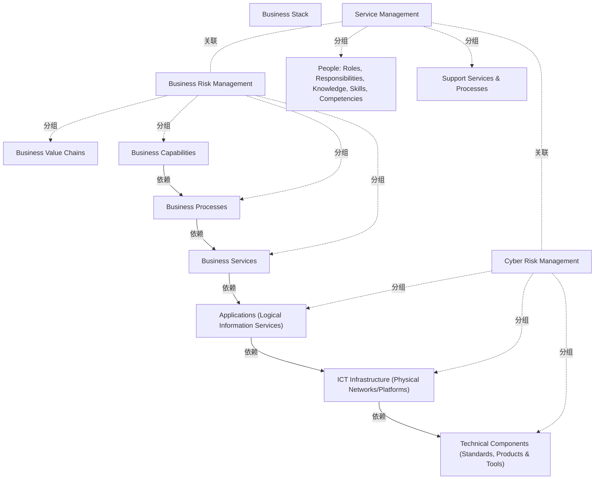

# G152/fig3-1 · 业务风险领域与网络风险领域（业务栈）

类型：`system-or-data-reference-architecture`。说明风险可出现在业务栈的任何层次，区分上部业务风险与下部网络风险管理范围。七个层次的纵向排列与五条实际箭头分别读取；服务管理及其内部两条竖带从能力层延伸至技术组件层。

英文 PDF 物理页：[22]。本页为架构语义分析，原文与原图分别保留。

## 原图与可编辑图


[完整 JSON](fig3-1.json) · [可编辑 Mermaid](fig3-1.mmd) · [仅关系图](fig3-1.relations.mmd) · [层级分解图](fig3-1.hierarchy.mmd)

图形重建表达语义，不复制源图布局。虚线表示解释、矩阵映射或分组关系，不自动表示不确定性的概率。



## 架构分析

先读七个业务栈层和右侧的业务/网络风险管理范围。紫色向下箭头从Business Capabilities开始，依次连到Business Processes、Business Services、Applications、ICT Infrastructure和Technical Components。价值链在顶部但与能力之间没有画线。左侧Service Management容器包含People与Support Services两条竖带，从能力层延伸至技术组件层。

- 本图有 13 个具名或隐含元素、7 条关系和 9 条包含/分组记录。
- 包含/分组树最大深度为 1；根节点为 业务栈、业务风险管理、网络风险管理、服务管理。
- 本图没有可直接确认为人员直属汇报的关系；视觉上下位置、能力分解和治理职责分别读取。
- 包含分组后有 2 个连通分量；分离可能源于图例、并列分类或独立示例，未自动补边。
- 源图七个栈层中，价值链与能力之间没有紫色连线；实际五条向下箭头从能力层开始。
- Service Management外框包含People与Support Services两条带，竖带从能力层起，跨业务/网络管理区域但不覆盖价值链行。
- 13个标签/范围节点、5条实际向下箭头及2条无连线的跨域范围对应逐项复核。

### 如何用于项目

- 先划定平台边界，登记应用、存储、数据来源及消费者，再逐条读取输入/输出流。
- 区分基线、过渡与目标架构，以及现有、保留与新增对象；范围包含不自动表示组件实现或组织管理。

### 结构所表达的逻辑

- 七个栈层从业务价值链到技术组件；右侧大括号划分业务风险与网络风险的管理范围。
- 实际五条向下箭头起于Business Capabilities；Business Value Chains与其下一层没有画箭头。
- Business Services→Applications跨管理范围边界，管理划分没有切断架构层间联系。
- Service Management包含People与Support Services两条带，跨两种管理范围，未覆盖顶部价值链行。
- 图中风险管理范围是关注视角，不是部门或岗位的汇报关系。

## 上下级与包含

七个业务栈层按图内纵向位置排列，右侧括号分为前四层的业务风险管理范围和后三层的网络风险管理范围。左侧Service Management为外层容器，内含People与Support Services & Processes两条带；三者从能力层起跨两种风险管理范围，不覆盖顶部价值链行。范围分组和视觉包含不等于组织汇报关系。

|父项|子项|层级类型|依据与解释|
|---|---|---|---|
|服务管理|人员：角色、职责、知识、技能、胜任力|visual_grouping|框、泳道、域或分类组的成员归属；没有额外证据不提升为业务组合或管理关系。|
|服务管理|支持服务与流程|visual_grouping|框、泳道、域或分类组的成员归属；没有额外证据不提升为业务组合或管理关系。|
|业务风险管理|业务价值链|visual_grouping|框、泳道、域或分类组的成员归属；没有额外证据不提升为业务组合或管理关系。|
|业务风险管理|业务能力|visual_grouping|框、泳道、域或分类组的成员归属；没有额外证据不提升为业务组合或管理关系。|
|业务风险管理|业务流程|visual_grouping|框、泳道、域或分类组的成员归属；没有额外证据不提升为业务组合或管理关系。|
|业务风险管理|业务服务|visual_grouping|框、泳道、域或分类组的成员归属；没有额外证据不提升为业务组合或管理关系。|
|网络风险管理|应用（逻辑信息服务）|visual_grouping|框、泳道、域或分类组的成员归属；没有额外证据不提升为业务组合或管理关系。|
|网络风险管理|ICT 基础设施（物理网络/平台）|visual_grouping|框、泳道、域或分类组的成员归属；没有额外证据不提升为业务组合或管理关系。|
|网络风险管理|技术组件（标准、产品与工具）|visual_grouping|框、泳道、域或分类组的成员归属；没有额外证据不提升为业务组合或管理关系。|

## 全部元素与角色

|元素ID|原文名称|类型|含义|直接父项|深度|
|---|---|---|---|---|---|
|business_stack|Business Stack|note|图内标题，不是框；图题另见 Figure 3-1。|—||
|br_group|Business Risk Management|group|右侧大括号覆盖 Business Value Chains 至 Business Services 四层。|—||
|cr_group|Cyber Risk Management|group|右侧大括号覆盖 Applications 至 Technical Components 三层。|—||
|service_management|Service Management|group|浅蓝外框包含人员带与支持服务/流程带，顶部与业务能力行对齐。|—||
|people|People: Roles, Responsibilities, Knowledge, Skills, Competencies|capability|能力：人员：角色、职责、知识、技能、胜任力|服务管理|1|
|support_services|Support Services & Processes|capability|能力：支持服务与流程|服务管理|1|
|value_chains|Business Value Chains|value_stream|价值流：业务价值链|业务风险管理|1|
|capabilities|Business Capabilities|capability|能力：业务能力|业务风险管理|1|
|processes|Business Processes|process|流程：业务流程|业务风险管理|1|
|business_services|Business Services|service|服务：业务服务|业务风险管理|1|
|applications|Applications (Logical Information Services)|application|应用：应用（逻辑信息服务）|网络风险管理|1|
|ict_infrastructure|ICT Infrastructure (Physical Networks/Platforms)|technology|技术：ICT 基础设施（物理网络/平台）|网络风险管理|1|
|technical_components|Technical Components (Standards, Products & Tools)|technology|技术：技术组件（标准、产品与工具）|网络风险管理|1|

## 全部关系

五条紫色实心箭头：能力→流程→业务服务→应用→ICT基础设施→技术组件；箭头表达源图层间支撑/依赖，不是数据流。价值链至能力没有连线。大括号标范围，竖带相交范围不产生显式连线。

|主体|语义关系|客体|显式线/隐式|原文标签|依据|
|---|---|---|---|---|---|
|业务能力|依赖|业务流程|显式连线||依赖|
|业务流程|依赖|业务服务|显式连线||依赖|
|业务服务|依赖|应用（逻辑信息服务）|显式连线||跨过业务/网络风险管理分界线的唯一直连箭头。|
|应用（逻辑信息服务）|依赖|ICT 基础设施（物理网络/平台）|显式连线||依赖|
|ICT 基础设施（物理网络/平台）|依赖|技术组件（标准、产品与工具）|显式连线||依赖|
|服务管理|关联|业务风险管理|implicit||左侧竖带贯穿业务风险管理段，未画连线，由位置表达横切关系。|
|服务管理|关联|网络风险管理|implicit||同一竖带继续贯穿网络风险管理段。|

## 本轮否定的历史关系

以下旧解释保留用于追溯，不进入当前关系图、层级或知识图谱的有效边。

|旧记录|主体|旧关系|客体|否定依据|
|---|---|---|---|---|
||业务价值链|dependency|业务能力|Business Value Chains与Business Capabilities之间有白色间隔而没有箭头；旧解释补画了第六条向下关系。原文业务价值驱动风险评估不等于此处显式连线。|

## 本轮语义修正

- Business Value Chains与Business Capabilities之间有白色间隔而没有箭头；旧解释补画了第六条向下关系。原文业务价值驱动风险评估不等于此处显式连线。

## 误读检查

- 不要把从上到下排列自动变成七层连续箭头；价值链至能力没有线。
- 不要将两个风险管理范围理解为两套完全独立的架构。
- 不要把竖带当成另几个流程步骤，或声称它们视觉上覆盖价值链行。

## 原文证据

### [PDF 第 21 页](../../../documents/G152.md#page-21)

> Understanding the term “risk” is central to understanding the broader concepts of ERM, and the role of effective Enterprise Architecture and Enterprise Security Architecture. In this Guide we define risk in line with ISO 31000:2009. Risk is the effect that uncertainty has on the achievement of business objectives. The uncertainty is concerned with predicting future outcomes, given the limited amount of information available when making a business decision. This information can never be perfect, although our expectation is that given better quality information we can make better quality decisions. Every decision is based on assessing the balance between potential opportunities and threats, the likelihood of beneficial outcomes versus damaging outcomes, the magnitude of these potential positive or negative events, and the likelihood associated with each identified outcome. Identifying and assessing these factors is known as “risk assessment” or “risk analysis”. “Risk management” is the art and science of applying these concepts in the decision-making process. Risk can be seen at the strategic long-term level (overall direction of the business), the medium term tactical level (transformation projects and programs), and at the operational level (regular day-to-day operational decisions, processes, and practices). The objective of risk management is to optimize business outcomes to maximize business value and minimize business losses. Risk can be seen at any level in the business stack (see Figure 3-1), but is always driven top-down from assessment of business value and its optimization.
### [PDF 第 22 页](../../../documents/G152.md#page-22)

> Figure 3-1: Business Risk versus Cyber Risk Areas (© The SABSA Institute)

## 来源与分析状态

所有元素/关系均有来源定位；未把历史解释重命名为本轮逐线视觉确认。源图与语义图是两种视图，布局不证明汇报或因果。

源 PDF SHA-256：`919c53bfa4259a4b3a9686762f37c0576a1cd2f8e77e74648826d9f9c84ed6e0`。

源图记录：[原始解释与转录](../../../figures/G152/fig3-1.json)。

```json
{
  "quality": {
    "graph_integrity": "checked",
    "semantic_analysis": "typed-graph-and-context-analysis",
    "visual_review": "source-content-audited",
    "notice_zh": "所有元素/关系均有来源定位；未把历史解释重命名为本轮逐线视觉确认。源图与语义图是两种视图，布局不证明汇报或因果。"
  },
  "source_uncertainty": {
    "confidence": "source-content-audited-with-explicit-interpretation-boundary",
    "uncertainties_zh": [
      "原图未给正式关系图例；层间支撑/依赖为结合正文的解释，不是正式建模语言或数据流定义。"
    ],
    "analyzed_from": [
      "英文PDF第22页原图及第21页正文"
    ],
    "date": "2026-11-08"
  },
  "source_conflicts": []
}
```
