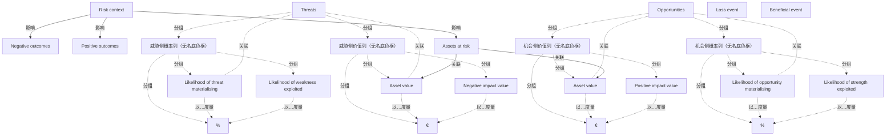

# G152/fig3-2 · SABSA 运营风险模型

类型：`process-or-method-model`。纠正“风险只等于威胁与损失”的行业惯性：先由 Risk context 给出风险语境，再把处于风险中的资产分别放到负向（威胁/损失）与正向（机会/收益）两条对称链上，用可能性和货币价值两个维度量化，说明风险管理是在正负结果之间取得平衡。

英文 PDF 物理页：[23]。本页为架构语义分析，原文与原图分别保留。

## 原图与可编辑图


[完整 JSON](fig3-2.json) · [可编辑 Mermaid](fig3-2.mmd) · [仅关系图](fig3-2.relations.mmd) · [层级分解图](fig3-2.hierarchy.mmd)

图形重建表达语义，不复制源图布局。虚线表示解释、矩阵映射或分组关系，不自动表示不确定性的概率。



## 架构分析

从顶部中央的 Risk context 读起：红色箭头向左指向 Negative outcomes，绿色箭头向右指向 Positive outcomes；向下则进入 Assets at risk。由 Assets at risk 向下分叉，向左、向右各有一个箭头指向两侧的 Asset value，表示同一组资产在两条链上都被估值。左支红色：Threats 下的“威胁发生可能性/弱点被利用可能性”（%）与“资产价值/负面影响值”（€）共同导致 Loss event；右支绿色：Opportunities 下的“资产价值/正面影响值”（€）与“机会出现可能性/优势被利用可能性”（%）共同导致 Beneficial event。

- 本图有 24 个具名或隐含元素、17 条关系和 16 条包含/分组记录。
- 包含/分组树最大深度为 2；根节点为 风险语境、负向结果、正向结果、处于风险中的资产、威胁、机会、损失事件、收益事件。
- 本图没有可直接确认为人员直属汇报的关系；视觉上下位置、能力分解和治理职责分别读取。
- 包含分组后有 3 个连通分量；分离可能源于图例、并列分类或独立示例，未自动补边。
- 20个原标签全部核对；追加4个实际底色列框，避免把红/绿标题误当包围全部项目的容器。
- 5条实际箭头：风险语境到负/正结果及在险资产，在险资产到左右资产价值。
- %和€是列单位，没有给出任何概率或金额数值，也没有概率×影响的公式；4条旧因果推断被拒绝。

### 如何用于项目

- 按阶段/事件/行为关系读取入口、出口、责任和产物；检查循环与例外路径。
- 工作流先后不表示组织管理权；在项目中显式记录条件和完成标准。

### 结构所表达的逻辑

- 风险语境（Risk context）同时产生负向结果与正向结果两种可能，图中用红色左箭头与绿色右箭头并列表示，没有偏向任何一侧。
- 处于风险中的资产（Assets at risk）位于模型中心，并向左右两侧的 Asset value 各发出一条箭头：同一资产既承受威胁，也可能带来机会。
- 左支（红/橙）表示威胁侧：两个可能性框以 % 计量（威胁发生的可能性、弱点被利用的可能性），两个价值框以 € 计量（资产价值、负面影响值），汇总为 Loss event。
- 右支（绿）与左支严格对称：机会侧同样有 % 列（机会出现的可能性、优势被利用的可能性）与 € 列（资产价值、正面影响值），汇总为 Beneficial event。
- 模型把“资产价值”在两侧各画一次，强调风险计算的分母/基准相同，只是影响方向相反：负向为损失，正向为收益。
- 四列底部的 % 与 € 大符号标明了两个量化维度：可能性与货币影响；这也解释了 SABSA 为何要求业务属性可度量。
- 该图是第 3 章“平衡的风险观”的图形依据：运营风险既要控制损失事件，也要使能收益事件。

## 上下级与包含

三层。第 1 层是两个核心概念：Risk context 与 Assets at risk（后者由前者向下引出）；第 2 层是左右两条对称支路及其类别带（Threats / Opportunities）；第 3 层是每条支路内的可能性列与价值列，以及底部的 Loss event / Beneficial event 结果条。左右两支是并列关系，不是先后步骤。

|父项|子项|层级类型|依据与解释|
|---|---|---|---|
|威胁侧概率列（无名底色框）|威胁发生的可能性|visual_grouping|框、泳道、域或分类组的成员归属；没有额外证据不提升为业务组合或管理关系。|
|威胁侧概率列（无名底色框）|弱点被利用的可能性|visual_grouping|框、泳道、域或分类组的成员归属；没有额外证据不提升为业务组合或管理关系。|
|威胁侧概率列（无名底色框）|百分比（%）|visual_grouping|框、泳道、域或分类组的成员归属；没有额外证据不提升为业务组合或管理关系。|
|威胁侧价值列（无名底色框）|资产价值（威胁侧）|visual_grouping|框、泳道、域或分类组的成员归属；没有额外证据不提升为业务组合或管理关系。|
|威胁侧价值列（无名底色框）|负面影响值|visual_grouping|框、泳道、域或分类组的成员归属；没有额外证据不提升为业务组合或管理关系。|
|威胁侧价值列（无名底色框）|欧元（€）|visual_grouping|框、泳道、域或分类组的成员归属；没有额外证据不提升为业务组合或管理关系。|
|机会侧价值列（无名底色框）|资产价值（机会侧）|visual_grouping|框、泳道、域或分类组的成员归属；没有额外证据不提升为业务组合或管理关系。|
|机会侧价值列（无名底色框）|正面影响值|visual_grouping|框、泳道、域或分类组的成员归属；没有额外证据不提升为业务组合或管理关系。|
|机会侧价值列（无名底色框）|欧元（€）|visual_grouping|框、泳道、域或分类组的成员归属；没有额外证据不提升为业务组合或管理关系。|
|机会侧概率列（无名底色框）|机会出现的可能性|visual_grouping|框、泳道、域或分类组的成员归属；没有额外证据不提升为业务组合或管理关系。|
|机会侧概率列（无名底色框）|优势被利用的可能性|visual_grouping|框、泳道、域或分类组的成员归属；没有额外证据不提升为业务组合或管理关系。|
|机会侧概率列（无名底色框）|百分比（%）|visual_grouping|框、泳道、域或分类组的成员归属；没有额外证据不提升为业务组合或管理关系。|
|威胁|威胁侧概率列（无名底色框）|classified_under|按当前原图审校显式区分分类、包含与其他层级语义。|
|威胁|威胁侧价值列（无名底色框）|classified_under|按当前原图审校显式区分分类、包含与其他层级语义。|
|机会|机会侧价值列（无名底色框）|classified_under|按当前原图审校显式区分分类、包含与其他层级语义。|
|机会|机会侧概率列（无名底色框）|classified_under|按当前原图审校显式区分分类、包含与其他层级语义。|

## 全部元素与角色

|元素ID|原文名称|类型|含义|直接父项|深度|
|---|---|---|---|---|---|
|risk_context|Risk context|concept|概念：风险语境|—||
|negative_outcomes|Negative outcomes|concept|概念：负向结果|—||
|positive_outcomes|Positive outcomes|concept|概念：正向结果|—||
|assets_at_risk|Assets at risk|concept|概念：处于风险中的资产|—||
|threats|Threats|risk|横跨左支两个列。|—||
|opportunities|Opportunities|goal|横跨右支两个列。|—||
|likelihood_threat|Likelihood of threat materialising|metric|度量：威胁发生的可能性|威胁侧概率列（无名底色框）|2|
|likelihood_weakness|Likelihood of weakness exploited|metric|度量：弱点被利用的可能性|威胁侧概率列（无名底色框）|2|
|pct_threat|%|metric|该列的单位标记。|威胁侧概率列（无名底色框）|2|
|asset_value_threat|Asset value|metric|度量：资产价值（威胁侧）|威胁侧价值列（无名底色框）|2|
|negative_impact|Negative impact value|metric|度量：负面影响值|威胁侧价值列（无名底色框）|2|
|eur_threat|€|metric|该列的单位标记。|威胁侧价值列（无名底色框）|2|
|loss_event|Loss event|event|事件：损失事件|—||
|asset_value_opp|Asset value|metric|度量：资产价值（机会侧）|机会侧价值列（无名底色框）|2|
|positive_impact|Positive impact value|metric|度量：正面影响值|机会侧价值列（无名底色框）|2|
|eur_opp|€|metric|该列的单位标记。|机会侧价值列（无名底色框）|2|
|likelihood_opportunity|Likelihood of opportunity materialising|metric|度量：机会出现的可能性|机会侧概率列（无名底色框）|2|
|likelihood_strength|Likelihood of strength exploited|metric|度量：优势被利用的可能性|机会侧概率列（无名底色框）|2|
|pct_opp|%|metric|该列的单位标记。|机会侧概率列（无名底色框）|2|
|beneficial_event|Beneficial event|event|事件：收益事件|—||
|threat_probability|威胁侧概率列（无名底色框）|group|原图列框；概率列用%，价值列用€，未列计算公式。|威胁|1|
|threat_value|威胁侧价值列（无名底色框）|group|原图列框；概率列用%，价值列用€，未列计算公式。|威胁|1|
|opportunity_value|机会侧价值列（无名底色框）|group|原图列框；概率列用%，价值列用€，未列计算公式。|机会|1|
|opportunity_probability|机会侧概率列（无名底色框）|group|原图列框；概率列用%，价值列用€，未列计算公式。|机会|1|

## 全部关系

深蓝色箭头表示概念间的推导方向：Risk context → 负向/正向结果，Risk context → Assets at risk，Assets at risk → 两侧 Asset value。左侧红色双线箭头与右侧绿色箭头是同一关系的两种结果方向，不是对立箭头。两个“Assets at risk → Asset value”箭头分别指向左右，强调双向估值。底部事件条与上方列之间没有画箭头，风险=可能性×影响值的合成关系由上下叠放隐含。

|主体|语义关系|客体|显式线/隐式|原文标签|依据|
|---|---|---|---|---|---|
|风险语境|影响|负向结果|显式连线||红色粗双线箭头向左；from 取箭尾的 Risk context，to 取箭头所指的 Negative outcomes。|
|风险语境|影响|正向结果|显式连线||绿色粗箭头向右。|
|风险语境|影响|处于风险中的资产|显式连线||深蓝色向下箭头。|
|处于风险中的资产|关联|资产价值（威胁侧）|显式连线||从 Assets at risk 底部向下再向左折，箭头指向左侧 Asset value。|
|处于风险中的资产|关联|资产价值（机会侧）|显式连线||同一分叉向右，箭头指向右侧 Asset value。|
|威胁|关联|威胁发生的可能性|implicit||标题分类的列项目；不是业务组合关系。|
|威胁|关联|资产价值（威胁侧）|implicit||标题分类的列项目；不是业务组合关系。|
|机会|关联|资产价值（机会侧）|implicit||标题分类的列项目；不是业务组合关系。|
|机会|关联|机会出现的可能性|implicit||标题分类的列项目；不是业务组合关系。|
|弱点被利用的可能性|以…度量|百分比（%）|implicit||列底部符号标识该列量纲，不是前一指标包含这个符号。|
|负面影响值|以…度量|欧元（€）|implicit||列底部符号标识该列量纲，不是前一指标包含这个符号。|
|正面影响值|以…度量|欧元（€）|implicit||列底部符号标识该列量纲，不是前一指标包含这个符号。|
|优势被利用的可能性|以…度量|百分比（%）|implicit||列底部符号标识该列量纲，不是前一指标包含这个符号。|
|威胁发生的可能性|以…度量|百分比（%）|none||指标与同列底部单位符号对应，无连接线。|
|资产价值（威胁侧）|以…度量|欧元（€）|none||指标与同列底部单位符号对应，无连接线。|
|资产价值（机会侧）|以…度量|欧元（€）|none||指标与同列底部单位符号对应，无连接线。|
|机会出现的可能性|以…度量|百分比（%）|none||指标与同列底部单位符号对应，无连接线。|

## 本轮否定的历史关系

以下旧解释保留用于追溯，不进入当前关系图、层级或知识图谱的有效边。

|旧记录|主体|旧关系|客体|否定依据|
|---|---|---|---|---|
|13|弱点被利用的可能性|causal|损失事件|原图无这些因果箭头、无+极性、也没有乘法计算式。仅上下排列不能证明指标合成事件的因果关系。|
|14|负面影响值|causal|损失事件|原图无这些因果箭头、无+极性、也没有乘法计算式。仅上下排列不能证明指标合成事件的因果关系。|
|15|优势被利用的可能性|causal|收益事件|原图无这些因果箭头、无+极性、也没有乘法计算式。仅上下排列不能证明指标合成事件的因果关系。|
|16|正面影响值|causal|收益事件|原图无这些因果箭头、无+极性、也没有乘法计算式。仅上下排列不能证明指标合成事件的因果关系。|

## 本轮语义修正

- 标题分类的列项目；不是业务组合关系。
- 标题分类的列项目；不是业务组合关系。
- 标题分类的列项目；不是业务组合关系。
- 标题分类的列项目；不是业务组合关系。
- 列底部符号标识该列量纲，不是前一指标包含这个符号。
- 列底部符号标识该列量纲，不是前一指标包含这个符号。
- 列底部符号标识该列量纲，不是前一指标包含这个符号。
- 列底部符号标识该列量纲，不是前一指标包含这个符号。
- 原图无这些因果箭头、无+极性、也没有乘法计算式。仅上下排列不能证明指标合成事件的因果关系。
- 原图无这些因果箭头、无+极性、也没有乘法计算式。仅上下排列不能证明指标合成事件的因果关系。
- 原图无这些因果箭头、无+极性、也没有乘法计算式。仅上下排列不能证明指标合成事件的因果关系。
- 原图无这些因果箭头、无+极性、也没有乘法计算式。仅上下排列不能证明指标合成事件的因果关系。
- 指标与同列底部单位符号对应，无连接线。
- 指标与同列底部单位符号对应，无连接线。
- 指标与同列底部单位符号对应，无连接线。
- 指标与同列底部单位符号对应，无连接线。

## 误读检查

- 不要只读左支：右支 Opportunities → Beneficial event 与左支同等重要，是模型的一半。
- 两侧各有一个 Asset value 框，不是两个不同的资产；指的是同一组处于风险中的资产在正负两条链上的估值。
- Threats 与 Opportunities 是两条并列类别带，不是先后阶段；Loss event 与 Beneficial event 也不是时间上的先后。
- Risk context 左右的两个箭头不是“输入/输出”，而是同一风险语境下的两种结果可能。
- 图中没有画出乘法公式；% 与 € 只是列单位，不能据此推断具体计算公式或权重。

## 原文证据

### [PDF 第 21 页](../../../documents/G152.md#page-21)

> The Information Technology security and information security industry has evolved over its lifetime a view of operational risk that is concerned only with threats, vulnerabilities, and loss events (negative impacts). However, as noted earlier in Section 1.2, this Guide uses the ISO 31000:2009 [ISO 31000] definition of “risk”, an “uncertainty of outcomes”, and risk management is presented as striking a balance between positive and negative outcomes resulting from the realization of either opportunities or threats.
> The effect of uncertainty is any deviation from what is expected – positive and negative.
### [PDF 第 22 页](../../../documents/G152.md#page-22)

> This balanced view of risk is also embedded in SABSA, as shown in Figure 3-2, including the enabling of benefits arising from opportunities as well as the control of the effects of threats. Arguably, the sole role of the Enterprise Architect is to create an operational environment in which operational risk can be optimized for maximum business benefit and minimum business loss.
### [PDF 第 23 页](../../../documents/G152.md#page-23)

> Operational risk is concerned with the threats and opportunities arising in business operations. SABSA is an architectural and operational framework for reaching out to opportunities and enabling positive outcomes to attain defined business targets and managing negative outcomes of loss events to within an enterprise’s tolerance towards risk – namely their risk appetite.
> According to ISO 31000:2009, the risk management process aids decision-making by taking account of uncertainty and the possibility of future events or circumstances (intended or unintended) and their effects on agreed objectives. It also gives a risk management process model, as illustrated in Figure 3-3. The ISO 31000:2009 approach makes it clear that risk management should be embedded deeply and firmly in all business activities. It also states that it is a continuous lifecycle rather than an isolated activity. This definition of risk management is adopted in this work.

## 来源与分析状态

所有元素/关系均有来源定位；未把历史解释重命名为本轮逐线视觉确认。源图与语义图是两种视图，布局不证明汇报或因果。

源 PDF SHA-256：`919c53bfa4259a4b3a9686762f37c0576a1cd2f8e77e74648826d9f9c84ed6e0`。

源图记录：[原始解释与转录](../../../figures/G152/fig3-2.json)。

```json
{
  "quality": {
    "graph_integrity": "checked",
    "semantic_analysis": "typed-graph-and-context-analysis",
    "visual_review": "source-content-audited",
    "notice_zh": "所有元素/关系均有来源定位；未把历史解释重命名为本轮逐线视觉确认。源图与语义图是两种视图，布局不证明汇报或因果。"
  },
  "source_uncertainty": {
    "confidence": "high",
    "uncertainties_zh": [
      "Assets at risk 到左右两个 Asset value 的连线在原图中是一条向下分叉、两端各带箭头的折线；本分析拆成两条关系记录。",
      "底部事件条与上方列之间没有画箭头，本分析把“可能性×影响值→事件”记为隐含因果（polarity +），属于对模型含义的解读。",
      "图中 % 与 € 的确切含义（可能性百分比、货币价值）由图题与 SABSA 背景推断，图内无文字说明。"
    ],
    "analyzed_from": [
      "英文 PDF 第 23 页原图截图（220 dpi）及 2x2 放大分块",
      "英文 PDF 第 22–23 页正文",
      "中文稿 G152e_将风险与安全融入TOGAF企业架构.md 第 192、194 行"
    ],
    "date": "2026-10-31"
  },
  "source_conflicts": []
}
```
