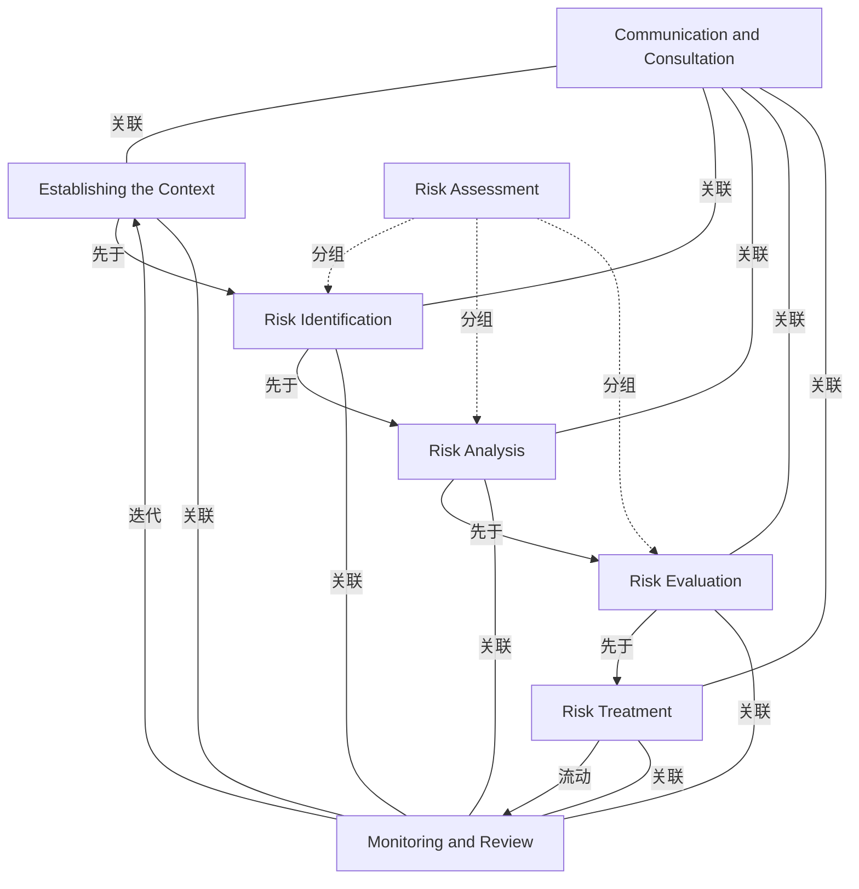

# G152/fig3-3 · ISO 31000:2009 风险管理模型

类型：`process-or-method-model`。给出本指南采用的 ERM 过程模型：说明风险管理不是一次性的孤立活动，而是一个持续生命周期；沟通与协商、监督与评审贯穿全过程，风险处置之后还要回到语境，体现“管理到预期目标”的循环。

英文 PDF 物理页：[24]。本页为架构语义分析，原文与原图分别保留。

## 原图与可编辑图


[完整 JSON](fig3-3.json) · [可编辑 Mermaid](fig3-3.mmd) · [仅关系图](fig3-3.relations.mmd) · [层级分解图](fig3-3.hierarchy.mmd)

图形重建表达语义，不复制源图布局。虚线表示解释、矩阵映射或分组关系，不自动表示不确定性的概率。



## 架构分析

先看中央自上而下的主链：Establishing the Context → Risk Identification → Risk Analysis → Risk Evaluation → Risk Treatment，箭头向下。中间三步被 Risk Assessment 容器括住，表示它们合起来构成风险评估。再看左右两条竖长条：Communication and Consultation 在左、Monitoring and Review 在右，它们与每一个步骤都有横向连线（无箭头），表示贯穿每一步。最后看两条回路：Risk Treatment 底部向右绕到 Monitoring and Review，再由其顶部绕回 Establishing the Context 顶部，形成闭环。

- 本图有 8 个具名或隐含元素、16 条关系和 3 条包含/分组记录。
- 包含/分组树最大深度为 1；根节点为 沟通与协商、监督与评审、建立语境、风险评估（范围框）、风险处置。
- 本图没有可直接确认为人员直属汇报的关系；视觉上下位置、能力分解和治理职责分别读取。
- 8个过程/范围标签全部核对；Risk Assessment框仅包含Identification、Analysis、Evaluation三个阶段。
- 4条向下顺序箭头，加Treatment→Monitoring and Review的下回路及Monitoring and Review→Context的上回路。
- 左右各5条横向实线无箭头；8个框右上角的空心箭头是流程符号而非额外边。

### 如何用于项目

- 按阶段/事件/行为关系读取入口、出口、责任和产物；检查循环与例外路径。
- 工作流先后不表示组织管理权；在项目中显式记录条件和完成标准。

### 结构所表达的逻辑

- 主流程 5 步：建立语境 → 风险识别 → 风险分析 → 风险评价 → 风险处置，箭头单向向下。
- 风险识别、风险分析、风险评价三步被 Risk Assessment 容器括在一起，说明它们共同构成“风险评估”，不是三个独立阶段。
- 沟通与协商（左）与监督与评审（右）不是流程前后的步骤，而是贯穿全部 5 步的持续活动；图中每个步骤都向两侧各引出一条横线。
- 风险处置之后有两条去向：横向连到监督与评审，以及底部回路绕到监督与评审，表示处置结果必须被监督。
- 顶部回路从监督与评审回到建立语境，说明监督结果会重新界定风险语境，过程因此是持续生命周期而非一次性项目。
- 该模型是正文“风险管理应深植于所有业务活动、是持续生命周期”的图形依据；本指南采用 ISO 31000:2009 的风险定义。
- 图中没有画出“风险处置”之后直接回到识别的内环，闭环的唯一入口是建立语境，这一点容易被误读为处置后重新识别。

## 上下级与包含

两层。外层是 5 个顺序步骤 + 2 个贯穿性活动（左右长条）；内层是 Risk Assessment 容器及其包含的 3 个步骤（识别、分析、评价）。Risk Treatment 在容器之外，位于主链末端。左右长条与步骤之间是并列的“伴随”关系，不是上下级。

|父项|子项|层级类型|依据与解释|
|---|---|---|---|
|风险评估（范围框）|风险识别|visual_grouping|框、泳道、域或分类组的成员归属；没有额外证据不提升为业务组合或管理关系。|
|风险评估（范围框）|风险分析|visual_grouping|框、泳道、域或分类组的成员归属；没有额外证据不提升为业务组合或管理关系。|
|风险评估（范围框）|风险评价|visual_grouping|框、泳道、域或分类组的成员归属；没有额外证据不提升为业务组合或管理关系。|

## 全部元素与角色

|元素ID|原文名称|类型|含义|直接父项|深度|
|---|---|---|---|---|---|
|comm_consult|Communication and Consultation|process|流程：沟通与协商|—||
|monitor_review|Monitoring and Review|process|流程：监督与评审|—||
|context|Establishing the Context|process|流程：建立语境|—||
|risk_assessment|Risk Assessment|group|分组：风险评估（范围框）|—||
|identification|Risk Identification|process|流程：风险识别|风险评估（范围框）|1|
|analysis|Risk Analysis|process|流程：风险分析|风险评估（范围框）|1|
|evaluation|Risk Evaluation|process|流程：风险评价|风险评估（范围框）|1|
|treatment|Risk Treatment|process|流程：风险处置|—||

## 全部关系

带箭头的实线表示过程方向：4 条向下的步骤箭头、1 条从风险处置底部绕到监督与评审的回路、1 条从监督与评审顶部绕回建立语境的回路。无箭头的横线表示该步骤与沟通/协商或监督/评审之间的双向联系。每个框右上角的小空心双线箭头是装饰性的“输出”标记，不承担流程语义（原图无图例）。

|主体|语义关系|客体|显式线/隐式|原文标签|依据|
|---|---|---|---|---|---|
|建立语境|先于|风险识别|显式连线||先于|
|风险识别|先于|风险分析|显式连线||先于|
|风险分析|先于|风险评价|显式连线||先于|
|风险评价|先于|风险处置|显式连线||先于|
|风险处置|流动|监督与评审|显式连线||风险处置底部向下、向右、再向上绕到监督与评审底部。|
|监督与评审|迭代|建立语境|显式连线||顶部大回路：从监督与评审顶部绕到建立语境顶部，箭头向下进入 Establishing the Context。|
|沟通与协商|关联|建立语境|显式连线||关联|
|沟通与协商|关联|风险识别|显式连线||关联|
|沟通与协商|关联|风险分析|显式连线||关联|
|沟通与协商|关联|风险评价|显式连线||关联|
|沟通与协商|关联|风险处置|显式连线||关联|
|监督与评审|关联|建立语境|显式连线||与顶部回路分开的一条横向连线。|
|监督与评审|关联|风险识别|显式连线||关联|
|监督与评审|关联|风险分析|显式连线||关联|
|监督与评审|关联|风险评价|显式连线||关联|
|监督与评审|关联|风险处置|显式连线||关联|

## 误读检查

- 不要把左右两条竖长条读成流程的开始和结束步骤：它们贯穿所有步骤，没有先后。
- 顶部回路的箭头落在 Establishing the Context，而不是 Risk Identification；监督结果先回到语境，再重新进入识别。
- Risk Assessment 不是第 6 个步骤，而是包住识别/分析/评价三步的范围框。
- 横向连线没有箭头，不能读成“步骤把结果单向送给监督/沟通”。
- 框右上角的小空心箭头不是 ArchiMate 或其他标准记法，原图没有图例，不应据此推断元素类型。
- 中文稿引用的 figs/g152_fig3-3.svg 丢掉了分组与全部回路，不能据它理解本图的闭环结构。

## 原文证据

### [PDF 第 23 页](../../../documents/G152.md#page-23)

> According to ISO 31000:2009, the risk management process aids decision-making by taking account of uncertainty and the possibility of future events or circumstances (intended or unintended) and their effects on agreed objectives. It also gives a risk management process model, as illustrated in Figure 3-3. The ISO 31000:2009 approach makes it clear that risk management should be embedded deeply and firmly in all business activities. It also states that it is a continuous lifecycle rather than an isolated activity. This definition of risk management is adopted in this work.
### [PDF 第 24 页](../../../documents/G152.md#page-24)

> Figure 3-3: ISO 31000:2009 Model for Risk Management (Derived from ISO 31000)

## 来源与分析状态

所有元素/关系均有来源定位；未把历史解释重命名为本轮逐线视觉确认。源图与语义图是两种视图，布局不证明汇报或因果。

源 PDF SHA-256：`919c53bfa4259a4b3a9686762f37c0576a1cd2f8e77e74648826d9f9c84ed6e0`。

源图记录：[原始解释与转录](../../../figures/G152/fig3-3.json)。

```json
{
  "quality": {
    "graph_integrity": "checked",
    "semantic_analysis": "typed-graph-and-context-analysis",
    "visual_review": "source-content-audited",
    "notice_zh": "所有元素/关系均有来源定位；未把历史解释重命名为本轮逐线视觉确认。源图与语义图是两种视图，布局不证明汇报或因果。"
  },
  "source_uncertainty": {
    "confidence": "high",
    "uncertainties_zh": [
      "框右上角的小空心双线箭头无图例；本分析按装饰性输出标记处理，未赋予语义。",
      "Risk Assessment 在原图是包住三步的容器（本分析用 group 表示）；G184 同一张图的分析把它记为 process，两处类型不同但不影响关系。",
      "“建立语境”在 G184 的分析中译作“建立情境”，本图沿用中文稿所引 SVG 的“建立语境”，两种译法指同一 ISO 31000 步骤。"
    ],
    "analyzed_from": [
      "英文 PDF 第 24 页原图截图（220 dpi）及 2x2 放大分块",
      "英文 PDF 第 23–24 页正文",
      "中文稿 G152e_将风险与安全融入TOGAF企业架构.md 第 198–202 行",
      "figs/g152_fig3-3.svg 源码",
      "G184/fig6-3 已完成分析（对照同一张图的元素与连线）"
    ],
    "date": "2026-10-31"
  },
  "source_conflicts": []
}
```
