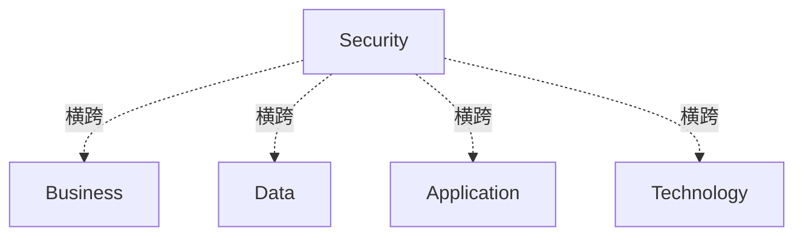

# G152/fig4-1 · 安全作为横切关注点

类型：`architecture-concept-or-system-model`。用最简的叠加图说明安全架构的定位：TOGAF ADM 的四个架构域是横向分层，安全架构则以一条竖列同时穿过四层，因此被称为横切关注点；它为四个域提供安全、隐私与运营风险视角，并影响/输入四个域。

英文 PDF 物理页：[28]。本页为架构语义分析，原文与原图分别保留。

## 原图与可编辑图


[完整 JSON](fig4-1.json) · [可编辑 Mermaid](fig4-1.mmd) · [仅关系图](fig4-1.relations.mmd) · [层级分解图](fig4-1.hierarchy.mmd)

图形重建表达语义，不复制源图布局。虚线表示解释、矩阵映射或分组关系，不自动表示不确定性的概率。



## 架构分析

自上而下先读四条横条：Business、Data、Application、Technology，这是企业架构的四个域。然后把视线移到中间那条白色竖列 Security：它从 Business 上方一直延伸到 Technology 下方，压住四条横条，表示安全同时作用于四个域，而不是其中某一层。图中没有任何箭头，关系完全由“覆盖/穿过”表达。

- 本图有 5 个具名或隐含元素、4 条关系和 0 条包含/分组记录。
- 本图没有可直接确认为人员直属汇报的关系；视觉上下位置、能力分解和治理职责分别读取。
- Business、Data、Application、Technology横框与Security纵框共5个标签完整；纵框交叉穿过4域。
- 源文说明security为横切关注点；原图没有连线、箭头、上下游或域间依赖。

### 如何用于项目

- 围绕作者目的读取本图实体、分组与连线，并用对应原文限定其含义。
- 把参考模型与项目事实分开，实际范围、约束、值和责任须有项目证据。

### 结构所表达的逻辑

- 四个架构域自上而下为 Business、Data、Application、Technology，与 TOGAF ADM 的四个架构域一致。
- Security 是一条竖向列，覆盖全部四条横条，并且上下都超出堆叠范围，强调它不受任一架构域边界限制。
- Security 列画在四条横条之上（白色填充遮住横条中段），是“横切/穿透”的视觉表达，不是四条横条在此断开。
- 正文据此说明安全架构与四个域都交互，因而称为横切关注点；它影响并向 Business、Data、Application、Technology 四个架构提供输入。
- 安全架构不只是数据集，而是视图、视角与制品的连贯集合，包含安全、隐私与运营风险视角，并以 ISM 与 ERM 过程为基础。
- 安全架构可能常在企业架构范围之外组织，但其部分内容必须与架构整合开发；第 5 章逐一说明这些接触点。

## 上下级与包含

两层：底层是四个并列的架构域（上下堆叠，无包含关系）；上层是一条跨域的 Security 列。Security 与四个域是“横切/作用于”的关系，不是四个域之上的第五层，也不是某一个域的子元素。

|父项|子项|层级类型|依据与解释|
|---|---|---|---|
|—|—|无视觉包含|关系中明确的组成/特化见 JSON semantic_hierarchy。|

## 全部元素与角色

|元素ID|原文名称|类型|含义|直接父项|深度|
|---|---|---|---|---|---|
|business|Business|architecture|架构：业务架构|—||
|data|Data|architecture|架构：数据架构|—||
|application|Application|architecture|架构：应用架构|—||
|technology|Technology|architecture|架构：技术架构|—||
|security|Security|architecture|代表安全架构：安全、隐私与运营风险视角的视图/视角/制品集合。|—||

## 全部关系

图中没有连线或箭头。四条横条的上下排列表示架构域的分层顺序；Security 竖列与四条横条的交叉覆盖表示横切关系。白色列遮住横条中段只是绘制层次（前景/背景），不表示中断或缺口。

|主体|语义关系|客体|显式线/隐式|原文标签|依据|
|---|---|---|---|---|---|
|安全（横切关注点）|横跨|业务架构|implicit||由纵向安全框与架构域重叠及正文cross-cutting说明得到横切关系，不是源图箭头。|
|安全（横切关注点）|横跨|数据架构|implicit||由纵向安全框与架构域重叠及正文cross-cutting说明得到横切关系，不是源图箭头。|
|安全（横切关注点）|横跨|应用架构|implicit||由纵向安全框与架构域重叠及正文cross-cutting说明得到横切关系，不是源图箭头。|
|安全（横切关注点）|横跨|技术架构|implicit||由纵向安全框与架构域重叠及正文cross-cutting说明得到横切关系，不是源图箭头。|

## 本轮语义修正

- 由纵向安全框与架构域重叠及正文cross-cutting说明得到横切关系，不是源图箭头。
- 由纵向安全框与架构域重叠及正文cross-cutting说明得到横切关系，不是源图箭头。
- 由纵向安全框与架构域重叠及正文cross-cutting说明得到横切关系，不是源图箭头。
- 由纵向安全框与架构域重叠及正文cross-cutting说明得到横切关系，不是源图箭头。

## 误读检查

- 不要把 Security 读成第五个架构域或最上面/最下面的一层：它是纵列，贯穿全部四层。
- 四条横条在 Security 列处看不见，不是断开了；那是白色前景遮挡。
- 四个架构域不是时间顺序或流程步骤，只是分层堆叠。
- 图内没有箭头，不能推断“安全 → 业务”这样的单向流；正文用“impacts and informs”描述的是影响与输入，方向需按正文理解。
- 中文稿当前引用的 figs/g152_fig4-1.svg 改成了 5 个并排框 + 底部横条，并多出“交付运营”，不能据它理解原图的纵向穿透结构。

## 原文证据

### [PDF 第 28 页](../../../documents/G152.md#page-28)

> Security Architecture is a cross-cutting concern (see Figure 4-1), pervasive through the whole Enterprise Architecture. It can be described as a coherent collection of views, viewpoints, and artifacts, including security, privacy, and operational risk perspectives, along with related topics like security objectives and security services. The Security Architecture is more than a dataset; it is based on the ISM and ERM processes.
> Figure 4-1: Security as a Cross-Cutting Concern through the Architecture

## 来源与分析状态

所有元素/关系均有来源定位；未把历史解释重命名为本轮逐线视觉确认。源图与语义图是两种视图，布局不证明汇报或因果。

源 PDF SHA-256：`919c53bfa4259a4b3a9686762f37c0576a1cd2f8e77e74648826d9f9c84ed6e0`。

源图记录：[原始解释与转录](../../../figures/G152/fig4-1.json)。

```json
{
  "quality": {
    "graph_integrity": "checked",
    "semantic_analysis": "typed-graph-and-context-analysis",
    "visual_review": "source-content-audited",
    "notice_zh": "所有元素/关系均有来源定位；未把历史解释重命名为本轮逐线视觉确认。源图与语义图是两种视图，布局不证明汇报或因果。"
  },
  "source_uncertainty": {
    "confidence": "high",
    "uncertainties_zh": [
      "图中没有箭头与图例；“Security 影响四个域”的方向依据正文 impacts and informs，而非图内符号。",
      "Security 列上下超出堆叠范围是否有额外含义（如超出架构范围组织），图内无说明，未作推断。"
    ],
    "analyzed_from": [
      "英文 PDF 第 28 页原图截图（220 dpi）及 2x2 放大分块",
      "英文 PDF 第 28 页正文",
      "中文稿 G152e_将风险与安全融入TOGAF企业架构.md 第 306–308 行",
      "figs/g152_fig4-1.svg 源码"
    ],
    "date": "2026-10-31"
  },
  "source_conflicts": []
}
```
