# G152/fig5-1 · SABSA 业务属性分类法示例

类型：`decomposition-or-organization-model`。为 5.10.1 的业务属性画像提供一份示例分类法：架构师以此为指导，挑选与当前业务论证相关的属性，再逐一按业务语境重新定义、设定度量与目标；图的作用是展示属性的完整范围与分组，而不是规定必须全部采用。

英文 PDF 物理页：[40]。本页为架构语义分析，原文与原图分别保留。

## 原图与可编辑图


[完整 JSON](fig5-1.json) · [可编辑 Mermaid](fig5-1.mmd) · [仅关系图](fig5-1.relations.mmd) · [层级分解图](fig5-1.hierarchy.mmd)

图形重建表达语义，不复制源图布局。虚线表示解释、矩阵映射或分组关系，不自动表示不确定性的概率。

```mermaid
flowchart TB
  %% Semantic reconstruction; see original source image for exact layout.
  n0["Business Attributes"]
  n1["User Attributes"]
  n2["Management Attributes"]
  n3["Operational Attributes"]
  n4["Risk Management Attributes"]
  n5["Legal / Regulatory Attributes"]
  n6["Technical Strategy Attributes"]
  n7["Business Strategy Attributes"]
  n8["Accessible"]
  n9["Accurate"]
  n10["Consistent"]
  n11["Current"]
  n12["Duty Segregated"]
  n13["Educated &amp; Aware"]
  n14["Informed"]
  n15["Motivated"]
  n16["Protected"]
  n17["Reliable"]
  n18["Supported"]
  n19["Timely"]
  n20["Usable"]
  n21["Automated"]
  n22["Change-managed"]
  n23["Controlled"]
  n24["Cost-Effective"]
  n25["Efficient"]
  n26["Maintainable"]
  n27["Measured"]
  n28["Supportable"]
  n29["Available"]
  n30["Detectable"]
  n31["Error-Free"]
  n32["Inter-Operable"]
  n33["Productive"]
  n34["Recoverable"]
  n35["Access-controlled"]
  n36["Accountable"]
  n37["Assurable"]
  n38["Assuring Honesty"]
  n39["Auditable"]
  n40["Authenticated"]
  n41["Authorised"]
  n42["Capturing New Risks"]
  n43["Confidential"]
  n44["Crime-Free"]
  n45["Flexibly Secure"]
  n46["Identified"]
  n47["Independently Secure"]
  n48["In our sole possession"]
  n49["Integrity-Assured"]
  n50["Non-Repudiable"]
  n51["Owned"]
  n52["Private"]
  n53["Trustworthy"]
  n54["Admissible"]
  n55["Compliant"]
  n56["Enforceable"]
  n57["Insurable"]
  n58["Liability Managed"]
  n59["Resolvable"]
  n60["Time-bound"]
  n61["Architecturally Open"]
  n62["COTS / GOTS"]
  n63["Extendible"]
  n64["Flexible / Adaptable"]
  n65["Future-Proof"]
  n66["Legacy-Sensitive"]
  n67["Migratable"]
  n68["Multi-Sourced"]
  n69["Scalable"]
  n70["Simple"]
  n71["Standards Compliant"]
  n72["Traceable"]
  n73["Upgradeable"]
  n74["Brand Enhancing"]
  n75["Business-Enabled"]
  n76["Competent"]
  n77["Confident"]
  n78["Credible"]
  n79["Governable"]
  n80["Providing Good Stewardship and Custody"]
  n81["Providing Investment Re-use"]
  n82["Reputable"]
  n0 -->|"关联"| n1
  n0 -->|"关联"| n2
  n0 -->|"关联"| n3
  n0 -->|"关联"| n4
  n0 -->|"关联"| n5
  n0 -->|"关联"| n6
  n0 -->|"关联"| n7
  n1 ---|"关联"| n8
  n8 ---|"关联"| n9
  n9 ---|"关联"| n10
  n10 ---|"关联"| n11
  n11 ---|"关联"| n12
  n12 ---|"关联"| n13
  n13 ---|"关联"| n14
  n14 ---|"关联"| n15
  n15 ---|"关联"| n16
  n16 ---|"关联"| n17
  n17 ---|"关联"| n18
  n18 ---|"关联"| n19
  n19 ---|"关联"| n20
  n2 ---|"关联"| n21
  n21 ---|"关联"| n22
  n22 ---|"关联"| n23
  n23 ---|"关联"| n24
  n24 ---|"关联"| n25
  n25 ---|"关联"| n26
  n26 ---|"关联"| n27
  n27 ---|"关联"| n28
  n3 ---|"关联"| n29
  n29 ---|"关联"| n30
  n30 ---|"关联"| n31
  n31 ---|"关联"| n32
  n32 ---|"关联"| n33
  n33 ---|"关联"| n34
  n4 ---|"关联"| n35
  n35 ---|"关联"| n36
  n36 ---|"关联"| n37
  n37 ---|"关联"| n38
  n38 ---|"关联"| n39
  n39 ---|"关联"| n40
  n40 ---|"关联"| n41
  n41 ---|"关联"| n42
  n42 ---|"关联"| n43
  n43 ---|"关联"| n44
  n44 ---|"关联"| n45
  n45 ---|"关联"| n46
  n46 ---|"关联"| n47
  n47 ---|"关联"| n48
  n48 ---|"关联"| n49
  n49 ---|"关联"| n50
  n50 ---|"关联"| n51
  n51 ---|"关联"| n52
  n52 ---|"关联"| n53
  n5 ---|"关联"| n54
  n54 ---|"关联"| n55
  n55 ---|"关联"| n56
  n56 ---|"关联"| n57
  n57 ---|"关联"| n58
  n58 ---|"关联"| n59
  n59 ---|"关联"| n60
  n6 ---|"关联"| n61
  n61 ---|"关联"| n62
  n62 ---|"关联"| n63
  n63 ---|"关联"| n64
  n64 ---|"关联"| n65
  n65 ---|"关联"| n66
  n66 ---|"关联"| n67
  n67 ---|"关联"| n68
  n68 ---|"关联"| n69
  n69 ---|"关联"| n70
  n70 ---|"关联"| n71
  n71 ---|"关联"| n72
  n72 ---|"关联"| n73
  n7 ---|"关联"| n74
  n74 ---|"关联"| n75
  n75 ---|"关联"| n76
  n76 ---|"关联"| n77
  n77 ---|"关联"| n78
  n78 ---|"关联"| n79
  n79 ---|"关联"| n80
  n80 ---|"关联"| n81
  n81 ---|"关联"| n82
  n0 -.->|"分组"| n1
  n0 -.->|"分组"| n2
  n0 -.->|"分组"| n3
  n0 -.->|"分组"| n4
  n0 -.->|"分组"| n5
  n0 -.->|"分组"| n6
  n0 -.->|"分组"| n7
  n1 -.->|"分组"| n8
  n1 -.->|"分组"| n9
  n1 -.->|"分组"| n10
  n1 -.->|"分组"| n11
  n1 -.->|"分组"| n12
  n1 -.->|"分组"| n13
  n1 -.->|"分组"| n14
  n1 -.->|"分组"| n15
  n1 -.->|"分组"| n16
  n1 -.->|"分组"| n17
  n1 -.->|"分组"| n18
  n1 -.->|"分组"| n19
  n1 -.->|"分组"| n20
  n2 -.->|"分组"| n21
  n2 -.->|"分组"| n22
  n2 -.->|"分组"| n23
  n2 -.->|"分组"| n24
  n2 -.->|"分组"| n25
  n2 -.->|"分组"| n26
  n2 -.->|"分组"| n27
  n2 -.->|"分组"| n28
  n3 -.->|"分组"| n29
  n3 -.->|"分组"| n30
  n3 -.->|"分组"| n31
  n3 -.->|"分组"| n32
  n3 -.->|"分组"| n33
  n3 -.->|"分组"| n34
  n4 -.->|"分组"| n35
  n4 -.->|"分组"| n36
  n4 -.->|"分组"| n37
  n4 -.->|"分组"| n38
  n4 -.->|"分组"| n39
  n4 -.->|"分组"| n40
  n4 -.->|"分组"| n41
  n4 -.->|"分组"| n42
  n4 -.->|"分组"| n43
  n4 -.->|"分组"| n44
  n4 -.->|"分组"| n45
  n4 -.->|"分组"| n46
  n4 -.->|"分组"| n47
  n4 -.->|"分组"| n48
  n4 -.->|"分组"| n49
  n4 -.->|"分组"| n50
  n4 -.->|"分组"| n51
  n4 -.->|"分组"| n52
  n4 -.->|"分组"| n53
  n5 -.->|"分组"| n54
  n5 -.->|"分组"| n55
  n5 -.->|"分组"| n56
  n5 -.->|"分组"| n57
  n5 -.->|"分组"| n58
  n5 -.->|"分组"| n59
  n5 -.->|"分组"| n60
  n6 -.->|"分组"| n61
  n6 -.->|"分组"| n62
  n6 -.->|"分组"| n63
  n6 -.->|"分组"| n64
  n6 -.->|"分组"| n65
  n6 -.->|"分组"| n66
  n6 -.->|"分组"| n67
  n6 -.->|"分组"| n68
  n6 -.->|"分组"| n69
  n6 -.->|"分组"| n70
  n6 -.->|"分组"| n71
  n6 -.->|"分组"| n72
  n6 -.->|"分组"| n73
  n7 -.->|"分组"| n74
  n7 -.->|"分组"| n75
  n7 -.->|"分组"| n76
  n7 -.->|"分组"| n77
  n7 -.->|"分组"| n78
  n7 -.->|"分组"| n79
  n7 -.->|"分组"| n80
  n7 -.->|"分组"| n81
  n7 -.->|"分组"| n82
```



## 架构分析

从Business Attributes读7个分类，再在各列读取并列属性。列中竖线是列表连续线，不是属性包含、依赖、执行或先后关系。

- 本图有 83 个具名或隐含元素、82 条关系和 82 条包含/分组记录。
- 包含/分组树最大深度为 2；根节点为 业务属性（根）。
- 本图没有可直接确认为人员直属汇报的关系；视觉上下位置、能力分解和治理职责分别读取。
- 逐项抄核83个节点：1总类、7分类、75并列属性；各分类数量为13、8、6、19、7、13、9。
- 7个顶层分类箭头和75条列中短实线保留；纠正旧组合链，属性分类直接归属列标题。
- 此图为示例属性分类法；PDF第41页明确详细定义与度量未包含，不能凭标签生成正式指标或目标。

### 如何用于项目

- 按父项展开所有直接子项，检查同层粒度、重叠和缺项。
- 保留组成、分类、能力分解与组织汇报的区别；将示例名称替换为已确认的项目对象。

### 结构所表达的逻辑

- 分类法共 7 类、75 个业务属性：User 13 个、Management 8 个、Operational 6 个、Risk Management 19 个、Legal/Regulatory 7 个、Technical Strategy 13 个、Business Strategy 9 个。
- Risk Management Attributes 是最大的一类（19 个），集中了访问控制、可问责、可审计、认证/授权、保密、完整性保证、不可否认、私有、可信等安全与保证属性，是 SABSA 安全需求的主体。
- User Attributes 描述最终用户对服务的感受与使用条件（可访问、准确、一致、现行、职责分离、受培训、知情、有动力、受保护、可靠、受支持、及时、可用）。
- Management Attributes 描述经营管理层面的质量（自动化、变更受控、受控、成本有效、高效、可维护、可度量、可支持）；Operational Attributes 描述运行层面的行为（可用、可检测、无差错、可互操作、高生产率、可恢复）。
- Legal/Regulatory Attributes 覆盖可采信、合规、可执行、可保险、责任已管理、可解决、有时限；Technical Strategy Attributes 覆盖架构开放、COTS/GOTS、可扩展、灵活可适应、面向未来、兼顾遗留、可迁移、多来源、可伸缩、简单、符合标准、可追溯、可升级；Business Strategy Attributes 覆盖品牌、业务使能、胜任、自信、可信、可治理、良好保管、投资复用、声誉。
- 正文说明每个属性都有详细的通用定义与度量建议（本图未列出）；业务属性画像由架构师按具体业务论证挑选属性并重新定义，因此分类法可扩展、画像是高度定制的。
- 分类法本身不是流程：它回答“可以从哪些维度描述业务需求”，不回答“先做哪一类”。

## 上下级与包含

三层。L0：Business Attributes（青色根）；L1：7 个绿色分类表头；L2：各分类下的黄色业务属性（共 75 个）。根到分类是分支箭头，分类到属性是竖直串接的成员关系。属性之间没有上下级。

|父项|子项|层级类型|依据与解释|
|---|---|---|---|
|业务属性（根）|用户属性|classified_under|分类树/属性列，没有包围关系；同列属性彼此并列。|
|业务属性（根）|管理属性|classified_under|分类树/属性列，没有包围关系；同列属性彼此并列。|
|业务属性（根）|运营属性|classified_under|分类树/属性列，没有包围关系；同列属性彼此并列。|
|业务属性（根）|风险管理属性|classified_under|分类树/属性列，没有包围关系；同列属性彼此并列。|
|业务属性（根）|法律/监管属性|classified_under|分类树/属性列，没有包围关系；同列属性彼此并列。|
|业务属性（根）|技术战略属性|classified_under|分类树/属性列，没有包围关系；同列属性彼此并列。|
|业务属性（根）|业务战略属性|classified_under|分类树/属性列，没有包围关系；同列属性彼此并列。|
|用户属性|可访问|classified_under|分类树/属性列，没有包围关系；同列属性彼此并列。|
|用户属性|准确|classified_under|分类树/属性列，没有包围关系；同列属性彼此并列。|
|用户属性|一致|classified_under|分类树/属性列，没有包围关系；同列属性彼此并列。|
|用户属性|现行|classified_under|分类树/属性列，没有包围关系；同列属性彼此并列。|
|用户属性|职责分离|classified_under|分类树/属性列，没有包围关系；同列属性彼此并列。|
|用户属性|受培训且有意识|classified_under|分类树/属性列，没有包围关系；同列属性彼此并列。|
|用户属性|知情|classified_under|分类树/属性列，没有包围关系；同列属性彼此并列。|
|用户属性|有动力|classified_under|分类树/属性列，没有包围关系；同列属性彼此并列。|
|用户属性|受保护|classified_under|分类树/属性列，没有包围关系；同列属性彼此并列。|
|用户属性|可靠|classified_under|分类树/属性列，没有包围关系；同列属性彼此并列。|
|用户属性|受支持|classified_under|分类树/属性列，没有包围关系；同列属性彼此并列。|
|用户属性|及时|classified_under|分类树/属性列，没有包围关系；同列属性彼此并列。|
|用户属性|可用|classified_under|分类树/属性列，没有包围关系；同列属性彼此并列。|
|管理属性|自动化|classified_under|分类树/属性列，没有包围关系；同列属性彼此并列。|
|管理属性|变更受管理|classified_under|分类树/属性列，没有包围关系；同列属性彼此并列。|
|管理属性|受控|classified_under|分类树/属性列，没有包围关系；同列属性彼此并列。|
|管理属性|成本有效|classified_under|分类树/属性列，没有包围关系；同列属性彼此并列。|
|管理属性|高效|classified_under|分类树/属性列，没有包围关系；同列属性彼此并列。|
|管理属性|可维护|classified_under|分类树/属性列，没有包围关系；同列属性彼此并列。|
|管理属性|可度量|classified_under|分类树/属性列，没有包围关系；同列属性彼此并列。|
|管理属性|可支持|classified_under|分类树/属性列，没有包围关系；同列属性彼此并列。|
|运营属性|可用|classified_under|分类树/属性列，没有包围关系；同列属性彼此并列。|
|运营属性|可检测|classified_under|分类树/属性列，没有包围关系；同列属性彼此并列。|
|运营属性|无差错|classified_under|分类树/属性列，没有包围关系；同列属性彼此并列。|
|运营属性|可互操作|classified_under|分类树/属性列，没有包围关系；同列属性彼此并列。|
|运营属性|高生产率|classified_under|分类树/属性列，没有包围关系；同列属性彼此并列。|
|运营属性|可恢复|classified_under|分类树/属性列，没有包围关系；同列属性彼此并列。|
|风险管理属性|访问受控|classified_under|分类树/属性列，没有包围关系；同列属性彼此并列。|
|风险管理属性|可问责|classified_under|分类树/属性列，没有包围关系；同列属性彼此并列。|
|风险管理属性|可保证|classified_under|分类树/属性列，没有包围关系；同列属性彼此并列。|
|风险管理属性|保证诚实|classified_under|分类树/属性列，没有包围关系；同列属性彼此并列。|
|风险管理属性|可审计|classified_under|分类树/属性列，没有包围关系；同列属性彼此并列。|
|风险管理属性|已认证|classified_under|分类树/属性列，没有包围关系；同列属性彼此并列。|
|风险管理属性|已授权|classified_under|分类树/属性列，没有包围关系；同列属性彼此并列。|
|风险管理属性|捕获新风险|classified_under|分类树/属性列，没有包围关系；同列属性彼此并列。|
|风险管理属性|保密|classified_under|分类树/属性列，没有包围关系；同列属性彼此并列。|
|风险管理属性|无犯罪|classified_under|分类树/属性列，没有包围关系；同列属性彼此并列。|
|风险管理属性|灵活安全|classified_under|分类树/属性列，没有包围关系；同列属性彼此并列。|
|风险管理属性|已识别|classified_under|分类树/属性列，没有包围关系；同列属性彼此并列。|
|风险管理属性|独立安全|classified_under|分类树/属性列，没有包围关系；同列属性彼此并列。|
|风险管理属性|由我方独占|classified_under|分类树/属性列，没有包围关系；同列属性彼此并列。|
|风险管理属性|完整性保证|classified_under|分类树/属性列，没有包围关系；同列属性彼此并列。|
|风险管理属性|不可否认|classified_under|分类树/属性列，没有包围关系；同列属性彼此并列。|
|风险管理属性|有主|classified_under|分类树/属性列，没有包围关系；同列属性彼此并列。|
|风险管理属性|私密|classified_under|分类树/属性列，没有包围关系；同列属性彼此并列。|
|风险管理属性|可信|classified_under|分类树/属性列，没有包围关系；同列属性彼此并列。|
|法律/监管属性|可采信|classified_under|分类树/属性列，没有包围关系；同列属性彼此并列。|
|法律/监管属性|合规|classified_under|分类树/属性列，没有包围关系；同列属性彼此并列。|
|法律/监管属性|可执行|classified_under|分类树/属性列，没有包围关系；同列属性彼此并列。|
|法律/监管属性|可保险|classified_under|分类树/属性列，没有包围关系；同列属性彼此并列。|
|法律/监管属性|责任已管理|classified_under|分类树/属性列，没有包围关系；同列属性彼此并列。|
|法律/监管属性|可解决|classified_under|分类树/属性列，没有包围关系；同列属性彼此并列。|
|法律/监管属性|有时限|classified_under|分类树/属性列，没有包围关系；同列属性彼此并列。|
|技术战略属性|架构开放|classified_under|分类树/属性列，没有包围关系；同列属性彼此并列。|
|技术战略属性|商用现货/政府现货|classified_under|分类树/属性列，没有包围关系；同列属性彼此并列。|
|技术战略属性|可扩展|classified_under|分类树/属性列，没有包围关系；同列属性彼此并列。|
|技术战略属性|灵活/可适应|classified_under|分类树/属性列，没有包围关系；同列属性彼此并列。|
|技术战略属性|面向未来|classified_under|分类树/属性列，没有包围关系；同列属性彼此并列。|
|技术战略属性|兼顾遗留|classified_under|分类树/属性列，没有包围关系；同列属性彼此并列。|
|技术战略属性|可迁移|classified_under|分类树/属性列，没有包围关系；同列属性彼此并列。|
|技术战略属性|多来源|classified_under|分类树/属性列，没有包围关系；同列属性彼此并列。|
|技术战略属性|可伸缩|classified_under|分类树/属性列，没有包围关系；同列属性彼此并列。|
|技术战略属性|简单|classified_under|分类树/属性列，没有包围关系；同列属性彼此并列。|
|技术战略属性|符合标准|classified_under|分类树/属性列，没有包围关系；同列属性彼此并列。|
|技术战略属性|可追溯|classified_under|分类树/属性列，没有包围关系；同列属性彼此并列。|
|技术战略属性|可升级|classified_under|分类树/属性列，没有包围关系；同列属性彼此并列。|
|业务战略属性|提升品牌|classified_under|分类树/属性列，没有包围关系；同列属性彼此并列。|
|业务战略属性|业务使能|classified_under|分类树/属性列，没有包围关系；同列属性彼此并列。|
|业务战略属性|有胜任力|classified_under|分类树/属性列，没有包围关系；同列属性彼此并列。|
|业务战略属性|有把握|classified_under|分类树/属性列，没有包围关系；同列属性彼此并列。|
|业务战略属性|可信|classified_under|分类树/属性列，没有包围关系；同列属性彼此并列。|
|业务战略属性|可治理|classified_under|分类树/属性列，没有包围关系；同列属性彼此并列。|
|业务战略属性|提供良好保管与托管|classified_under|分类树/属性列，没有包围关系；同列属性彼此并列。|
|业务战略属性|提供投资复用|classified_under|分类树/属性列，没有包围关系；同列属性彼此并列。|
|业务战略属性|声誉良好|classified_under|分类树/属性列，没有包围关系；同列属性彼此并列。|

## 全部元素与角色

|元素ID|原文名称|类型|含义|直接父项|深度|
|---|---|---|---|---|---|
|business_attributes|Business Attributes|concept|概念：业务属性（根）|—||
|cat_user|User Attributes|group|分组：用户属性|业务属性（根）|1|
|cat_management|Management Attributes|group|分组：管理属性|业务属性（根）|1|
|cat_operational|Operational Attributes|group|分组：运营属性|业务属性（根）|1|
|cat_risk|Risk Management Attributes|group|分组：风险管理属性|业务属性（根）|1|
|cat_legal|Legal / Regulatory Attributes|group|分组：法律/监管属性|业务属性（根）|1|
|cat_tech|Technical Strategy Attributes|group|分组：技术战略属性|业务属性（根）|1|
|cat_business|Business Strategy Attributes|group|分组：业务战略属性|业务属性（根）|1|
|ua_accessible|Accessible|concept|概念：可访问|用户属性|2|
|ua_accurate|Accurate|concept|概念：准确|用户属性|2|
|ua_consistent|Consistent|concept|概念：一致|用户属性|2|
|ua_current|Current|concept|概念：现行|用户属性|2|
|ua_duty_segregated|Duty Segregated|concept|概念：职责分离|用户属性|2|
|ua_educated_aware|Educated & Aware|concept|概念：受培训且有意识|用户属性|2|
|ua_informed|Informed|concept|概念：知情|用户属性|2|
|ua_motivated|Motivated|concept|概念：有动力|用户属性|2|
|ua_protected|Protected|concept|概念：受保护|用户属性|2|
|ua_reliable|Reliable|concept|概念：可靠|用户属性|2|
|ua_supported|Supported|concept|概念：受支持|用户属性|2|
|ua_timely|Timely|concept|概念：及时|用户属性|2|
|ua_usable|Usable|concept|概念：可用|用户属性|2|
|ma_automated|Automated|concept|概念：自动化|管理属性|2|
|ma_change_managed|Change-managed|concept|概念：变更受管理|管理属性|2|
|ma_controlled|Controlled|concept|概念：受控|管理属性|2|
|ma_cost_effective|Cost-Effective|concept|概念：成本有效|管理属性|2|
|ma_efficient|Efficient|concept|概念：高效|管理属性|2|
|ma_maintainable|Maintainable|concept|概念：可维护|管理属性|2|
|ma_measured|Measured|concept|概念：可度量|管理属性|2|
|ma_supportable|Supportable|concept|概念：可支持|管理属性|2|
|oa_available|Available|concept|概念：可用|运营属性|2|
|oa_detectable|Detectable|concept|概念：可检测|运营属性|2|
|oa_error_free|Error-Free|concept|概念：无差错|运营属性|2|
|oa_inter_operable|Inter-Operable|concept|概念：可互操作|运营属性|2|
|oa_productive|Productive|concept|概念：高生产率|运营属性|2|
|oa_recoverable|Recoverable|concept|概念：可恢复|运营属性|2|
|rma_access_controlled|Access-controlled|concept|概念：访问受控|风险管理属性|2|
|rma_accountable|Accountable|concept|概念：可问责|风险管理属性|2|
|rma_assurable|Assurable|concept|概念：可保证|风险管理属性|2|
|rma_assuring_honesty|Assuring Honesty|concept|概念：保证诚实|风险管理属性|2|
|rma_auditable|Auditable|concept|概念：可审计|风险管理属性|2|
|rma_authenticated|Authenticated|concept|概念：已认证|风险管理属性|2|
|rma_authorized|Authorised|concept|按源图英式拼写抄录。|风险管理属性|2|
|rma_capturing_new_risks|Capturing New Risks|concept|概念：捕获新风险|风险管理属性|2|
|rma_confidential|Confidential|concept|概念：保密|风险管理属性|2|
|rma_crime_free|Crime-Free|concept|概念：无犯罪|风险管理属性|2|
|rma_flexibly_secure|Flexibly Secure|concept|概念：灵活安全|风险管理属性|2|
|rma_identified|Identified|concept|概念：已识别|风险管理属性|2|
|rma_independently_secure|Independently Secure|concept|概念：独立安全|风险管理属性|2|
|rma_sole_possession|In our sole possession|concept|概念：由我方独占|风险管理属性|2|
|rma_integrity_assured|Integrity-Assured|concept|概念：完整性保证|风险管理属性|2|
|rma_non_repudiable|Non-Repudiable|concept|概念：不可否认|风险管理属性|2|
|rma_owned|Owned|concept|概念：有主|风险管理属性|2|
|rma_private|Private|concept|概念：私密|风险管理属性|2|
|rma_trustworthy|Trustworthy|concept|概念：可信|风险管理属性|2|
|lra_admissible|Admissible|concept|概念：可采信|法律/监管属性|2|
|lra_compliant|Compliant|concept|概念：合规|法律/监管属性|2|
|lra_enforceable|Enforceable|concept|概念：可执行|法律/监管属性|2|
|lra_insurable|Insurable|concept|概念：可保险|法律/监管属性|2|
|lra_liability_managed|Liability Managed|concept|概念：责任已管理|法律/监管属性|2|
|lra_resolvable|Resolvable|concept|概念：可解决|法律/监管属性|2|
|lra_time_bound|Time-bound|concept|概念：有时限|法律/监管属性|2|
|tsa_architecturally_open|Architecturally Open|concept|概念：架构开放|技术战略属性|2|
|tsa_cots_gots|COTS / GOTS|concept|概念：商用现货/政府现货|技术战略属性|2|
|tsa_extendible|Extendible|concept|概念：可扩展|技术战略属性|2|
|tsa_flexible_adaptable|Flexible / Adaptable|concept|概念：灵活/可适应|技术战略属性|2|
|tsa_future_proof|Future-Proof|concept|概念：面向未来|技术战略属性|2|
|tsa_legacy_sensitive|Legacy-Sensitive|concept|概念：兼顾遗留|技术战略属性|2|
|tsa_migratable|Migratable|concept|概念：可迁移|技术战略属性|2|
|tsa_multi_sourced|Multi-Sourced|concept|概念：多来源|技术战略属性|2|
|tsa_scalable|Scalable|concept|概念：可伸缩|技术战略属性|2|
|tsa_simple|Simple|concept|概念：简单|技术战略属性|2|
|tsa_standards_compliant|Standards Compliant|concept|概念：符合标准|技术战略属性|2|
|tsa_traceable|Traceable|concept|概念：可追溯|技术战略属性|2|
|tsa_upgradeable|Upgradeable|concept|概念：可升级|技术战略属性|2|
|bsa_brand_enhancing|Brand Enhancing|concept|概念：提升品牌|业务战略属性|2|
|bsa_business_enabled|Business-Enabled|concept|概念：业务使能|业务战略属性|2|
|bsa_competent|Competent|concept|概念：有胜任力|业务战略属性|2|
|bsa_confident|Confident|concept|概念：有把握|业务战略属性|2|
|bsa_credible|Credible|concept|概念：可信|业务战略属性|2|
|bsa_governable|Governable|concept|概念：可治理|业务战略属性|2|
|bsa_stewardship|Providing Good Stewardship and Custody|concept|概念：提供良好保管与托管|业务战略属性|2|
|bsa_investment_reuse|Providing Investment Re-use|concept|概念：提供投资复用|业务战略属性|2|
|bsa_reputable|Reputable|concept|概念：声誉良好|业务战略属性|2|

## 全部关系

根框下的横杆与 7 个向下短箭头表示分类分支；每个分类表头下的竖直脊线依次穿过所有属性框，表示这些属性都属于该分类（为版面紧凑画成链状，不是属性之间的先后或依赖）。全图没有横向连线，也没有箭头指向属性框。

|主体|语义关系|客体|显式线/隐式|原文标签|依据|
|---|---|---|---|---|---|
|业务属性（根）|关联|用户属性|显式连线||顶层分类箭头，将Business Attributes分为7类。|
|业务属性（根）|关联|管理属性|显式连线||顶层分类箭头，将Business Attributes分为7类。|
|业务属性（根）|关联|运营属性|显式连线||顶层分类箭头，将Business Attributes分为7类。|
|业务属性（根）|关联|风险管理属性|显式连线||顶层分类箭头，将Business Attributes分为7类。|
|业务属性（根）|关联|法律/监管属性|显式连线||顶层分类箭头，将Business Attributes分为7类。|
|业务属性（根）|关联|技术战略属性|显式连线||顶层分类箭头，将Business Attributes分为7类。|
|业务属性（根）|关联|业务战略属性|显式连线||顶层分类箭头，将Business Attributes分为7类。|
|用户属性|关联|可访问|显式连线||同列短实线沿列表串连属性框；其分类父节点是列标题，不表示前一个属性包含后一个属性。|
|可访问|关联|准确|显式连线||同列短实线沿列表串连属性框；其分类父节点是列标题，不表示前一个属性包含后一个属性。|
|准确|关联|一致|显式连线||同列短实线沿列表串连属性框；其分类父节点是列标题，不表示前一个属性包含后一个属性。|
|一致|关联|现行|显式连线||同列短实线沿列表串连属性框；其分类父节点是列标题，不表示前一个属性包含后一个属性。|
|现行|关联|职责分离|显式连线||同列短实线沿列表串连属性框；其分类父节点是列标题，不表示前一个属性包含后一个属性。|
|职责分离|关联|受培训且有意识|显式连线||同列短实线沿列表串连属性框；其分类父节点是列标题，不表示前一个属性包含后一个属性。|
|受培训且有意识|关联|知情|显式连线||同列短实线沿列表串连属性框；其分类父节点是列标题，不表示前一个属性包含后一个属性。|
|知情|关联|有动力|显式连线||同列短实线沿列表串连属性框；其分类父节点是列标题，不表示前一个属性包含后一个属性。|
|有动力|关联|受保护|显式连线||同列短实线沿列表串连属性框；其分类父节点是列标题，不表示前一个属性包含后一个属性。|
|受保护|关联|可靠|显式连线||同列短实线沿列表串连属性框；其分类父节点是列标题，不表示前一个属性包含后一个属性。|
|可靠|关联|受支持|显式连线||同列短实线沿列表串连属性框；其分类父节点是列标题，不表示前一个属性包含后一个属性。|
|受支持|关联|及时|显式连线||同列短实线沿列表串连属性框；其分类父节点是列标题，不表示前一个属性包含后一个属性。|
|及时|关联|可用|显式连线||同列短实线沿列表串连属性框；其分类父节点是列标题，不表示前一个属性包含后一个属性。|
|管理属性|关联|自动化|显式连线||同列短实线沿列表串连属性框；其分类父节点是列标题，不表示前一个属性包含后一个属性。|
|自动化|关联|变更受管理|显式连线||同列短实线沿列表串连属性框；其分类父节点是列标题，不表示前一个属性包含后一个属性。|
|变更受管理|关联|受控|显式连线||同列短实线沿列表串连属性框；其分类父节点是列标题，不表示前一个属性包含后一个属性。|
|受控|关联|成本有效|显式连线||同列短实线沿列表串连属性框；其分类父节点是列标题，不表示前一个属性包含后一个属性。|
|成本有效|关联|高效|显式连线||同列短实线沿列表串连属性框；其分类父节点是列标题，不表示前一个属性包含后一个属性。|
|高效|关联|可维护|显式连线||同列短实线沿列表串连属性框；其分类父节点是列标题，不表示前一个属性包含后一个属性。|
|可维护|关联|可度量|显式连线||同列短实线沿列表串连属性框；其分类父节点是列标题，不表示前一个属性包含后一个属性。|
|可度量|关联|可支持|显式连线||同列短实线沿列表串连属性框；其分类父节点是列标题，不表示前一个属性包含后一个属性。|
|运营属性|关联|可用|显式连线||同列短实线沿列表串连属性框；其分类父节点是列标题，不表示前一个属性包含后一个属性。|
|可用|关联|可检测|显式连线||同列短实线沿列表串连属性框；其分类父节点是列标题，不表示前一个属性包含后一个属性。|
|可检测|关联|无差错|显式连线||同列短实线沿列表串连属性框；其分类父节点是列标题，不表示前一个属性包含后一个属性。|
|无差错|关联|可互操作|显式连线||同列短实线沿列表串连属性框；其分类父节点是列标题，不表示前一个属性包含后一个属性。|
|可互操作|关联|高生产率|显式连线||同列短实线沿列表串连属性框；其分类父节点是列标题，不表示前一个属性包含后一个属性。|
|高生产率|关联|可恢复|显式连线||同列短实线沿列表串连属性框；其分类父节点是列标题，不表示前一个属性包含后一个属性。|
|风险管理属性|关联|访问受控|显式连线||同列短实线沿列表串连属性框；其分类父节点是列标题，不表示前一个属性包含后一个属性。|
|访问受控|关联|可问责|显式连线||同列短实线沿列表串连属性框；其分类父节点是列标题，不表示前一个属性包含后一个属性。|
|可问责|关联|可保证|显式连线||同列短实线沿列表串连属性框；其分类父节点是列标题，不表示前一个属性包含后一个属性。|
|可保证|关联|保证诚实|显式连线||同列短实线沿列表串连属性框；其分类父节点是列标题，不表示前一个属性包含后一个属性。|
|保证诚实|关联|可审计|显式连线||同列短实线沿列表串连属性框；其分类父节点是列标题，不表示前一个属性包含后一个属性。|
|可审计|关联|已认证|显式连线||同列短实线沿列表串连属性框；其分类父节点是列标题，不表示前一个属性包含后一个属性。|
|已认证|关联|已授权|显式连线||同列短实线沿列表串连属性框；其分类父节点是列标题，不表示前一个属性包含后一个属性。|
|已授权|关联|捕获新风险|显式连线||同列短实线沿列表串连属性框；其分类父节点是列标题，不表示前一个属性包含后一个属性。|
|捕获新风险|关联|保密|显式连线||同列短实线沿列表串连属性框；其分类父节点是列标题，不表示前一个属性包含后一个属性。|
|保密|关联|无犯罪|显式连线||同列短实线沿列表串连属性框；其分类父节点是列标题，不表示前一个属性包含后一个属性。|
|无犯罪|关联|灵活安全|显式连线||同列短实线沿列表串连属性框；其分类父节点是列标题，不表示前一个属性包含后一个属性。|
|灵活安全|关联|已识别|显式连线||同列短实线沿列表串连属性框；其分类父节点是列标题，不表示前一个属性包含后一个属性。|
|已识别|关联|独立安全|显式连线||同列短实线沿列表串连属性框；其分类父节点是列标题，不表示前一个属性包含后一个属性。|
|独立安全|关联|由我方独占|显式连线||同列短实线沿列表串连属性框；其分类父节点是列标题，不表示前一个属性包含后一个属性。|
|由我方独占|关联|完整性保证|显式连线||同列短实线沿列表串连属性框；其分类父节点是列标题，不表示前一个属性包含后一个属性。|
|完整性保证|关联|不可否认|显式连线||同列短实线沿列表串连属性框；其分类父节点是列标题，不表示前一个属性包含后一个属性。|
|不可否认|关联|有主|显式连线||同列短实线沿列表串连属性框；其分类父节点是列标题，不表示前一个属性包含后一个属性。|
|有主|关联|私密|显式连线||同列短实线沿列表串连属性框；其分类父节点是列标题，不表示前一个属性包含后一个属性。|
|私密|关联|可信|显式连线||同列短实线沿列表串连属性框；其分类父节点是列标题，不表示前一个属性包含后一个属性。|
|法律/监管属性|关联|可采信|显式连线||同列短实线沿列表串连属性框；其分类父节点是列标题，不表示前一个属性包含后一个属性。|
|可采信|关联|合规|显式连线||同列短实线沿列表串连属性框；其分类父节点是列标题，不表示前一个属性包含后一个属性。|
|合规|关联|可执行|显式连线||同列短实线沿列表串连属性框；其分类父节点是列标题，不表示前一个属性包含后一个属性。|
|可执行|关联|可保险|显式连线||同列短实线沿列表串连属性框；其分类父节点是列标题，不表示前一个属性包含后一个属性。|
|可保险|关联|责任已管理|显式连线||同列短实线沿列表串连属性框；其分类父节点是列标题，不表示前一个属性包含后一个属性。|
|责任已管理|关联|可解决|显式连线||同列短实线沿列表串连属性框；其分类父节点是列标题，不表示前一个属性包含后一个属性。|
|可解决|关联|有时限|显式连线||同列短实线沿列表串连属性框；其分类父节点是列标题，不表示前一个属性包含后一个属性。|
|技术战略属性|关联|架构开放|显式连线||同列短实线沿列表串连属性框；其分类父节点是列标题，不表示前一个属性包含后一个属性。|
|架构开放|关联|商用现货/政府现货|显式连线||同列短实线沿列表串连属性框；其分类父节点是列标题，不表示前一个属性包含后一个属性。|
|商用现货/政府现货|关联|可扩展|显式连线||同列短实线沿列表串连属性框；其分类父节点是列标题，不表示前一个属性包含后一个属性。|
|可扩展|关联|灵活/可适应|显式连线||同列短实线沿列表串连属性框；其分类父节点是列标题，不表示前一个属性包含后一个属性。|
|灵活/可适应|关联|面向未来|显式连线||同列短实线沿列表串连属性框；其分类父节点是列标题，不表示前一个属性包含后一个属性。|
|面向未来|关联|兼顾遗留|显式连线||同列短实线沿列表串连属性框；其分类父节点是列标题，不表示前一个属性包含后一个属性。|
|兼顾遗留|关联|可迁移|显式连线||同列短实线沿列表串连属性框；其分类父节点是列标题，不表示前一个属性包含后一个属性。|
|可迁移|关联|多来源|显式连线||同列短实线沿列表串连属性框；其分类父节点是列标题，不表示前一个属性包含后一个属性。|
|多来源|关联|可伸缩|显式连线||同列短实线沿列表串连属性框；其分类父节点是列标题，不表示前一个属性包含后一个属性。|
|可伸缩|关联|简单|显式连线||同列短实线沿列表串连属性框；其分类父节点是列标题，不表示前一个属性包含后一个属性。|
|简单|关联|符合标准|显式连线||同列短实线沿列表串连属性框；其分类父节点是列标题，不表示前一个属性包含后一个属性。|
|符合标准|关联|可追溯|显式连线||同列短实线沿列表串连属性框；其分类父节点是列标题，不表示前一个属性包含后一个属性。|
|可追溯|关联|可升级|显式连线||同列短实线沿列表串连属性框；其分类父节点是列标题，不表示前一个属性包含后一个属性。|
|业务战略属性|关联|提升品牌|显式连线||同列短实线沿列表串连属性框；其分类父节点是列标题，不表示前一个属性包含后一个属性。|
|提升品牌|关联|业务使能|显式连线||同列短实线沿列表串连属性框；其分类父节点是列标题，不表示前一个属性包含后一个属性。|
|业务使能|关联|有胜任力|显式连线||同列短实线沿列表串连属性框；其分类父节点是列标题，不表示前一个属性包含后一个属性。|
|有胜任力|关联|有把握|显式连线||同列短实线沿列表串连属性框；其分类父节点是列标题，不表示前一个属性包含后一个属性。|
|有把握|关联|可信|显式连线||同列短实线沿列表串连属性框；其分类父节点是列标题，不表示前一个属性包含后一个属性。|
|可信|关联|可治理|显式连线||同列短实线沿列表串连属性框；其分类父节点是列标题，不表示前一个属性包含后一个属性。|
|可治理|关联|提供良好保管与托管|显式连线||同列短实线沿列表串连属性框；其分类父节点是列标题，不表示前一个属性包含后一个属性。|
|提供良好保管与托管|关联|提供投资复用|显式连线||同列短实线沿列表串连属性框；其分类父节点是列标题，不表示前一个属性包含后一个属性。|
|提供投资复用|关联|声誉良好|显式连线||同列短实线沿列表串连属性框；其分类父节点是列标题，不表示前一个属性包含后一个属性。|

## SABSA 业务属性分类法逐列转录（每列自上而下）

```json
{
  "id": "t_taxonomy",
  "title_zh": "SABSA 业务属性分类法逐列转录（每列自上而下）",
  "columns": [
    "分类",
    "属性（按原图自上而下）"
  ],
  "rows": [
    [
      "User Attributes 用户属性",
      "Accessible；Accurate；Consistent；Current；Duty Segregated；Educated & Aware；Informed；Motivated；Protected；Reliable；Supported；Timely；Usable"
    ],
    [
      "Management Attributes 管理属性",
      "Automated；Change-managed；Controlled；Cost-Effective；Efficient；Maintainable；Measured；Supportable"
    ],
    [
      "Operational Attributes 运营属性",
      "Available；Detectable；Error-Free；Inter-Operable；Productive；Recoverable"
    ],
    [
      "Risk Management Attributes 风险管理属性",
      "Access-controlled；Accountable；Assurable；Assuring Honesty；Auditable；Authenticated；Authorized；Capturing New Risks；Confidential；Crime-Free；Flexibly Secure；Identified；Independently Secure；In our sole possession；Integrity-Assured；Non-Repudiable；Owned；Private；Trustworthy"
    ],
    [
      "Legal / Regulatory Attributes 法律/监管属性",
      "Admissible；Compliant；Enforceable；Insurable；Liability Managed；Resolvable；Time-bound"
    ],
    [
      "Technical Strategy Attributes 技术战略属性",
      "Architecturally Open；COTS / GOTS；Extendible；Flexible / Adaptable；Future-Proof；Legacy-Sensitive；Migratable；Multi-Sourced；Scalable；Simple；Standards Compliant；Traceable；Upgradeable"
    ],
    [
      "Business Strategy Attributes 业务战略属性",
      "Brand Enhancing；Business-Enabled；Competent；Confident；Credible；Governable；Providing Good Stewardship and Custody；Providing Investment Re-use；Reputable"
    ]
  ],
  "notes_zh": "共 7 类 75 个属性；原图未编号，顺序即版面自上而下顺序。"
}
```

## 本轮语义修正

- 顶层分类箭头，将Business Attributes分为7类。
- 顶层分类箭头，将Business Attributes分为7类。
- 顶层分类箭头，将Business Attributes分为7类。
- 顶层分类箭头，将Business Attributes分为7类。
- 顶层分类箭头，将Business Attributes分为7类。
- 顶层分类箭头，将Business Attributes分为7类。
- 顶层分类箭头，将Business Attributes分为7类。
- 同列短实线沿列表串连属性框；其分类父节点是列标题，不表示前一个属性包含后一个属性。
- 同列短实线沿列表串连属性框；其分类父节点是列标题，不表示前一个属性包含后一个属性。
- 同列短实线沿列表串连属性框；其分类父节点是列标题，不表示前一个属性包含后一个属性。
- 同列短实线沿列表串连属性框；其分类父节点是列标题，不表示前一个属性包含后一个属性。
- 同列短实线沿列表串连属性框；其分类父节点是列标题，不表示前一个属性包含后一个属性。
- 同列短实线沿列表串连属性框；其分类父节点是列标题，不表示前一个属性包含后一个属性。
- 同列短实线沿列表串连属性框；其分类父节点是列标题，不表示前一个属性包含后一个属性。
- 同列短实线沿列表串连属性框；其分类父节点是列标题，不表示前一个属性包含后一个属性。
- 同列短实线沿列表串连属性框；其分类父节点是列标题，不表示前一个属性包含后一个属性。
- 同列短实线沿列表串连属性框；其分类父节点是列标题，不表示前一个属性包含后一个属性。
- 同列短实线沿列表串连属性框；其分类父节点是列标题，不表示前一个属性包含后一个属性。
- 同列短实线沿列表串连属性框；其分类父节点是列标题，不表示前一个属性包含后一个属性。
- 同列短实线沿列表串连属性框；其分类父节点是列标题，不表示前一个属性包含后一个属性。
- 同列短实线沿列表串连属性框；其分类父节点是列标题，不表示前一个属性包含后一个属性。
- 同列短实线沿列表串连属性框；其分类父节点是列标题，不表示前一个属性包含后一个属性。
- 同列短实线沿列表串连属性框；其分类父节点是列标题，不表示前一个属性包含后一个属性。
- 同列短实线沿列表串连属性框；其分类父节点是列标题，不表示前一个属性包含后一个属性。
- 同列短实线沿列表串连属性框；其分类父节点是列标题，不表示前一个属性包含后一个属性。
- 同列短实线沿列表串连属性框；其分类父节点是列标题，不表示前一个属性包含后一个属性。
- 同列短实线沿列表串连属性框；其分类父节点是列标题，不表示前一个属性包含后一个属性。
- 同列短实线沿列表串连属性框；其分类父节点是列标题，不表示前一个属性包含后一个属性。
- 同列短实线沿列表串连属性框；其分类父节点是列标题，不表示前一个属性包含后一个属性。
- 同列短实线沿列表串连属性框；其分类父节点是列标题，不表示前一个属性包含后一个属性。
- 同列短实线沿列表串连属性框；其分类父节点是列标题，不表示前一个属性包含后一个属性。
- 同列短实线沿列表串连属性框；其分类父节点是列标题，不表示前一个属性包含后一个属性。
- 同列短实线沿列表串连属性框；其分类父节点是列标题，不表示前一个属性包含后一个属性。
- 同列短实线沿列表串连属性框；其分类父节点是列标题，不表示前一个属性包含后一个属性。
- 同列短实线沿列表串连属性框；其分类父节点是列标题，不表示前一个属性包含后一个属性。
- 同列短实线沿列表串连属性框；其分类父节点是列标题，不表示前一个属性包含后一个属性。
- 同列短实线沿列表串连属性框；其分类父节点是列标题，不表示前一个属性包含后一个属性。
- 同列短实线沿列表串连属性框；其分类父节点是列标题，不表示前一个属性包含后一个属性。
- 同列短实线沿列表串连属性框；其分类父节点是列标题，不表示前一个属性包含后一个属性。
- 同列短实线沿列表串连属性框；其分类父节点是列标题，不表示前一个属性包含后一个属性。
- 同列短实线沿列表串连属性框；其分类父节点是列标题，不表示前一个属性包含后一个属性。
- 同列短实线沿列表串连属性框；其分类父节点是列标题，不表示前一个属性包含后一个属性。
- 同列短实线沿列表串连属性框；其分类父节点是列标题，不表示前一个属性包含后一个属性。
- 同列短实线沿列表串连属性框；其分类父节点是列标题，不表示前一个属性包含后一个属性。
- 同列短实线沿列表串连属性框；其分类父节点是列标题，不表示前一个属性包含后一个属性。
- 同列短实线沿列表串连属性框；其分类父节点是列标题，不表示前一个属性包含后一个属性。
- 同列短实线沿列表串连属性框；其分类父节点是列标题，不表示前一个属性包含后一个属性。
- 同列短实线沿列表串连属性框；其分类父节点是列标题，不表示前一个属性包含后一个属性。
- 同列短实线沿列表串连属性框；其分类父节点是列标题，不表示前一个属性包含后一个属性。
- 同列短实线沿列表串连属性框；其分类父节点是列标题，不表示前一个属性包含后一个属性。
- 同列短实线沿列表串连属性框；其分类父节点是列标题，不表示前一个属性包含后一个属性。
- 同列短实线沿列表串连属性框；其分类父节点是列标题，不表示前一个属性包含后一个属性。
- 同列短实线沿列表串连属性框；其分类父节点是列标题，不表示前一个属性包含后一个属性。
- 同列短实线沿列表串连属性框；其分类父节点是列标题，不表示前一个属性包含后一个属性。
- 同列短实线沿列表串连属性框；其分类父节点是列标题，不表示前一个属性包含后一个属性。
- 同列短实线沿列表串连属性框；其分类父节点是列标题，不表示前一个属性包含后一个属性。
- 同列短实线沿列表串连属性框；其分类父节点是列标题，不表示前一个属性包含后一个属性。
- 同列短实线沿列表串连属性框；其分类父节点是列标题，不表示前一个属性包含后一个属性。
- 同列短实线沿列表串连属性框；其分类父节点是列标题，不表示前一个属性包含后一个属性。
- 同列短实线沿列表串连属性框；其分类父节点是列标题，不表示前一个属性包含后一个属性。
- 同列短实线沿列表串连属性框；其分类父节点是列标题，不表示前一个属性包含后一个属性。
- 同列短实线沿列表串连属性框；其分类父节点是列标题，不表示前一个属性包含后一个属性。
- 同列短实线沿列表串连属性框；其分类父节点是列标题，不表示前一个属性包含后一个属性。
- 同列短实线沿列表串连属性框；其分类父节点是列标题，不表示前一个属性包含后一个属性。
- 同列短实线沿列表串连属性框；其分类父节点是列标题，不表示前一个属性包含后一个属性。
- 同列短实线沿列表串连属性框；其分类父节点是列标题，不表示前一个属性包含后一个属性。
- 同列短实线沿列表串连属性框；其分类父节点是列标题，不表示前一个属性包含后一个属性。
- 同列短实线沿列表串连属性框；其分类父节点是列标题，不表示前一个属性包含后一个属性。
- 同列短实线沿列表串连属性框；其分类父节点是列标题，不表示前一个属性包含后一个属性。
- 同列短实线沿列表串连属性框；其分类父节点是列标题，不表示前一个属性包含后一个属性。
- 同列短实线沿列表串连属性框；其分类父节点是列标题，不表示前一个属性包含后一个属性。
- 同列短实线沿列表串连属性框；其分类父节点是列标题，不表示前一个属性包含后一个属性。
- 同列短实线沿列表串连属性框；其分类父节点是列标题，不表示前一个属性包含后一个属性。
- 同列短实线沿列表串连属性框；其分类父节点是列标题，不表示前一个属性包含后一个属性。
- 同列短实线沿列表串连属性框；其分类父节点是列标题，不表示前一个属性包含后一个属性。
- 同列短实线沿列表串连属性框；其分类父节点是列标题，不表示前一个属性包含后一个属性。
- 同列短实线沿列表串连属性框；其分类父节点是列标题，不表示前一个属性包含后一个属性。
- 同列短实线沿列表串连属性框；其分类父节点是列标题，不表示前一个属性包含后一个属性。
- 同列短实线沿列表串连属性框；其分类父节点是列标题，不表示前一个属性包含后一个属性。
- 同列短实线沿列表串连属性框；其分类父节点是列标题，不表示前一个属性包含后一个属性。
- 同列短实线沿列表串连属性框；其分类父节点是列标题，不表示前一个属性包含后一个属性。
- 同列短实线沿列表串连属性框；其分类父节点是列标题，不表示前一个属性包含后一个属性。

## 误读检查

- 不能把Accessible→Accurate等相邻短线解释为组成或递进。
- 属性名字不是已定义指标；原文明确详细通用定义和建议度量不在此概览中。

## 原文证据

### [PDF 第 39 页](../../../documents/G152.md#page-39)

> Change is driven by new requirements or changes in the environment. For instance, changes in security requirements can be caused by changes in the threat environment, changed compliance requirements, or changes due to discovered vulnerabilities in the existing processes and solutions. Changes required due to security-related causes are often more disruptive than a simplification or incremental change.
> Due care must be taken in deciding whether a security change triggers a new iteration though the TOGAF ADM cycle – for instance, when enterprise risk appetite changes – a seemingly small security requirement change can easily trigger a new architecture development cycle.
### [PDF 第 40 页](../../../documents/G152.md#page-40)

> Figure 5-1: Example of a SABSA Business Attribute Taxonomy (© The SABSA Institute)
### [PDF 第 41 页](../../../documents/G152.md#page-41)

> Each SABSA Business Attribute in the example taxonomy of Figure 5-1 has a detailed generic definition and some suggested guidelines for applying metrics to that attribute, not included in this overview. A Business Attribute Profile is built by the architects, using the taxonomy as a guideline. The objective is to document the relevant attributes for the business case in hand, redefining each selected attribute in terms of the business case, developing a measurement approach, specific metrics, and performance targets, again related to the business case. The model is flexible and adaptive. When needed, new attributes and new definitions should be added to fulfill the business requirements. Thus, although the method is well defined, the Business Attribute taxonomy can be extended as much as is appropriate and each Business Attribute Profile is highly customized according to the business case being considered by the architecture team.

## 来源与分析状态

所有元素/关系均有来源定位；未把历史解释重命名为本轮逐线视觉确认。源图与语义图是两种视图，布局不证明汇报或因果。

源 PDF SHA-256：`919c53bfa4259a4b3a9686762f37c0576a1cd2f8e77e74648826d9f9c84ed6e0`。

源图记录：[原始解释与转录](../../../figures/G152/fig5-1.json)。

```json
{
  "quality": {
    "graph_integrity": "checked",
    "semantic_analysis": "typed-graph-and-context-analysis",
    "visual_review": "source-content-audited",
    "notice_zh": "所有元素/关系均有来源定位；未把历史解释重命名为本轮逐线视觉确认。源图与语义图是两种视图，布局不证明汇报或因果。"
  },
  "source_uncertainty": {
    "confidence": "high",
    "uncertainties_zh": [
      "75 个属性的中文译名由解析者拟定（中文稿只给出 Business Attribute=业务属性，没有逐项对照）；个别近义词（如 Assurable/Assuring Honesty、Owned/In our sole possession）译法可能与其他章节不一致。",
      "原图无图例；“绿色=分类、黄色=属性、青色=根”按颜色与版式判读。",
      "属性列内部的竖直连线为版面脊线；本分析用连续的 composition 关系记录，未把它们解释为属性之间的语义依赖。"
    ],
    "analyzed_from": [
      "英文 PDF 第 40 页原图截图（220 dpi）及 2x2 放大分块",
      "英文 PDF 第 40 页 600 dpi 重渲染，左右两半分别放大逐列转录",
      "英文 PDF 第 40–41 页正文",
      "中文稿 G152e_将风险与安全融入TOGAF企业架构.md 第 410 行"
    ],
    "date": "2026-10-31"
  },
  "source_conflicts": []
}
```
