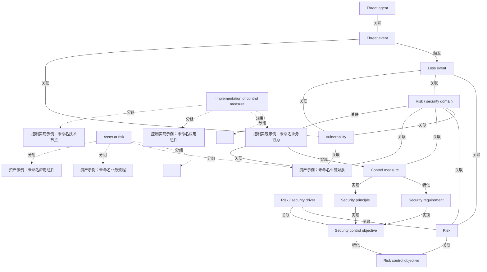

# G152/fig5-2 · 使用 ArchiMate 语言对风险与安全建模

类型：`architecture-model`。证明 ArchiMate 语言足以表达 ISM 与 ERM：把抽象的威胁、脆弱性、风险、控制目标、安全需求、控制措施与安全原则落成有类型、有关系、可被工具解析的模型，并用两个 grouping 说明资产与控制措施的实现都由多层元素构成。

英文 PDF 物理页：[43]。本页为架构语义分析，原文与原图分别保留。

## 原图与可编辑图


[完整 JSON](fig5-2.json) · [可编辑 Mermaid](fig5-2.mmd) · [仅关系图](fig5-2.relations.mmd) · [层级分解图](fig5-2.hierarchy.mmd)

图形重建表达语义，不复制源图布局。虚线表示解释、矩阵映射或分组关系，不自动表示不确定性的概率。



## 架构分析

先读威胁主体与威胁事件的关联，再沿唯一实心触发箭头到损失事件；损失事件与风险是关联。右侧区分安全控制目标对风险控制目标的特化、控制措施对安全需求的特化，以及需求/原则/实现行为之间的实现关系。底部未命名元素是跨层示例，不能当作项目实际实体。

- 本图有 22 个具名或隐含元素、22 条关系和 8 条包含/分组记录。
- 包含/分组树最大深度为 1；根节点为 威胁主体、威胁事件、损失事件、脆弱性、风险、风险/安全驱动因素、风险控制目标、安全控制目标、安全需求、控制措施、安全原则、风险/安全域、处于风险中的资产、控制措施的实施。
- 本图没有可直接确认为人员直属汇报的关系；视觉上下位置、能力分解和治理职责分别读取。
- PDF第43页原生1636×1036栅格逐线复核：Loss event和Risk之间没有箭头；唯一实心触发箭头是Threat event→Loss event。
- Control measure→Security requirement是实线空心三角（特化）；Control measure→Security principle是点线空心三角（实现），旧解释把两条线型读反。
- 域右侧折线连接Control measure，不是Security requirement；Loss event→Asset和域→Risk control objective两条旧记录未在源图观察到。
- 底部两组内各有三个未命名元素和省略号；连线接到具体的未命名业务对象/行为，不能把组边界自动当成线端点。
- 底部水平虚线没有可辨箭头；旧解释把业务流程框右上角的箭头形图标误当成该连线箭头。
- 全部16个既有节点及6个补录未命名源形状再次核对；未命名形状各自保留原始记法与分组。

### 如何用于项目

- 按节点类型建立业务、应用、数据、技术对象，并保留跨层服务、访问和实现关系。
- 交叉线不是连接点；角色分工、数据使用和组织汇报不得混用。

### 结构所表达的逻辑

- Threat event触发Loss event；Threat agent—Threat event及Loss event—Risk均为无箭头关联。
- Vulnerability关联Threat event、Loss event和资产组内业务对象。
- Security control objective特化Risk control objective；Control measure特化Security requirement，两条都是实线空心三角。
- Security requirement和Security principle实现Security control objective；Control measure实现Security principle；控制实现业务行为实现Control measure。
- Risk/security domain明确关联Loss event、Risk、Vulnerability、Control measure及两组内的业务对象/行为。图中没有域到Risk control objective的直连。
- 资产与控制实现是灰色分组，每组展示未命名的业务/应用/技术记法及省略号，表达多类型示例而非部署清单。
- 底部虚线连到具体业务对象与行为，没有可辨箭头；流程框右上角的小箭头是元素图标。

## 上下级与包含

上下位置区分风险、控制与实现的阅读区域，不是组织上下级。资产与控制实现两个灰色分组各包含三类未命名示例元素及省略号。Risk/security domain通过明确连线关联对象；它不是覆盖整个图的视觉外框。

|父项|子项|层级类型|依据与解释|
|---|---|---|---|
|处于风险中的资产|省略的其他资产元素|visual_grouping|框、泳道、域或分类组的成员归属；没有额外证据不提升为业务组合或管理关系。|
|控制措施的实施|省略的其他实现元素|visual_grouping|框、泳道、域或分类组的成员归属；没有额外证据不提升为业务组合或管理关系。|
|处于风险中的资产|资产示例：未命名业务对象|visual_grouping|框、泳道、域或分类组的成员归属；没有额外证据不提升为业务组合或管理关系。|
|处于风险中的资产|资产示例：未命名业务流程|visual_grouping|框、泳道、域或分类组的成员归属；没有额外证据不提升为业务组合或管理关系。|
|处于风险中的资产|资产示例：未命名应用组件|visual_grouping|框、泳道、域或分类组的成员归属；没有额外证据不提升为业务组合或管理关系。|
|控制措施的实施|控制实现示例：未命名业务行为|visual_grouping|框、泳道、域或分类组的成员归属；没有额外证据不提升为业务组合或管理关系。|
|控制措施的实施|控制实现示例：未命名应用组件|visual_grouping|框、泳道、域或分类组的成员归属；没有额外证据不提升为业务组合或管理关系。|
|控制措施的实施|控制实现示例：未命名技术节点|visual_grouping|框、泳道、域或分类组的成员归属；没有额外证据不提升为业务组合或管理关系。|

### 业务组成与特化

|父项/范围/类型|子项/责任对象/实例|语义|
|---|---|---|
|风险控制目标|安全控制目标|type_specialization|
|安全需求|控制措施|type_specialization|

## 全部元素与角色

|元素ID|原文名称|类型|含义|直接父项|深度|
|---|---|---|---|---|---|
|threat_agent|Threat agent|actor|黄色矩形，右上角人物图标。|—||
|threat_event|Threat event|event|黄色事件形（左侧凹口）。|—||
|loss_event|Loss event|event|事件：损失事件|—||
|vulnerability|Vulnerability|risk|粉色框，右上角放大镜图标。|—||
|risk|Risk|risk|粉色框，右上角风险图标。|—||
|risk_security_driver|Risk / security driver|goal|粉色框，右上角驱动因素图标。|—||
|risk_control_objective|Risk control objective|goal|紫色框，右上角目标图标。|—||
|security_control_objective|Security control objective|goal|目标/成果：安全控制目标|—||
|security_requirement|Security requirement|requirement|紫色框，右上角文档图标。|—||
|control_measure|Control measure|risk|紫色框，右上角文档图标；在模型中承担控制措施角色。|—||
|security_principle|Security principle|principle|紫色框，右上角感叹号方框图标。|—||
|risk_security_domain|Risk / security domain|group|灰色双矩形（带标题条），figures 中作为语境容器。|—||
|asset_at_risk|Asset at risk|group|灰色虚线 grouping，内含黄色业务元素、青色应用元素与白色虚线“…”文件夹。|—||
|implementation_of_control_measure|Implementation of control measure|group|灰色虚线 grouping，内含黄/青/绿三层元素与“…”文件夹。|—||
|ellipsis_asset|...|note|白色虚线文件夹内的省略号。|处于风险中的资产|1|
|ellipsis_impl|...|note|白色虚线文件夹内的省略号。|控制措施的实施|1|
|asset_business_object|资产示例：未命名业务对象|data|未命名的业务对象记法；不是名为“资产示例”的原文业务实体。|处于风险中的资产|1|
|asset_business_process|资产示例：未命名业务流程|process|未命名业务流程记法；框内箭头是图标，不是指向别的元素的关系箭头。|处于风险中的资产|1|
|asset_application_component|资产示例：未命名应用组件|application|未命名应用组件记法，表示资产可能来自应用层。|处于风险中的资产|1|
|implementation_business_behavior|控制实现示例：未命名业务行为|process|未命名业务行为的抽象记法；源图没有文字，不能进一步命名为特定流程。|控制措施的实施|1|
|implementation_application_component|控制实现示例：未命名应用组件|application|未命名应用层实现示例。|控制措施的实施|1|
|implementation_technology_node|控制实现示例：未命名技术节点|technology|未命名技术层节点实现示例；不是实际部署清单。|控制措施的实施|1|

## 全部关系

只有Threat event→Loss event为实心触发箭头。无箭头实线为关联；实线空心三角为特化（Security control objective→Risk control objective、Control measure→Security requirement）；点线空心三角为实现（Security requirement/ Security principle→Security control objective、Control measure→Security principle、实现业务行为→Control measure）。底部水平点线无可辨方向。

|主体|语义关系|客体|显式线/隐式|原文标签|依据|
|---|---|---|---|---|---|
|威胁主体|关联|威胁事件|显式连线||威胁主体与威胁事件之间的水平实线，无箭头。|
|威胁事件|触发|损失事件|显式连线||实心箭头。|
|威胁事件|关联|脆弱性|显式连线||垂直实线。|
|脆弱性|关联|损失事件|显式连线||斜线，原图未画箭头。|
|脆弱性|关联|资产示例：未命名业务对象|显式连线||原图垂直线到资产组内最前方业务对象的顶边，不是到灰色分组边界。|
|损失事件|关联|风险|显式连线||Loss event—Risk为无箭头实线关联；不能记录为损失事件触发风险。|
|损失事件|关联|风险/安全域|显式连线||损失事件向下连到风险/安全域。|
|风险|关联|风险控制目标|显式连线||垂直实线。|
|风险/安全驱动因素|关联|风险|显式连线||水平实线，无箭头。|
|风险/安全驱动因素|关联|安全控制目标|显式连线||垂直实线。|
|安全控制目标|特化|风险控制目标|显式连线||空心三角箭头指向风险控制目标。|
|安全需求|实现|安全控制目标|显式连线||点线折向安全控制目标底部，空心三角。|
|安全原则|实现|安全控制目标|显式连线||从安全原则顶部垂直向上的点线，空心三角。|
|控制措施|特化|安全需求|显式连线||原生栅格显示实线加空心三角指向Security requirement；Control measure是Security requirement的特化。|
|控制措施|实现|安全原则|显式连线||原生栅格显示点线加空心三角指向Security principle，保持realization并纠正旧实线描述。|
|控制实现示例：未命名业务行为|实现|控制措施|显式连线||实现线从右下组内黄色业务行为形向上到Control measure，源端是未命名业务行为。|
|风险/安全域|关联|脆弱性|显式连线||点线折线，从脆弱性右侧连到域。|
|风险/安全域|关联|风险|显式连线||斜线。|
|风险/安全域|关联|控制措施|显式连线||域右侧点状折线下降后到Control measure上边缘；Security requirement位于更上方且未与域连线。|
|风险/安全域|关联|资产示例：未命名业务对象|显式连线||域左下斜线连接资产组内业务对象右上角。|
|风险/安全域|关联|控制实现示例：未命名业务行为|显式连线||域右下斜线连接控制实现组内黄色业务行为形。|
|控制实现示例：未命名业务行为|关联|资产示例：未命名业务对象|显式连线||水平虚线连接两组内业务对象与业务行为；没有可辨箭头。左端下方箭头形是另一个业务流程框的记法图标。|

## 本轮否定的历史关系

以下旧解释保留用于追溯，不进入当前关系图、层级或知识图谱的有效边。

|旧记录|主体|旧关系|客体|否定依据|
|---|---|---|---|---|
|7|损失事件|association|处于风险中的资产|原图Loss event向下的线到Risk/security domain；没有另一路直接连接Asset at risk，旧记录把经分组连接拼成了直接边。|
|19|风险/安全域|association|风险控制目标|逐线追踪只看到域→Risk的斜线；没有域到Risk control objective的另一条线。旧记录没有源图依据。|

## 本轮语义修正

- 原图垂直线到资产组内最前方业务对象的顶边，不是到灰色分组边界。
- Loss event—Risk为无箭头实线关联；不能记录为损失事件触发风险。
- 原图Loss event向下的线到Risk/security domain；没有另一路直接连接Asset at risk，旧记录把经分组连接拼成了直接边。
- 原生栅格显示实线加空心三角指向Security requirement；Control measure是Security requirement的特化。
- 原生栅格显示点线加空心三角指向Security principle，保持realization并纠正旧实线描述。
- 实现线从右下组内黄色业务行为形向上到Control measure，源端是未命名业务行为。
- 逐线追踪只看到域→Risk的斜线；没有域到Risk control objective的另一条线。旧记录没有源图依据。
- 域右侧点状折线下降后到Control measure上边缘；Security requirement位于更上方且未与域连线。
- 域左下斜线连接资产组内业务对象右上角。
- 域右下斜线连接控制实现组内黄色业务行为形。
- 水平虚线连接两组内业务对象与业务行为；没有可辨箭头。左端下方箭头形是另一个业务流程框的记法图标。

## 误读检查

- 不要把Loss event—Risk画成触发；源图没有该箭头。
- 不要把Control measure→Security requirement的实线特化误成实现，也不要把其到Security principle的点线实现误成特化。
- 不能把经过Risk/security domain的两段关系折叠为Loss event→Asset直接关联。
- 所有未命名形状都只是示例记法，不可补造系统名、岗位或业务流程名。
- 视觉位置和分组不构成岗位直属汇报关系。

## 原文证据

### [PDF 第 42 页](../../../documents/G152.md#page-42)

> The ArchiMate language [C226] supports ISM and ERM modeling. This is described in The Open Group White Paper: Modeling Enterprise Risk Management and Security with the ArchiMate® Language [W150]. An example of the risk model in the ArchiMate language is given in Figure 5-2.
### [PDF 第 43 页](../../../documents/G152.md#page-43)

> Endnotes [1] See Chapter 6 (pp.87-97) of the SABSA® Blue Book [SABSA, 2005]. [2] The Open Group published a Guide to the Trust Ecosystem in January 2014 that describes the need for a trust ecosystem, a taxonomy for trust, as well as the impact of trust on business relationships and contracts (available at www.opengroup.org/library/g141). [3] This document addresses the TOGAF Standard, 10th Edition which does not sustain a distinction between data and information. When your architecture makes a clear distinction, all references to data are appropriate for information.

## 来源与分析状态

所有元素/关系均有来源定位；未把历史解释重命名为本轮逐线视觉确认。源图与语义图是两种视图，布局不证明汇报或因果。

源 PDF SHA-256：`919c53bfa4259a4b3a9686762f37c0576a1cd2f8e77e74648826d9f9c84ed6e0`。

源图记录：[原始解释与转录](../../../figures/G152/fig5-2.json)。

```json
{
  "quality": {
    "graph_integrity": "checked",
    "semantic_analysis": "typed-graph-and-context-analysis",
    "visual_review": "source-content-audited",
    "notice_zh": "所有元素/关系均有来源定位；未把历史解释重命名为本轮逐线视觉确认。源图与语义图是两种视图，布局不证明汇报或因果。"
  },
  "source_uncertainty": {
    "confidence": "medium",
    "uncertainties_zh": [
      "Control measure → Security principle 的连线是实线空心三角；按 ArchiMate 标准这更像 specialization，但语义上应为 realization（控制措施落实安全原则），本分析按 realization 记录并在描述中说明线型差异。",
      "Threat agent → Threat event、Vulnerability → Loss event、Risk/security driver → Risk 等线在原图中看不到箭头；本分析按无箭头关联记录，不排除箭头被形状边框遮挡。",
      "Risk / security domain 画成两个重叠的灰色矩形（带标题条），本分析按一个 grouping 记录。",
      "底部两个 grouping 内未命名的黄/青/绿堆叠图形只能判读为业务/应用/技术层实例示意，具体类型无法确认。",
      "“Implementation of control measure → Asset at risk” 的虚线小箭头方向按箭头尖端判读为向左。"
    ],
    "analyzed_from": [
      "英文 PDF 第 43 页原图截图（220 dpi）及 2x2、3x3 放大分块",
      "figs/g152e_fig5-2_en.png（1394×896，与 PDF 截图逐项比对）",
      "figs/zh/g152e_fig5-2_zh.png（逐项与英文原图比较）",
      "英文 PDF 第 42–43 页正文",
      "中文稿 G152e_将风险与安全融入TOGAF企业架构.md 第 429–456 行（含图内标签对照表）"
    ],
    "date": "2026-10-31"
  },
  "source_conflicts": []
}
```
