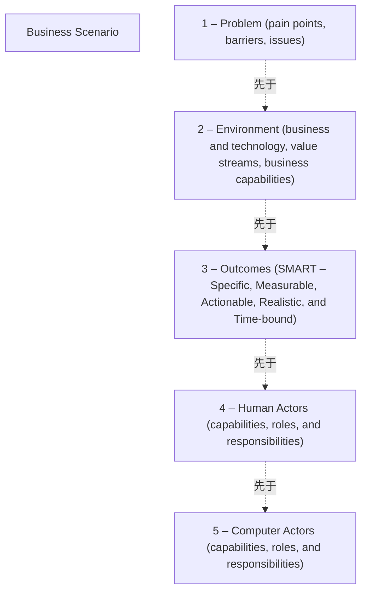

# G176/fig3-1 · 创建业务场景

类型：`process-or-method-model`。第 3.1 节“总体过程”用它概括业务场景必须捕获的五个要素；正文列出的六个步骤中，前五步依次对应图中编号 1–5，第 6 步是检验“是否适用”并仅在必要时细化。第 3.2.2 节“收集”步骤又以本图的五个领域作为信息收集的范围。

英文 PDF 物理页：[18]。本页为架构语义分析，原文与原图分别保留。

## 原图与可编辑图


[完整 JSON](fig3-1.json) · [可编辑 Mermaid](fig3-1.mmd) · [仅关系图](fig3-1.relations.mmd) · [层级分解图](fig3-1.hierarchy.mmd)

图形重建表达语义，不复制源图布局。虚线表示解释、矩阵映射或分组关系，不自动表示不确定性的概率。



## 架构分析

从上往下按编号读 5 个色块，阶梯式右移只表示先后，不表示上下级。每块第一行是要素名，括号内是该要素要涵盖的内容。图中没有连线、箭头或图例。

- 本图有 6 个具名或隐含元素、4 条关系和 0 条包含/分组记录。
- 本图没有可直接确认为人员直属汇报的关系；视觉上下位置、能力分解和治理职责分别读取。
- 包含分组后有 2 个连通分量；分离可能源于图例、并列分类或独立示例，未自动补边。
- 对照原PDF第18页全部五块标签与正文六步骤，保留未画出的适用性检查。
- 删除历史解析中虚拟Business Scenario外框的视觉包含；五要素的语义归纳仍在说明中。

### 如何用于项目

- 按阶段/事件/行为关系读取入口、出口、责任和产物；检查循环与例外路径。
- 工作流先后不表示组织管理权；在项目中显式记录条件和完成标准。

### 结构所表达的逻辑

- 图内五个编号色块依次为Problem、Environment、Outcomes、Human Actors、Computer Actors。
- Outcomes使用SMART：Specific、Measurable、Actionable、Realistic、Time-bound。
- 第18页正文有六个创建步骤：第六步Checking for fitness-for-purpose没有绘成第六个色块。
- 色块没有箭头；编号表达阅读顺序。Business Scenario是归纳概念，没有对应封闭外框。

## 上下级与包含

原图只有五个阶梯排列的色块，没有具名外框；Business Scenario作为归纳概念保留，不把它当作可见容器。

|父项|子项|层级类型|依据与解释|
|---|---|---|---|
|—|—|无视觉包含|关系中明确的组成/特化见 JSON semantic_hierarchy。|

## 全部元素与角色

|元素ID|原文名称|类型|含义|直接父项|深度|
|---|---|---|---|---|---|
|business_scenario|Business Scenario|concept|用于归纳五要素的语义概念；原图没有标作Business Scenario的外框。|—||
|e_problem|1 – Problem (pain points, barriers, issues)|requirement|对应步骤 1：识别、记录并排序驱动场景的问题。|—||
|e_environment|2 – Environment (business and technology, value streams, business capabilities)|concept|对应步骤 2：识别业务与技术环境，记录在包含价值流和业务能力的场景模型中。|—||
|e_outcomes|3 – Outcomes (SMART – Specific, Measurable, Actionable, Realistic, and Time-bound)|goal|对应步骤 3：识别并记录期望成果。|—||
|e_human_actors|4 – Human Actors (capabilities, roles, and responsibilities)|actor|对应步骤 4：识别人的参与者及其在业务模型中的位置。|—||
|e_computer_actors|5 – Computer Actors (capabilities, roles, and responsibilities)|application|对应步骤 5：识别计算机参与者（计算元素）及其在技术模型中的位置。|—||

## 全部关系

图中没有连线。编号和阶梯式错位排列表示先后顺序（关系清单中标为推断的 sequence）；颜色从深蓝渐变到绿色，推断只是视觉上的递进，没有额外含义。

|主体|语义关系|客体|显式线/隐式|原文标签|依据|
|---|---|---|---|---|---|
|1 – 问题（痛点、障碍、议题）|先于|2 – 环境（业务与技术、价值流、业务能力）|implicit||编号与阶梯排列表示顺序|
|2 – 环境（业务与技术、价值流、业务能力）|先于|3 – 成果（SMART：具体、可度量、可行动、现实、有时限）|implicit||先于|
|3 – 成果（SMART：具体、可度量、可行动、现实、有时限）|先于|4 – 人的参与者（能力、角色与职责）|implicit||先于|
|4 – 人的参与者（能力、角色与职责）|先于|5 – 计算机参与者（能力、角色与职责）|implicit||先于|

## 误读检查

- 阶梯排列不是层级：问题并不统辖其余四个要素；中文稿引用的 SVG 用树形连线把“问题”画成上级，原图没有这种关系。
- 顺序也不等于一次走完：正文说明业务场景按多轮迭代完善，每轮可改进任一要素。
- 参与者括注中的“capabilities”指参与者具备的能力；第 3.1 节对“能力”和“业务能力”分别下了定义。
- 中文稿把本图放在第 1 章引言（L82），图题写作“业务场景的五个要素”；英文原文中图 3-1 位于第 3.1 节“总体过程”，图题为“Creating a Business Scenario”，中文稿第 3.1 节（L135）引用图 3-1 处没有放图。

## 原文证据

### [PDF 第 13 页](../../../documents/G176.md#page-13)

> A key factor in the success of an Enterprise Architecture is the extent to which it is linked to business requirements, and demonstrably supporting and enabling the enterprise to achieve its business objectives. Any architectural effort must begin with a baseline view of the needs to be fulfilled by the solution or solutions. Consider guiding the construction of a warehouse building without understanding why the warehouse is needed. This could result in a fine warehouse solution for housing large-scale mechanical parts; however, the need was a warehouse for household goods. Creating an architecture without understanding “why” typically results in mismatches between solutions and needs.
> The Business Scenario method is a technique to validate, elaborate, and/or change the premise behind an architecture effort by understanding and documenting the key elements of a Business Scenario in successive iterations where:
### [PDF 第 18 页](../../../documents/G176.md#page-18)

> Creating a Business Scenario involves completing the six steps that capture the five elements illustrated in Figure 3-1:
### [PDF 第 19 页](../../../documents/G176.md#page-19)

> • Outcomes are the changes, benefits, learning, or other effects that happen as a result of what the project or organization offers or provides
> • A capability is an ability that an organization, person, or system possesses
### [PDF 第 21 页](../../../documents/G176.md#page-21)

> The Gathering step is where information is collected on each of the areas in Figure 3-1. The objective is to obtain valid data to shape, confirm, and/or deny the premise driving the effort. If information gathering procedures and practices are already in place in an organization – for example, to gather information for strategic planning – they should be used as appropriate, either during Business Scenario workshops or in place of Business Scenario workshops.

## 来源与分析状态

所有元素/关系均有来源定位；未把历史解释重命名为本轮逐线视觉确认。源图与语义图是两种视图，布局不证明汇报或因果。

源 PDF SHA-256：`48c76fbfd164020fcbc0a4f2ec12ee849a2af83424a332883f9a8e0260bf4961`。

源图记录：[原始解释与转录](../../../figures/G176/fig3-1.json)。

```json
{
  "quality": {
    "graph_integrity": "checked",
    "semantic_analysis": "typed-graph-and-context-analysis",
    "visual_review": "source-content-audited",
    "notice_zh": "所有元素/关系均有来源定位；未把历史解释重命名为本轮逐线视觉确认。源图与语义图是两种视图，布局不证明汇报或因果。"
  },
  "source_uncertainty": {
    "confidence": "high",
    "uncertainties_zh": [],
    "analyzed_from": [
      "英文 PDF 第 18 页原图截图（220 dpi）",
      "英文 PDF 第 13、18、21 页正文",
      "中文稿 G176e_业务场景.md 第 62–92 行、第 131–150 行",
      "figs/g176_fig3-1.svg 源码"
    ],
    "date": "2026-10-31"
  },
  "source_conflicts": []
}
```
