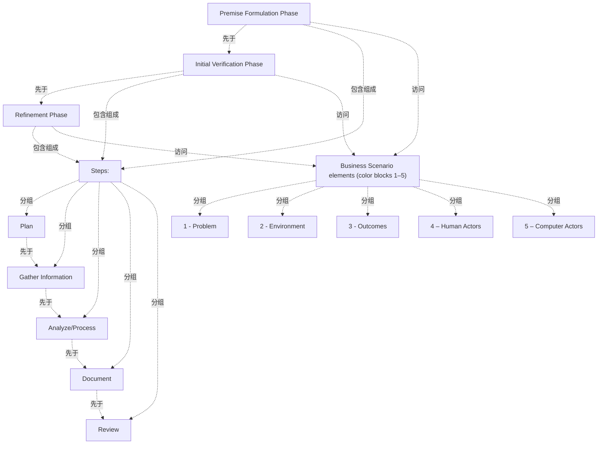

# G176/fig3-2 · 开发业务场景的阶段与步骤

类型：`mapping-or-assessment-matrix`。第 3.1 节用它说明业务场景是怎样开发出来的：经过若干阶段来形成、验证和细化驱动工作的业务需求前提；每个阶段都由规划、收集信息、分析、记录、评审这些步骤组成，并在每个阶段中依次改进业务场景的五个要素（图 3-1）。第 3.2 节先统一描述这些步骤，第 3.3 节再分别描述三个阶段。

英文 PDF 物理页：[20]。本页为架构语义分析，原文与原图分别保留。

## 原图与可编辑图


[完整 JSON](fig3-2.json) · [可编辑 Mermaid](fig3-2.mmd) · [仅关系图](fig3-2.relations.mmd) · [层级分解图](fig3-2.hierarchy.mmd)

图形重建表达语义，不复制源图布局。虚线表示解释、矩阵映射或分组关系，不自动表示不确定性的概率。



## 架构分析

从左到右读 3 个面板，面板标题是阶段名，左右顺序就是阶段的先后。每个面板左侧“Steps:”下的 5 个圆点是该阶段要执行的步骤，自上而下为执行顺序；右侧 5 个编号色块是本阶段要处理的五个要素，配色与图 3-1 相同。三个面板内容完全一样，表示步骤和要素在每个阶段都重复一遍，区别只在阶段的目标和产出（见第 3.3 节）。图中没有箭头或连线。

- 本图有 15 个具名或隐含元素、12 条关系和 10 条包含/分组记录。
- 包含/分组树最大深度为 1；根节点为 前提形成阶段、初步验证阶段、细化阶段、步骤、业务场景五要素（色块 1–5）。
- 本图没有可直接确认为人员直属汇报的关系；视觉上下位置、能力分解和治理职责分别读取。
- 三列阶段从左到右为Premise Formulation、Initial Verification、Refinement。每列都列出Plan、Gather Information、Analyze/Process、Document、Review和同样五要素。
- 图无流程箭头；共同步骤和要素是归一后的模板元素，各列重复内容完整保存在t_panels表。第19–20页正文明确每阶段重复这些步骤并逐次改进要素。

### 如何用于项目

- 先固定行、列所代表的维度及单元格含义，再登记有证据的映射或评分。
- 空白、无关系、未测量和不适用分别处理；颜色不自动等于优先级。

### 结构所表达的逻辑

- 三个阶段依次为：前提形成 → 初步验证 → 细化。正文说明这些阶段从提出前提一直走到业务场景获业务领导者批准。
- 每个阶段都重复同样 5 个步骤：规划 → 收集信息 → 分析/处理 → 记录 → 评审；第 3.2 节说明因为步骤在各阶段重复，所以先统一描述步骤。
- 每个阶段都覆盖全部五个要素（问题、环境、成果、人的参与者、计算机参与者），逐阶段改进；这些要素就是图 3-1 的五个要素。
- 前提形成阶段：记录工作背后的主张（前提，如“上 ERP 就能解决系统不互通”）和它隐含的未明说问题，并找出能帮助验证和细化前提的目标利益相关者。
- 初步验证阶段：与利益相关者面对面考察真实业务问题，产出一份草稿性、尚不完整的业务场景和下一步建议。
- 细化阶段：迭代细化直到就推进方式达成一致，产出发布的业务场景文档；正文说明此时要判断业务场景是否已足以把需求传给下游架构过程，决定进入 ADM 下一阶段还是继续细化。
- 获批的业务场景文档放入需求存储库，作为驱动下游架构工作的高层需求陈述，并用来验证架构质量（第 3.3 节）。

## 上下级与包含

三层视觉包含：外框（业务场景开发过程）→ 3 个阶段面板 → 每个面板内的步骤列表与五要素色块。步骤和要素在三个面板中原样重复，表示它们属于每一个阶段。

|父项|子项|层级类型|依据与解释|
|---|---|---|---|
|步骤|规划|visual_grouping|框、泳道、域或分类组的成员归属；没有额外证据不提升为业务组合或管理关系。|
|步骤|收集信息|visual_grouping|框、泳道、域或分类组的成员归属；没有额外证据不提升为业务组合或管理关系。|
|步骤|分析/处理|visual_grouping|框、泳道、域或分类组的成员归属；没有额外证据不提升为业务组合或管理关系。|
|步骤|记录（文档化）|visual_grouping|框、泳道、域或分类组的成员归属；没有额外证据不提升为业务组合或管理关系。|
|步骤|评审|visual_grouping|框、泳道、域或分类组的成员归属；没有额外证据不提升为业务组合或管理关系。|
|业务场景五要素（色块 1–5）|1 – 问题|visual_grouping|框、泳道、域或分类组的成员归属；没有额外证据不提升为业务组合或管理关系。|
|业务场景五要素（色块 1–5）|2 – 环境|visual_grouping|框、泳道、域或分类组的成员归属；没有额外证据不提升为业务组合或管理关系。|
|业务场景五要素（色块 1–5）|3 – 成果|visual_grouping|框、泳道、域或分类组的成员归属；没有额外证据不提升为业务组合或管理关系。|
|业务场景五要素（色块 1–5）|4 – 人的参与者|visual_grouping|框、泳道、域或分类组的成员归属；没有额外证据不提升为业务组合或管理关系。|
|业务场景五要素（色块 1–5）|5 – 计算机参与者|visual_grouping|框、泳道、域或分类组的成员归属；没有额外证据不提升为业务组合或管理关系。|

### 业务组成与特化

|父项/范围/类型|子项/责任对象/实例|语义|
|---|---|---|
|前提形成阶段|步骤|composition|
|初步验证阶段|步骤|composition|
|细化阶段|步骤|composition|

存在多个父项的节点：步骤；保留多重关系，不强行转成单父项树。

## 全部元素与角色

|元素ID|原文名称|类型|含义|直接父项|深度|
|---|---|---|---|---|---|
|ph_premise|Premise Formulation Phase|phase|阶段：前提形成阶段|—||
|ph_verification|Initial Verification Phase|phase|阶段：初步验证阶段|—||
|ph_refinement|Refinement Phase|phase|阶段：细化阶段|—||
|g_steps|Steps:|group|在 3 个面板中各出现一次，内容相同；这里只记录一次。|—||
|s_plan|Plan|process|流程：规划|步骤|1|
|s_gather|Gather Information|process|流程：收集信息|步骤|1|
|s_analyze|Analyze/Process|process|流程：分析/处理|步骤|1|
|s_document|Document|process|流程：记录（文档化）|步骤|1|
|s_review|Review|process|流程：评审|步骤|1|
|g_elements|Business Scenario elements (color blocks 1–5)|group|图中无此标签；在 3 个面板中各出现一次，内容相同。|—||
|e_problem|1 - Problem|requirement|需求：1 – 问题|业务场景五要素（色块 1–5）|1|
|e_environment|2 - Environment|concept|概念：2 – 环境|业务场景五要素（色块 1–5）|1|
|e_outcomes|3 - Outcomes|goal|目标/成果：3 – 成果|业务场景五要素（色块 1–5）|1|
|e_human_actors|4 – Human Actors|actor|参与者：4 – 人的参与者|业务场景五要素（色块 1–5）|1|
|e_computer_actors|5 – Computer Actors|application|应用：5 – 计算机参与者|业务场景五要素（色块 1–5）|1|

## 全部关系

图中没有连线或箭头。阶段顺序由面板从左到右的位置表示；步骤顺序由列表自上而下表示；“阶段执行步骤、处理要素”由面板包含关系表示。关系清单中这些都标为推断。

|主体|语义关系|客体|显式线/隐式|原文标签|依据|
|---|---|---|---|---|---|
|前提形成阶段|先于|初步验证阶段|implicit||面板左右顺序|
|初步验证阶段|先于|细化阶段|implicit||先于|
|规划|先于|收集信息|implicit||列表自上而下|
|收集信息|先于|分析/处理|implicit||先于|
|分析/处理|先于|记录（文档化）|implicit||先于|
|记录（文档化）|先于|评审|implicit||先于|
|前提形成阶段|包含组成|步骤|implicit||面板内包含全部步骤|
|初步验证阶段|包含组成|步骤|implicit||包含组成|
|细化阶段|包含组成|步骤|implicit||包含组成|
|前提形成阶段|访问|业务场景五要素（色块 1–5）|implicit||该阶段处理并改进全部五要素|
|初步验证阶段|访问|业务场景五要素（色块 1–5）|implicit||访问|
|细化阶段|访问|业务场景五要素（色块 1–5）|implicit||访问|

## 三个面板逐项转录

```json
{
  "id": "t_panels",
  "title_zh": "三个面板逐项转录",
  "columns": [
    "阶段（面板）",
    "步骤（左侧列表）",
    "要素（右侧色块）"
  ],
  "rows": [
    [
      "Premise Formulation Phase 前提形成阶段",
      "Plan；Gather Information；Analyze/Process；Document；Review",
      "1 - Problem；2 - Environment；3 - Outcomes；4 – Human Actors；5 – Computer Actors"
    ],
    [
      "Initial Verification Phase 初步验证阶段",
      "Plan；Gather Information；Analyze/Process；Document；Review",
      "1 - Problem；2 - Environment；3 - Outcomes；4 – Human Actors；5 – Computer Actors"
    ],
    [
      "Refinement Phase 细化阶段",
      "Plan；Gather Information；Analyze/Process；Document；Review",
      "1 - Problem；2 - Environment；3 - Outcomes；4 – Human Actors；5 – Computer Actors"
    ]
  ],
  "notes_zh": "三个面板内容完全相同，只有阶段名不同。"
}
```

## 误读检查

- 三个面板内容相同不是重复排版，而是表示每个阶段都要执行全部步骤、处理全部要素。
- 面板之间没有箭头，阶段顺序来自左右位置和正文；细化阶段结束时可能继续细化，并非一次走完。
- 五要素色块的上下顺序与图 3-1 的编号一致，不是步骤；步骤是左侧的圆点列表。
- 中文稿引用的 SVG 去掉了五要素色块，只剩阶段和步骤，容易让人以为各阶段不涉及五要素。

## 原文证据

### [PDF 第 19 页](../../../documents/G176.md#page-19)

> A Business Scenario is developed over a number of phases that formulate, verify, and refine a premise of the business requirements driving an effort. Each phase is comprised of steps to plan the phase, gather information, analyze information gathered, document the results, and review the results of the Business Scenario, as depicted in Figure 3-2.
> The three phases of developing a Business Scenario and steps are described in detail in Figure 3-2 and Section 3.2.
### [PDF 第 20 页](../../../documents/G176.md#page-20)

> Since the steps are repeated in each phase they are described first. Within the phase descriptions any specific emphasis about the steps will be described if necessary.
> The Planning step is used to ensure each iteration is well orchestrated as a mini-project, to get the right people and resources onboard, and to prepare all those involved.
### [PDF 第 24 页](../../../documents/G176.md#page-24)

> The steps above are repeated in the following phases that go from creating a premise to having a Business Scenario that has been approved by the leaders of the business. This Business Scenario document is then placed in the Requirements Repository as the high-level requirements statement that drives the architecture work downstream and is used to validate the quality of the architecture.
> Every effort starts with some notion of a problem and an approach to dealing with a problem. For example, an enterprise might have the problem of disparate systems that do not communicate and they may have the notion that to address the problem they may implement an Enterprise Resource Planning (ERP) system. This proposition is an example of a premise. This premise in essence presumes an answer to an unstated question – do ERPs actually reduce my problem of all my systems that do not interoperate? Sometimes this premise and the unstated question do not get examined, which can be a critical mistake. In this phase we attempt to develop an understanding of the premise and unstated question or questions that need to be examined to ensure an architecture project is on point.
### [PDF 第 25 页](../../../documents/G176.md#page-25)

> What is driving an effort? It could be a fully documented project, or something as simple as an idea or concept. It also could be the lack of something; for example:
> Premise, key questions that need answered to validate the premise, and a list of stakeholders willing to help validate and detail the premise. This output is used in the next phase to plan, manage, and execute the validation phase.
### [PDF 第 26 页](../../../documents/G176.md#page-26)

> Having the stakeholder needs faithfully captured is important, but it mustn’t be done to the exclusion of moving forward. We have all heard of paralysis by analysis. This phase helps get a good enough statement of the business requirements.
> An agreed statement of the business requirements, documented in the Business Scenario, along with an agreed path forward including commitments for developing to and preferring standards documented in the architecture.

## 来源与分析状态

所有元素/关系均有来源定位；未把历史解释重命名为本轮逐线视觉确认。源图与语义图是两种视图，布局不证明汇报或因果。

源 PDF SHA-256：`48c76fbfd164020fcbc0a4f2ec12ee849a2af83424a332883f9a8e0260bf4961`。

源图记录：[原始解释与转录](../../../figures/G176/fig3-2.json)。

```json
{
  "quality": {
    "graph_integrity": "checked",
    "semantic_analysis": "typed-graph-and-context-analysis",
    "visual_review": "source-content-audited",
    "notice_zh": "所有元素/关系均有来源定位；未把历史解释重命名为本轮逐线视觉确认。源图与语义图是两种视图，布局不证明汇报或因果。"
  },
  "source_uncertainty": {
    "confidence": "high",
    "uncertainties_zh": [],
    "analyzed_from": [
      "英文 PDF 第 20 页原图截图（220 dpi）",
      "英文 PDF 第 19、20、24–26 页正文",
      "中文稿 G176e_业务场景.md 第 152–160 行、第 268–297 行",
      "figs/g176_fig3-2.svg 源码"
    ],
    "date": "2026-10-31"
  },
  "source_conflicts": []
}
```
