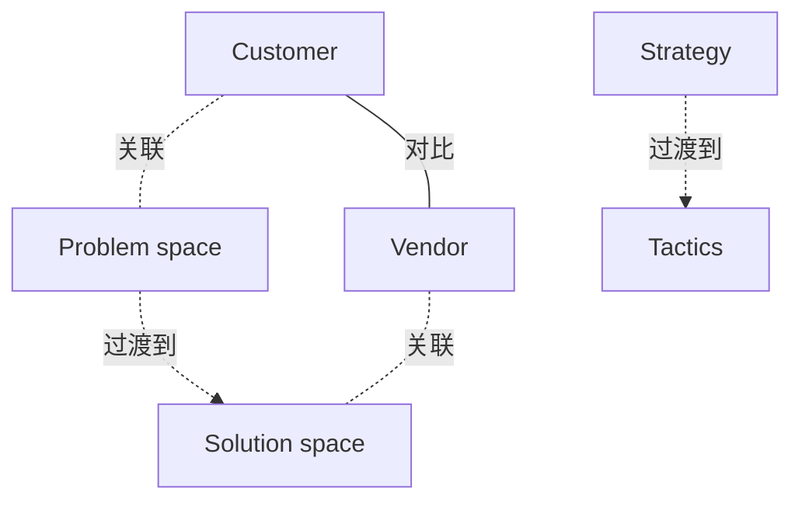

# G176/fig5-1 · 业务场景的相对贡献

类型：`analytical-view`。第 5 章说明业务场景不是架构师一个人的事：业务线管理者等利益相关者参与以准确捕获业务目标，视企业与 IT 供应商的关系，供应商也可能参与以准确捕获技术方案的角色。本图用一条对角线示意：客户方（业务管理层加企业架构师）在早期贡献最大，供应商在后期探索具体技术方案的角色时贡献最大。

英文 PDF 物理页：[29]。本页为架构语义分析，原文与原图分别保留。

## 原图与可编辑图


[完整 JSON](fig5-1.json) · [可编辑 Mermaid](fig5-1.mmd) · [仅关系图](fig5-1.relations.mmd) · [层级分解图](fig5-1.hierarchy.mmd)

图形重建表达语义，不复制源图布局。虚线表示解释、矩阵映射或分组关系，不自动表示不确定性的概率。



## 架构分析

从左往右读：左端上沿是“问题空间”、下沿是“战略”，右端上沿是“解决方案空间”、下沿是“战术”，正文把这个方向称为时间线。在任一横向位置竖着看，蓝色（客户方）与绿色（供应商）各占的高度就是双方贡献的相对比例。对角线是两方的分界。

- 本图有 6 个具名或隐含元素、5 条关系和 0 条包含/分组记录。
- 本图没有可直接确认为人员直属汇报的关系；视觉上下位置、能力分解和治理职责分别读取。
- 包含分组后有 2 个连通分量；分离可能源于图例、并列分类或独立示例，未自动补边。
- 核对无刻度的两色区域与第29页正文，将历史百分比表替换为定性趋势表。

### 如何用于项目

- 围绕作者目的读取本图实体、分组与连线，并用对应原文限定其含义。
- 把参考模型与项目事实分开，实际范围、约束、值和责任须有项目证据。

### 结构所表达的逻辑

- 蓝色Customer面积在Problem space / Strategy一端较大；绿色Vendor面积在Solution space / Tactics一端较大。
- 对角分界线表达相对贡献变化，原图没有百分比或测量坐标。
- 第29页正文认为供应商IT架构师协助集成可能位于时间线中间，不规定50/50分工。

## 上下级与包含

没有层级。两个区域（客户方、供应商）是并列的两方；四个角标是横轴两端的说明。

|父项|子项|层级类型|依据与解释|
|---|---|---|---|
|—|—|无视觉包含|关系中明确的组成/特化见 JSON semantic_hierarchy。|

## 全部元素与角色

|元素ID|原文名称|类型|含义|直接父项|深度|
|---|---|---|---|---|---|
|customer|Customer|stakeholder|正文：客户方 = 业务管理层 + 企业架构师。|—||
|vendor|Vendor|stakeholder|IT 供应商，是否参与取决于组织与供应商的关系。|—||
|problem_space|Problem space|concept|概念：问题空间|—||
|solution_space|Solution space|concept|概念：解决方案空间|—||
|strategy|Strategy|concept|概念：战略|—||
|tactics|Tactics|concept|概念：战术|—||

## 全部关系

图中唯一的线是从左下角到右上角的对角线，它是两方贡献份额的分界线（关系清单中记为 contrast，无箭头）。横向“从左到右”的方向由角标表示，没有画箭头（记为推断的 transitions_to）。

|主体|语义关系|客体|显式线/隐式|原文标签|依据|
|---|---|---|---|---|---|
|客户方|对比|供应商|显式连线||对角分界线：两方贡献此消彼长|
|问题空间|过渡到|解决方案空间|implicit||横向从左到右，正文称为时间线|
|战略|过渡到|战术|implicit||过渡到|
|客户方|关联|问题空间|implicit||客户方份额在问题空间 / 战略一端最大|
|供应商|关联|解决方案空间|implicit||供应商份额在解决方案空间 / 战术一端最大|

## 相对贡献的定性趋势

```json
{
  "id": "t_relative_contributions",
  "title_zh": "相对贡献的定性趋势",
  "content_role": "qualitative-source-diagram-transcription",
  "columns": [
    "图内位置",
    "客户侧贡献",
    "供应商侧贡献"
  ],
  "rows": [
    [
      "Problem space / Strategy",
      "相对较大",
      "相对较小"
    ],
    [
      "中间（原图无刻度）",
      "与供应商侧交叠协作",
      "与客户侧交叠协作"
    ],
    [
      "Solution space / Tactics",
      "相对较小",
      "相对较大"
    ]
  ],
  "notes_zh": "原图没有任何百分比、测量值或坐标刻度。历史t_shares中的约100%、50%、0%是几何估算，保留在source_tables供审计，不能作为来源数值。"
}
```

## 误读检查

- 原图只有客户方和供应商两方，不是三条参与度曲线；中文稿引用的 SVG 自拟了三方曲线。
- 对角线是份额分界，不是趋势线，也不是测量数据；线性变化只是示意。
- 上下两组角标描述的是同一个横向方向（问题→方案、战略→战术），不是四个独立维度。
- 两块区域中部颜色较浅只是渐变效果，没有含义（推断）。
- 不能把旧解析按三角形估计的100%、50%、0%当作原文给出的参与率或工时分配。

## 原文证据

### [PDF 第 29 页](../../../documents/G176.md#page-29)

> Typically, the involvement of the business management is greatest in the early stages while the business problems are being explored and captured; while the involvement of the architect is greatest in the later stages and when architectural solutions are being described. Similarly, if vendors are involved in the Business Scenario process, the involvement of the customer side (business management plus Enterprise Architects) is greatest in the early stages, while that of the vendors is greatest in the later stages when the role of specific technical solutions is being explored and captured. This concept is illustrated in Figure 5-1.
> Vendor IT architects might be able to assist enterprise IT architects with integration of the vendor’s products into the Enterprise Architecture. This assistance most probably falls in the middle of the timeline in Figure 5-1.

## 来源与分析状态

所有元素/关系均有来源定位；未把历史解释重命名为本轮逐线视觉确认。源图与语义图是两种视图，布局不证明汇报或因果。

源 PDF SHA-256：`48c76fbfd164020fcbc0a4f2ec12ee849a2af83424a332883f9a8e0260bf4961`。

源图记录：[原始解释与转录](../../../figures/G176/fig5-1.json)。

```json
{
  "quality": {
    "graph_integrity": "checked",
    "semantic_analysis": "typed-graph-and-context-analysis",
    "visual_review": "source-content-audited",
    "notice_zh": "所有元素/关系均有来源定位；未把历史解释重命名为本轮逐线视觉确认。源图与语义图是两种视图，布局不证明汇报或因果。"
  },
  "source_uncertainty": {
    "confidence": "high",
    "uncertainties_zh": [],
    "analyzed_from": [
      "英文 PDF 第 29 页原图截图（220 dpi）",
      "英文 PDF 第 29 页正文",
      "中文稿 G176e_业务场景.md 第 353–359 行",
      "figs/g176_fig5-1.svg 源码"
    ],
    "date": "2026-10-31"
  },
  "source_conflicts": []
}
```
