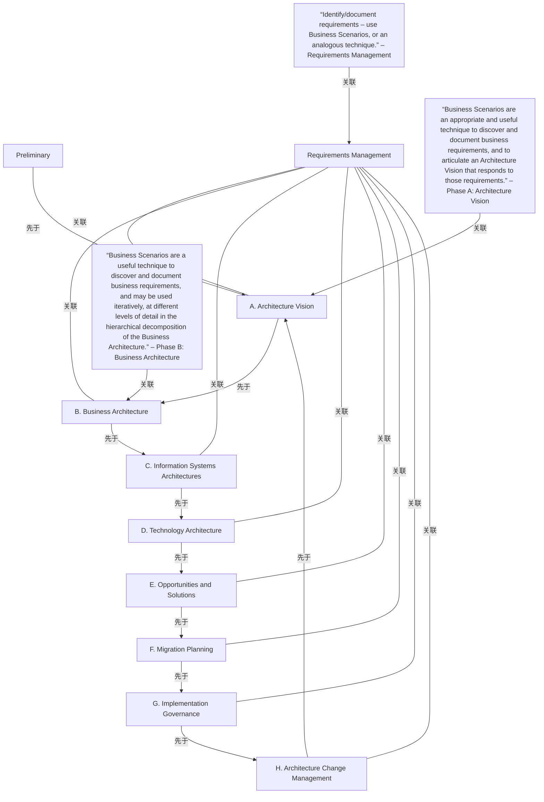

# G176/fig6-1 · 需求在整个 TOGAF ADM 中的相关性

类型：`process-or-method-model`。第 6 章说明业务场景与 TOGAF ADM 的关系：业务场景在阶段 A（架构愿景）最为突出，用来定义相关业务需求并与业务管理层和其他利益相关者达成共识；也用于业务架构阶段，从业务的高层需求直接推导架构特征。正文说业务需求在 ADM 生命周期的所有阶段都会被引用，并以本图为证：需求管理位于 ADM 轮中心、与每个阶段相连，右侧三段引文标出业务场景被明确推荐的三个位置。

英文 PDF 物理页：[30]。本页为架构语义分析，原文与原图分别保留。

## 原图与可编辑图


[完整 JSON](fig6-1.json) · [可编辑 Mermaid](fig6-1.mmd) · [仅关系图](fig6-1.relations.mmd) · [层级分解图](fig6-1.hierarchy.mmd)

图形重建表达语义，不复制源图布局。虚线表示解释、矩阵映射或分组关系，不自动表示不确定性的概率。



## 架构分析

左侧是 TOGAF ADM 轮：顶部单独的“Preliminary（预备阶段）”用一条竖线连到阶段 A；阶段 A–H 八个黄色圆排成一圈，相邻阶段由弧线相连；中心的橙色大圆是“Requirements Management（需求管理）”，用 8 条辐条连到每个阶段。这些线都没有箭头，ADM 按 A→B→…→H 顺时针推进是 TOGAF 标准的约定（背景知识）。右侧三段带引号的文字各有一个绿色箭头，分别指向阶段 A、阶段 B 和需求管理，引文末尾的斜体字标明它对应的阶段。

- 本图有 13 个具名或隐含元素、20 条关系和 0 条包含/分组记录。
- 本图没有可直接确认为人员直属汇报的关系；视觉上下位置、能力分解和治理职责分别读取。
- 逐条核对九条外部/环连线、八条辐条和三条绿色旁注箭头。将历史单向serving辐条改为原图无向关联。

### 如何用于项目

- 按阶段/事件/行为关系读取入口、出口、责任和产物；检查循环与例外路径。
- 工作流先后不表示组织管理权；在项目中显式记录条件和完成标准。

### 结构所表达的逻辑

- 所有Preliminary、A–H、Requirements Management标签和三个业务场景旁注均保留。
- 三个旁注分别说明在A发现并记录业务需求和愿景，在B迭代分解业务架构，以及在需求管理中识别和记录需求。
- 第30页正文说明业务场景还可在任意需要推导需求的阶段使用，包括Preliminary；图中的三个旁注不是排他使用清单。
- 中心辐条没有箭头，不能作为单向服务关系；外环连线也没有绘制方向箭头。

## 上下级与包含

没有容器嵌套。预备阶段位于循环之外的上方；阶段 A–H 构成循环；需求管理在中心，与各阶段是居中支撑关系，不是上下级。三段引文是附加注释。

|父项|子项|层级类型|依据与解释|
|---|---|---|---|
|—|—|无视觉包含|关系中明确的组成/特化见 JSON semantic_hierarchy。|

## 全部元素与角色

|元素ID|原文名称|类型|含义|直接父项|深度|
|---|---|---|---|---|---|
|preliminary|Preliminary|phase|阶段：预备阶段|—||
|ph_a|A. Architecture Vision|phase|阶段：阶段 A：架构愿景|—||
|ph_b|B. Business Architecture|phase|阶段：阶段 B：业务架构|—||
|ph_c|C. Information Systems Architectures|phase|阶段：阶段 C：信息系统架构|—||
|ph_d|D. Technology Architecture|phase|阶段：阶段 D：技术架构|—||
|ph_e|E. Opportunities and Solutions|phase|阶段：阶段 E：机会与解决方案|—||
|ph_f|F. Migration Planning|phase|阶段：阶段 F：迁移规划|—||
|ph_g|G. Implementation Governance|phase|阶段：阶段 G：实施治理|—||
|ph_h|H. Architecture Change Management|phase|阶段：阶段 H：架构变更管理|—||
|req_mgmt|Requirements Management|phase|阶段：需求管理|—||
|note_a|“Business Scenarios are an appropriate and useful technique to discover and document business requirements, and to articulate an Architecture Vision that responds to those requirements.” – Phase A: Architecture Vision|note|说明：“业务场景是发现并记录业务需求、并阐明响应这些需求的架构愿景的合适且有用的技术。”——阶段 A：架构愿景|—||
|note_b|“Business Scenarios are a useful technique to discover and document business requirements, and may be used iteratively, at different levels of detail in the hierarchical decomposition of the Business Architecture.” – Phase B: Business Architecture|note|说明：“业务场景是发现并记录业务需求的有用技术，可在业务架构分层分解的不同详细程度上迭代使用。”——阶段 B：业务架构|—||
|note_rm|“Identify/document requirements – use Business Scenarios, or an analogous technique.” – Requirements Management|note|说明：“识别/记录需求——使用业务场景或类似技术。”——需求管理|—||

## 全部关系

黄色ADM轮的外环、Preliminary到A及八根需求管理辐条均无箭头。外环顺序借助阶段字母作语义阅读；中心辐条为无向关联。三条绿色实线箭头分别从旁注指向A、B、Requirements Management，表示注释归属。

|主体|语义关系|客体|显式线/隐式|原文标签|依据|
|---|---|---|---|---|---|
|预备阶段|先于|阶段 A：架构愿景|显式连线||竖线，无箭头；预备阶段在循环之前（背景知识）|
|阶段 A：架构愿景|先于|阶段 B：业务架构|显式连线||环上弧线，无箭头；方向按 ADM 约定|
|阶段 B：业务架构|先于|阶段 C：信息系统架构|显式连线||先于|
|阶段 C：信息系统架构|先于|阶段 D：技术架构|显式连线||先于|
|阶段 D：技术架构|先于|阶段 E：机会与解决方案|显式连线||先于|
|阶段 E：机会与解决方案|先于|阶段 F：迁移规划|显式连线||先于|
|阶段 F：迁移规划|先于|阶段 G：实施治理|显式连线||先于|
|阶段 G：实施治理|先于|阶段 H：架构变更管理|显式连线||先于|
|阶段 H：架构变更管理|先于|阶段 A：架构愿景|显式连线||先于|
|需求管理|关联|阶段 A：架构愿景|显式连线||原图中心与各阶段以无箭头辐条相连；第30页正文说业务需求贯穿所有阶段，不据连线建立单向服务流。|
|需求管理|关联|阶段 B：业务架构|显式连线||原图中心与各阶段以无箭头辐条相连；第30页正文说业务需求贯穿所有阶段，不据连线建立单向服务流。|
|需求管理|关联|阶段 C：信息系统架构|显式连线||原图中心与各阶段以无箭头辐条相连；第30页正文说业务需求贯穿所有阶段，不据连线建立单向服务流。|
|需求管理|关联|阶段 D：技术架构|显式连线||原图中心与各阶段以无箭头辐条相连；第30页正文说业务需求贯穿所有阶段，不据连线建立单向服务流。|
|需求管理|关联|阶段 E：机会与解决方案|显式连线||原图中心与各阶段以无箭头辐条相连；第30页正文说业务需求贯穿所有阶段，不据连线建立单向服务流。|
|需求管理|关联|阶段 F：迁移规划|显式连线||原图中心与各阶段以无箭头辐条相连；第30页正文说业务需求贯穿所有阶段，不据连线建立单向服务流。|
|需求管理|关联|阶段 G：实施治理|显式连线||原图中心与各阶段以无箭头辐条相连；第30页正文说业务需求贯穿所有阶段，不据连线建立单向服务流。|
|需求管理|关联|阶段 H：架构变更管理|显式连线||原图中心与各阶段以无箭头辐条相连；第30页正文说业务需求贯穿所有阶段，不据连线建立单向服务流。|
|“业务场景是发现并记录业务需求、并阐明响应这些需求的架构愿景的合适且有用的技术。”——阶段 A：架构愿景|关联|阶段 A：架构愿景|显式连线||绿色注释箭头|
|“业务场景是发现并记录业务需求的有用技术，可在业务架构分层分解的不同详细程度上迭代使用。”——阶段 B：业务架构|关联|阶段 B：业务架构|显式连线||绿色注释箭头|
|“识别/记录需求——使用业务场景或类似技术。”——需求管理|关联|需求管理|显式连线||绿色注释箭头|

## 本轮语义修正

- 原图中心与各阶段以无箭头辐条相连；第30页正文说业务需求贯穿所有阶段，不据连线建立单向服务流。
- 原图中心与各阶段以无箭头辐条相连；第30页正文说业务需求贯穿所有阶段，不据连线建立单向服务流。
- 原图中心与各阶段以无箭头辐条相连；第30页正文说业务需求贯穿所有阶段，不据连线建立单向服务流。
- 原图中心与各阶段以无箭头辐条相连；第30页正文说业务需求贯穿所有阶段，不据连线建立单向服务流。
- 原图中心与各阶段以无箭头辐条相连；第30页正文说业务需求贯穿所有阶段，不据连线建立单向服务流。
- 原图中心与各阶段以无箭头辐条相连；第30页正文说业务需求贯穿所有阶段，不据连线建立单向服务流。
- 原图中心与各阶段以无箭头辐条相连；第30页正文说业务需求贯穿所有阶段，不据连线建立单向服务流。
- 原图中心与各阶段以无箭头辐条相连；第30页正文说业务需求贯穿所有阶段，不据连线建立单向服务流。

## 误读检查

- 绿色箭头只表示引文说的是哪个阶段，不是流程或数据流。
- 图中线条没有箭头，ADM 的顺时针次序来自 TOGAF 标准，不是本图画出的。
- 只有三处有引文，不表示业务场景只能用在这三处；正文说任何需要推导需求的阶段都可以用。
- 中文稿第 6 章（L363–L369）没有放这张图，也删去了英文“see Figure 6-1”的引用，读中文稿无从得知需求管理居中和三段引文的内容。

## 原文证据

### [PDF 第 13 页](../../../documents/G176.md#page-13)

> A key factor in the success of an Enterprise Architecture is the extent to which it is linked to business requirements, and demonstrably supporting and enabling the enterprise to achieve its business objectives. Any architectural effort must begin with a baseline view of the needs to be fulfilled by the solution or solutions. Consider guiding the construction of a warehouse building without understanding why the warehouse is needed. This could result in a fine warehouse solution for housing large-scale mechanical parts; however, the need was a warehouse for household goods. Creating an architecture without understanding “why” typically results in mismatches between solutions and needs.
> The Business Scenario method is a technique to validate, elaborate, and/or change the premise behind an architecture effort by understanding and documenting the key elements of a Business Scenario in successive iterations where:
### [PDF 第 30 页](../../../documents/G176.md#page-30)

> The business requirements are referred to throughout all phases of an ADM lifecycle; see Figure 6-1.

## 来源与分析状态

所有元素/关系均有来源定位；未把历史解释重命名为本轮逐线视觉确认。源图与语义图是两种视图，布局不证明汇报或因果。

源 PDF SHA-256：`48c76fbfd164020fcbc0a4f2ec12ee849a2af83424a332883f9a8e0260bf4961`。

源图记录：[原始解释与转录](../../../figures/G176/fig6-1.json)。

```json
{
  "quality": {
    "graph_integrity": "checked",
    "semantic_analysis": "typed-graph-and-context-analysis",
    "visual_review": "source-content-audited",
    "notice_zh": "所有元素/关系均有来源定位；未把历史解释重命名为本轮逐线视觉确认。源图与语义图是两种视图，布局不证明汇报或因果。"
  },
  "source_uncertainty": {
    "confidence": "high",
    "uncertainties_zh": [
      "三段引文与各阶段名的中文由解析者翻译；中文稿没有本图，无对照。"
    ],
    "analyzed_from": [
      "英文 PDF 第 30 页原图截图（220 dpi）及 2×2 放大分块",
      "英文 PDF 第 13、30 页正文",
      "中文稿 G176e_业务场景.md 第 361–369 行（无本图）"
    ],
    "date": "2026-10-31"
  },
  "source_conflicts": []
}
```
