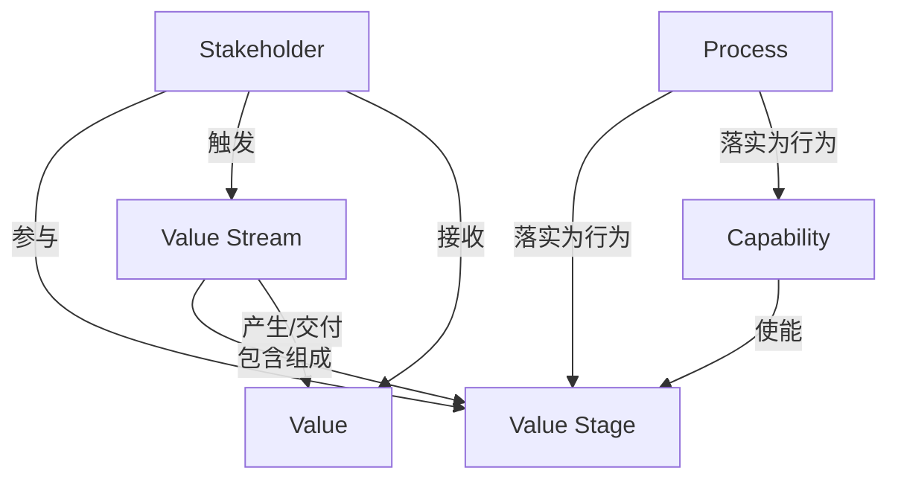

# G178/fig1-2 · 价值流建模关系

类型：`architecture-metamodel`。说明价值流与其他基础业务架构概念（利益相关者、价值、能力、流程）之间的关系，为后文把价值流阶段映射到业务能力（如图 4-3）和业务流程提供概念依据。

英文 PDF 物理页：[13]。本页为架构语义分析，原文与原图分别保留。

## 原图与可编辑图


[完整 JSON](fig1-2.json) · [可编辑 Mermaid](fig1-2.mmd) · [仅关系图](fig1-2.relations.mmd) · [层级分解图](fig1-2.hierarchy.mmd)

图形重建表达语义，不复制源图布局。虚线表示解释、矩阵映射或分组关系，不自动表示不确定性的概率。



## 架构分析

每条连线都按“主语—动词—宾语”读：标签旁的实心三角指向宾语。例如“consists of ▲”位于价值阶段与价值流之间、三角朝上，读作“价值流由价值阶段组成”。线条本身没有箭头。图左侧的利益相关者通过三条线分别连到价值阶段、价值流和价值；右上方的流程与能力通过顶部的横线相连。

- 本图有 6 个具名或隐含元素、8 条关系和 0 条包含/分组记录。
- 本图没有可直接确认为人员直属汇报的关系；视觉上下位置、能力分解和治理职责分别读取。
- Value Stream consists of Value Stage；Capability enables Value Stage；Process operationalizes阶段与能力，三种关系不可合并成同一上下级。
- Stakeholder triggers Value Stream、participates in Value Stage并receives Value。黑三角是关系名称的阅读方向标识，不能当成新的业务节点。
- 6个实体、8个具名关联均核对；黑三角是关系阅读方向，非额外实体或箭头尖端。Process operationalizes Capability/Value Stage、Capability enables Value Stage、Value Stream consists of Value Stage保持不同语义。
- 复核六个实体与八个关系名；保留已有黑三角阅读方向校正，实体连线本身不带箭头尖端。

### 如何用于项目

- 使用本图的实体类型作为建模词表，建立本地实体ID，再分别填入关系端点与证据。
- 核对主动/被动关系的语义方向和基数；实现、使能、使用、包含及实例化分别建模。

### 结构所表达的逻辑

- 利益相关者在价值流中有三个角色：触发价值流（triggers）、参与其中的价值阶段（participates in）、接收最终价值（receives）。
- 价值流由一个或多个价值阶段组成（consists of），整体创造价值（creates）；正文说明价值流的价值是各阶段所交付增量价值项的汇总。
- 能力使能价值阶段（enables）：能力回答“做什么”，价值流回答“价值如何实现”，二者分离但通过“使能”关系联系起来。图 4-3 就是这条关系的实例。
- 流程有两条“落实（operationalizes）”关系：流程落实价值阶段，也落实能力。正文指出阶段到流程不是一对一，一个阶段可映射到一个或多个业务流程。
- 价值流采取由外而内（客户/最终用户）视角，流程更偏内部运营视角且粒度更细（中文稿 L116）。

## 上下级与包含

本图没有容器嵌套。唯一的“整体—部分”关系是价值流由价值阶段组成；其他都是同级概念之间的关联。纵向上，流程与能力位于最上层（实现与使能层），价值阶段、价值流、价值依次在下。

|父项|子项|层级类型|依据与解释|
|---|---|---|---|
|—|—|无视觉包含|关系中明确的组成/特化见 JSON semantic_hierarchy。|

### 业务组成与特化

|父项/范围/类型|子项/责任对象/实例|语义|
|---|---|---|
|价值流|价值阶段（价值流阶段）|composition|

## 全部元素与角色

|元素ID|原文名称|类型|含义|直接父项|深度|
|---|---|---|---|---|---|
|stakeholder|Stakeholder|stakeholder|利益相关者：利益相关者|—||
|value|Value|goal|目标/成果：价值|—||
|value_stream|Value Stream|value_stream|价值流：价值流|—||
|value_stage|Value Stage|value_stream_stage|价值流阶段：价值阶段（价值流阶段）|—||
|process|Process|process|流程：流程|—||
|capability|Capability|capability|能力：能力|—||

## 全部关系

全部为细实线，没有箭头。方向只由标签旁的实心三角（▶▼▲）表示，三角指向关系的宾语（正文明确说明）。关系清单中的 from→to 即按该方向记录的主语→宾语。

|主体|语义关系|客体|显式线/隐式|原文标签|依据|
|---|---|---|---|---|---|
|利益相关者|参与|价值阶段（价值流阶段）|显式连线|participates in|黑三角位于标签旁并与线分离，是关系名称的阅读方向标记；保留语义主语到宾语。|
|利益相关者|触发|价值流|显式连线|triggers|黑三角位于标签旁并与线分离，是关系名称的阅读方向标记；保留语义主语到宾语。|
|利益相关者|接收|价值|显式连线|receives|黑三角位于标签旁并与线分离，是关系名称的阅读方向标记；保留语义主语到宾语。|
|价值流|包含组成|价值阶段（价值流阶段）|显式连线|consists of|黑三角位于标签旁并与线分离，是关系名称的阅读方向标记；保留语义主语到宾语。|
|价值流|产生/交付|价值|显式连线|creates|黑三角位于标签旁并与线分离，是关系名称的阅读方向标记；保留语义主语到宾语。|
|能力|使能|价值阶段（价值流阶段）|显式连线|enables|黑三角位于标签旁并与线分离，是关系名称的阅读方向标记；保留语义主语到宾语。|
|流程|落实为行为|价值阶段（价值流阶段）|显式连线|operationalizes|黑三角位于标签旁并与线分离，是关系名称的阅读方向标记；保留语义主语到宾语。|
|流程|落实为行为|能力|显式连线|operationalizes|黑三角位于标签旁并与线分离，是关系名称的阅读方向标记；保留语义主语到宾语。|

## 本轮语义修正

- 黑三角位于标签旁并与线分离，是关系名称的阅读方向标记；保留语义主语到宾语。
- 黑三角位于标签旁并与线分离，是关系名称的阅读方向标记；保留语义主语到宾语。
- 黑三角位于标签旁并与线分离，是关系名称的阅读方向标记；保留语义主语到宾语。
- 黑三角位于标签旁并与线分离，是关系名称的阅读方向标记；保留语义主语到宾语。
- 黑三角位于标签旁并与线分离，是关系名称的阅读方向标记；保留语义主语到宾语。
- 黑三角位于标签旁并与线分离，是关系名称的阅读方向标记；保留语义主语到宾语。
- 黑三角位于标签旁并与线分离，是关系名称的阅读方向标记；保留语义主语到宾语。
- 黑三角位于标签旁并与线分离，是关系名称的阅读方向标记；保留语义主语到宾语。

## 误读检查

- 不要把标签旁的三角当作连线的箭头或数据流方向，它只表示读法。
- “consists of ▲”的主语是下方的价值流，不是上方的价值阶段。
- 原图写的是“Value Stage（价值阶段）”，即价值流阶段；图中没有组织单元或业务模型（中文稿引用的重绘 SVG 加入了这两个节点）。

## 原文证据

### [PDF 第 12 页](../../../documents/G178.md#page-12)

> As part of the practice of Business Architecture, we separate the concern of what we do (business capability), from who does it (organization), from how value is achieved (value stream), from how it is implemented or performed at an operational level (process), from the information that is needed, from the systems that are used, and so on. Figure 1-2 shows the relationships between value, value streams, and value stream stages (discussed further in the next section), and other foundational Business Architecture concepts.
> For example, Figure 1-2 shows that a Stakeholder receives Value, and that a Value Stream consists of one or more Value Stages (note that the direction of the arrows indicates the object of the relationship in a subject-verb-object grammatical structure).
### [PDF 第 13 页](../../../documents/G178.md#page-13)

> The complete set of value streams depicts the various ways in which an organization orchestrates its capabilities to create stakeholder value. The value stream has a direct linkage to an organization’s business model (specifically to the value proposition). As an organization translates its business model to an operating model, those value stream stages can be translated into business processes. Importantly, this translation (or mapping) is not a direct one-to-one type; a single value stream stage can map to one or more business processes. The process of mapping value stream stages to business processes is a reflection of operating model-level decisions about how to segregate a business model into the various different ways that an organization can structure itself.
> Another way to think about the relationship between value streams and business processes is to consider their viewpoint: value streams take an outside-in perspective – usually a customer or end- user – and show how value gets created and moved around in relation to that stakeholder only. Business processes, on the other hand, tend to have more of an inward-looking, operational-level focus that is primarily concerned with how work gets done – the operational implementation. While some business processes may cover the same stream of activity that forms a value stream, it usually occurs at a much more granular level. That granularity is ideal for optimizing workflow and efficiency (i.e., incrementally improving existing activities), but it is far less suited to answering deeper questions about how a business should serve its customers in such a way that maximizes the value generated along the way.

## 来源与分析状态

所有元素/关系均有来源定位；未把历史解释重命名为本轮逐线视觉确认。源图与语义图是两种视图，布局不证明汇报或因果。

源 PDF SHA-256：`517130a041a8d956b2868dc39d570b84e2d80c64709e4c1368f9747388a3a026`。

源图记录：[原始解释与转录](../../../figures/G178/fig1-2.json)。

```json
{
  "quality": {
    "graph_integrity": "checked",
    "semantic_analysis": "typed-graph-and-context-analysis",
    "visual_review": "source-content-audited",
    "notice_zh": "所有元素/关系均有来源定位；未把历史解释重命名为本轮逐线视觉确认。源图与语义图是两种视图，布局不证明汇报或因果。"
  },
  "source_uncertainty": {
    "confidence": "high",
    "uncertainties_zh": [],
    "analyzed_from": [
      "英文 PDF 第 13 页原图截图（220 dpi）",
      "英文 PDF 第 12 页正文",
      "中文稿 G178e_价值流.md 第 108–116 行",
      "figs/g178_fig1-2.svg 源码"
    ],
    "date": "2026-10-31"
  },
  "source_conflicts": []
}
```
