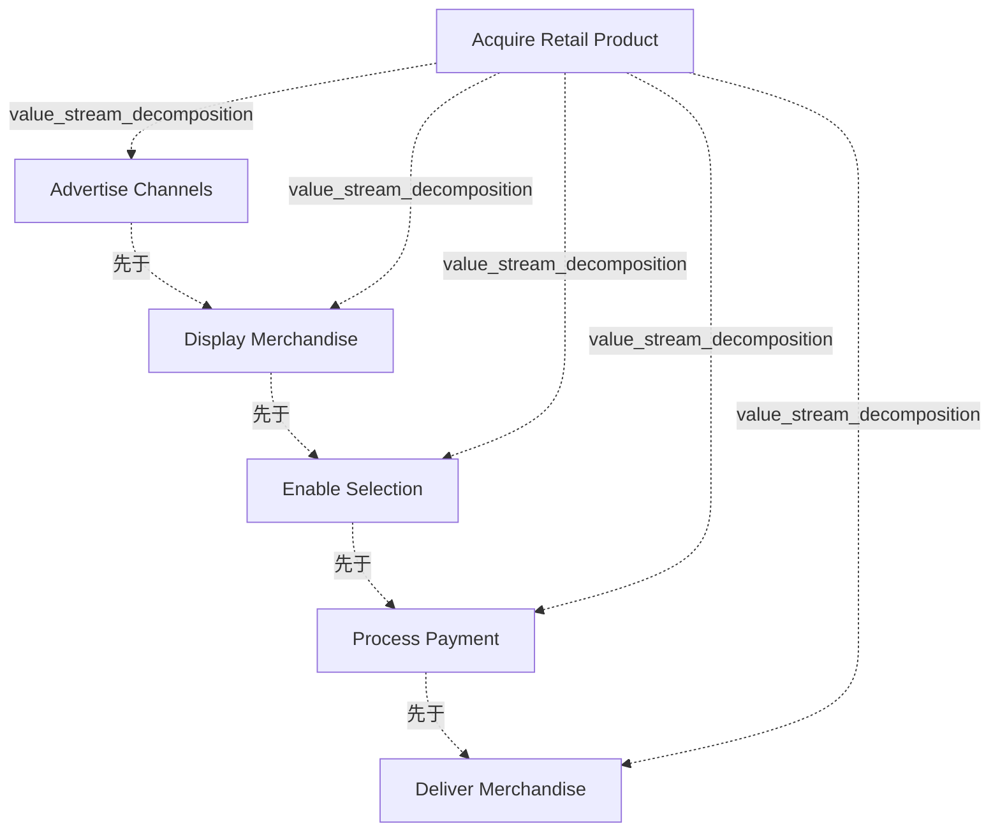

# G178/fig4-1 · 价值流示例

类型：`process-or-method-model`。第 4.1 节“基线示例”把前文方法用到具体例子上，先从外部利益相关者价值流入手：重新展示图 1-1 的“获取零售产品”价值流（即本图），配合表 4-1（价值流定义：名称、描述、利益相关者、价值）和表 4-2（各阶段的描述、参与利益相关者、进入/退出标准、价值项），演示第 2.1、2.2 节的前两步：先定义价值流，再分解为价值创造阶段。正文说明该零售例子同时适用于实体门店和在线网站。更完整的热力图与决策场景随后改用“招聘员工”价值流（图 4-2 起）。

英文 PDF 物理页：[18]。本页为架构语义分析，原文与原图分别保留。

## 原图与可编辑图


[完整 JSON](fig4-1.json) · [可编辑 Mermaid](fig4-1.mmd) · [仅关系图](fig4-1.relations.mmd) · [层级分解图](fig4-1.hierarchy.mmd)

图形重建表达语义，不复制源图布局。虚线表示解释、矩阵映射或分组关系，不自动表示不确定性的概率。



## 架构分析

先读外框左上角的价值流名称“Acquire Retail Product（获取零售产品）”，再从左到右读框内 5 个 V 形箭头，每个箭头是一个价值流阶段。第一个箭头左端是缺口，最后一个箭头右端是尖头，其余箭头的尖端嵌进下一个箭头的缺口，表示紧接的先后顺序。图里没有单独的连线，也没有利益相关者、能力或流程等其他元素。

- 本图有 6 个具名或隐含元素、4 条关系和 5 条包含/分组记录。
- 包含/分组树最大深度为 1；根节点为 获取零售产品（价值流）。
- 本图没有可直接确认为人员直属汇报的关系；视觉上下位置、能力分解和治理职责分别读取。
- 完整核对零售价值流标题、五阶段名称和从左到右的chevron顺序。
- V形块用于阶段次序；不把顺序误作具体业务流程、角色或能力映射。

### 如何用于项目

- 按阶段/事件/行为关系读取入口、出口、责任和产物；检查循环与例外路径。
- 工作流先后不表示组织管理权；在项目中显式记录条件和完成标准。

### 结构所表达的逻辑

- 价值流用“动词—名词”命名，从触发方利益相关者（这里是零售顾客）的视角表述；“获取零售产品”是本指南贯穿使用的两个价值流示例之一（另一个是“招聘员工”，见图 4-2）。
- 价值流的 5 个阶段按顺序排列：广告渠道 → 展示商品 → 启用选择 → 处理付款 → 交付商品；阶段名用两三个词说明该阶段达成什么（第 2.2 节规则）。
- 每个阶段逐步累加利益相关者价值；表 4-2 给出各阶段的价值项，依次为：客户可获得零售渠道、客户获得产品选项、定位到所需产品、交付承诺、客户占有产品。
- 前一阶段的退出标准就是后一阶段的进入标准（第 2.2 节），表 4-2 中依次衔接：客户选择渠道 → 客户查看产品 → 客户选定产品 → 款项已支付 → 产品已交付。
- 这是外部触发的价值流（零售客户购买商品）；正文用“经理招聘新员工”作为内部触发价值流的对照，后者就是第 4.2 节的“招聘员工”价值流。
- 首尾相接的箭头不代表一旦开始就必须走完：正文指出每个阶段之后都可以停止，例如顾客看到价格后决定不买了。
- 图中只画阶段，不画执行阶段所需的流程、角色、信息或技术，也还没有映射业务能力；能力映射在第 2.3 节和第 4.2 节（图 4-3）才做。

## 上下级与包含

两层。第 0 层是外框代表的“获取零售产品”价值流；第 1 层是框内的 5 个价值流阶段，通过视觉包含表达“价值流由价值阶段组成”。阶段之间是同级的先后关系，没有更深的分解。

|父项|子项|层级类型|依据与解释|
|---|---|---|---|
|获取零售产品（价值流）|广告渠道|value_stream_decomposition|价值流包含阶段；具体先后另看sequence关系。|
|获取零售产品（价值流）|展示商品|value_stream_decomposition|价值流包含阶段；具体先后另看sequence关系。|
|获取零售产品（价值流）|启用选择|value_stream_decomposition|价值流包含阶段；具体先后另看sequence关系。|
|获取零售产品（价值流）|处理付款|value_stream_decomposition|价值流包含阶段；具体先后另看sequence关系。|
|获取零售产品（价值流）|交付商品|value_stream_decomposition|价值流包含阶段；具体先后另看sequence关系。|

## 全部元素与角色

|元素ID|原文名称|类型|含义|直接父项|深度|
|---|---|---|---|---|---|
|vs_acquire_retail|Acquire Retail Product|value_stream|触发方利益相关者：希望购买产品的零售顾客；价值：客户能找到所需产品并及时获得（表 4-1）。|—||
|st_advertise|Advertise Channels|value_stream_stage|让客户知道公司产品的行为；进入标准：客户搜索产品；退出标准：客户选择渠道；价值项：客户可获得零售渠道（表 4-2）。|获取零售产品（价值流）|1|
|st_display|Display Merchandise|value_stream_stage|以实体或可搜索的数字形式呈现产品；进入：客户选择渠道；退出：客户查看产品；价值项：客户获得产品选项。|获取零售产品（价值流）|1|
|st_enable_selection|Enable Selection|value_stream_stage|帮助客户筛选和评估最符合需求的产品；进入：客户查看产品；退出：客户选定产品；价值项：定位到所需产品。|获取零售产品（价值流）|1|
|st_process_payment|Process Payment|value_stream_stage|收取并处理客户付款；进入：客户选定产品；退出：款项已支付；价值项：交付承诺。|获取零售产品（价值流）|1|
|st_deliver|Deliver Merchandise|value_stream_stage|把产品交到客户手中；进入：款项已支付；退出：产品已交付；价值项：客户占有产品。|获取零售产品（价值流）|1|

## 全部关系

图中没有独立的连线。V 形箭头本身就是阶段，箭头尖端嵌进下一阶段的缺口，表示先后顺序（关系清单中记为 sequence）；外框只表示这些阶段属于同一条价值流（用 parent 表示）。

|主体|语义关系|客体|显式线/隐式|原文标签|依据|
|---|---|---|---|---|---|
|广告渠道|先于|展示商品|chevron-shape||相邻V形阶段块的尖角表达顺序，原图没有单独画四条连接线。|
|展示商品|先于|启用选择|chevron-shape||相邻V形阶段块的尖角表达顺序，原图没有单独画四条连接线。|
|启用选择|先于|处理付款|chevron-shape||相邻V形阶段块的尖角表达顺序，原图没有单独画四条连接线。|
|处理付款|先于|交付商品|chevron-shape||相邻V形阶段块的尖角表达顺序，原图没有单独画四条连接线。|

## 本轮语义修正

- 相邻V形阶段块的尖角表达顺序，原图没有单独画四条连接线。
- 相邻V形阶段块的尖角表达顺序，原图没有单独画四条连接线。
- 相邻V形阶段块的尖角表达顺序，原图没有单独画四条连接线。
- 相邻V形阶段块的尖角表达顺序，原图没有单独画四条连接线。

## 误读检查

- V 形箭头是阶段本身，不是阶段之间的流转线，也不表示物流或数据流。
- 阶段首尾相接不表示必须连续走完，每个阶段之后都可能停止。
- 价值流阶段不是业务流程：一个阶段可以映射到一个或多个业务流程，流程的粒度更细（第 1.4 节）。
- “广告渠道（Advertise Channels）”指“让客户知道有哪些零售渠道可用”的行为（价值项是“客户可获得零售渠道”），不是指投放广告的媒体渠道；“启用选择（Enable Selection）”指帮助客户筛选和评估产品。
- 中文稿引用的 SVG 底部写着“外箭头表示端到端流向”，原图和 SVG 中都没有外箭头；原图用灰色外框表示价值流整体。
- 中文稿 L197 写“下文重绘为图 4-1”，英文原文是“shown below as Figure 4-1”，图 4-1 与图 1-1 是同一张图原样复用，并非重绘。

## 原文证据

### [PDF 第 12 页](../../../documents/G178.md#page-12)

> The approach to value analysis that is used in Business Architecture is derived from James Martin’s The Great Transition: Using the Seven Disciplines of Enterprise Engineering to Align People, Technology, and Strategy [Martin, 1995]. The value stream (a simple example of which is shown in Figure 1-1) is depicted as an end-to-end collection of value-adding activities that create an overall result for a customer, stakeholder, or end-user. In modeling terms, those value-adding activities are represented by value stream stages, each of which creates and adds incremental stakeholder value from one stage to the next.
> Value streams may be externally triggered, such as a retail customer acquiring some merchandise, as shown in the example above. Value streams may also be internally triggered, such as a manager obtaining a new hire. Value streams may be defined at an enterprise level or at a business unit level. Either way, the complete set of value streams (as depicted in a value stream diagram or map) is simply the visual representation of all the value streams that denote an organization’s primary set of business activities. It is an aggregation of the multiple ways in which the enterprise creates value for its various stakeholders.
### [PDF 第 16 页](../../../documents/G178.md#page-16)

> Stakeholder value is rarely produced as the result of a single step or activity. More often, value is achieved through a series of sequential and/or parallel actions, or value stream stages, that incrementally create and add stakeholder value from one stage to the next.
> 1. Name – Two to three words identifying what is (or will be) achieved by this stage
### [PDF 第 18 页](../../../documents/G178.md#page-18)

> We start with an external stakeholder value stream – the Acquire Retail Product value stream introduced in Figure 1-1 (shown below as Figure 4-1). A more comprehensive scenario that includes heat-mapping and decision-making processes uses the Recruit Employee value stream that was first introduced in the TOGAF® Series Guide: Business Capabilities.
> The first step is to define the value stream (see Table 4-1), as discussed in Section 2.1:
### [PDF 第 19 页](../../../documents/G178.md#page-19)

> The second example focuses on creating internal business value via the activity of recruiting employees to join the business; see Table 4-3. It provides a more detailed example of mapping value stream stages to business capabilities and performing a gap analysis.
> How would a business determine whether this was an important value stream, worth the effort to model and apply to business decisions? It may result from a specific need or pain point that the business is currently suffering such as inefficiencies associated with disparate activities related to recruitment, or it may be part of a strategic assessment at an enterprise level to identify and document all of the core value streams for the company.

## 来源与分析状态

所有元素/关系均有来源定位；未把历史解释重命名为本轮逐线视觉确认。源图与语义图是两种视图，布局不证明汇报或因果。

源 PDF SHA-256：`517130a041a8d956b2868dc39d570b84e2d80c64709e4c1368f9747388a3a026`。

源图记录：[原始解释与转录](../../../figures/G178/fig4-1.json)。

```json
{
  "quality": {
    "graph_integrity": "checked",
    "semantic_analysis": "typed-graph-and-context-analysis",
    "visual_review": "source-content-audited",
    "notice_zh": "所有元素/关系均有来源定位；未把历史解释重命名为本轮逐线视觉确认。源图与语义图是两种视图，布局不证明汇报或因果。"
  },
  "source_uncertainty": {
    "confidence": "high",
    "uncertainties_zh": [],
    "analyzed_from": [
      "英文 PDF 第 18 页原图截图（220 dpi），与第 12 页图 1-1 截图逐项比对，内容相同",
      "英文 PDF 第 18、19 页正文（表 4-1、表 4-2），第 12、15、16 页正文",
      "中文稿 G178e_价值流.md 第 195–222 行",
      "figs/g178_fig1-1.svg 源码（与图 1-1 共用同一 SVG）",
      "G233/fig6-3 原图截图（仅用于核对图间关系）"
    ],
    "date": "2026-10-31"
  },
  "source_conflicts": []
}
```
