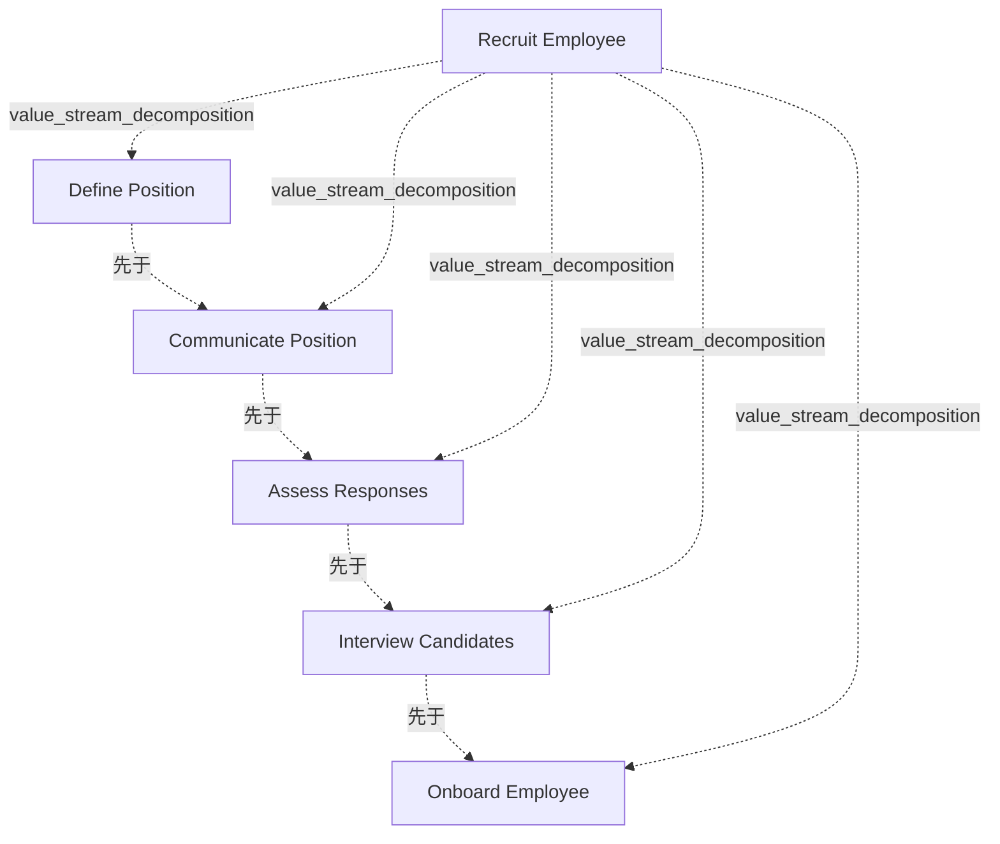

# G178/fig4-2 · 招聘员工价值流

类型：`process-or-method-model`。第 4.2 节用它展示一轮轮迭代建模后得到的价值流图：业务利益相关者与主题专家先画草案，经业务架构师指导细化，得到只含阶段的价值流。随后的步骤都以它为基础：表 4-4 为每个阶段补充定义、参与利益相关者和价值项，图 4-3 把业务能力映射到这 5 个阶段，图 4-4 再做热力图。与图 1-1 的零售例子不同，这是一个内部触发、创造内部业务价值的价值流。

英文 PDF 物理页：[20]。本页为架构语义分析，原文与原图分别保留。

## 原图与可编辑图


[完整 JSON](fig4-2.json) · [可编辑 Mermaid](fig4-2.mmd) · [仅关系图](fig4-2.relations.mmd) · [层级分解图](fig4-2.hierarchy.mmd)

图形重建表达语义，不复制源图布局。虚线表示解释、矩阵映射或分组关系，不自动表示不确定性的概率。



## 架构分析

先读外框左上角的价值流名称“Recruit Employee（招聘员工）”，再从左到右读框内 5 个 V 形箭头，每个箭头是一个价值流阶段，箭头尖端嵌进下一个箭头的缺口表示紧接的先后顺序。图中没有连线、利益相关者、能力或流程。

- 本图有 6 个具名或隐含元素、4 条关系和 5 条包含/分组记录。
- 包含/分组树最大深度为 1；根节点为 招聘员工（价值流）。
- 本图没有可直接确认为人员直属汇报的关系；视觉上下位置、能力分解和治理职责分别读取。
- 完整核对招聘价值流标题、五阶段名称和从左到右的chevron顺序。
- V形块用于阶段次序；不把顺序误作具体业务流程、角色或能力映射。

### 如何用于项目

- 按阶段/事件/行为关系读取入口、出口、责任和产物；检查循环与例外路径。
- 工作流先后不表示组织管理权；在项目中显式记录条件和完成标准。

### 结构所表达的逻辑

- 价值流定义（表 4-3）：识别并聘用合适合格员工的活动；触发方利益相关者是想填补特定岗位的招聘经理；价值是与岗位匹配、快速聘用并高效工作的新员工。
- 5 个阶段依次为：定义岗位 → 发布职位 → 评估应聘 → 面试候选人 → 入职；阶段名采用“动词—名词”短语。
- 阶段通过退出/进入标准首尾衔接（表 4-4）：识别招聘需求 → 职位已发布 → 选出合格回应 → 作出录用决定 → 员工完成入职。
- 价值流图只描述产生预期业务影响的阶段，不规定执行阶段所需的流程、角色、信息或技术，也独立于所需的业务能力和对现状表现的评估（正文第 4.2 节）。
- 本图是迭代建模的结果：第一轮可能发现缺少能覆盖端到端的专家，需要在业务架构师指导下反复细化后才得到。
- “入职”阶段在表 4-4 中被描述为发出录用通知后触发一个内嵌的价值流，覆盖让员工融入工作环境的全部活动；第 4.3 节的热力图分析据此提出要新建一个从属价值流（图 4-4）。
- 本价值流是第 4.2、4.3 节能力映射（图 4-3）与热力图（图 4-4）的底图；正文说明它最早出自《TOGAF 系列指南：业务能力》。

## 上下级与包含

两层。第 0 层是外框代表的“招聘员工”价值流；第 1 层是框内的 5 个价值流阶段，通过视觉包含表达“价值流由价值阶段组成”。“入职”阶段内嵌的从属价值流在本图中没有画出。

|父项|子项|层级类型|依据与解释|
|---|---|---|---|
|招聘员工（价值流）|定义岗位|value_stream_decomposition|价值流包含阶段；具体先后另看sequence关系。|
|招聘员工（价值流）|发布职位|value_stream_decomposition|价值流包含阶段；具体先后另看sequence关系。|
|招聘员工（价值流）|评估应聘|value_stream_decomposition|价值流包含阶段；具体先后另看sequence关系。|
|招聘员工（价值流）|面试候选人|value_stream_decomposition|价值流包含阶段；具体先后另看sequence关系。|
|招聘员工（价值流）|入职|value_stream_decomposition|价值流包含阶段；具体先后另看sequence关系。|

## 全部元素与角色

|元素ID|原文名称|类型|含义|直接父项|深度|
|---|---|---|---|---|---|
|vs_recruit|Recruit Employee|value_stream|触发方利益相关者：想填补特定岗位的招聘经理；价值：与岗位匹配、快速聘用并高效工作的新员工（表 4-3）。|—||
|st_define|Define Position|value_stream_stage|确定用人需求、识别技能与资格并形成文档；参与者：招聘经理、HR 招聘负责人；进入：识别出人员变动；退出：识别招聘需求；价值项：节省搜寻候选人的时间与费用（表 4-4）。|招聘员工（价值流）|1|
|st_communicate|Communicate Position|value_stream_stage|向可用的招聘门户和招聘活动刊登、发布或发送职位信息；参与者：招聘专员；退出：职位已发布；价值项：找到合格候选人的可能性高。|招聘员工（价值流）|1|
|st_assess|Assess Responses|value_stream_stage|接收、登记、分发并评分候选人回应及附加核查；参与者：招聘经理、招聘专员；退出：选出合格回应；价值项：有效利用面试时间与成本。|招聘员工（价值流）|1|
|st_interview|Interview Candidates|value_stream_stage|与候选人沟通、安排交通、排期并开展面试；参与者：招聘经理、候选人、员工；退出：作出录用决定；价值项：选出最合适的员工。|招聘员工（价值流）|1|
|st_onboard|Onboard Employee|value_stream_stage|发出录用通知并触发内嵌的价值流，处理员工融入工作环境的全部活动；参与者：员工、HR、安全、设施、财务、IT；进入：已作出录用决定；退出：员工完成入职；价值项：生产力就绪、能满足业务承诺的员工队伍。|招聘员工（价值流）|1|

## 全部关系

图中没有独立的连线。V 形箭头本身就是阶段，箭头尖端嵌进下一阶段的缺口，表示先后顺序（关系清单中记为 sequence）；外框只表示这些阶段属于同一条价值流（用 parent 表示）。

|主体|语义关系|客体|显式线/隐式|原文标签|依据|
|---|---|---|---|---|---|
|定义岗位|先于|发布职位|chevron-shape||相邻V形阶段块的尖角表达顺序，原图没有单独画四条连接线。|
|发布职位|先于|评估应聘|chevron-shape||相邻V形阶段块的尖角表达顺序，原图没有单独画四条连接线。|
|评估应聘|先于|面试候选人|chevron-shape||相邻V形阶段块的尖角表达顺序，原图没有单独画四条连接线。|
|面试候选人|先于|入职|chevron-shape||相邻V形阶段块的尖角表达顺序，原图没有单独画四条连接线。|

## 本轮语义修正

- 相邻V形阶段块的尖角表达顺序，原图没有单独画四条连接线。
- 相邻V形阶段块的尖角表达顺序，原图没有单独画四条连接线。
- 相邻V形阶段块的尖角表达顺序，原图没有单独画四条连接线。
- 相邻V形阶段块的尖角表达顺序，原图没有单独画四条连接线。

## 误读检查

- V 形箭头是阶段本身，不是阶段之间的流转线。
- 阶段首尾相接不表示必须连续走完，每个阶段之后都可能停止（第 2.2 节）。
- 阶段不是部门职责或业务流程，图中没有表示由谁执行或怎样执行。
- 第 5 阶段原图为“Onboard Employee”；中文稿引用的 SVG 写成“Onboard”，并加了一行原图没有的注释。

## 原文证据

### [PDF 第 18 页](../../../documents/G178.md#page-18)

> The second step involves decomposing the value stream into a sequence of value-creating stages. Table 4-2 lists the key elements of each value stream stage, including a description, the participating stakeholders, entry criteria, exit criteria, and the value delivered from each stage. This retail example deals with physical storefronts as well as online sites, so the terms used could apply to either channel or type of customer interaction.
### [PDF 第 19 页](../../../documents/G178.md#page-19)

> The second example focuses on creating internal business value via the activity of recruiting employees to join the business; see Table 4-3. It provides a more detailed example of mapping value stream stages to business capabilities and performing a gap analysis.
> How would a business determine whether this was an important value stream, worth the effort to model and apply to business decisions? It may result from a specific need or pain point that the business is currently suffering such as inefficiencies associated with disparate activities related to recruitment, or it may be part of a strategic assessment at an enterprise level to identify and document all of the core value streams for the company.
### [PDF 第 20 页](../../../documents/G178.md#page-20)

> This first round of modeling may expose the fact that key experts who can cover the full, end-to-end value stream are missing from the room, so the modeling process will have to be done iteratively. As further refinement and alignment is achieved (usually with guidance from the Business Architect to ensure adherence to proven principles and rules), a value stream diagram such as the example shown in Figure 4-2 emerges.

## 来源与分析状态

所有元素/关系均有来源定位；未把历史解释重命名为本轮逐线视觉确认。源图与语义图是两种视图，布局不证明汇报或因果。

源 PDF SHA-256：`517130a041a8d956b2868dc39d570b84e2d80c64709e4c1368f9747388a3a026`。

源图记录：[原始解释与转录](../../../figures/G178/fig4-2.json)。

```json
{
  "quality": {
    "graph_integrity": "checked",
    "semantic_analysis": "typed-graph-and-context-analysis",
    "visual_review": "source-content-audited",
    "notice_zh": "所有元素/关系均有来源定位；未把历史解释重命名为本轮逐线视觉确认。源图与语义图是两种视图，布局不证明汇报或因果。"
  },
  "source_uncertainty": {
    "confidence": "high",
    "uncertainties_zh": [
      "表 4-4 中“定义岗位”的参与者在 PDF 中分两行排为“HR Recruitment / Lead”，按版式理解为一个角色“HR 招聘负责人”；中文稿译成“人力资源、招聘负责人”两个角色，两种读法都有可能。"
    ],
    "analyzed_from": [
      "英文 PDF 第 20 页原图截图（220 dpi）",
      "英文 PDF 第 18–22 页正文（表 4-3、表 4-4、第 4.3 节）",
      "中文稿 G178e_价值流.md 第 226–252 行",
      "figs/g178_fig4-2.svg 源码",
      "G211/fig5-3、G233/figC-1 原图截图（仅用于核对图间关系）"
    ],
    "date": "2026-10-31"
  },
  "source_conflicts": []
}
```
