# G178/fig4-3 · 价值流阶段到业务能力的交叉映射

类型：`mapping-or-assessment-matrix`。示范第 4.2 节的做法：按顺序走查每个价值流阶段，挑出对该阶段最关键的业务能力；当某个一级能力下只有部分二级能力参与时，要把这些二级能力显式画出。正文称该映射针对的是目标（未来态）价值流，并作为第 4.3 节热力图分析（图 4-4）的底图。

英文 PDF 物理页：[21]。本页为架构语义分析，原文与原图分别保留。

## 原图与可编辑图


[完整 JSON](fig4-3.json) · [可编辑 Mermaid](fig4-3.mmd) · [仅关系图](fig4-3.relations.mmd) · [层级分解图](fig4-3.hierarchy.mmd)

图形重建表达语义，不复制源图布局。虚线表示解释、矩阵映射或分组关系，不自动表示不确定性的概率。

```mermaid
flowchart TB
  %% Semantic reconstruction; see original source image for exact layout.
  n0["Recruit Employee (value stream)"]
  n1["Define Position"]
  n2["Communicate Position"]
  n3["Assess Responses"]
  n4["Interview Candidates"]
  n5["Onboard Employee"]
  n6["Program Mgmt."]
  n7["HR Mgmt."]
  n8["Finance Mgmt."]
  n9["Agreement Mgmt."]
  n10["Asset Mgmt."]
  n11["Facilities Mgmt."]
  n12["Security Mgmt."]
  n13["Information Mgmt."]
  n14["Program/Human Resource Matching"]
  n15["Competency Mgmt."]
  n16["Employee Supply and Demand Mgmt."]
  n17["Position Advertising"]
  n18["Skills Assessment"]
  n19["Benefits Management"]
  n20["Terms Management"]
  n21["Compensation Mgmt."]
  n22["Onboard Tracking"]
  n23["Labor Funding"]
  n24["Agreement Structuring"]
  n25["Asset Allocation"]
  n26["Space Allocation"]
  n27["Employee Background and ID"]
  n28["Employee Information Mgmt."]
  n1 -.->|"先于"| n2
  n2 -.->|"先于"| n3
  n3 -.->|"先于"| n4
  n4 -.->|"先于"| n5
  n14 -.->|"使能"| n1
  n15 -.->|"使能"| n1
  n16 -.->|"使能"| n2
  n17 -.->|"使能"| n2
  n23 -.->|"使能"| n2
  n16 -.->|"使能"| n3
  n18 -.->|"使能"| n3
  n19 -.->|"使能"| n4
  n20 -.->|"使能"| n4
  n21 -.->|"使能"| n4
  n24 -.->|"使能"| n4
  n22 -.->|"使能"| n5
  n25 -.->|"使能"| n5
  n26 -.->|"使能"| n5
  n27 -.->|"使能"| n5
  n28 -.->|"使能"| n5
  n0 -.->|"value_stream_decomposition"| n1
  n0 -.->|"value_stream_decomposition"| n2
  n0 -.->|"value_stream_decomposition"| n3
  n0 -.->|"value_stream_decomposition"| n4
  n0 -.->|"value_stream_decomposition"| n5
  n6 -.->|"capability_decomposition"| n14
  n7 -.->|"capability_decomposition"| n15
  n7 -.->|"capability_decomposition"| n16
  n7 -.->|"capability_decomposition"| n17
  n7 -.->|"capability_decomposition"| n18
  n7 -.->|"capability_decomposition"| n19
  n7 -.->|"capability_decomposition"| n20
  n7 -.->|"capability_decomposition"| n21
  n7 -.->|"capability_decomposition"| n22
  n8 -.->|"capability_decomposition"| n23
  n9 -.->|"capability_decomposition"| n24
  n10 -.->|"capability_decomposition"| n25
  n11 -.->|"capability_decomposition"| n26
  n12 -.->|"capability_decomposition"| n27
  n13 -.->|"capability_decomposition"| n28
```



## 架构分析

从左到右读顶部的 5 个 V 形箭头，这是价值流阶段的先后顺序。每个箭头正下方那一列灰框，是使能该阶段的能力：灰框左上角的粗体字是一级能力，框内深灰色条是该一级能力下被选中的二级能力。同一列内的灰框是并列关系，上下次序没有含义。图中没有连线，能力与阶段的对应关系完全由“在哪一列”表达。

- 本图有 29 个具名或隐含元素、20 条关系和 20 条包含/分组记录。
- 包含/分组树最大深度为 1；根节点为 招聘员工（价值流）、项目群管理、人力资源管理、财务管理、协议管理、资产管理、设施管理、安全管理、信息管理。
- 本图没有可直接确认为人员直属汇报的关系；视觉上下位置、能力分解和治理职责分别读取。
- 逐列核对所有一级/二级能力和阶段对应；同一业务能力可以出现在多列，列位置表达映射。
- 灰色条不表示成熟度或缺口数值。

### 如何用于项目

- 先固定行、列所代表的维度及单元格含义，再登记有证据的映射或评分。
- 空白、无关系、未测量和不适用分别处理；颜色不自动等于优先级。

### 结构所表达的逻辑

- 价值流本身是有序的 5 个阶段：定义岗位 → 发布职位 → 评估应聘 → 面试候选人 → 入职；每个阶段的进入/退出标准与价值项见中文稿表 4-4。
- 人力资源管理是贯穿型一级能力，5 个阶段都出现，但每个阶段调用的二级能力不同：胜任力管理（定义）、员工供需管理与职位广告（发布）、员工供需管理与技能评估（评估）、福利/条款/薪酬管理（面试）、入职跟踪（入职）。
- 同一个二级能力可以支撑多个阶段：员工供需管理同时出现在“发布职位”和“评估应聘”下面；能力与阶段是多对多关系。
- “入职”阶段涉及的一级能力最多（人力资源、资产、设施、安全、信息管理 5 项），是跨职能协作最重的阶段；第 4.3 节热力图分析找到的根因（无人统筹整个入职序列）就出在这里。
- 图中只画部分二级能力，表示只有这些子能力直接参与该阶段；如果某个一级能力下的全部二级能力都参与，按正文规则只画一级能力即可。
- 本图只表达“能力使能阶段”的对应关系，不表达能力的成熟度或差距；差距着色在图 4-4 中才引入，图 4-4 还在“定义岗位”下新增了“政策发布”能力。
- 正文指出这里的能力大多是“支撑型”能力（相对于面向客户的能力和战略能力），与销售产品/服务相关的价值流通常会映射到更多其他层级的能力。

## 上下级与包含

共三层。第 1 层是“招聘员工”价值流（由 5 个阶段整体隐含表示，图中没有单独的框）；第 2 层是 5 个价值流阶段；业务能力自身又分一级能力（灰框）和二级能力（框内深灰条），二级能力嵌套在所属一级能力之内。业务能力与阶段之间是映射（使能）关系，不是上下级关系。

|父项|子项|层级类型|依据与解释|
|---|---|---|---|
|招聘员工（价值流）|定义岗位|value_stream_decomposition|价值流包含阶段；具体先后另看sequence关系。|
|招聘员工（价值流）|发布职位|value_stream_decomposition|价值流包含阶段；具体先后另看sequence关系。|
|招聘员工（价值流）|评估应聘|value_stream_decomposition|价值流包含阶段；具体先后另看sequence关系。|
|招聘员工（价值流）|面试候选人|value_stream_decomposition|价值流包含阶段；具体先后另看sequence关系。|
|招聘员工（价值流）|入职|value_stream_decomposition|价值流包含阶段；具体先后另看sequence关系。|
|项目群管理|项目群/人力资源匹配|capability_decomposition|同类能力的包含分解；能力实例与能力类型另以实例化关系记录。|
|人力资源管理|胜任力管理|capability_decomposition|同类能力的包含分解；能力实例与能力类型另以实例化关系记录。|
|人力资源管理|员工供需管理|capability_decomposition|同类能力的包含分解；能力实例与能力类型另以实例化关系记录。|
|人力资源管理|职位广告|capability_decomposition|同类能力的包含分解；能力实例与能力类型另以实例化关系记录。|
|人力资源管理|技能评估|capability_decomposition|同类能力的包含分解；能力实例与能力类型另以实例化关系记录。|
|人力资源管理|福利管理|capability_decomposition|同类能力的包含分解；能力实例与能力类型另以实例化关系记录。|
|人力资源管理|雇佣条款管理|capability_decomposition|同类能力的包含分解；能力实例与能力类型另以实例化关系记录。|
|人力资源管理|薪酬管理|capability_decomposition|同类能力的包含分解；能力实例与能力类型另以实例化关系记录。|
|人力资源管理|入职跟踪|capability_decomposition|同类能力的包含分解；能力实例与能力类型另以实例化关系记录。|
|财务管理|人工经费|capability_decomposition|同类能力的包含分解；能力实例与能力类型另以实例化关系记录。|
|协议管理|协议架构设计|capability_decomposition|同类能力的包含分解；能力实例与能力类型另以实例化关系记录。|
|资产管理|资产分配|capability_decomposition|同类能力的包含分解；能力实例与能力类型另以实例化关系记录。|
|设施管理|空间分配|capability_decomposition|同类能力的包含分解；能力实例与能力类型另以实例化关系记录。|
|安全管理|员工背景调查与身份|capability_decomposition|同类能力的包含分解；能力实例与能力类型另以实例化关系记录。|
|信息管理|员工信息管理|capability_decomposition|同类能力的包含分解；能力实例与能力类型另以实例化关系记录。|

## 全部元素与角色

|元素ID|原文名称|类型|含义|直接父项|深度|
|---|---|---|---|---|---|
|vs_recruit|Recruit Employee (value stream)|value_stream|图中未单独画出，由 5 个阶段整体表示；名称来自图 4-2 与正文。|—||
|st_define|Define Position|value_stream_stage|价值流阶段：定义岗位|招聘员工（价值流）|1|
|st_communicate|Communicate Position|value_stream_stage|价值流阶段：发布职位|招聘员工（价值流）|1|
|st_assess|Assess Responses|value_stream_stage|价值流阶段：评估应聘|招聘员工（价值流）|1|
|st_interview|Interview Candidates|value_stream_stage|价值流阶段：面试候选人|招聘员工（价值流）|1|
|st_onboard|Onboard Employee|value_stream_stage|价值流阶段：入职|招聘员工（价值流）|1|
|c_program|Program Mgmt.|capability|能力：项目群管理|—||
|c_hr|HR Mgmt.|capability|在 5 个阶段下都出现。|—||
|c_finance|Finance Mgmt.|capability|能力：财务管理|—||
|c_agreement|Agreement Mgmt.|capability|能力：协议管理|—||
|c_asset|Asset Mgmt.|capability|能力：资产管理|—||
|c_facilities|Facilities Mgmt.|capability|能力：设施管理|—||
|c_security|Security Mgmt.|capability|能力：安全管理|—||
|c_information|Information Mgmt.|capability|能力：信息管理|—||
|c_prog_hr_match|Program/Human Resource Matching|capability|能力：项目群/人力资源匹配|项目群管理|1|
|c_competency|Competency Mgmt.|capability|能力：胜任力管理|人力资源管理|1|
|c_supply_demand|Employee Supply and Demand Mgmt.|capability|同时支撑“发布职位”和“评估应聘”。|人力资源管理|1|
|c_position_ad|Position Advertising|capability|能力：职位广告|人力资源管理|1|
|c_skills_assess|Skills Assessment|capability|能力：技能评估|人力资源管理|1|
|c_benefits|Benefits Management|capability|能力：福利管理|人力资源管理|1|
|c_terms|Terms Management|capability|能力：雇佣条款管理|人力资源管理|1|
|c_compensation|Compensation Mgmt.|capability|能力：薪酬管理|人力资源管理|1|
|c_onboard_track|Onboard Tracking|capability|能力：入职跟踪|人力资源管理|1|
|c_labor_funding|Labor Funding|capability|能力：人工经费|财务管理|1|
|c_agreement_struct|Agreement Structuring|capability|能力：协议架构设计|协议管理|1|
|c_asset_alloc|Asset Allocation|capability|能力：资产分配|资产管理|1|
|c_space_alloc|Space Allocation|capability|能力：空间分配|设施管理|1|
|c_background_id|Employee Background and ID|capability|能力：员工背景调查与身份|安全管理|1|
|c_employee_info|Employee Information Mgmt.|capability|能力：员工信息管理|信息管理|1|

## 全部关系

图中没有任何连线。V 形箭头首尾相接表示阶段的先后顺序；能力与阶段之间的使能关系由“灰框位于哪个阶段的正下方”隐含表达（关系清单中标为“推断”）；二级能力与一级能力的上下级由框内嵌套表达。这里的“能力位于阶段下方”对应图 1-2 元模型中的“Capability enables Value Stage（能力使能价值阶段）”关系。

|主体|语义关系|客体|显式线/隐式|原文标签|依据|
|---|---|---|---|---|---|
|定义岗位|先于|发布职位|chevron-shape||五个V形阶段块构成阅读顺序，未画独立阶段连线。|
|发布职位|先于|评估应聘|chevron-shape||五个V形阶段块构成阅读顺序，未画独立阶段连线。|
|评估应聘|先于|面试候选人|chevron-shape||五个V形阶段块构成阅读顺序，未画独立阶段连线。|
|面试候选人|先于|入职|chevron-shape||五个V形阶段块构成阅读顺序，未画独立阶段连线。|
|项目群/人力资源匹配|使能|定义岗位|implicit||能力框位于对应价值流阶段列下方；按正文映射语义表示使能，不把列位置当作有箭头连线。|
|胜任力管理|使能|定义岗位|implicit||能力框位于对应价值流阶段列下方；按正文映射语义表示使能，不把列位置当作有箭头连线。|
|员工供需管理|使能|发布职位|implicit||能力框位于对应价值流阶段列下方；按正文映射语义表示使能，不把列位置当作有箭头连线。|
|职位广告|使能|发布职位|implicit||能力框位于对应价值流阶段列下方；按正文映射语义表示使能，不把列位置当作有箭头连线。|
|人工经费|使能|发布职位|implicit||能力框位于对应价值流阶段列下方；按正文映射语义表示使能，不把列位置当作有箭头连线。|
|员工供需管理|使能|评估应聘|implicit||能力框位于对应价值流阶段列下方；按正文映射语义表示使能，不把列位置当作有箭头连线。|
|技能评估|使能|评估应聘|implicit||能力框位于对应价值流阶段列下方；按正文映射语义表示使能，不把列位置当作有箭头连线。|
|福利管理|使能|面试候选人|implicit||能力框位于对应价值流阶段列下方；按正文映射语义表示使能，不把列位置当作有箭头连线。|
|雇佣条款管理|使能|面试候选人|implicit||能力框位于对应价值流阶段列下方；按正文映射语义表示使能，不把列位置当作有箭头连线。|
|薪酬管理|使能|面试候选人|implicit||能力框位于对应价值流阶段列下方；按正文映射语义表示使能，不把列位置当作有箭头连线。|
|协议架构设计|使能|面试候选人|implicit||能力框位于对应价值流阶段列下方；按正文映射语义表示使能，不把列位置当作有箭头连线。|
|入职跟踪|使能|入职|implicit||能力框位于对应价值流阶段列下方；按正文映射语义表示使能，不把列位置当作有箭头连线。|
|资产分配|使能|入职|implicit||能力框位于对应价值流阶段列下方；按正文映射语义表示使能，不把列位置当作有箭头连线。|
|空间分配|使能|入职|implicit||能力框位于对应价值流阶段列下方；按正文映射语义表示使能，不把列位置当作有箭头连线。|
|员工背景调查与身份|使能|入职|implicit||能力框位于对应价值流阶段列下方；按正文映射语义表示使能，不把列位置当作有箭头连线。|
|员工信息管理|使能|入职|implicit||能力框位于对应价值流阶段列下方；按正文映射语义表示使能，不把列位置当作有箭头连线。|

## 阶段 × 能力交叉映射（按原图逐列转录，列内自上而下）

```json
{
  "id": "t_crossmap",
  "title_zh": "阶段 × 能力交叉映射（按原图逐列转录，列内自上而下）",
  "columns": [
    "价值流阶段",
    "一级能力",
    "二级能力"
  ],
  "rows": [
    [
      "定义岗位 Define Position",
      "项目群管理 Program Mgmt.",
      "项目群/人力资源匹配 Program/Human Resource Matching"
    ],
    [
      "定义岗位 Define Position",
      "人力资源管理 HR Mgmt.",
      "胜任力管理 Competency Mgmt."
    ],
    [
      "发布职位 Communicate Position",
      "人力资源管理 HR Mgmt.",
      "员工供需管理 Employee Supply and Demand Mgmt.；职位广告 Position Advertising"
    ],
    [
      "发布职位 Communicate Position",
      "财务管理 Finance Mgmt.",
      "人工经费 Labor Funding"
    ],
    [
      "评估应聘 Assess Responses",
      "人力资源管理 HR Mgmt.",
      "员工供需管理 Employee Supply and Demand Mgmt.；技能评估 Skills Assessment"
    ],
    [
      "面试候选人 Interview Candidates",
      "人力资源管理 HR Mgmt.",
      "福利管理 Benefits Management；雇佣条款管理 Terms Management；薪酬管理 Compensation Mgmt."
    ],
    [
      "面试候选人 Interview Candidates",
      "协议管理 Agreement Mgmt.",
      "协议架构设计 Agreement Structuring"
    ],
    [
      "入职 Onboard Employee",
      "人力资源管理 HR Mgmt.",
      "入职跟踪 Onboard Tracking"
    ],
    [
      "入职 Onboard Employee",
      "资产管理 Asset Mgmt.",
      "资产分配 Asset Allocation"
    ],
    [
      "入职 Onboard Employee",
      "设施管理 Facilities Mgmt.",
      "空间分配 Space Allocation"
    ],
    [
      "入职 Onboard Employee",
      "安全管理 Security Mgmt.",
      "员工背景调查与身份 Employee Background and ID"
    ],
    [
      "入职 Onboard Employee",
      "信息管理 Information Mgmt.",
      "员工信息管理 Employee Information Mgmt."
    ]
  ],
  "notes_zh": "每行对应原图中的一个灰色一级能力框；同一阶段多行即该列从上到下的多个框。"
}
```

## 本轮语义修正

- 五个V形阶段块构成阅读顺序，未画独立阶段连线。
- 五个V形阶段块构成阅读顺序，未画独立阶段连线。
- 五个V形阶段块构成阅读顺序，未画独立阶段连线。
- 五个V形阶段块构成阅读顺序，未画独立阶段连线。
- 能力框位于对应价值流阶段列下方；按正文映射语义表示使能，不把列位置当作有箭头连线。
- 能力框位于对应价值流阶段列下方；按正文映射语义表示使能，不把列位置当作有箭头连线。
- 能力框位于对应价值流阶段列下方；按正文映射语义表示使能，不把列位置当作有箭头连线。
- 能力框位于对应价值流阶段列下方；按正文映射语义表示使能，不把列位置当作有箭头连线。
- 能力框位于对应价值流阶段列下方；按正文映射语义表示使能，不把列位置当作有箭头连线。
- 能力框位于对应价值流阶段列下方；按正文映射语义表示使能，不把列位置当作有箭头连线。
- 能力框位于对应价值流阶段列下方；按正文映射语义表示使能，不把列位置当作有箭头连线。
- 能力框位于对应价值流阶段列下方；按正文映射语义表示使能，不把列位置当作有箭头连线。
- 能力框位于对应价值流阶段列下方；按正文映射语义表示使能，不把列位置当作有箭头连线。
- 能力框位于对应价值流阶段列下方；按正文映射语义表示使能，不把列位置当作有箭头连线。
- 能力框位于对应价值流阶段列下方；按正文映射语义表示使能，不把列位置当作有箭头连线。
- 能力框位于对应价值流阶段列下方；按正文映射语义表示使能，不把列位置当作有箭头连线。
- 能力框位于对应价值流阶段列下方；按正文映射语义表示使能，不把列位置当作有箭头连线。
- 能力框位于对应价值流阶段列下方；按正文映射语义表示使能，不把列位置当作有箭头连线。
- 能力框位于对应价值流阶段列下方；按正文映射语义表示使能，不把列位置当作有箭头连线。
- 能力框位于对应价值流阶段列下方；按正文映射语义表示使能，不把列位置当作有箭头连线。

## 误读检查

- 不要把同一列中灰框的上下顺序理解为优先级或时间先后，它们是并列的。
- 多次出现的“HR Mgmt.”是同一个一级能力在不同阶段被引用，不是 5 个不同的能力。
- 本图不是热力图，没有红/黄/绿差距含义（中文稿当前引用的重绘 SVG 加入了这类着色，与原图不符）。
- 中文稿第 4.2 节当前引用的 figs/g178_fig4-3.svg 是自拟的 ●/○ 矩阵，能力列和映射都与原图不同，不能据它理解本图。

## 原文证据

### [PDF 第 20 页](../../../documents/G178.md#page-20)

> This first round of modeling may expose the fact that key experts who can cover the full, end-to-end value stream are missing from the room, so the modeling process will have to be done iteratively. As further refinement and alignment is achieved (usually with guidance from the Business Architect to ensure adherence to proven principles and rules), a value stream diagram such as the example shown in Figure 4-2 emerges.
> The next iteration involves the same experts developing clear definitions for each value stream stage, identifying the participating stakeholder(s) for each, and the value delivered at each stage (as shown in Table 4-4).
### [PDF 第 21 页](../../../documents/G178.md#page-21)

> If every level 2 capability within a level 1 (parent) capability has a direct role in enabling that stage, then the mapping only needs to show the level 1 entry. For example, under the Interview Candidates value stream stage, if the level 2 child capabilities under HR Management comprise the complete set, then showing the level 1 capability is sufficient. As shown in Figure 4-3, if only certain level 2 capabilities are included (or even lower levels), then each of those lower levels needs to be shown explicitly.
### [PDF 第 22 页](../../../documents/G178.md#page-22)

> The Recruitment Director assembles a cross-functional team including Program Management, Finance, Asset Management, and the company’s lead Business Architect. The Business Architect takes the team through the Recruit Employee value stream and helps them to refine it to better represent their company’s approach in the future. The Business Architect also guides the team in mapping their business capabilities to the value stream stages of the target or future-state value stream, resulting in the value stream-to-capability cross-mapping shown in Figure 4-3.

## 来源与分析状态

所有元素/关系均有来源定位；未把历史解释重命名为本轮逐线视觉确认。源图与语义图是两种视图，布局不证明汇报或因果。

源 PDF SHA-256：`517130a041a8d956b2868dc39d570b84e2d80c64709e4c1368f9747388a3a026`。

源图记录：[原始解释与转录](../../../figures/G178/fig4-3.json)。

```json
{
  "quality": {
    "graph_integrity": "checked",
    "semantic_analysis": "typed-graph-and-context-analysis",
    "visual_review": "source-content-audited",
    "notice_zh": "所有元素/关系均有来源定位；未把历史解释重命名为本轮逐线视觉确认。源图与语义图是两种视图，布局不证明汇报或因果。"
  },
  "source_uncertainty": {
    "confidence": "high",
    "uncertainties_zh": [
      "二级能力的中文译名（如“协议架构设计”“人工经费”“雇佣条款管理”）由解析者拟定，中文稿未给出对照。"
    ],
    "analyzed_from": [
      "英文 PDF 第 21 页原图截图（220 dpi）",
      "英文 PDF 第 21 页正文",
      "中文稿 G178e_价值流.md 第 257–277 行",
      "figs/g178_fig4-3.svg 的文本内容"
    ],
    "date": "2026-10-31"
  },
  "source_conflicts": []
}
```
