# G178/fig4-4 · 招聘员工价值流热力图

类型：`mapping-or-assessment-matrix`。第 4.3 节热力图场景的结果图。虚构公司的录用接受率下降，HR 发起能力与价值流分析：团队先做出图 4-3 的交叉映射，再逐项评估每个能力对其上方阶段所需价值的支撑程度，得到初始热力图；一周后补充信息、找到根因，更新成本图。作者用它演示热力图如何把注意力引到差距集中的地方，并支撑决策（新增政策发布能力、提出新建入职从属价值流与价值流负责人）。

英文 PDF 物理页：[23]。本页为架构语义分析，原文与原图分别保留。

## 原图与可编辑图


[完整 JSON](fig4-4.json) · [可编辑 Mermaid](fig4-4.mmd) · [仅关系图](fig4-4.relations.mmd) · [层级分解图](fig4-4.hierarchy.mmd)

图形重建表达语义，不复制源图布局。虚线表示解释、矩阵映射或分组关系，不自动表示不确定性的概率。

```mermaid
flowchart TB
  %% Semantic reconstruction; see original source image for exact layout.
  n0["Recruit Employee (value stream)"]
  n1["Define Position"]
  n2["Communicate Position"]
  n3["Assess Responses"]
  n4["Interview Candidates"]
  n5["Onboard Employee"]
  n6["Program Mgmt."]
  n7["HR Mgmt."]
  n8["Policy Mgmt."]
  n9["Finance Mgmt."]
  n10["Agreement Mgmt."]
  n11["Asset Mgmt."]
  n12["Facilities Mgmt."]
  n13["Security Mgmt."]
  n14["Information Mgmt."]
  n15["Program/Human Resource Matching"]
  n16["Competency Mgmt."]
  n17["Policy Dissemination"]
  n18["Employee Supply and Demand Mgmt."]
  n19["Position Advertising"]
  n20["Labor Funding"]
  n21["Skills Assessment"]
  n22["Benefits Management"]
  n23["Terms Management"]
  n24["Compensation Mgmt."]
  n25["Agreement Structuring"]
  n26["Onboard Tracking"]
  n27["Asset Allocation"]
  n28["Space Allocation"]
  n29["Employee Background and ID"]
  n30["Employee Information Mgmt."]
  n1 -.->|"先于"| n2
  n2 -.->|"先于"| n3
  n3 -.->|"先于"| n4
  n4 -.->|"先于"| n5
  n15 -.->|"使能"| n1
  n16 -.->|"使能"| n1
  n17 -.->|"使能"| n1
  n18 -.->|"使能"| n2
  n19 -.->|"使能"| n2
  n20 -.->|"使能"| n2
  n18 -.->|"使能"| n3
  n21 -.->|"使能"| n3
  n22 -.->|"使能"| n4
  n23 -.->|"使能"| n4
  n24 -.->|"使能"| n4
  n25 -.->|"使能"| n4
  n26 -.->|"使能"| n5
  n27 -.->|"使能"| n5
  n28 -.->|"使能"| n5
  n29 -.->|"使能"| n5
  n30 -.->|"使能"| n5
  n0 -.->|"value_stream_decomposition"| n1
  n0 -.->|"value_stream_decomposition"| n2
  n0 -.->|"value_stream_decomposition"| n3
  n0 -.->|"value_stream_decomposition"| n4
  n0 -.->|"value_stream_decomposition"| n5
  n6 -.->|"capability_decomposition"| n15
  n7 -.->|"capability_decomposition"| n16
  n8 -.->|"capability_decomposition"| n17
  n7 -.->|"capability_decomposition"| n18
  n7 -.->|"capability_decomposition"| n19
  n9 -.->|"capability_decomposition"| n20
  n7 -.->|"capability_decomposition"| n21
  n7 -.->|"capability_decomposition"| n22
  n7 -.->|"capability_decomposition"| n23
  n7 -.->|"capability_decomposition"| n24
  n10 -.->|"capability_decomposition"| n25
  n7 -.->|"capability_decomposition"| n26
  n11 -.->|"capability_decomposition"| n27
  n12 -.->|"capability_decomposition"| n28
  n13 -.->|"capability_decomposition"| n29
  n14 -.->|"capability_decomposition"| n30
```



## 架构分析

从左到右读顶部 5 个 V 形箭头（价值流阶段）。每个箭头下方那一列灰框是使能该阶段的能力：灰框左上角粗体字是一级能力（不着色），框内彩色条是被选中的二级能力，颜色是该二级能力在这个阶段的评估结果。正文给出的评估方法是“沿价值流图纵向往上看”，即问每个能力条对它正上方阶段所需价值支撑得怎样。红色表示重大差距，黄色表示需要一定调整，绿色正文未定义，按热力图惯例理解为未见明显差距。图中没有连线和图例。

- 本图有 31 个具名或隐含元素、21 条关系和 21 条包含/分组记录。
- 包含/分组树最大深度为 1；根节点为 招聘员工（价值流）、项目群管理、人力资源管理、政策管理、财务管理、协议管理、资产管理、设施管理、安全管理、信息管理。
- 本图没有可直接确认为人员直属汇报的关系；视觉上下位置、能力分解和治理职责分别读取。
- 逐列核对所有一级/二级能力和阶段对应；同一业务能力可以出现在多列，列位置表达映射。
- 逐项核对17个颜色条：2红、6黄、9绿；红黄含义来自第22页，绿色仅保存原图颜色。

### 如何用于项目

- 先固定行、列所代表的维度及单元格含义，再登记有证据的映射或评分。
- 空白、无关系、未测量和不适用分别处理；颜色不自动等于优先级。

### 结构所表达的逻辑

- 本图是图 4-3 的热力图版本：阶段、一级/二级能力与图 4-3 相同，只是给二级能力条着色，并在“定义岗位”下新增了一级能力“政策管理（Policy Mgmt.）”及其二级能力“政策发布（Policy Dissemination）”。正文说明这是团队第二次开会后做出的两项关键调整之一。
- 颜色只涂在二级能力条上，评价的是“该能力在这个阶段”的表现：同一能力（员工供需管理）在“发布职位”和“评估应聘”下各出现一次，两处都是绿色。
- 17 个能力条中 2 红、6 黄、9 绿。2 个红色（入职跟踪、员工信息管理）都在“入职”阶段；该阶段另外 3 个（资产分配、空间分配、员工背景调查与身份）是黄色，没有一个绿色，是全图差距最集中的阶段。
- “发布职位”“评估应聘”两个阶段全部为绿色；“面试候选人”只有协议架构设计为黄色；“定义岗位”的项目群/人力资源匹配和新增的政策发布为黄色。
- “入职跟踪”为红色，与正文找到的根因相对应：过去由一位已退休的 IT 员工手工跟踪从入职日起的整个入职序列（入职引导、安全与身份办理、办公空间分配、资产配备、开通网络与系统访问），他退休后无人接手，缺少统筹整个入职序列的角色。
- 项目群经理起初认为最大问题是给新员工配电脑、网络和移动设备太慢；本图中“资产分配”只是黄色，红色落在入职跟踪和员工信息管理上，与正文“问题没那么简单”的判断一致（对应关系由解析者比对图与正文得出）。
- 正文的第二项调整（需要新建一个覆盖员工入职所涉职能、系统与角色的从属价值流，并设价值流负责人）没有画在图中，只能从正文得知。
- 热力图的颜色是讨论和收集信息的焦点，不是结论本身：正文中 HR 总监和业务架构师建议先以初始热力图为焦点收集各差距领域的细节，再下结论。

## 上下级与包含

与图 4-3 相同，共三层：“招聘员工”价值流（由 5 个阶段整体隐含表示，图中没有单独的框）→ 5 个价值流阶段；业务能力分一级能力（灰框）和二级能力（框内彩色条），二级能力嵌套在所属一级能力之内。能力与阶段之间是使能关系，不是上下级关系。

|父项|子项|层级类型|依据与解释|
|---|---|---|---|
|招聘员工（价值流）|定义岗位|value_stream_decomposition|价值流包含阶段；具体先后另看sequence关系。|
|招聘员工（价值流）|发布职位|value_stream_decomposition|价值流包含阶段；具体先后另看sequence关系。|
|招聘员工（价值流）|评估应聘|value_stream_decomposition|价值流包含阶段；具体先后另看sequence关系。|
|招聘员工（价值流）|面试候选人|value_stream_decomposition|价值流包含阶段；具体先后另看sequence关系。|
|招聘员工（价值流）|入职|value_stream_decomposition|价值流包含阶段；具体先后另看sequence关系。|
|项目群管理|项目群/人力资源匹配|capability_decomposition|同类能力的包含分解；能力实例与能力类型另以实例化关系记录。|
|人力资源管理|胜任力管理|capability_decomposition|同类能力的包含分解；能力实例与能力类型另以实例化关系记录。|
|政策管理|政策发布|capability_decomposition|同类能力的包含分解；能力实例与能力类型另以实例化关系记录。|
|人力资源管理|员工供需管理|capability_decomposition|同类能力的包含分解；能力实例与能力类型另以实例化关系记录。|
|人力资源管理|职位广告|capability_decomposition|同类能力的包含分解；能力实例与能力类型另以实例化关系记录。|
|财务管理|人工经费|capability_decomposition|同类能力的包含分解；能力实例与能力类型另以实例化关系记录。|
|人力资源管理|技能评估|capability_decomposition|同类能力的包含分解；能力实例与能力类型另以实例化关系记录。|
|人力资源管理|福利管理|capability_decomposition|同类能力的包含分解；能力实例与能力类型另以实例化关系记录。|
|人力资源管理|雇佣条款管理|capability_decomposition|同类能力的包含分解；能力实例与能力类型另以实例化关系记录。|
|人力资源管理|薪酬管理|capability_decomposition|同类能力的包含分解；能力实例与能力类型另以实例化关系记录。|
|协议管理|协议架构设计|capability_decomposition|同类能力的包含分解；能力实例与能力类型另以实例化关系记录。|
|人力资源管理|入职跟踪|capability_decomposition|同类能力的包含分解；能力实例与能力类型另以实例化关系记录。|
|资产管理|资产分配|capability_decomposition|同类能力的包含分解；能力实例与能力类型另以实例化关系记录。|
|设施管理|空间分配|capability_decomposition|同类能力的包含分解；能力实例与能力类型另以实例化关系记录。|
|安全管理|员工背景调查与身份|capability_decomposition|同类能力的包含分解；能力实例与能力类型另以实例化关系记录。|
|信息管理|员工信息管理|capability_decomposition|同类能力的包含分解；能力实例与能力类型另以实例化关系记录。|

## 全部元素与角色

|元素ID|原文名称|类型|含义|直接父项|深度|
|---|---|---|---|---|---|
|vs_recruit|Recruit Employee (value stream)|value_stream|图中未单独画出，由 5 个阶段整体表示；名称来自图题、图 4-2 与正文。|—||
|st_define|Define Position|value_stream_stage|价值流阶段：定义岗位|招聘员工（价值流）|1|
|st_communicate|Communicate Position|value_stream_stage|价值流阶段：发布职位|招聘员工（价值流）|1|
|st_assess|Assess Responses|value_stream_stage|价值流阶段：评估应聘|招聘员工（价值流）|1|
|st_interview|Interview Candidates|value_stream_stage|价值流阶段：面试候选人|招聘员工（价值流）|1|
|st_onboard|Onboard Employee|value_stream_stage|差距最集中的阶段：2 红 3 黄，无绿色。|招聘员工（价值流）|1|
|c_program|Program Mgmt.|capability|能力：项目群管理|—||
|c_hr|HR Mgmt.|capability|在 5 个阶段下都出现。|—||
|c_policy|Policy Mgmt.|capability|图 4-3 中没有，本图新增于“定义岗位”下。|—||
|c_finance|Finance Mgmt.|capability|能力：财务管理|—||
|c_agreement|Agreement Mgmt.|capability|能力：协议管理|—||
|c_asset|Asset Mgmt.|capability|能力：资产管理|—||
|c_facilities|Facilities Mgmt.|capability|能力：设施管理|—||
|c_security|Security Mgmt.|capability|能力：安全管理|—||
|c_information|Information Mgmt.|capability|能力：信息管理|—||
|c_prog_hr_match|Program/Human Resource Matching|capability|能力：项目群/人力资源匹配|项目群管理|1|
|c_competency|Competency Mgmt.|capability|能力：胜任力管理|人力资源管理|1|
|c_policy_dissem|Policy Dissemination|capability|第二次开会后新增：团队认识到它是使能该价值流的关键能力。|政策管理|1|
|c_supply_demand|Employee Supply and Demand Mgmt.|capability|同时支撑“发布职位”和“评估应聘”，两处都是绿色。|人力资源管理|1|
|c_position_ad|Position Advertising|capability|能力：职位广告|人力资源管理|1|
|c_labor_funding|Labor Funding|capability|能力：人工经费|财务管理|1|
|c_skills_assess|Skills Assessment|capability|能力：技能评估|人力资源管理|1|
|c_benefits|Benefits Management|capability|能力：福利管理|人力资源管理|1|
|c_terms|Terms Management|capability|能力：雇佣条款管理|人力资源管理|1|
|c_compensation|Compensation Mgmt.|capability|能力：薪酬管理|人力资源管理|1|
|c_agreement_struct|Agreement Structuring|capability|能力：协议架构设计|协议管理|1|
|c_onboard_track|Onboard Tracking|capability|对应正文根因：缺少统筹整个入职序列的角色。|人力资源管理|1|
|c_asset_alloc|Asset Allocation|capability|能力：资产分配|资产管理|1|
|c_space_alloc|Space Allocation|capability|能力：空间分配|设施管理|1|
|c_background_id|Employee Background and ID|capability|能力：员工背景调查与身份|安全管理|1|
|c_employee_info|Employee Information Mgmt.|capability|能力：员工信息管理|信息管理|1|

### 项目群/人力资源匹配：属性

```json
{
  "heat": {
    "st_define": "yellow"
  }
}
```

### 胜任力管理：属性

```json
{
  "heat": {
    "st_define": "green"
  }
}
```

### 政策发布：属性

```json
{
  "heat": {
    "st_define": "yellow"
  }
}
```

### 员工供需管理：属性

```json
{
  "heat": {
    "st_communicate": "green",
    "st_assess": "green"
  }
}
```

### 职位广告：属性

```json
{
  "heat": {
    "st_communicate": "green"
  }
}
```

### 人工经费：属性

```json
{
  "heat": {
    "st_communicate": "green"
  }
}
```

### 技能评估：属性

```json
{
  "heat": {
    "st_assess": "green"
  }
}
```

### 福利管理：属性

```json
{
  "heat": {
    "st_interview": "green"
  }
}
```

### 雇佣条款管理：属性

```json
{
  "heat": {
    "st_interview": "green"
  }
}
```

### 薪酬管理：属性

```json
{
  "heat": {
    "st_interview": "green"
  }
}
```

### 协议架构设计：属性

```json
{
  "heat": {
    "st_interview": "yellow"
  }
}
```

### 入职跟踪：属性

```json
{
  "heat": {
    "st_onboard": "red"
  }
}
```

### 资产分配：属性

```json
{
  "heat": {
    "st_onboard": "yellow"
  }
}
```

### 空间分配：属性

```json
{
  "heat": {
    "st_onboard": "yellow"
  }
}
```

### 员工背景调查与身份：属性

```json
{
  "heat": {
    "st_onboard": "yellow"
  }
}
```

### 员工信息管理：属性

```json
{
  "heat": {
    "st_onboard": "red"
  }
}
```

## 全部关系

图中没有任何连线。V 形箭头首尾相接表示阶段先后；能力与阶段的使能关系由“位于哪个阶段的正下方”隐含表达（关系清单中标为推断）；二级与一级能力的上下级由框内嵌套表达；颜色表示该二级能力在该阶段的差距评估。

|主体|语义关系|客体|显式线/隐式|原文标签|依据|
|---|---|---|---|---|---|
|定义岗位|先于|发布职位|chevron-shape||五个V形阶段块构成阅读顺序，未画独立阶段连线。|
|发布职位|先于|评估应聘|chevron-shape||五个V形阶段块构成阅读顺序，未画独立阶段连线。|
|评估应聘|先于|面试候选人|chevron-shape||五个V形阶段块构成阅读顺序，未画独立阶段连线。|
|面试候选人|先于|入职|chevron-shape||五个V形阶段块构成阅读顺序，未画独立阶段连线。|
|项目群/人力资源匹配|使能|定义岗位|implicit||能力框位于对应价值流阶段列下方；按正文映射语义表示使能，不把列位置当作有箭头连线。|
|胜任力管理|使能|定义岗位|implicit||能力框位于对应价值流阶段列下方；按正文映射语义表示使能，不把列位置当作有箭头连线。|
|政策发布|使能|定义岗位|implicit||能力框位于对应价值流阶段列下方；按正文映射语义表示使能，不把列位置当作有箭头连线。|
|员工供需管理|使能|发布职位|implicit||能力框位于对应价值流阶段列下方；按正文映射语义表示使能，不把列位置当作有箭头连线。|
|职位广告|使能|发布职位|implicit||能力框位于对应价值流阶段列下方；按正文映射语义表示使能，不把列位置当作有箭头连线。|
|人工经费|使能|发布职位|implicit||能力框位于对应价值流阶段列下方；按正文映射语义表示使能，不把列位置当作有箭头连线。|
|员工供需管理|使能|评估应聘|implicit||能力框位于对应价值流阶段列下方；按正文映射语义表示使能，不把列位置当作有箭头连线。|
|技能评估|使能|评估应聘|implicit||能力框位于对应价值流阶段列下方；按正文映射语义表示使能，不把列位置当作有箭头连线。|
|福利管理|使能|面试候选人|implicit||能力框位于对应价值流阶段列下方；按正文映射语义表示使能，不把列位置当作有箭头连线。|
|雇佣条款管理|使能|面试候选人|implicit||能力框位于对应价值流阶段列下方；按正文映射语义表示使能，不把列位置当作有箭头连线。|
|薪酬管理|使能|面试候选人|implicit||能力框位于对应价值流阶段列下方；按正文映射语义表示使能，不把列位置当作有箭头连线。|
|协议架构设计|使能|面试候选人|implicit||能力框位于对应价值流阶段列下方；按正文映射语义表示使能，不把列位置当作有箭头连线。|
|入职跟踪|使能|入职|implicit||能力框位于对应价值流阶段列下方；按正文映射语义表示使能，不把列位置当作有箭头连线。|
|资产分配|使能|入职|implicit||能力框位于对应价值流阶段列下方；按正文映射语义表示使能，不把列位置当作有箭头连线。|
|空间分配|使能|入职|implicit||能力框位于对应价值流阶段列下方；按正文映射语义表示使能，不把列位置当作有箭头连线。|
|员工背景调查与身份|使能|入职|implicit||能力框位于对应价值流阶段列下方；按正文映射语义表示使能，不把列位置当作有箭头连线。|
|员工信息管理|使能|入职|implicit||能力框位于对应价值流阶段列下方；按正文映射语义表示使能，不把列位置当作有箭头连线。|

## 热力图逐项转录（按原图逐列、列内自上而下，每个二级能力条一行）

```json
{
  "id": "t_heatmap",
  "title_zh": "热力图逐项转录（按原图逐列、列内自上而下，每个二级能力条一行）",
  "columns": [
    "价值流阶段",
    "一级能力",
    "二级能力",
    "颜色"
  ],
  "rows": [
    [
      "定义岗位 Define Position",
      "项目群管理 Program Mgmt.",
      "项目群/人力资源匹配 Program/Human Resource Matching",
      "黄"
    ],
    [
      "定义岗位 Define Position",
      "人力资源管理 HR Mgmt.",
      "胜任力管理 Competency Mgmt.",
      "绿"
    ],
    [
      "定义岗位 Define Position",
      "政策管理 Policy Mgmt.（新增）",
      "政策发布 Policy Dissemination（新增）",
      "黄"
    ],
    [
      "发布职位 Communicate Position",
      "人力资源管理 HR Mgmt.",
      "员工供需管理 Employee Supply and Demand Mgmt.",
      "绿"
    ],
    [
      "发布职位 Communicate Position",
      "人力资源管理 HR Mgmt.",
      "职位广告 Position Advertising",
      "绿"
    ],
    [
      "发布职位 Communicate Position",
      "财务管理 Finance Mgmt.",
      "人工经费 Labor Funding",
      "绿"
    ],
    [
      "评估应聘 Assess Responses",
      "人力资源管理 HR Mgmt.",
      "员工供需管理 Employee Supply and Demand Mgmt.",
      "绿"
    ],
    [
      "评估应聘 Assess Responses",
      "人力资源管理 HR Mgmt.",
      "技能评估 Skills Assessment",
      "绿"
    ],
    [
      "面试候选人 Interview Candidates",
      "人力资源管理 HR Mgmt.",
      "福利管理 Benefits Management",
      "绿"
    ],
    [
      "面试候选人 Interview Candidates",
      "人力资源管理 HR Mgmt.",
      "雇佣条款管理 Terms Management",
      "绿"
    ],
    [
      "面试候选人 Interview Candidates",
      "人力资源管理 HR Mgmt.",
      "薪酬管理 Compensation Mgmt.",
      "绿"
    ],
    [
      "面试候选人 Interview Candidates",
      "协议管理 Agreement Mgmt.",
      "协议架构设计 Agreement Structuring",
      "黄"
    ],
    [
      "入职 Onboard Employee",
      "人力资源管理 HR Mgmt.",
      "入职跟踪 Onboard Tracking",
      "红"
    ],
    [
      "入职 Onboard Employee",
      "资产管理 Asset Mgmt.",
      "资产分配 Asset Allocation",
      "黄"
    ],
    [
      "入职 Onboard Employee",
      "设施管理 Facilities Mgmt.",
      "空间分配 Space Allocation",
      "黄"
    ],
    [
      "入职 Onboard Employee",
      "安全管理 Security Mgmt.",
      "员工背景调查与身份 Employee Background and ID",
      "黄"
    ],
    [
      "入职 Onboard Employee",
      "信息管理 Information Mgmt.",
      "员工信息管理 Employee Information Mgmt.",
      "红"
    ]
  ],
  "cell_legend": [
    "红 = 交付业务价值所需与现状之间的重大差距（正文定义）",
    "黄 = 需要一些调整（正文定义）",
    "绿 = 原图绿色条；正文没有独立规定绿色的语义，不能据惯例赋分或认定无差距。",
    "一级能力灰框本身不着色"
  ],
  "notes_zh": "合计 17 个能力条：红 2、黄 6、绿 9。与图 4-3 相比，只新增了第 3 行（政策管理/政策发布），其余行的阶段—能力对应不变。"
}
```

## 本轮语义修正

- 五个V形阶段块构成阅读顺序，未画独立阶段连线。
- 五个V形阶段块构成阅读顺序，未画独立阶段连线。
- 五个V形阶段块构成阅读顺序，未画独立阶段连线。
- 五个V形阶段块构成阅读顺序，未画独立阶段连线。
- 能力框位于对应价值流阶段列下方；按正文映射语义表示使能，不把列位置当作有箭头连线。
- 能力框位于对应价值流阶段列下方；按正文映射语义表示使能，不把列位置当作有箭头连线。
- 能力框位于对应价值流阶段列下方；按正文映射语义表示使能，不把列位置当作有箭头连线。
- 能力框位于对应价值流阶段列下方；按正文映射语义表示使能，不把列位置当作有箭头连线。
- 能力框位于对应价值流阶段列下方；按正文映射语义表示使能，不把列位置当作有箭头连线。
- 能力框位于对应价值流阶段列下方；按正文映射语义表示使能，不把列位置当作有箭头连线。
- 能力框位于对应价值流阶段列下方；按正文映射语义表示使能，不把列位置当作有箭头连线。
- 能力框位于对应价值流阶段列下方；按正文映射语义表示使能，不把列位置当作有箭头连线。
- 能力框位于对应价值流阶段列下方；按正文映射语义表示使能，不把列位置当作有箭头连线。
- 能力框位于对应价值流阶段列下方；按正文映射语义表示使能，不把列位置当作有箭头连线。
- 能力框位于对应价值流阶段列下方；按正文映射语义表示使能，不把列位置当作有箭头连线。
- 能力框位于对应价值流阶段列下方；按正文映射语义表示使能，不把列位置当作有箭头连线。
- 能力框位于对应价值流阶段列下方；按正文映射语义表示使能，不把列位置当作有箭头连线。
- 能力框位于对应价值流阶段列下方；按正文映射语义表示使能，不把列位置当作有箭头连线。
- 能力框位于对应价值流阶段列下方；按正文映射语义表示使能，不把列位置当作有箭头连线。
- 能力框位于对应价值流阶段列下方；按正文映射语义表示使能，不把列位置当作有箭头连线。
- 能力框位于对应价值流阶段列下方；按正文映射语义表示使能，不把列位置当作有箭头连线。

## 误读检查

- 颜色评价的是“某能力在某阶段”的支撑程度，不是对能力本身的总体评分；同一能力在不同阶段可以颜色不同。
- 这是第二次开会后更新的热力图；正文提到的初始热力图（“几个红、几个黄”）本指南没有画出，因此除新增的政策管理/政策发布外，看不出更新时哪些颜色改变了。
- 红色不表示能力不存在，而是“交付业务价值所需与现在的运作方式之间有重大差距”；新加入的“政策发布”着黄色，也不是“缺失”。
- 正文所说的新从属价值流和价值流负责人不在图中。
- 同一列中灰框的上下顺序没有优先级含义；多次出现的“HR Mgmt.”是同一个一级能力。
- 中文稿引用的 figs/g178_fig4-4.svg 是自拟的 4×4 色块网格，缺少“入职”阶段和全部能力名称，颜色位置也与原图不同，不能据它理解本图。
- 绿色只作为观察到的颜色保存；本指南第22页只解释红色和黄色，不用常见热力图惯例替原文补定义。

## 原文证据

### [PDF 第 20 页](../../../documents/G178.md#page-20)

> The next iteration involves the same experts developing clear definitions for each value stream stage, identifying the participating stakeholder(s) for each, and the value delivered at each stage (as shown in Table 4-4).
### [PDF 第 21 页](../../../documents/G178.md#page-21)

> focusing on each stage (in order), and then selecting the business capabilities that are most critical to enabling that stage. The level of detail, or how far down to go in the capability hierarchy, is driven by clarity on the specific capabilities in the company that contribute directly to supporting that stage and business value.
> If every level 2 capability within a level 1 (parent) capability has a direct role in enabling that stage, then the mapping only needs to show the level 1 entry. For example, under the Interview Candidates value stream stage, if the level 2 child capabilities under HR Management comprise the complete set, then showing the level 1 capability is sufficient. As shown in Figure 4-3, if only certain level 2 capabilities are included (or even lower levels), then each of those lower levels needs to be shown explicitly.
### [PDF 第 22 页](../../../documents/G178.md#page-22)

> The team updated the heat map to that shown in Figure 4-4, making two critical changes. First, the team recognized that Policy Dissemination was a key capability enabling this value stream, and added it to the first value stream stage. Second, the gaps were recognized as driving a need for a new subordinate value stream to recognize the broad set of functions, systems, and roles touching employee onboarding, with the subsequent need for a value stream owner to improve company recruitment.
### [PDF 第 23 页](../../../documents/G178.md#page-23)


## 来源与分析状态

所有元素/关系均有来源定位；未把历史解释重命名为本轮逐线视觉确认。源图与语义图是两种视图，布局不证明汇报或因果。

源 PDF SHA-256：`517130a041a8d956b2868dc39d570b84e2d80c64709e4c1368f9747388a3a026`。

源图记录：[原始解释与转录](../../../figures/G178/fig4-4.json)。

```json
{
  "quality": {
    "graph_integrity": "checked",
    "semantic_analysis": "typed-graph-and-context-analysis",
    "visual_review": "source-content-audited",
    "notice_zh": "所有元素/关系均有来源定位；未把历史解释重命名为本轮逐线视觉确认。源图与语义图是两种视图，布局不证明汇报或因果。"
  },
  "source_uncertainty": {
    "confidence": "high",
    "uncertainties_zh": [
      "正文只定义了红色和黄色，绿色含义按热力图惯例推断。",
      "本指南没有画出正文提到的初始热力图，无法判断更新时除新增政策管理/政策发布外还改了哪些颜色。",
      "“政策管理”和部分二级能力的中文译名（如“协议架构设计”“人工经费”“雇佣条款管理”）由解析者拟定，与图 4-3 的解析保持一致，中文稿未给出对照。"
    ],
    "analyzed_from": [
      "英文 PDF 第 23 页原图截图（220 dpi）",
      "英文 PDF 第 20–22 页正文（表 4-4、第 4.3 节）",
      "中文稿 G178e_价值流.md 第 265–277 行",
      "figs/g178_fig4-4.svg 源码",
      "已完成的 G178/fig4-3 解析（逐行比对阶段—能力对应）"
    ],
    "date": "2026-10-31"
  },
  "source_conflicts": []
}
```
