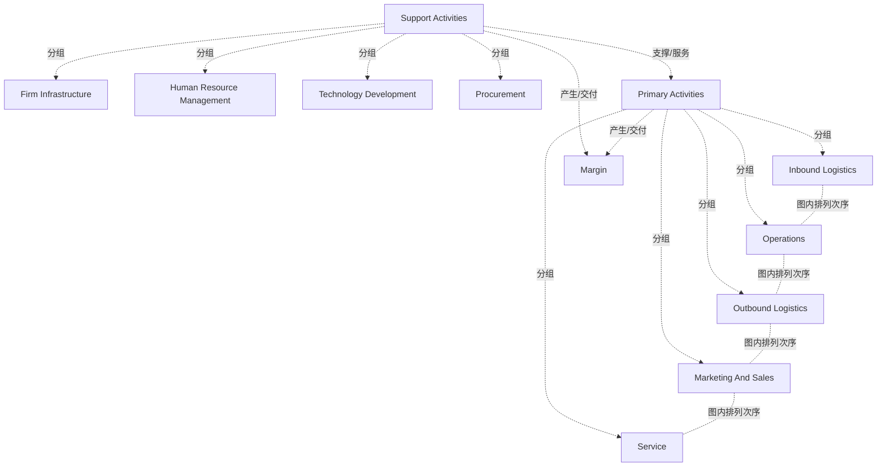

# G178/figA-1 · 迈克尔·波特的价值链

类型：`process-or-method-model`。附录 A 比较其他价值分析技术，本图在 A.1 节给出价值链的样子，用来说明它与价值流的区别：价值链着眼于活动成本和利润，给出企业如何产生经济价值（钱）的宏观视角，但缺少一种结构来建模、分解和分析企业如何组合能力为利益相关者产出结果，而这正是价值流的用途。

英文 PDF 物理页：[25]。本页为架构语义分析，原文与原图分别保留。

## 原图与可编辑图


[完整 JSON](figA-1.json) · [可编辑 Mermaid](figA-1.mmd) · [仅关系图](figA-1.relations.mmd) · [层级分解图](figA-1.hierarchy.mmd)

图形重建表达语义，不复制源图布局。虚线表示解释、矩阵映射或分组关系，不自动表示不确定性的概率。



## 架构分析

先看左侧大括号“Support Activities（辅助活动）”括住的上部 4 条绿色横带，再看下方大括号“Primary Activities（主要活动）”括住的下部 5 个彩色竖列（从左到右）。最右边的灰色 V 形箭头写着两次“Margin（利润）”，上半段挨着辅助活动，下半段挨着主要活动，表示利润由全部活动共同形成。图中没有连线和箭头线，关系全靠位置表达。

- 本图有 12 个具名或隐含元素、7 条关系和 9 条包含/分组记录。
- 包含/分组树最大深度为 1；根节点为 辅助活动、主要活动、利润（毛利）。
- 本图没有可直接确认为人员直属汇报的关系；视觉上下位置、能力分解和治理职责分别读取。
- 核对四个Support Activities横条、五个Primary Activities列和右侧Margin区域。
- 主要活动没有流程连线；将历史sequence关系明确改为版式排列次序。

### 如何用于项目

- 按阶段/事件/行为关系读取入口、出口、责任和产物；检查循环与例外路径。
- 工作流先后不表示组织管理权；在项目中显式记录条件和完成标准。

### 结构所表达的逻辑

- 价值链把企业活动分为两组：主要活动 5 项（内部后勤、生产运营、外部后勤、市场营销与销售、服务）和辅助活动 4 项（企业基础设施、人力资源管理、技术开发、采购）。
- 每条辅助活动横带都横跨全部 5 个主要活动列，表示辅助活动支撑整条价值链，而不是对应某一个主要活动（由版式表达；Porter 模型的含义属背景知识）。
- 右端的利润箭头同时包住两组活动：利润是全部活动共同作用的结果。正文说明价值链主要关注活动成本和利润，即经济价值如何产生。
- 正文引用 Porter 的定义：价值链把企业拆分为战略上相关的活动，以理解成本行为和现有及潜在的（竞争）差异化来源。
- 与价值流对比：价值链是企业如何产生经济价值（钱）的宏观视角；价值流则把端到端的价值生产系统分解为由业务能力使能的核心活动序列（价值流阶段），从利益相关者的角度定义价值。
- 图中没有利益相关者、触发事件、阶段的进入/退出标准或价值项，活动是通用的企业职能类别，这也是正文所说它“缺少建模、分解与分析结构”的直观体现。

## 上下级与包含

两组并列的活动类别：辅助活动（4 项，上部横带）和主要活动（5 项，下部竖列），各由大括号标出；利润位于右端，覆盖两组。组内各项是同级关系。

|父项|子项|层级类型|依据与解释|
|---|---|---|---|
|辅助活动|企业基础设施|visual_grouping|框、泳道、域或分类组的成员归属；没有额外证据不提升为业务组合或管理关系。|
|辅助活动|人力资源管理|visual_grouping|框、泳道、域或分类组的成员归属；没有额外证据不提升为业务组合或管理关系。|
|辅助活动|技术开发|visual_grouping|框、泳道、域或分类组的成员归属；没有额外证据不提升为业务组合或管理关系。|
|辅助活动|采购|visual_grouping|框、泳道、域或分类组的成员归属；没有额外证据不提升为业务组合或管理关系。|
|主要活动|内部后勤|visual_grouping|框、泳道、域或分类组的成员归属；没有额外证据不提升为业务组合或管理关系。|
|主要活动|生产运营|visual_grouping|框、泳道、域或分类组的成员归属；没有额外证据不提升为业务组合或管理关系。|
|主要活动|外部后勤|visual_grouping|框、泳道、域或分类组的成员归属；没有额外证据不提升为业务组合或管理关系。|
|主要活动|市场营销与销售|visual_grouping|框、泳道、域或分类组的成员归属；没有额外证据不提升为业务组合或管理关系。|
|主要活动|服务|visual_grouping|框、泳道、域或分类组的成员归属；没有额外证据不提升为业务组合或管理关系。|

## 全部元素与角色

|元素ID|原文名称|类型|含义|直接父项|深度|
|---|---|---|---|---|---|
|g_support|Support Activities|group|分组：辅助活动|—||
|sa_firm_infra|Firm Infrastructure|process|流程：企业基础设施|辅助活动|1|
|sa_hrm|Human Resource Management|process|流程：人力资源管理|辅助活动|1|
|sa_tech_dev|Technology Development|process|流程：技术开发|辅助活动|1|
|sa_procurement|Procurement|process|流程：采购|辅助活动|1|
|g_primary|Primary Activities|group|分组：主要活动|—||
|pa_inbound|Inbound Logistics|process|也常译作“进货后勤”。|主要活动|1|
|pa_operations|Operations|process|流程：生产运营|主要活动|1|
|pa_outbound|Outbound Logistics|process|也常译作“出货后勤”。|主要活动|1|
|pa_marketing_sales|Marketing And Sales|process|流程：市场营销与销售|主要活动|1|
|pa_service|Service|process|流程：服务|主要活动|1|
|margin|Margin|goal|价值链的经济结果；箭头同时覆盖辅助活动和主要活动。|—||

## 全部关系

图中没有连线。辅助活动横带横跨主要活动表示支撑关系；主要活动从左到右排列，连同右端箭头形状给出指向利润的方向；利润箭头覆盖两组活动表示利润来自全部活动。这些关系在清单中都标为推断。

|主体|语义关系|客体|显式线/隐式|原文标签|依据|
|---|---|---|---|---|---|
|辅助活动|支撑/服务|主要活动|implicit||辅助活动横带横跨全部主要活动列，表示支撑整条价值链|
|内部后勤|图内排列次序|生产运营|implicit||原图为主要活动类别的左到右排布，没有顺序连接线；不把版式转为必须执行的工作流。|
|生产运营|图内排列次序|外部后勤|implicit||原图为主要活动类别的左到右排布，没有顺序连接线；不把版式转为必须执行的工作流。|
|外部后勤|图内排列次序|市场营销与销售|implicit||原图为主要活动类别的左到右排布，没有顺序连接线；不把版式转为必须执行的工作流。|
|市场营销与销售|图内排列次序|服务|implicit||原图为主要活动类别的左到右排布，没有顺序连接线；不把版式转为必须执行的工作流。|
|主要活动|产生/交付|利润（毛利）|implicit||利润箭头下半段紧接主要活动|
|辅助活动|产生/交付|利润（毛利）|implicit||利润箭头上半段紧接辅助活动|

## 本轮语义修正

- 原图为主要活动类别的左到右排布，没有顺序连接线；不把版式转为必须执行的工作流。
- 原图为主要活动类别的左到右排布，没有顺序连接线；不把版式转为必须执行的工作流。
- 原图为主要活动类别的左到右排布，没有顺序连接线；不把版式转为必须执行的工作流。
- 原图为主要活动类别的左到右排布，没有顺序连接线；不把版式转为必须执行的工作流。

## 误读检查

- 利润来自全部活动（辅助 + 主要），不只来自主要活动；中文稿引用的 SVG 把“利润 / 毛利”画成只和主要活动同行的方框，容易造成这种误读。
- 主要活动从左到右的排列和右端箭头，不等于价值流阶段那种带进入/退出标准的先后阶段；价值链的活动是企业内部的职能类别。
- 辅助活动横带的上下次序不表示层级或重要性。
- 原图是“Marketing And Sales（市场营销与销售）”；SVG 只写“市场营销”，并把整张图上下颠倒。
- 主要活动五列的空间排列不是带依赖约束的项目执行流程。

## 原文证据

### [PDF 第 25 页](../../../documents/G178.md#page-25)

> With its primary focus on activity costs and margins, the value chain perspective is mainly concerned with understanding how economic value is created. However, value chains (an example of which is shown in Figure A-1) lack a structure from which to model, decompose, and analyze how a business combines its various capabilities to produce useful outcomes for stakeholders – which is the raison d’être of the value stream. In other words, value chains provide a macro-level view of how a business produces economic value (i.e., money), whereas value streams provide Business and Enterprise Architects the opportunity to decompose the end-to-end value producing system into sequences of core activities enabled by business capabilities.

## 来源与分析状态

所有元素/关系均有来源定位；未把历史解释重命名为本轮逐线视觉确认。源图与语义图是两种视图，布局不证明汇报或因果。

源 PDF SHA-256：`517130a041a8d956b2868dc39d570b84e2d80c64709e4c1368f9747388a3a026`。

源图记录：[原始解释与转录](../../../figures/G178/figA-1.json)。

```json
{
  "quality": {
    "graph_integrity": "checked",
    "semantic_analysis": "typed-graph-and-context-analysis",
    "visual_review": "source-content-audited",
    "notice_zh": "所有元素/关系均有来源定位；未把历史解释重命名为本轮逐线视觉确认。源图与语义图是两种视图，布局不证明汇报或因果。"
  },
  "source_uncertainty": {
    "confidence": "high",
    "uncertainties_zh": [],
    "analyzed_from": [
      "英文 PDF 第 25 页原图截图（220 dpi）",
      "英文 PDF 第 25 页正文",
      "中文稿 G178e_价值流.md 第 293–301 行",
      "figs/g178_figA-1.svg 源码",
      "G233/figB-1 原图截图（核对 same_as）"
    ],
    "date": "2026-10-31"
  },
  "source_conflicts": []
}
```
