# G178/figA-2 · 价值网络图

类型：`architecture-concept-or-system-model`。根据A.2分析企业内外社会/技术资源之间复杂关系及交换区域，识别谁向谁提供什么交付物。

英文 PDF 物理页：[26]。本页为架构语义分析，原文与原图分别保留。

## 原图与可编辑图


[完整 JSON](figA-2.json) · [可编辑 Mermaid](figA-2.mmd) · [仅关系图](figA-2.relations.mmd) · [层级分解图](figA-2.hierarchy.mmd)

图形重建表达语义，不复制源图布局。虚线表示解释、矩阵映射或分组关系，不自动表示不确定性的概率。

```mermaid
flowchart TB
  %% Semantic reconstruction; see original source image for exact layout.
  n0["Technology Company"]
  n1["Executive Team"]
  n2["Researchers"]
  n3["Resellers"]
  n4["Local Affiliates"]
  n5["Go-To-Market Partners"]
  n6["Advisory Board"]
  n1 -->|"value_exchange"| n2
  n1 -->|"value_exchange"| n2
  n2 -->|"value_exchange"| n1
  n0 -->|"value_exchange"| n1
  n0 -->|"value_exchange"| n1
  n3 -->|"value_exchange"| n1
  n1 -->|"value_exchange"| n0
  n3 -->|"value_exchange"| n0
  n0 -->|"value_exchange"| n3
  n0 -->|"value_exchange"| n3
  n3 -->|"value_exchange"| n0
  n3 -->|"value_exchange"| n0
  n3 -->|"value_exchange"| n0
  n3 -->|"value_exchange"| n0
  n3 -->|"value_exchange"| n4
  n4 -->|"value_exchange"| n3
  n4 -->|"value_exchange"| n3
  n2 -->|"value_exchange"| n0
  n2 -->|"value_exchange"| n0
  n0 -->|"value_exchange"| n2
  n2 -->|"value_exchange"| n0
  n2 -->|"value_exchange"| n0
  n0 -->|"value_exchange"| n2
  n4 -->|"value_exchange"| n0
  n4 -->|"value_exchange"| n0
  n0 -->|"value_exchange"| n4
  n0 -->|"value_exchange"| n4
  n4 -->|"value_exchange"| n0
  n4 -->|"value_exchange"| n0
  n5 -->|"value_exchange"| n4
  n5 -->|"value_exchange"| n4
  n5 -->|"value_exchange"| n4
  n4 -->|"value_exchange"| n5
  n5 -->|"value_exchange"| n4
  n0 -->|"value_exchange"| n5
  n0 -->|"value_exchange"| n5
  n5 -->|"value_exchange"| n0
  n5 -->|"value_exchange"| n0
  n5 -->|"value_exchange"| n0
  n5 -->|"value_exchange"| n0
  n5 -->|"value_exchange"| n0
  n5 -->|"value_exchange"| n0
  n6 -->|"value_exchange"| n0
  n6 -->|"value_exchange"| n0
  n6 -->|"value_exchange"| n0
  n6 -->|"value_exchange"| n0
  n0 -->|"value_exchange"| n6
  n6 -->|"value_exchange"| n0
  n6 -->|"value_exchange"| n5
  n5 -->|"value_exchange"| n6
```



## 架构分析

识别7角色，再逐条读取交付物和箭头。

外围角色也直接互换；同一对角色可有多个双向交换。

线型颜色忠实记录，未定义含义保持未知。

- 本图有 7 个具名或隐含元素、50 条关系和 0 条包含/分组记录。
- 本图没有可直接确认为人员直属汇报的关系；视觉上下位置、能力分解和治理职责分别读取。
- 7角色、50有向交换完整核对；无包含关系、基数、正式表格或印刷图例。
- Beta Tests箭头明确指向Technology Company，撤销历史推断语气；Local Affiliates的Insights与Resellers的Cultural Trends分开。
- Technology Company与Researchers的两条Trends方向相反；Plans由科技公司到Advisory Board，Selling Insights反向。
- 合作伙伴向本地分支送Marketing Insights、Trends、Company Contacts、Local Innovations；Local Market Intelligence反向。
- 顶部Resellers到Executive Team的Input to Strategy，以及底部Advisory Board到合作伙伴的Market Insights、反向Feedback，均未经过中心节点。

### 如何用于项目

- 围绕作者目的读取本图实体、分组与连线，并用对应原文限定其含义。
- 把参考模型与项目事实分开，实际范围、约束、值和责任须有项目证据。

### 结构所表达的逻辑

- A.2将节点定义为人或角色，交互代表有形（产品、现金）或无形（知识）的交付物。
- 网络用于理解复杂关系；A.3精益价值流用于活动序列及浪费分析，不能互换。
- 50条交换按各自端点保存；重复标签不能并成单一对象。
- 示例未给交换量、SLA、实际职责、系统实现或绩效证据；项目需要另行收集。

## 上下级与包含

7个同层参与方节点，居中位置不构成拥有或汇报。

|父项|子项|层级类型|依据与解释|
|---|---|---|---|
|—|—|无视觉包含|关系中明确的组成/特化见 JSON semantic_hierarchy。|

## 全部元素与角色

|元素ID|原文名称|类型|含义|直接父项|深度|
|---|---|---|---|---|---|
|tech_co|Technology Company|role|焦点企业；50 条交互中 36 条与它相连。|—||
|exec_team|Executive Team|role|角色：高管团队|—||
|researchers|Researchers|role|角色：研究人员|—||
|resellers|Resellers|role|角色：经销商|—||
|local_affiliates|Local Affiliates|role|角色：本地分支机构|—||
|gtm_partners|Go-To-Market Partners|role|角色：市场推广合作伙伴|—||
|advisory_board|Advisory Board|role|角色：顾问委员会|—||

## 全部关系

箭头指向交付物接收方。保留青绿实线、深蓝虚线；正文没有定义颜色与线型的严格分类。相交曲线不产生新节点，同名交换按端点区分。

|主体|语义关系|客体|显式线/隐式|原文标签|依据|
|---|---|---|---|---|---|
|高管团队|value_exchange|研究人员|显式连线|Special Projects|本次沿有标签曲线核对起点、终点箭头与实/虚线；标签表示交换交付物，不是执行步骤。|
|高管团队|value_exchange|研究人员|显式连线|Trends|本次沿有标签曲线核对起点、终点箭头与实/虚线；标签表示交换交付物，不是执行步骤。|
|研究人员|value_exchange|高管团队|显式连线|Input to Strategy|本次沿有标签曲线核对起点、终点箭头与实/虚线；标签表示交换交付物，不是执行步骤。|
|科技公司|value_exchange|高管团队|显式连线|Input to Strategy|本次沿有标签曲线核对起点、终点箭头与实/虚线；标签表示交换交付物，不是执行步骤。|
|科技公司|value_exchange|高管团队|显式连线|Insights|本次沿有标签曲线核对起点、终点箭头与实/虚线；标签表示交换交付物，不是执行步骤。|
|经销商|value_exchange|高管团队|显式连线|Input to Strategy|本次沿有标签曲线核对起点、终点箭头与实/虚线；标签表示交换交付物，不是执行步骤。|
|高管团队|value_exchange|科技公司|显式连线|Strategic Direction|本次沿有标签曲线核对起点、终点箭头与实/虚线；标签表示交换交付物，不是执行步骤。|
|经销商|value_exchange|科技公司|显式连线|Co brand Opportunities|本次沿有标签曲线核对起点、终点箭头与实/虚线；标签表示交换交付物，不是执行步骤。|
|科技公司|value_exchange|经销商|显式连线|Strategic Focus|本次沿有标签曲线核对起点、终点箭头与实/虚线；标签表示交换交付物，不是执行步骤。|
|科技公司|value_exchange|经销商|显式连线|Offerings|本次沿有标签曲线核对起点、终点箭头与实/虚线；标签表示交换交付物，不是执行步骤。|
|经销商|value_exchange|科技公司|显式连线|Market Assess|本次沿有标签曲线核对起点、终点箭头与实/虚线；标签表示交换交付物，不是执行步骤。|
|经销商|value_exchange|科技公司|显式连线|Revenue|本次沿有标签曲线核对起点、终点箭头与实/虚线；标签表示交换交付物，不是执行步骤。|
|经销商|value_exchange|科技公司|显式连线|Market Insights|本次沿有标签曲线核对起点、终点箭头与实/虚线；标签表示交换交付物，不是执行步骤。|
|经销商|value_exchange|科技公司|显式连线|Cultural Trends|本次沿有标签曲线核对起点、终点箭头与实/虚线；标签表示交换交付物，不是执行步骤。|
|经销商|value_exchange|本地分支机构|显式连线|Marketing Ideas|本次沿有标签曲线核对起点、终点箭头与实/虚线；标签表示交换交付物，不是执行步骤。|
|本地分支机构|value_exchange|经销商|显式连线|Company Experiences|本次沿有标签曲线核对起点、终点箭头与实/虚线；标签表示交换交付物，不是执行步骤。|
|本地分支机构|value_exchange|经销商|显式连线|Local Innovations|本次沿有标签曲线核对起点、终点箭头与实/虚线；标签表示交换交付物，不是执行步骤。|
|研究人员|value_exchange|科技公司|显式连线|Product Innovations|本次沿有标签曲线核对起点、终点箭头与实/虚线；标签表示交换交付物，不是执行步骤。|
|研究人员|value_exchange|科技公司|显式连线|Market Research|本次沿有标签曲线核对起点、终点箭头与实/虚线；标签表示交换交付物，不是执行步骤。|
|科技公司|value_exchange|研究人员|显式连线|Research Request|本次沿有标签曲线核对起点、终点箭头与实/虚线；标签表示交换交付物，不是执行步骤。|
|研究人员|value_exchange|科技公司|显式连线|Beta Tests|本次沿有标签曲线核对起点、终点箭头与实/虚线；标签表示交换交付物，不是执行步骤。|
|研究人员|value_exchange|科技公司|显式连线|Trends|本次沿有标签曲线核对起点、终点箭头与实/虚线；标签表示交换交付物，不是执行步骤。|
|科技公司|value_exchange|研究人员|显式连线|Trends|本次沿有标签曲线核对起点、终点箭头与实/虚线；标签表示交换交付物，不是执行步骤。|
|本地分支机构|value_exchange|科技公司|显式连线|Revenue|本次沿有标签曲线核对起点、终点箭头与实/虚线；标签表示交换交付物，不是执行步骤。|
|本地分支机构|value_exchange|科技公司|显式连线|Market Assess|本次沿有标签曲线核对起点、终点箭头与实/虚线；标签表示交换交付物，不是执行步骤。|
|科技公司|value_exchange|本地分支机构|显式连线|Strategic Focus|本次沿有标签曲线核对起点、终点箭头与实/虚线；标签表示交换交付物，不是执行步骤。|
|科技公司|value_exchange|本地分支机构|显式连线|Offerings|本次沿有标签曲线核对起点、终点箭头与实/虚线；标签表示交换交付物，不是执行步骤。|
|本地分支机构|value_exchange|科技公司|显式连线|Insights|本次沿有标签曲线核对起点、终点箭头与实/虚线；标签表示交换交付物，不是执行步骤。|
|本地分支机构|value_exchange|科技公司|显式连线|Trends|本次沿有标签曲线核对起点、终点箭头与实/虚线；标签表示交换交付物，不是执行步骤。|
|市场推广合作伙伴|value_exchange|本地分支机构|显式连线|Marketing Insights|本次沿有标签曲线核对起点、终点箭头与实/虚线；标签表示交换交付物，不是执行步骤。|
|市场推广合作伙伴|value_exchange|本地分支机构|显式连线|Trends|本次沿有标签曲线核对起点、终点箭头与实/虚线；标签表示交换交付物，不是执行步骤。|
|市场推广合作伙伴|value_exchange|本地分支机构|显式连线|Company Contacts|本次沿有标签曲线核对起点、终点箭头与实/虚线；标签表示交换交付物，不是执行步骤。|
|本地分支机构|value_exchange|市场推广合作伙伴|显式连线|Local Market Intelligence|本次沿有标签曲线核对起点、终点箭头与实/虚线；标签表示交换交付物，不是执行步骤。|
|市场推广合作伙伴|value_exchange|本地分支机构|显式连线|Local Innovations|本次沿有标签曲线核对起点、终点箭头与实/虚线；标签表示交换交付物，不是执行步骤。|
|科技公司|value_exchange|市场推广合作伙伴|显式连线|Strategic Focus|本次沿有标签曲线核对起点、终点箭头与实/虚线；标签表示交换交付物，不是执行步骤。|
|科技公司|value_exchange|市场推广合作伙伴|显式连线|Offerings|本次沿有标签曲线核对起点、终点箭头与实/虚线；标签表示交换交付物，不是执行步骤。|
|市场推广合作伙伴|value_exchange|科技公司|显式连线|Market Assess|本次沿有标签曲线核对起点、终点箭头与实/虚线；标签表示交换交付物，不是执行步骤。|
|市场推广合作伙伴|value_exchange|科技公司|显式连线|Revenue|本次沿有标签曲线核对起点、终点箭头与实/虚线；标签表示交换交付物，不是执行步骤。|
|市场推广合作伙伴|value_exchange|科技公司|显式连线|Trends|本次沿有标签曲线核对起点、终点箭头与实/虚线；标签表示交换交付物，不是执行步骤。|
|市场推广合作伙伴|value_exchange|科技公司|显式连线|Regional Needs|本次沿有标签曲线核对起点、终点箭头与实/虚线；标签表示交换交付物，不是执行步骤。|
|市场推广合作伙伴|value_exchange|科技公司|显式连线|Marketing Innovations|本次沿有标签曲线核对起点、终点箭头与实/虚线；标签表示交换交付物，不是执行步骤。|
|市场推广合作伙伴|value_exchange|科技公司|显式连线|Co brand Opportunity|本次沿有标签曲线核对起点、终点箭头与实/虚线；标签表示交换交付物，不是执行步骤。|
|顾问委员会|value_exchange|科技公司|显式连线|Market Stories|本次沿有标签曲线核对起点、终点箭头与实/虚线；标签表示交换交付物，不是执行步骤。|
|顾问委员会|value_exchange|科技公司|显式连线|Industry Experience|本次沿有标签曲线核对起点、终点箭头与实/虚线；标签表示交换交付物，不是执行步骤。|
|顾问委员会|value_exchange|科技公司|显式连线|Co-branding Options|本次沿有标签曲线核对起点、终点箭头与实/虚线；标签表示交换交付物，不是执行步骤。|
|顾问委员会|value_exchange|科技公司|显式连线|Product Suggestions|本次沿有标签曲线核对起点、终点箭头与实/虚线；标签表示交换交付物，不是执行步骤。|
|科技公司|value_exchange|顾问委员会|显式连线|Plans|本次沿有标签曲线核对起点、终点箭头与实/虚线；标签表示交换交付物，不是执行步骤。|
|顾问委员会|value_exchange|科技公司|显式连线|Selling Insights|本次沿有标签曲线核对起点、终点箭头与实/虚线；标签表示交换交付物，不是执行步骤。|
|顾问委员会|value_exchange|市场推广合作伙伴|显式连线|Market Insights|本次沿有标签曲线核对起点、终点箭头与实/虚线；标签表示交换交付物，不是执行步骤。|
|市场推广合作伙伴|value_exchange|顾问委员会|显式连线|Feedback|本次沿有标签曲线核对起点、终点箭头与实/虚线；标签表示交换交付物，不是执行步骤。|

## 本轮语义修正

- 本次沿有标签曲线核对起点、终点箭头与实/虚线；标签表示交换交付物，不是执行步骤。
- 本次沿有标签曲线核对起点、终点箭头与实/虚线；标签表示交换交付物，不是执行步骤。
- 本次沿有标签曲线核对起点、终点箭头与实/虚线；标签表示交换交付物，不是执行步骤。
- 本次沿有标签曲线核对起点、终点箭头与实/虚线；标签表示交换交付物，不是执行步骤。
- 本次沿有标签曲线核对起点、终点箭头与实/虚线；标签表示交换交付物，不是执行步骤。
- 本次沿有标签曲线核对起点、终点箭头与实/虚线；标签表示交换交付物，不是执行步骤。
- 本次沿有标签曲线核对起点、终点箭头与实/虚线；标签表示交换交付物，不是执行步骤。
- 本次沿有标签曲线核对起点、终点箭头与实/虚线；标签表示交换交付物，不是执行步骤。
- 本次沿有标签曲线核对起点、终点箭头与实/虚线；标签表示交换交付物，不是执行步骤。
- 本次沿有标签曲线核对起点、终点箭头与实/虚线；标签表示交换交付物，不是执行步骤。
- 本次沿有标签曲线核对起点、终点箭头与实/虚线；标签表示交换交付物，不是执行步骤。
- 本次沿有标签曲线核对起点、终点箭头与实/虚线；标签表示交换交付物，不是执行步骤。
- 本次沿有标签曲线核对起点、终点箭头与实/虚线；标签表示交换交付物，不是执行步骤。
- 本次沿有标签曲线核对起点、终点箭头与实/虚线；标签表示交换交付物，不是执行步骤。
- 本次沿有标签曲线核对起点、终点箭头与实/虚线；标签表示交换交付物，不是执行步骤。
- 本次沿有标签曲线核对起点、终点箭头与实/虚线；标签表示交换交付物，不是执行步骤。
- 本次沿有标签曲线核对起点、终点箭头与实/虚线；标签表示交换交付物，不是执行步骤。
- 本次沿有标签曲线核对起点、终点箭头与实/虚线；标签表示交换交付物，不是执行步骤。
- 本次沿有标签曲线核对起点、终点箭头与实/虚线；标签表示交换交付物，不是执行步骤。
- 本次沿有标签曲线核对起点、终点箭头与实/虚线；标签表示交换交付物，不是执行步骤。
- 本次沿有标签曲线核对起点、终点箭头与实/虚线；标签表示交换交付物，不是执行步骤。
- 本次沿有标签曲线核对起点、终点箭头与实/虚线；标签表示交换交付物，不是执行步骤。
- 本次沿有标签曲线核对起点、终点箭头与实/虚线；标签表示交换交付物，不是执行步骤。
- 本次沿有标签曲线核对起点、终点箭头与实/虚线；标签表示交换交付物，不是执行步骤。
- 本次沿有标签曲线核对起点、终点箭头与实/虚线；标签表示交换交付物，不是执行步骤。
- 本次沿有标签曲线核对起点、终点箭头与实/虚线；标签表示交换交付物，不是执行步骤。
- 本次沿有标签曲线核对起点、终点箭头与实/虚线；标签表示交换交付物，不是执行步骤。
- 本次沿有标签曲线核对起点、终点箭头与实/虚线；标签表示交换交付物，不是执行步骤。
- 本次沿有标签曲线核对起点、终点箭头与实/虚线；标签表示交换交付物，不是执行步骤。
- 本次沿有标签曲线核对起点、终点箭头与实/虚线；标签表示交换交付物，不是执行步骤。
- 本次沿有标签曲线核对起点、终点箭头与实/虚线；标签表示交换交付物，不是执行步骤。
- 本次沿有标签曲线核对起点、终点箭头与实/虚线；标签表示交换交付物，不是执行步骤。
- 本次沿有标签曲线核对起点、终点箭头与实/虚线；标签表示交换交付物，不是执行步骤。
- 本次沿有标签曲线核对起点、终点箭头与实/虚线；标签表示交换交付物，不是执行步骤。
- 本次沿有标签曲线核对起点、终点箭头与实/虚线；标签表示交换交付物，不是执行步骤。
- 本次沿有标签曲线核对起点、终点箭头与实/虚线；标签表示交换交付物，不是执行步骤。
- 本次沿有标签曲线核对起点、终点箭头与实/虚线；标签表示交换交付物，不是执行步骤。
- 本次沿有标签曲线核对起点、终点箭头与实/虚线；标签表示交换交付物，不是执行步骤。
- 本次沿有标签曲线核对起点、终点箭头与实/虚线；标签表示交换交付物，不是执行步骤。
- 本次沿有标签曲线核对起点、终点箭头与实/虚线；标签表示交换交付物，不是执行步骤。
- 本次沿有标签曲线核对起点、终点箭头与实/虚线；标签表示交换交付物，不是执行步骤。
- 本次沿有标签曲线核对起点、终点箭头与实/虚线；标签表示交换交付物，不是执行步骤。
- 本次沿有标签曲线核对起点、终点箭头与实/虚线；标签表示交换交付物，不是执行步骤。
- 本次沿有标签曲线核对起点、终点箭头与实/虚线；标签表示交换交付物，不是执行步骤。
- 本次沿有标签曲线核对起点、终点箭头与实/虚线；标签表示交换交付物，不是执行步骤。
- 本次沿有标签曲线核对起点、终点箭头与实/虚线；标签表示交换交付物，不是执行步骤。
- 本次沿有标签曲线核对起点、终点箭头与实/虚线；标签表示交换交付物，不是执行步骤。
- 本次沿有标签曲线核对起点、终点箭头与实/虚线；标签表示交换交付物，不是执行步骤。
- 本次沿有标签曲线核对起点、终点箭头与实/虚线；标签表示交换交付物，不是执行步骤。
- 本次沿有标签曲线核对起点、终点箭头与实/虚线；标签表示交换交付物，不是执行步骤。

## 误读检查

- 不能以中心位置推定组织层级。
- 不能声称实/虚线的有形/无形映射为官方图例。
- 不能把价值网络强制排成执行流水线。

## 原文证据

### [PDF 第 25 页](../../../documents/G178.md#page-25)

> Value networks [Allee, 2003] are focused on describing the social and technical resources that exist within and between businesses. As shown in Figure A-2, the nodes in a value network represent people, or roles, in an enterprise. The nodes are connected by interactions, which represent deliverables that might be tangible (products or cash) or intangible; e.g., increased knowledge.
### [PDF 第 26 页](../../../documents/G178.md#page-26)

> While value networks deal with the same sort of elements as value chains, the main difference is to do with intent: the primary purpose for creating a value network is to understand the complex web of relationships and areas of value exchange that exist within and between businesses.
> Lean value streams came out of the Lean Thinking movement [Womack et al., 1990], which originated in the automotive industry in Japan (at Toyota®, the process is known as “material and information flow mapping”). The core premise of Lean Thinking is to identify and eliminate waste from a firm’s processes, with the goal of only retaining those activities that create or increase value for the end-user. The lean value stream is a diagrammatic representation of the sequence of activities required to design, produce, and deliver a good or service to a customer (see Figure A-3). By adding performance metrics around each process (such as Processing Time, Response Time, and Percent Complete & Accurate), it becomes possible to use lean value streams to identify opportunities for waste reduction.

## 来源与分析状态

所有元素/关系均有来源定位；未把历史解释重命名为本轮逐线视觉确认。源图与语义图是两种视图，布局不证明汇报或因果。

源 PDF SHA-256：`517130a041a8d956b2868dc39d570b84e2d80c64709e4c1368f9747388a3a026`。

源图记录：[原始解释与转录](../../../figures/G178/figA-2.json)。

```json
{
  "quality": {
    "graph_integrity": "checked",
    "semantic_analysis": "typed-graph-and-context-analysis",
    "visual_review": "source-content-audited",
    "notice_zh": "所有元素/关系均有来源定位；未把历史解释重命名为本轮逐线视觉确认。源图与语义图是两种视图，布局不证明汇报或因果。"
  },
  "source_uncertainty": {
    "status": "current-source-review",
    "uncertainties_zh": [
      "原文未解释椭圆颜色及线型类别；仅保留视觉特征。"
    ]
  },
  "source_conflicts": []
}
```
