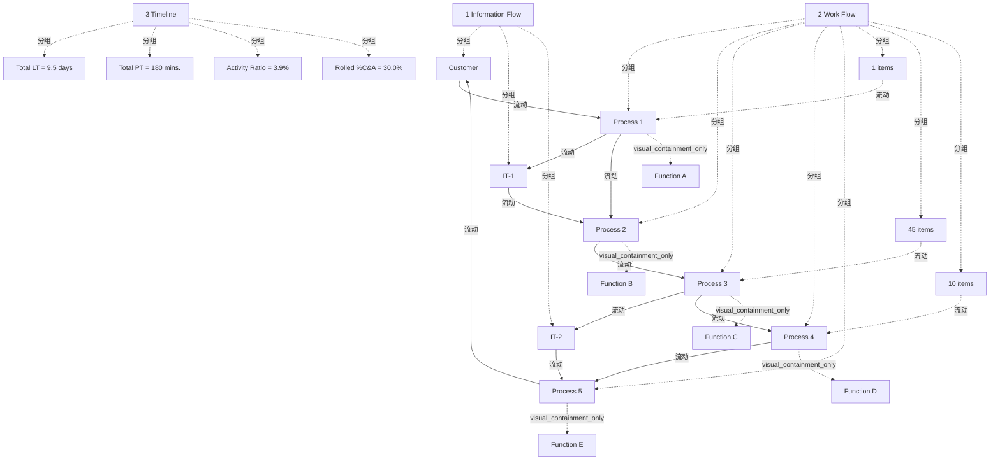

# G178/figA-3 · 精益价值流

类型：`architecture-evolution-or-plan`。附录 A.3 用它展示精益价值流：用图表示为客户设计、生产、交付产品或服务所需的活动序列，并给每个流程加上绩效指标，以发现减少浪费的机会。作者借此说明它与业务架构价值流同名但目的不同：精益价值流记录、分析、改进信息或物料的流动，不适合分解为为利益相关者逐步创造价值的阶段，也不适合与业务能力交叉映射。

英文 PDF 物理页：[27]。本页为架构语义分析，原文与原图分别保留。

## 原图与可编辑图


[完整 JSON](figA-3.json) · [可编辑 Mermaid](figA-3.mmd) · [仅关系图](figA-3.relations.mmd) · [层级分解图](figA-3.hierarchy.mmd)

图形重建表达语义，不复制源图布局。虚线表示解释、矩阵映射或分组关系，不自动表示不确定性的概率。



## 架构分析

左侧红色数字和大括号把图分成三层：1 信息流（顶部）、2 工作流（中部）、3 时间线（底部）。先看信息流：顶部锯齿屋顶图标是客户，它的细线箭头指向流程 1；流程 1 把信息送到 IT-1，IT-1 再送到流程 2；流程 3 送到 IT-2，IT-2 送到流程 5；流程 5 的箭头回到客户。再看工作流：流程 1 到 5 由粗点线箭头依次推进，每个流程框上半写流程名，下半写执行它的职能（Function A–E），左下角人员图标旁的数字推断为人数；流程之间的收件盘图标表示排队的工作项。每个流程下方的小表给出 LT、PT 和 %C&A。最后看时间线：阶梯线在每个流程下方下沉，线上写该流程的 LT，线下写 PT；右端汇总框给出总 LT、总 PT、活动比和累积 %C&A。

- 本图有 23 个具名或隐含元素、13 条关系和 20 条包含/分组记录。
- 包含/分组树最大深度为 2；根节点为 1 信息流、2 工作流、3 时间线。
- 本图没有可直接确认为人员直属汇报的关系；视觉上下位置、能力分解和治理职责分别读取。
- 包含分组后有 2 个连通分量；分离可能源于图例、并列分类或独立示例，未自动补边。
- 逐项核对五流程的LT/PT/%C&A、图标数字、三个排队数字及四个汇总值。
- 把印刷数据与历史计算假设分开；当前转录表不再把8小时折算假设与人数解释当作图内定义。

### 如何用于项目

- 为每个演进状态/工作包登记前置条件、交付物、依赖和实际决策人。
- 时间轴表达计划顺序；架构范围、已批准计划和资源承诺须另有项目证据。

### 结构所表达的逻辑

- 图中三层分别为Information Flow、Work Flow和Timeline；工作流含五个Process及Function A–E。
- 五个LT标签依次为1、0.5、5、2、1 days；PT标签为10、5、120、30、15 mins.。
- 各流程%C&A依次为50%、75%、85%、99%、95%。原图汇总为Total LT 9.5 days、Total PT 180 mins.、Activity Ratio 3.9%、Rolled %C&A 30.0%。
- 人形图标旁数字为5、11、3、7、4，排队图标旁数字为1、45、10 items；图内未独立定义人形数字的统计口径。
- 工作流四条虚线箭头从Process 1到Process 5；信息流联系Customer、IT-1、IT-2和相应流程，Process 4没有独立IT连线。
- 第26–27页正文强调它用于分析与改善信息/物料流，并与业务架构价值流的阶段/能力映射用途区分。
- 8小时/天折算和%C&A连乘属于历史验算的假设，不是原图明示的计算方法；不能由活动比直接证明其余时间全部为等待或浪费。

## 上下级与包含

三个横向分层（信息流 / 工作流 / 时间线）是视觉分组。工作流层内 5 个流程同级，每个流程框内含执行它的职能；客户和 IT 系统在信息流层。没有能力或阶段的层级。

|父项|子项|层级类型|依据与解释|
|---|---|---|---|
|1 信息流|客户|visual_grouping|框、泳道、域或分类组的成员归属；没有额外证据不提升为业务组合或管理关系。|
|1 信息流|IT 系统 1|visual_grouping|框、泳道、域或分类组的成员归属；没有额外证据不提升为业务组合或管理关系。|
|1 信息流|IT 系统 2|visual_grouping|框、泳道、域或分类组的成员归属；没有额外证据不提升为业务组合或管理关系。|
|2 工作流|流程 1|visual_grouping|框、泳道、域或分类组的成员归属；没有额外证据不提升为业务组合或管理关系。|
|2 工作流|流程 2|visual_grouping|框、泳道、域或分类组的成员归属；没有额外证据不提升为业务组合或管理关系。|
|2 工作流|流程 3|visual_grouping|框、泳道、域或分类组的成员归属；没有额外证据不提升为业务组合或管理关系。|
|2 工作流|流程 4|visual_grouping|框、泳道、域或分类组的成员归属；没有额外证据不提升为业务组合或管理关系。|
|2 工作流|流程 5|visual_grouping|框、泳道、域或分类组的成员归属；没有额外证据不提升为业务组合或管理关系。|
|流程 1|职能 A|visual_containment_only|保存原图解释中的包含；业务关系类型需要图例或正文进一步限定。|
|流程 2|职能 B|visual_containment_only|保存原图解释中的包含；业务关系类型需要图例或正文进一步限定。|
|流程 3|职能 C|visual_containment_only|保存原图解释中的包含；业务关系类型需要图例或正文进一步限定。|
|流程 4|职能 D|visual_containment_only|保存原图解释中的包含；业务关系类型需要图例或正文进一步限定。|
|流程 5|职能 E|visual_containment_only|保存原图解释中的包含；业务关系类型需要图例或正文进一步限定。|
|2 工作流|排队 1 项|visual_grouping|框、泳道、域或分类组的成员归属；没有额外证据不提升为业务组合或管理关系。|
|2 工作流|排队 45 项|visual_grouping|框、泳道、域或分类组的成员归属；没有额外证据不提升为业务组合或管理关系。|
|2 工作流|排队 10 项|visual_grouping|框、泳道、域或分类组的成员归属；没有额外证据不提升为业务组合或管理关系。|
|3 时间线|总前置时间 = 9.5 天|visual_grouping|框、泳道、域或分类组的成员归属；没有额外证据不提升为业务组合或管理关系。|
|3 时间线|总加工时间 = 180 分钟|visual_grouping|框、泳道、域或分类组的成员归属；没有额外证据不提升为业务组合或管理关系。|
|3 时间线|活动比 = 3.9%|visual_grouping|框、泳道、域或分类组的成员归属；没有额外证据不提升为业务组合或管理关系。|
|3 时间线|累积完整准确率 = 30.0%|visual_grouping|框、泳道、域或分类组的成员归属；没有额外证据不提升为业务组合或管理关系。|

## 全部元素与角色

|元素ID|原文名称|类型|含义|直接父项|深度|
|---|---|---|---|---|---|
|g_info_flow|1 Information Flow|group|分组：1 信息流|—||
|g_work_flow|2 Work Flow|group|分组：2 工作流|—||
|g_timeline|3 Timeline|group|分组：3 时间线|—||
|customer|Customer|actor|参与者：客户|1 信息流|1|
|it1|IT-1|application|应用：IT 系统 1|1 信息流|1|
|it2|IT-2|application|应用：IT 系统 2|1 信息流|1|
|p1|Process 1|process|流程：流程 1|2 工作流|1|
|p2|Process 2|process|流程：流程 2|2 工作流|1|
|p3|Process 3|process|流程：流程 3|2 工作流|1|
|p4|Process 4|process|流程：流程 4|2 工作流|1|
|p5|Process 5|process|流程：流程 5|2 工作流|1|
|fn_a|Function A|organization_unit|流程框下半部，执行流程 1 的职能|流程 1|2|
|fn_b|Function B|organization_unit|组织单元：职能 B|流程 2|2|
|fn_c|Function C|organization_unit|组织单元：职能 C|流程 3|2|
|fn_d|Function D|organization_unit|组织单元：职能 D|流程 4|2|
|fn_e|Function E|organization_unit|组织单元：职能 E|流程 5|2|
|q0|1 items|resource|进入流程 1 前排队的工作项|2 工作流|1|
|q2|45 items|resource|资源：排队 45 项|2 工作流|1|
|q3|10 items|resource|资源：排队 10 项|2 工作流|1|
|m_total_lt|Total LT = 9.5 days|metric|度量：总前置时间 = 9.5 天|3 时间线|1|
|m_total_pt|Total PT = 180 mins.|metric|度量：总加工时间 = 180 分钟|3 时间线|1|
|m_activity_ratio|Activity Ratio = 3.9%|metric|度量：活动比 = 3.9%|3 时间线|1|
|m_rolled_ca|Rolled %C&A = 30.0%|metric|度量：累积完整准确率 = 30.0%|3 时间线|1|

### 客户：属性

```json
{
  "box_number": 1
}
```

### 流程 1：属性

```json
{
  "function": "Function A",
  "people": 5,
  "LT": "1 days",
  "PT": "10 mins.",
  "pct_CA": "50%",
  "box_number": 2
}
```

### 流程 2：属性

```json
{
  "function": "Function B",
  "people": 11,
  "LT": "0.5 days",
  "PT": "5 mins.",
  "pct_CA": "75%",
  "box_number": 3
}
```

### 流程 3：属性

```json
{
  "function": "Function C",
  "people": 3,
  "LT": "5 days",
  "PT": "120 mins.",
  "pct_CA": "85%",
  "box_number": 4
}
```

### 流程 4：属性

```json
{
  "function": "Function D",
  "people": 7,
  "LT": "2 days",
  "PT": "30 mins.",
  "pct_CA": "99%",
  "box_number": 5
}
```

### 流程 5：属性

```json
{
  "function": "Function E",
  "people": 4,
  "LT": "1 days",
  "PT": "15 mins.",
  "pct_CA": "95%",
  "box_number": 6
}
```

## 全部关系

细实线箭头 = 信息流，共 6 条：客户→流程 1、流程 1→IT-1、IT-1→流程 2、流程 3→IT-2、IT-2→流程 5、流程 5→客户。粗点线箭头 = 工作在流程之间推送，共 4 条（流程 1→2→3→4→5）；在 VSM 中这种箭头通常表示推式生产（背景知识）。排队图标与流程之间没有连线，由位置表示它们在哪两个流程之间。时间线是阶梯折线，不是箭头：下沉段对应一个流程，线上为 LT、线下为 PT。

|主体|语义关系|客体|显式线/隐式|原文标签|依据|
|---|---|---|---|---|---|
|客户|流动|流程 1|显式连线||信息流：客户 → 流程 1（折线，先向左再向下）|
|流程 1|流动|IT 系统 1|显式连线||信息流|
|IT 系统 1|流动|流程 2|显式连线||信息流|
|流程 3|流动|IT 系统 2|显式连线||信息流|
|IT 系统 2|流动|流程 5|显式连线||信息流|
|流程 5|流动|客户|显式连线||信息流：流程 5 → 客户（折线，先向上再向左）|
|流程 1|流动|流程 2|显式连线||粗点线推送箭头：工作流|
|流程 2|流动|流程 3|显式连线||流动|
|流程 3|流动|流程 4|显式连线||流动|
|流程 4|流动|流程 5|显式连线||流动|
|排队 1 项|流动|流程 1|implicit||排队项位于流程 1 之前，等待被流程 1 处理|
|排队 45 项|流动|流程 3|implicit||位于流程 2 与 3 之间，等待被流程 3 处理|
|排队 10 项|流动|流程 4|implicit||位于流程 3 与 4 之间，等待被流程 4 处理|

## 逐流程数据（流程框、人员图标、指标框与时间线，按原图转录）

```json
{
  "id": "t_process_metrics",
  "title_zh": "逐流程数据（流程框、人员图标、指标框与时间线，按原图转录）",
  "columns": [
    "流程",
    "职能",
    "人形图标旁数字（原图未定义含义）",
    "之前排队",
    "LT 前置时间",
    "PT 加工时间",
    "%C&A",
    "信息流连接"
  ],
  "rows": [
    [
      "Process 1",
      "Function A",
      "5",
      "1 items",
      "1 days",
      "10 mins.",
      "50%",
      "接收客户信息；发往 IT-1"
    ],
    [
      "Process 2",
      "Function B",
      "11",
      "无",
      "0.5 days",
      "5 mins.",
      "75%",
      "接收 IT-1 信息"
    ],
    [
      "Process 3",
      "Function C",
      "3",
      "45 items",
      "5 days",
      "120 mins.",
      "85%",
      "发往 IT-2"
    ],
    [
      "Process 4",
      "Function D",
      "7",
      "10 items",
      "2 days",
      "30 mins.",
      "99%",
      "无"
    ],
    [
      "Process 5",
      "Function E",
      "4",
      "无",
      "1 days",
      "15 mins.",
      "95%",
      "接收 IT-2 信息；发往客户"
    ]
  ],
  "notes_zh": "时间线阶梯在每个流程下方重复了该流程的 LT（线上）和 PT（线下），数值与指标框一致。“之前排队”按收件盘图标所在位置判断。"
}
```

## 时间线右端汇总框

```json
{
  "id": "t_summary",
  "title_zh": "时间线右端汇总框",
  "columns": [
    "指标",
    "数值"
  ],
  "rows": [
    [
      "Total LT 总前置时间",
      "9.5 days"
    ],
    [
      "Total PT 总加工时间",
      "180 mins."
    ],
    [
      "Activity Ratio 活动比",
      "3.9%"
    ],
    [
      "Rolled %C&A 累积完整准确率",
      "30.0%"
    ]
  ],
  "notes_zh": "只保存原图印刷指标；图内未说明Activity Ratio的折算工时或Rolled %C&A的计算假设。"
}
```

## 误读检查

- 这不是业务架构价值流图：方框是具体流程，不是价值流阶段，也没有能力映射。
- 活动比低不表示加工慢，而是等待时间远大于加工时间。
- 人员图标旁的数字（5、11、3、7、4）推断为人数，不是工作项数；“n items”才是排队的工作项。
- 框右上角的小数字 1–6（客户为 1，流程 1–5 为 2–6）推断为图形编号，不表示别的含义。
- 中文稿引用的 SVG 是另一套自拟数字（4 道工序、加工 2′–5′、等待 1′–2′、总周期 20′），没有信息流、IT 系统和指标框，不能据它理解本图。
- 原图打印3.9%和30.0%；不得把按每日8小时验算的假设、全部剩余时间都是等待或约三成一次走完全程当作来源已证明结论。

## 原文证据

### [PDF 第 26 页](../../../documents/G178.md#page-26)

> Lean value streams came out of the Lean Thinking movement [Womack et al., 1990], which originated in the automotive industry in Japan (at Toyota®, the process is known as “material and information flow mapping”). The core premise of Lean Thinking is to identify and eliminate waste from a firm’s processes, with the goal of only retaining those activities that create or increase value for the end-user. The lean value stream is a diagrammatic representation of the sequence of activities required to design, produce, and deliver a good or service to a customer (see Figure A-3). By adding performance metrics around each process (such as Processing Time, Response Time, and Percent Complete & Accurate), it becomes possible to use lean value streams to identify opportunities for waste reduction.
### [PDF 第 27 页](../../../documents/G178.md#page-27)

> Despite the similarity in name to the Business Architecture value stream, the lean value stream’s primary purpose is to document, analyze, and improve the flow of information or materials required to produce a product or service for a customer. It is not designed (nor is it well suited) to broader architectural purposes — namely, decomposing down to the critical activities (or stages) that progressively combine to produce value for a stakeholder, or cross-mapping those value stream stages to the enabling business capabilities.

## 来源与分析状态

所有元素/关系均有来源定位；未把历史解释重命名为本轮逐线视觉确认。源图与语义图是两种视图，布局不证明汇报或因果。

源 PDF SHA-256：`517130a041a8d956b2868dc39d570b84e2d80c64709e4c1368f9747388a3a026`。

源图记录：[原始解释与转录](../../../figures/G178/figA-3.json)。

```json
{
  "quality": {
    "graph_integrity": "checked",
    "semantic_analysis": "typed-graph-and-context-analysis",
    "visual_review": "source-content-audited",
    "notice_zh": "所有元素/关系均有来源定位；未把历史解释重命名为本轮逐线视觉确认。源图与语义图是两种视图，布局不证明汇报或因果。"
  },
  "source_uncertainty": {
    "confidence": "high",
    "uncertainties_zh": [
      "人员图标旁的数字按 VSM 惯例解读为人数，框右上角数字解读为图形编号，图上没有说明。",
      "图中写“LT”，按 VSM 惯例为前置时间（Lead Time）；正文列举的指标是 Processing Time、Response Time、Percent Complete & Accurate，没有直接说明 LT 的含义。中文稿把 %C&A 对应的指标译为“一次合格率”，本解析用“完整准确率”。",
      "活动比 3.9% 只有按每天 8 小时折算才能得出（按 24 小时为 1.3%），这是解析者的验算，图中未说明折算口径。"
    ],
    "analyzed_from": [
      "英文 PDF 第 27 页原图截图（220 dpi）及 2×2 放大分块",
      "英文 PDF 第 26–27 页正文",
      "中文稿 G178e_价值流.md 第 311–317 行",
      "figs/g178_figA-3.svg 源码"
    ],
    "date": "2026-10-31"
  },
  "source_conflicts": []
}
```
