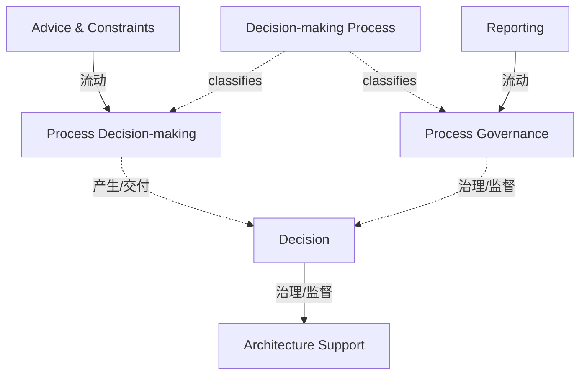

# G184/fig10-1 · 决策流程集成

类型：`process-or-method-model`。说明 EA 能力与决策流程之间的固定交互模式：向上提供建议与约束，向下接受决策指导，向治理提供报告。作者用它区分“对决策的输入”和“对治理的报告”，并说明该模式适用于所有类型的决策流程，变化的只是决策流程类型。

英文 PDF 物理页：[95]。本页为架构语义分析，原文与原图分别保留。

## 原图与可编辑图


[完整 JSON](fig10-1.json) · [可编辑 Mermaid](fig10-1.mmd) · [仅关系图](fig10-1.relations.mmd) · [层级分解图](fig10-1.hierarchy.mmd)

图形重建表达语义，不复制源图布局。虚线表示解释、矩阵映射或分组关系，不自动表示不确定性的概率。



## 架构分析

先看顶部蓝色标题框“Decision-making Process”，它统摄下方两个橙色流程框：左“Process Decision-making”、右“Process Governance”。中央小框“Decision”位于两框下方，向下箭头指向“Architecture Support”。左下“Advice & Constraints”向上箭头指向 Process Decision-making；右下“Reporting”向上箭头指向 Process Governance。三组箭头就是全部画出的关系。

- 本图有 7 个具名或隐含元素、7 条关系和 0 条包含/分组记录。
- 本图没有可直接确认为人员直属汇报的关系；视觉上下位置、能力分解和治理职责分别读取。
- 治理边回答谁提供约束、指导或监督；它们与岗位汇报边分别存储。
- 7标签与3条实际箭头完整核对；Advice & Constraints向上到Process Decision-making，Reporting向上到Process Governance，Decision向下到Architecture Support。
- Decision-making Process是上方标题条，非封闭容器；Decision框与上方两框重叠，Advice/Reporting与底部支持条重叠。
- 正文95页解释架构建议/约束/报告服务决策，决定反向指导架构支持；不把版式重叠当作新的显式连接。

### 如何用于项目

- 按阶段/事件/行为关系读取入口、出口、责任和产物；检查循环与例外路径。
- 工作流先后不表示组织管理权；在项目中显式记录条件和完成标准。

### 结构所表达的逻辑

- 两个上游输入：Advice & Constraints 向上进入决策制定流程；Reporting 向上进入治理流程。
- 建议通常采取权衡分析、视图与架构路线图的形式；约束多是先前的决策，常以架构需求规格说明表达。
- 建议导向决策，决策通常表现为批准候选架构；决策向下指导架构支持。
- 报告在目标架构范围内针对相关流程已做出的决策，用于确认执行、驱动目标架构变更或执行变更。
- 交互被分成两半：建议/约束喂给决策，报告喂给治理——这正是图中左右两条上行箭头。
- 该交互模型对所有决策流程不变，变化的只是决策流程类型；正文列出战略制定、组合/项目群规划、项目规划、解决方案开发四类。
- 存在子决策时，输入会受到指导与约束（正文），图中未画子决策。
- “Decision”框与两个流程框相接但无箭头，表示决策是流程的产出/交汇点（版式推断）。

## 上下级与包含

顶部蓝色标题框是流程总称，下方两个橙色框是它的两个侧面（决策制定与治理）；Decision 是二者下方的中心框；Advice & Constraints、Reporting、Architecture Support 是三个输入/受指导方。图中没有总框包含关系，全部是并列框加箭头。

|父项|子项|层级类型|依据与解释|
|---|---|---|---|
|—|—|无视觉包含|关系中明确的组成/特化见 JSON semantic_hierarchy。|

### 治理范围

|父项/范围/类型|子项/责任对象/实例|语义|
|---|---|---|
|决策|架构支持|governs|
|流程治理|决策|governs|

## 全部元素与角色

|元素ID|原文名称|类型|含义|直接父项|深度|
|---|---|---|---|---|---|
|dm_process|Decision-making Process|process|企业决策流程的总称；所有规划与预算流程都属于决策流程。图中没有从它出发的连线。|—||
|process_decision_making|Process Decision-making|process|决策制定流程；接收 EA 能力的建议与约束，产出决策。|—||
|process_governance|Process Governance|process|对决策进行治理的流程；接收 EA 能力的报告。|—||
|decision|Decision|event|决策制定与治理的交汇点；向下指导架构支持。通常表现为批准候选架构。|—||
|advice_constraints|Advice & Constraints|artifact|EA 能力提供给决策的建议与约束：权衡分析、视图、架构路线图，以及作为先前决策的架构需求规格说明。|—||
|reporting|Reporting|artifact|EA 能力在目标架构范围内针对已做出的决策提供的报告，用于确认执行或触发变更。|—||
|architecture_support|Architecture Support|process|接受决策指导的架构支持活动；与建议、报告两个框的边角略有叠压。|—||

## 全部关系

三条实线箭头：Advice & Constraints ↑ Process Decision-making；Reporting ↑ Process Governance；Decision ↓ Architecture Support。箭头方向与正文“建议/约束喂给决策、报告喂给治理、决策指导架构支持”一致。Decision 与两个流程框仅相邻，没有箭头；蓝色标题框与下方框之间也没有连线。

|主体|语义关系|客体|显式线/隐式|原文标签|依据|
|---|---|---|---|---|---|
|建议与约束|流动|流程决策（决策制定）|显式连线||左下框的竖直箭头向上指向 Process Decision-making。|
|报告|流动|流程治理|显式连线||右下框的竖直箭头向上指向 Process Governance。|
|决策|治理/监督|架构支持|显式连线||中央小框的竖直箭头向下指向 Architecture Support；正文为 decisions direct the architecture support。|
|流程决策（决策制定）|产生/交付|决策|implicit||由框重叠/标题分组及正文解释得到的语义，不是额外实线箭头。|
|流程治理|治理/监督|决策|implicit||由框重叠/标题分组及正文解释得到的语义，不是额外实线箭头。|
|决策流程（总称）|classifies|流程决策（决策制定）|implicit||由框重叠/标题分组及正文解释得到的语义，不是额外实线箭头。|
|决策流程（总称）|classifies|流程治理|implicit||由框重叠/标题分组及正文解释得到的语义，不是额外实线箭头。|

## 本轮语义修正

- 由框重叠/标题分组及正文解释得到的语义，不是额外实线箭头。
- 由框重叠/标题分组及正文解释得到的语义，不是额外实线箭头。
- 由框重叠/标题分组及正文解释得到的语义，不是额外实线箭头。
- 由框重叠/标题分组及正文解释得到的语义，不是额外实线箭头。

## 误读检查

- 不要以为 Reporting 指向决策流程；它指向 Process Governance。
- 不要以为 Decision 向上指向流程；图中唯一的向下箭头是 Decision→Architecture Support。
- 不要把顶部蓝色标题框当作流程中的一个步骤；它没有连线，只是流程总称。
- 不要把 Decision 与两个流程框的相邻读成包含关系；它是二者下方的产出/交汇框（版式推断）。
- 不要把“Advice & Constraints”读成 EA 能力的全部输出；它只是对决策的输入，报告是另一条独立通道。
- 中文稿引用的 SVG 重画成 EA→决策→执行→治理的闭环，并加入“执行流程”，与原图不符；不能据它理解本图。
- 原图没有“执行流程”；执行流程集成是图 10-2 的内容。

## 原文证据

### [PDF 第 95 页](../../../documents/G184.md#page-95)

> The interaction model described above and represented in Figure 10-1 remains constant with all decision-making processes. The interaction is dependent upon the type of decision-making process. The World-Class Enterprise Architecture White Paper classifies four decision-making processes with which an EA Capability can connect.

## 来源与分析状态

所有元素/关系均有来源定位；未把历史解释重命名为本轮逐线视觉确认。源图与语义图是两种视图，布局不证明汇报或因果。

源 PDF SHA-256：`85fe5653767b184c3c8c9c1bef9f5738adbb2bf6661fb50ee95e72d16bc9f614`。

源图记录：[原始解释与转录](../../../figures/G184/fig10-1.json)。

```json
{
  "quality": {
    "graph_integrity": "checked",
    "semantic_analysis": "typed-graph-and-context-analysis",
    "visual_review": "source-content-audited",
    "notice_zh": "所有元素/关系均有来源定位；未把历史解释重命名为本轮逐线视觉确认。源图与语义图是两种视图，布局不证明汇报或因果。"
  },
  "source_uncertainty": {
    "confidence": "high",
    "uncertainties_zh": [
      "Decision 与两个流程框只是相邻、没有箭头；“决策由决策制定流程产生、受治理流程治理”是依据版式与正文的推断，已标为 implicit。",
      "顶部蓝色标题框与下方两个流程框之间没有连线；“三者是整体与部分”同样是版式推断，未当作显式关系。",
      "Advice & Constraints 与 Architecture Support、Reporting 与 Architecture Support 的框角有轻微叠压，属排版重叠，不表示额外关系。",
      "中文稿引用的 SVG 是另一套模型（含执行流程），不是本图的忠实重绘，已在 asset_checks 中列为 not_equivalent。"
    ],
    "analyzed_from": [
      "英文 PDF 第 95 页图 10-1 截图与 2x2 放大分块",
      "英文 PDF 第 95 页 10.1.1 节正文",
      "中文稿 G184e_领导者指南_建立并演进EA能力.md 第 1068-1078 行",
      "figs/g184_fig10-1.svg 源码"
    ],
    "date": "2026-10-31"
  },
  "source_conflicts": []
}
```
