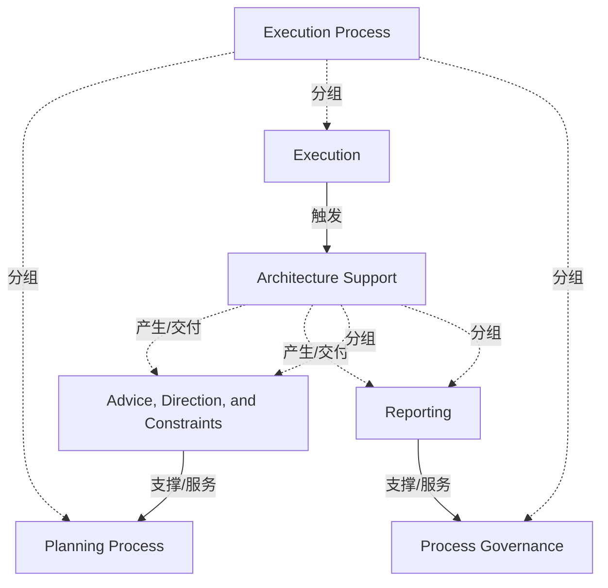

# G184/fig10-2 · 执行流程集成

类型：`process-or-method-model`。说明 EA 能力与“执行流程”之间的固定交互模型：一端把前瞻性的建议、方向与约束送入规划流程，另一端把执行变更的报告送入流程治理；无论执行流程属于组合/项目群、项目执行、运营变更还是运营，这个模型都不变。

英文 PDF 物理页：[97]。本页为架构语义分析，原文与原图分别保留。

## 原图与可编辑图


[完整 JSON](fig10-2.json) · [可编辑 Mermaid](fig10-2.mmd) · [仅关系图](fig10-2.relations.mmd) · [层级分解图](fig10-2.hierarchy.mmd)

图形重建表达语义，不复制源图布局。虚线表示解释、矩阵映射或分组关系，不自动表示不确定性的概率。



## 架构分析

先看顶部蓝色横幅“Execution Process”，它标明整张图讨论的是执行流程领域。其下三个框是执行流程的组成：左侧规划流程、右侧流程治理、中间小框“Execution”代表实际执行活动。底部宽条“Architecture Support”代表 EA 提供的架构支持；叠在它上面的“Advice, Direction, and Constraints”和“Reporting”是架构支持产生的两类输出。沿两条向上箭头读：左侧输出进入规划流程，右侧输出进入流程治理；中间向下箭头表示执行活动调用/触发架构支持。

- 本图有 7 个具名或隐含元素、5 条关系和 5 条包含/分组记录。
- 包含/分组树最大深度为 1；根节点为 执行流程、架构支持。
- 本图没有可直接确认为人员直属汇报的关系；视觉上下位置、能力分解和治理职责分别读取。
- 7标签与3条黑箭头完整核对：建议/方向/约束指向Planning Process、Reporting指向Process Governance、Execution指向Architecture Support。
- Execution Process是分类标题；5项原有父关系保留为语义分类，解除错误视觉容器推断。
- 96页将架构支持分为建议、方向、约束及报告；不推断全部项目决策必须通过架构团队审批。

### 如何用于项目

- 按阶段/事件/行为关系读取入口、出口、责任和产物；检查循环与例外路径。
- 工作流先后不表示组织管理权；在项目中显式记录条件和完成标准。

### 结构所表达的逻辑

- EA 能力对执行流程的介入分为两条通道：向规划流程提供建议、方向与约束（事前），向流程治理提供报告（事后/过程）。
- “Advice, Direction, and Constraints”和“Reporting”是架构支持的两个输出框，不是与架构支持并列的独立流程。
- 中间小框“Execution”向下指向“Architecture Support”，表示实际执行发生时需要调用架构支持；这是图中唯一的向下箭头。
- 规划流程与流程治理之间没有箭头，二者是执行流程中并列的两个治理/规划环节，不存在先后顺序。
- 正文强调该交互模型不随执行流程类型（组合/项目群管理、项目执行、运营变更、运营）而改变，改变的是交互的具体内容和时机。
- 图只表达交互通道，不表达组织归属、时间顺序或交付物细节；具体建议/报告内容在 10.1.3–10.1.9 分节展开。

## 上下级与包含

顶部蓝色“Execution Process”是领域标题，统辖其下三个执行流程组成：Planning Process、Execution、Process Governance。底部“Architecture Support”是 EA 支持层，其上方叠放两个输出：Advice, Direction, and Constraints 与 Reporting。两层之间是交互关系，不是上下级组织关系。

|父项|子项|层级类型|依据与解释|
|---|---|---|---|
|执行流程|规划流程|classified_under|标题条分类或重叠输出，图中并非被父节点框完整包围。|
|执行流程|执行|classified_under|标题条分类或重叠输出，图中并非被父节点框完整包围。|
|执行流程|流程治理|classified_under|标题条分类或重叠输出，图中并非被父节点框完整包围。|
|架构支持|建议、指导与约束|classified_under|标题条分类或重叠输出，图中并非被父节点框完整包围。|
|架构支持|报表|classified_under|标题条分类或重叠输出，图中并非被父节点框完整包围。|

## 全部元素与角色

|元素ID|原文名称|类型|含义|直接父项|深度|
|---|---|---|---|---|---|
|execution_process|Execution Process|process|标示整张图的领域，不是可执行的具体流程步骤。|—||
|planning_process|Planning Process|process|流程：规划流程|执行流程|1|
|execution|Execution|process|流程：执行|执行流程|1|
|process_governance|Process Governance|process|流程：流程治理|执行流程|1|
|architecture_support|Architecture Support|process|EA 能力面向执行流程的支持职能；两个输出框叠放在其上方。|—||
|advice_direction_constraints|Advice, Direction, and Constraints|artifact|EA 输出包：建议（实施指导/不合规建议）、方向（差距与工作包）、约束（架构需求规格说明）。|架构支持|1|
|reporting|Reporting|artifact|就执行流程在目标架构范围内所做变更提交的报告。|架构支持|1|

## 全部关系

三条粗黑实线箭头：Advice, Direction, and Constraints → Planning Process（向上，输入规划）；Reporting → Process Governance（向上，输入治理）；Execution → Architecture Support（向下，执行调用架构支持）。图中没有其他连线；输出框与架构支持带的重叠表示前者由后者产生（隐含关系）。

|主体|语义关系|客体|显式线/隐式|原文标签|依据|
|---|---|---|---|---|---|
|建议、指导与约束|支撑/服务|规划流程|显式连线||左侧粗黑箭头向上，EA 的建议/方向/约束输入规划流程。|
|报表|支撑/服务|流程治理|显式连线||右侧粗黑箭头向上，EA 的报告输入流程治理。|
|执行|触发|架构支持|显式连线||中间粗黑箭头向下，实际执行活动调用/触发架构支持。|
|架构支持|产生/交付|建议、指导与约束|implicit||正文支持产出语义，但重叠框之间没有连线。|
|架构支持|产生/交付|报表|implicit||正文支持产出语义，但重叠框之间没有连线。|

## 本轮语义修正

- 正文支持产出语义，但重叠框之间没有连线。
- 正文支持产出语义，但重叠框之间没有连线。

## 误读检查

- 不要把 Planning Process 与 Process Governance 读成先后步骤：两者之间没有箭头，是并列的两个环节。
- “Advice, Direction, and Constraints”并不直接指向小框“Execution”，而是向上进入 Planning Process。
- 底部“Architecture Support”不是执行结束后的一个阶段，而是持续存在、被执行的各个环节调用的 EA 支持职能。
- 蓝色“Execution Process”是领域标题，不是把三个子流程包在里面的外框；图中没有包含边框。
- “Reporting”的方向是 EA 向流程治理报告，不是执行方向 EA 汇报。
- 中文图把 Reporting 译成“报表”，不要据此把它理解成一张静态报表；它是报告机制/报告内容。

## 原文证据

### [PDF 第 96 页](../../../documents/G184.md#page-96)

> Regardless of the type of execution process and major transformation project, the interaction model described above and represented in Figure 10-2 remains constant. The interaction is dependent upon the type of execution process, and when the execution is taking place. The World-Class Enterprise Architecture White Paper classifies four execution management processes with which an EA Capability can connect. The nature of this connection will depend upon the purpose of the EA Capability identified in Chapter 5:
### [PDF 第 97 页](../../../documents/G184.md#page-97)

> Section 10.1.2 through Section 10.1.9 provide a discussion of how the EA Capability engages with execution processes.
> An EA Capability that is chartered to support strategy will be tightly integrated with strategy development processes. Strategic decision-making tends not to closely follow fixed cycles – this requires the EA Capability to be nimble.

## 来源与分析状态

所有元素/关系均有来源定位；未把历史解释重命名为本轮逐线视觉确认。源图与语义图是两种视图，布局不证明汇报或因果。

源 PDF SHA-256：`85fe5653767b184c3c8c9c1bef9f5738adbb2bf6661fb50ee95e72d16bc9f614`。

源图记录：[原始解释与转录](../../../figures/G184/fig10-2.json)。

```json
{
  "quality": {
    "graph_integrity": "checked",
    "semantic_analysis": "typed-graph-and-context-analysis",
    "visual_review": "source-content-audited",
    "notice_zh": "所有元素/关系均有来源定位；未把历史解释重命名为本轮逐线视觉确认。源图与语义图是两种视图，布局不证明汇报或因果。"
  },
  "source_uncertainty": {
    "confidence": "high",
    "uncertainties_zh": [
      "小框“Execution”与外层标题“Execution Process”同名，图中未说明其确切范围；解析按“实际执行活动”理解。",
      "“Execution → Architecture Support”箭头只表明调用方向，未区分请求、咨询还是介入治理。"
    ],
    "analyzed_from": [
      "英文 PDF 第 97 页原图截图与 2×2 放大分块",
      "英文 PDF 第 96 页正文（10.1.2 节）",
      "中文稿 G184e_领导者指南_建立并演进EA能力.md 第 1081–1099 行",
      "figs/zh/g184e_fig10-2_zh.png 与 figs/g184e_fig10-2_en.png"
    ],
    "date": "2026-10-31"
  },
  "source_conflicts": []
}
```
