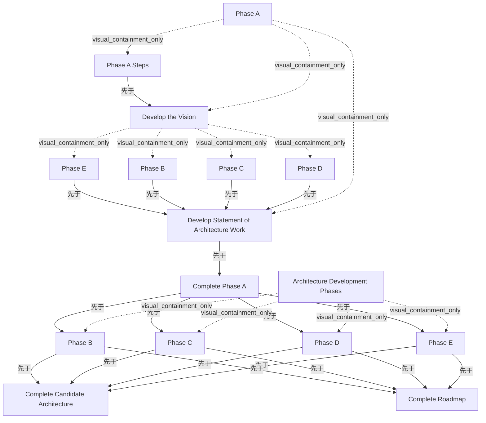

# G184/fig10-3 · 风格化架构开发甘特图

类型：`architecture-evolution-or-plan`。用一张进度图反驳“ADM=线性瀑布”的误读：所有开发候选架构的阶段（B–E）必须与阶段 A 同时进行，直到候选架构按利益相关者需求通过验收，然后这些阶段才关闭，以便完成支撑域的特定要素。图的重点不是活动顺序，而是何时必须交付什么。

英文 PDF 物理页：[102]。本页为架构语义分析，原文与原图分别保留。

## 原图与可编辑图


[完整 JSON](fig10-3.json) · [可编辑 Mermaid](fig10-3.mmd) · [仅关系图](fig10-3.relations.mmd) · [层级分解图](fig10-3.hierarchy.mmd)

图形重建表达语义，不复制源图布局。虚线表示解释、矩阵映射或分组关系，不自动表示不确定性的概率。



## 架构分析

先从左侧任务表看行号 2–17 与 Predecessor 列，再沿时间轴从左（2015-09-27）向右（2015-11-16）读条块。黑色细长括号是汇总行（第 2、4、11 行），括住其子任务；浅蓝条是任务持续期；青色菱形加“月-日”是里程碑；细折线箭头从紧前任务末端指向紧后任务起点。第 3–10 行是第一轮（为完成阶段 A），第 12–17 行是第二轮（完成候选架构与路线图）；两轮之间以 10-22 里程碑分隔。

- 本图有 16 个具名或隐含元素、18 条关系和 11 条包含/分组记录。
- 包含/分组树最大深度为 2；根节点为 阶段 A、完成阶段 A、架构开发阶段、完成候选架构、完成路线图。
- 本图没有可直接确认为人员直属汇报的关系；视觉上下位置、能力分解和治理职责分别读取。
- 16个任务/汇总/里程碑及周刻度逐行审查；补齐第一轮B/C/D→工作说明书的3条遗漏前置，补齐第二轮B–E→路线图的4条前置。
- 否定旧版将公共依赖线误作候选架构→路线图的新依赖。
- 任务表完整保留可见前置文字的截断状态；像素估算日期与打印里程碑日期明确区分。
- 101–103页说明此为迭代/并行的示例计划，不能把截图日期当成TOGAF规定工期或把ADM改写成单向瀑布。

### 如何用于项目

- 为每个演进状态/工作包登记前置条件、交付物、依赖和实际决策人。
- 时间轴表达计划顺序；架构范围、已批准计划和资源承诺须另有项目证据。

### 结构所表达的逻辑

- 阶段 A 不是先做完再启动 B–E：第一轮阶段 B–E 从 10-02 就开始，与阶段 A 的“制定愿景”并行，直到 10-20 前后才汇入“编制架构工作说明书”。
- 阶段 A 的关闭点是 10-22；此前必须先完成架构工作说明书（第 9 行），其前置是阶段 B、C、D、E 四项（5,6,7,8）。
- 第二轮从 10-22 起再次并行执行阶段 B–E，四者同一天启动，分别在不同日期结束，最后统一汇入 11-16 的“完成候选架构”。
- 11-16 同时是“完成候选架构”和“完成路线图”两个里程碑；图上另有一条从候选架构里程碑指向路线图里程碑的箭头（Predecessor 单元格被截断，未明确显示 16）。
- 两轮 B–E 的持续时间不同：第一轮约 10-02 至 10-20，第二轮约 10-22 至 11-15，说明迭代不是简单重复，而是按当下需要的深度执行。
- 全图没有回环箭头；“迭代”通过两轮并行波次和阶段关闭/重开表现，而不是 ADM 圆环。
- 正文明确这是风格化示例，真实世界更复杂；条长只表示大致时机，不应作为精确工期。

## 上下级与包含

四层任务大纲：阶段 A（第 2 行，汇总）下含“阶段 A 步骤”（第 3 行）与“制定愿景”（第 4 行，汇总）；“制定愿景”下含第一轮阶段 B、C、D、E（第 5–8 行）；“编制架构工作说明书”（第 9 行）与“完成阶段 A”里程碑（第 10 行）挂在阶段 A 之后。“架构开发阶段”（第 11 行，汇总）下含第二轮阶段 B、C、D、E（第 12–15 行）；“完成候选架构”（第 16 行）与“完成路线图”（第 17 行）是顶层里程碑。

|父项|子项|层级类型|依据与解释|
|---|---|---|---|
|阶段 A|阶段 A 步骤|visual_containment_only|保存原图解释中的包含；业务关系类型需要图例或正文进一步限定。|
|阶段 A|制定愿景|visual_containment_only|保存原图解释中的包含；业务关系类型需要图例或正文进一步限定。|
|制定愿景|阶段 B|visual_containment_only|保存原图解释中的包含；业务关系类型需要图例或正文进一步限定。|
|制定愿景|阶段 C|visual_containment_only|保存原图解释中的包含；业务关系类型需要图例或正文进一步限定。|
|制定愿景|阶段 D|visual_containment_only|保存原图解释中的包含；业务关系类型需要图例或正文进一步限定。|
|制定愿景|阶段 E|visual_containment_only|保存原图解释中的包含；业务关系类型需要图例或正文进一步限定。|
|阶段 A|编制架构工作说明书|visual_containment_only|保存原图解释中的包含；业务关系类型需要图例或正文进一步限定。|
|架构开发阶段|阶段 B|visual_containment_only|保存原图解释中的包含；业务关系类型需要图例或正文进一步限定。|
|架构开发阶段|阶段 C|visual_containment_only|保存原图解释中的包含；业务关系类型需要图例或正文进一步限定。|
|架构开发阶段|阶段 D|visual_containment_only|保存原图解释中的包含；业务关系类型需要图例或正文进一步限定。|
|架构开发阶段|阶段 E|visual_containment_only|保存原图解释中的包含；业务关系类型需要图例或正文进一步限定。|

## 全部元素与角色

|元素ID|原文名称|类型|含义|直接父项|深度|
|---|---|---|---|---|---|
|t2|Phase A|phase|汇总行，覆盖阶段 A 步骤、制定愿景及其第一轮子阶段。|—||
|t3|Phase A Steps|process|流程：阶段 A 步骤|阶段 A|1|
|t4|Develop the Vision|phase|汇总行，括住第一轮阶段 B–E；原图中有一条 10-02 至 10-20 的黑色汇总条。|阶段 A|1|
|t5|Phase B|phase|阶段：阶段 B|制定愿景|2|
|t6|Phase C|phase|阶段：阶段 C|制定愿景|2|
|t7|Phase D|phase|阶段：阶段 D|制定愿景|2|
|t8|Phase E|phase|阶段：阶段 E|制定愿景|2|
|t9|Develop Statement of Architecture Work|process|前置为第一轮阶段 B–E（5,6,7,8）。|阶段 A|1|
|t10|Complete Phase A|event|里程碑 10-22，前置为第 9 行。|—||
|t11|Architecture Development Phases|phase|汇总行，覆盖第二轮阶段 B–E。|—||
|t12|Phase B|phase|前置为里程碑 10-22。|架构开发阶段|1|
|t13|Phase C|phase|前置为里程碑 10-22。|架构开发阶段|1|
|t14|Phase D|phase|前置为里程碑 10-22。|架构开发阶段|1|
|t15|Phase E|phase|前置为里程碑 10-22。|架构开发阶段|1|
|t16|Complete Candidate Architecture|event|里程碑 11-16，前置为第二轮阶段 B–E。|—||
|t17|Complete Roadmap|event|与候选架构同日的独立里程碑11-16，由第二轮B–E公共依赖线接入；未证明额外依赖16。|—||

### 完成候选架构：属性

```json
{
  "predecessor_cell_visible": "12,13,14,1…",
  "predecessor_cell_truncated": true,
  "milestone_label": "11-16"
}
```

### 完成路线图：属性

```json
{
  "predecessor_cell_visible": "12,13,14,1…",
  "predecessor_cell_truncated": true,
  "milestone_label": "11-16"
}
```

## 全部关系

条块长度=任务持续期；第 2、4、11 行的细长黑色括号=汇总条，覆盖其子任务的时间跨度；青色菱形+“10-22”“11-16”=里程碑（月-日）；细青色折线箭头=完成—开始（FS）依赖，从紧前任务末端下折到紧后任务起点。依赖值也写在 Predecessor 列，两者一致。图中没有表示资源、成本或关键路径的线。

|主体|语义关系|客体|显式线/隐式|原文标签|依据|
|---|---|---|---|---|---|
|阶段 A 步骤|先于|制定愿景|显式连线||阶段 A 步骤完成后进入制定愿景（FS）。|
|阶段 E|先于|编制架构工作说明书|显式连线||第一轮阶段 E 完成后开始编制架构工作说明书（FS）。|
|编制架构工作说明书|先于|完成阶段 A|显式连线||架构工作说明书完成后到达里程碑 10-22。|
|完成阶段 A|先于|阶段 B|显式连线||里程碑 10-22 触发第二轮阶段 B 启动（Predecessor=10）。|
|完成阶段 A|先于|阶段 C|显式连线||里程碑 10-22 同时触发第二轮阶段 C 启动。|
|完成阶段 A|先于|阶段 D|显式连线||里程碑 10-22 同时触发第二轮阶段 D 启动。|
|完成阶段 A|先于|阶段 E|显式连线||里程碑 10-22 同时触发第二轮阶段 E 启动。|
|阶段 B|先于|完成候选架构|显式连线||第二轮阶段 B 完成后汇入里程碑 11-16。|
|阶段 C|先于|完成候选架构|显式连线||第二轮阶段 C 完成后汇入里程碑 11-16。|
|阶段 D|先于|完成候选架构|显式连线||第二轮阶段 D 完成后汇入里程碑 11-16。|
|阶段 E|先于|完成候选架构|显式连线||第二轮阶段 E 完成后汇入里程碑 11-16。|
|阶段 B|先于|编制架构工作说明书|显式连线||第一轮Phase B/C/D/E连至共同竖线并汇入任务9；Predecessor栏明确列出5,6,7,8。|
|阶段 C|先于|编制架构工作说明书|显式连线||第一轮Phase B/C/D/E连至共同竖线并汇入任务9；Predecessor栏明确列出5,6,7,8。|
|阶段 D|先于|编制架构工作说明书|显式连线||第一轮Phase B/C/D/E连至共同竖线并汇入任务9；Predecessor栏明确列出5,6,7,8。|
|阶段 B|先于|完成路线图|显式连线||第二轮Phase B/C/D/E通过右侧共同依赖竖线通往Complete Roadmap；第17行前置文字可见12,13,14,1…，其末尾被列宽截断。|
|阶段 C|先于|完成路线图|显式连线||第二轮Phase B/C/D/E通过右侧共同依赖竖线通往Complete Roadmap；第17行前置文字可见12,13,14,1…，其末尾被列宽截断。|
|阶段 D|先于|完成路线图|显式连线||第二轮Phase B/C/D/E通过右侧共同依赖竖线通往Complete Roadmap；第17行前置文字可见12,13,14,1…，其末尾被列宽截断。|
|阶段 E|先于|完成路线图|显式连线||第二轮Phase B/C/D/E通过右侧共同依赖竖线通往Complete Roadmap；第17行前置文字可见12,13,14,1…，其末尾被列宽截断。|

## 本轮否定的历史关系

以下旧解释保留用于追溯，不进入当前关系图、层级或知识图谱的有效边。

|旧记录|主体|旧关系|客体|否定依据|
|---|---|---|---|---|
|11|完成候选架构|sequence|完成路线图|右侧竖线为第二轮B–E依赖的公共线干；不能把向下延伸公共线解作里程碑16完成后才开始17，17前置栏也显示12,13,14,1…而非16。|

## 甘特图任务表逐行转录（按原图行号 2–17）

```json
{
  "id": "t_gantt_rows",
  "title_zh": "甘特图任务表逐行转录（按原图行号 2–17）",
  "columns": [
    "行号",
    "Task Name（原图）",
    "Predecessor（原图）",
    "开始（≈）",
    "完成（≈）",
    "行类型"
  ],
  "rows": [
    [
      "2",
      "Phase A",
      "",
      "2015-09-27",
      "2015-10-22",
      "汇总"
    ],
    [
      "3",
      "Phase A Steps",
      "",
      "2015-09-27",
      "2015-10-02",
      "任务"
    ],
    [
      "4",
      "Develop the Vision",
      "3",
      "2015-10-02",
      "2015-10-20",
      "汇总"
    ],
    [
      "5",
      "Phase B",
      "",
      "2015-10-02",
      "2015-10-07",
      "任务（第一轮）"
    ],
    [
      "6",
      "Phase C",
      "",
      "2015-10-02",
      "2015-10-10",
      "任务（第一轮）"
    ],
    [
      "7",
      "Phase D",
      "",
      "2015-10-02",
      "2015-10-15",
      "任务（第一轮）"
    ],
    [
      "8",
      "Phase E",
      "",
      "2015-10-02",
      "2015-10-20",
      "任务（第一轮）"
    ],
    [
      "9",
      "Develop Statement of Architecture Work",
      "5,6,7,8",
      "2015-10-20",
      "2015-10-22",
      "任务"
    ],
    [
      "10",
      "Complete Phase A",
      "9",
      "2015-10-22",
      "2015-10-22",
      "里程碑 10-22"
    ],
    [
      "11",
      "Architecture Development Phases",
      "",
      "2015-10-22",
      "2015-11-16",
      "汇总"
    ],
    [
      "12",
      "Phase B",
      "10",
      "2015-10-22",
      "2015-10-29",
      "任务（第二轮）"
    ],
    [
      "13",
      "Phase C",
      "10",
      "2015-10-22",
      "2015-11-04",
      "任务（第二轮）"
    ],
    [
      "14",
      "Phase D",
      "10",
      "2015-10-22",
      "2015-11-11",
      "任务（第二轮）"
    ],
    [
      "15",
      "Phase E",
      "10",
      "2015-10-22",
      "2015-11-15",
      "任务（第二轮）"
    ],
    [
      "16",
      "Complete Candidate Architecture",
      "12,13,14,1…（源图列宽截断；完整值不转录为可见文本）",
      "2015-11-16",
      "2015-11-16",
      "里程碑 11-16"
    ],
    [
      "17",
      "Complete Roadmap",
      "12,13,14,1…（源图列宽截断；完整值不转录为可见文本）",
      "2015-11-16",
      "2015-11-16",
      "里程碑 11-16"
    ]
  ],
  "cell_legend": [
    "浅蓝条=任务；黑色细长括号=汇总；青色菱形+月-日=里程碑；细折线箭头=完成—开始依赖",
    "开始/完成日期由条块像素位置按 10-22、11-16 两个里程碑校准换算，精度约 ±1 天；带“≈”含义见标题"
  ],
  "notes_zh": "顶部周刻度为2015-09-27、10-04、10-11、10-18、10-25、11-01、11-08、11-15。开始/完成列为历史按条块像素估计的日期（约±1天），不是原图打印数据；精确可见里程碑标签为10-22与11-16。16/17前置单元格末尾截断，连接线显示两里程碑都从第二轮B–E的公共依赖线取得输入，未显示明确16→17附加前置。"
}
```

## 本轮语义修正

- 右侧竖线为第二轮B–E依赖的公共线干；不能把向下延伸公共线解作里程碑16完成后才开始17，17前置栏也显示12,13,14,1…而非16。
- 第一轮Phase B/C/D/E连至共同竖线并汇入任务9；Predecessor栏明确列出5,6,7,8。
- 第一轮Phase B/C/D/E连至共同竖线并汇入任务9；Predecessor栏明确列出5,6,7,8。
- 第一轮Phase B/C/D/E连至共同竖线并汇入任务9；Predecessor栏明确列出5,6,7,8。
- 第二轮Phase B/C/D/E通过右侧共同依赖竖线通往Complete Roadmap；第17行前置文字可见12,13,14,1…，其末尾被列宽截断。
- 第二轮Phase B/C/D/E通过右侧共同依赖竖线通往Complete Roadmap；第17行前置文字可见12,13,14,1…，其末尾被列宽截断。
- 第二轮Phase B/C/D/E通过右侧共同依赖竖线通往Complete Roadmap；第17行前置文字可见12,13,14,1…，其末尾被列宽截断。
- 第二轮Phase B/C/D/E通过右侧共同依赖竖线通往Complete Roadmap；第17行前置文字可见12,13,14,1…，其末尾被列宽截断。

## 误读检查

- 不要按行从上到下当作执行顺序：第一轮阶段 B–E 与阶段 A 是并行的，行序只是任务表顺序。
- 第一轮阶段 B–E 不是“完整阶段”，而是为完成阶段 A 所需的局部工作；第二轮才是产出候选架构的完整一轮。
- 10-22 与 11-16 是里程碑日期（2015 年的月-日），不是任务编号或版本号。
- “Develop the Vision”是汇总行，不是单一任务；其条块括住第一轮 B–E，不能把它的工期当成一个活动。
- 图中没有 ADM 圆环或反馈箭头；迭代由两轮波次表达，不能据此认为阶段之间没有回路。
- 中文重绘 SVG 漏画了“制定愿景”汇总条和三个依赖箭头；中文 PNG 的任务名重叠严重，二者都不应替代英文原图。

## 原文证据

### [PDF 第 101 页](../../../documents/G184.md#page-101)

> Consider the stylized Gantt chart in Figure 10-3. The inter-dependent nature of EA requires all ADM phases that develop a candidate architecture to be executed simultaneously until the candidate architecture is tested for acceptance against the stakeholders’ requirements. They close to allow specific elements of supporting domains to be completed. This provides a process-oriented view of ADM iteration.
### [PDF 第 102 页](../../../documents/G184.md#page-102)

> The process created is not dependent upon the work the EA Capability undertakes to produce, but the timing of completion. The essential question is when an EA Capability must deliver specific work products. Table 10-3 provides a summary of work products that are actively consumed by key enterprise processes.
### [PDF 第 103 页](../../../documents/G184.md#page-103)

### [PDF 第 125 页](../../../documents/G184.md#page-125)

> For a graphical representation of this journey see Figure 10-3. The graphic in Figure 10-3 focuses on Phase A. It highlights that in order to complete Phase A, some amount of work is needed in Phases B, C, and D. The ADM is used to develop the EA. There is no difference between exercising the ADM to architect an EA Capability, a finance capability, a portfolio, or an organizational strategy. We are using the concepts of ADM to support two different activities. Application of steps in ADM phases is limited by the context of supporting the EA Capability.

## 来源与分析状态

所有元素/关系均有来源定位；未把历史解释重命名为本轮逐线视觉确认。源图与语义图是两种视图，布局不证明汇报或因果。

源 PDF SHA-256：`85fe5653767b184c3c8c9c1bef9f5738adbb2bf6661fb50ee95e72d16bc9f614`。

源图记录：[原始解释与转录](../../../figures/G184/fig10-3.json)。

```json
{
  "quality": {
    "graph_integrity": "checked",
    "semantic_analysis": "typed-graph-and-context-analysis",
    "visual_review": "source-content-audited",
    "notice_zh": "所有元素/关系均有来源定位；未把历史解释重命名为本轮逐线视觉确认。源图与语义图是两种视图，布局不证明汇报或因果。"
  },
  "source_uncertainty": {
    "confidence": "high",
    "uncertainties_zh": [
      "条块起止日期由像素位置估算，精度约 ±1 天；原图未标具体日期的任务起止，不应视为精确计划。",
      "第 16、17 行 Predecessor 在 PDF 原图中被列宽截断为“12,13,14,1”；第 16 行按第二轮四个阶段补全为 12,13,14,15，第 17 行另有一条来自里程碑 16 的箭头，无法确认单元格是否还含 16。",
      "“Develop the Vision”是汇总行还是任务行，需结合缩进与黑色汇总条判断；本分析按汇总行处理（其下含第一轮 B–E）。"
    ],
    "analyzed_from": [
      "英文 PDF 第 102 页原图截图与 3×3 放大分块",
      "英文 PDF 第 101、102、125 页正文",
      "中文稿 G184e_领导者指南_建立并演进EA能力.md 第 1201–1211 行",
      "figs/zh/g184e_fig10-3_zh.svg 源码与 figs/zh/g184e_fig10-3_zh.png",
      "对嵌入的 2141×963 甘特图位图所做的条块/里程碑像素测量（以 10-22、11-16 校准日尺度）"
    ],
    "date": "2026-10-31"
  },
  "source_conflicts": []
}
```
