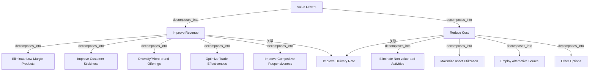

# G184/fig11-1 · 业务价值驱动（示例）

类型：`decomposition-or-organization-model`。给出一个“业务侧”价值驱动文档的示例：企业价值可以从收入增长与成本优化两条主线分解为一组可讨论的业务目标。第 11.2 节随后用图 11-2 把同一结构改写成 EA 的价值驱动，以便把 EA 价值地图挂到企业价值地图上。

英文 PDF 物理页：[109]。本页为架构语义分析，原文与原图分别保留。

## 原图与可编辑图


[完整 JSON](fig11-1.json) · [可编辑 Mermaid](fig11-1.mmd) · [仅关系图](fig11-1.relations.mmd) · [层级分解图](fig11-1.hierarchy.mmd)

图形重建表达语义，不复制源图布局。虚线表示解释、矩阵映射或分组关系，不自动表示不确定性的概率。



## 架构分析

从左向右读。最左蓝色“Value Drivers”是根；一条竖干在它右侧分成上下两支：上支进入橙色“Improve Revenue”，下支进入绿色“Reduce Cost”。每个主干右侧有一条竖直总线，分出若干水平箭头指向该主线的目标条。位于两组目标之间、底色由绿渐变到橙的“Improve Delivery Rate”接在连接两条主干的竖干上，表示它同时服务收入与成本两条主线。

- 本图有 13 个具名或隐含元素、13 条关系和 0 条包含/分组记录。
- 本图没有可直接确认为人员直属汇报的关系；视觉上下位置、能力分解和治理职责分别读取。
- 全部标签和分支端点核对；收入/成本各有独立目标，Improve Delivery Rate通过公共竖线共享。
- 保留各条原文，包含Other Options及渐变色共享条；不把选项穷尽为规范性目标清单。
- Value Drivers→收入/成本→选项属于分解视图；无明确正负极性、权重、基数或执行顺序。

### 如何用于项目

- 按父项展开所有直接子项，检查同层粒度、重叠和缺项。
- 保留组成、分类、能力分解与组织汇报的区别；将示例名称替换为已确认的项目对象。

### 结构所表达的逻辑

- 价值驱动被简化为财务上的二分：提升收入（Improve Revenue）与降低成本（Reduce Cost）；这是整棵目标树的顶层逻辑。
- 收入主线展开为 5 个业务目标：淘汰低毛利产品、提升客户粘性、多元化/微品牌产品、优化交易有效性、提升竞争响应力。
- 成本主线展开为 4 个目标：消除非增值活动、最大化资产利用、采用替代来源、其他选项。
- “提升交付率”（Improve Delivery Rate）位于两组之间，通过连接两条主干的竖干接入，并用橙绿渐变表示它既是收入目标也是成本目标，是图中唯一跨主线的共享目标。
- 目标条之间没有优先级、权重或时间顺序；图不提供 KPI、责任人、基线/目标值。
- “淘汰低毛利产品”“消除非增值活动”都以“消除”表述，说明目标不全是增量动作，也包括组合清理。

## 上下级与包含

三层：第 1 层是根“Value Drivers”；第 2 层是两条价值主线 Improve Revenue 与 Reduce Cost；第 3 层是 10 个业务目标。Improve Delivery Rate 是第 3 层中的跨主线共享节点，视觉上不归入任一主线的目标列。

|父项|子项|层级类型|依据与解释|
|---|---|---|---|
|—|—|无视觉包含|关系中明确的组成/特化见 JSON semantic_hierarchy。|

## 全部元素与角色

|元素ID|原文名称|类型|含义|直接父项|深度|
|---|---|---|---|---|---|
|value_drivers|Value Drivers|goal|目标/成果：价值驱动因素|—||
|improve_revenue|Improve Revenue|goal|目标/成果：提升收入|—||
|reduce_cost|Reduce Cost|goal|目标/成果：降低成本|—||
|eliminate_low_margin|Eliminate Low Margin Products|goal|目标/成果：淘汰低毛利产品|—||
|improve_customer_stickiness|Improve Customer Stickiness|goal|目标/成果：提升客户粘性|—||
|diversify_microbrand|Diversify/Micro-brand Offerings|goal|目标/成果：多元化/微品牌产品|—||
|optimize_trade|Optimize Trade Effectiveness|goal|目标/成果：优化交易有效性|—||
|improve_competitive_responsiveness|Improve Competitive Responsiveness|goal|目标/成果：提升竞争响应力|—||
|improve_delivery_rate|Improve Delivery Rate|goal|同时连接收入与成本两条主干，是图中唯一的共享目标。|—||
|eliminate_non_value_add|Eliminate Non-value-add Activities|goal|目标/成果：消除非增值活动|—||
|maximize_asset_utilization|Maximize Asset Utilization|goal|目标/成果：最大化资产利用|—||
|employ_alternative_source|Employ Alternative Source|goal|目标/成果：采用替代来源|—||
|other_options_cost|Other Options|goal|目标/成果：其他选项|—||

## 全部关系

全部为细实线正交折线，箭头指向被分解出的目标（根→主线→目标），表示“分解/贡献”而非流程或数据流。连接两条主干的竖干没有独立箭头，只在“Improve Delivery Rate”处有一个向右的箭头；因此该目标与两条主线都有连接。图中没有虚线、没有图例。

|主体|语义关系|客体|显式线/隐式|原文标签|依据|
|---|---|---|---|---|---|
|价值驱动因素|decomposes_into|提升收入|显式连线||箭头为价值驱动因素展开，非组织组成；共享交付率由收入与成本间的公共竖线单箭头接入，没有正负极性或量化因果。|
|价值驱动因素|decomposes_into|降低成本|显式连线||箭头为价值驱动因素展开，非组织组成；共享交付率由收入与成本间的公共竖线单箭头接入，没有正负极性或量化因果。|
|提升收入|decomposes_into|淘汰低毛利产品|显式连线||箭头为价值驱动因素展开，非组织组成；共享交付率由收入与成本间的公共竖线单箭头接入，没有正负极性或量化因果。|
|提升收入|decomposes_into|提升客户粘性|显式连线||箭头为价值驱动因素展开，非组织组成；共享交付率由收入与成本间的公共竖线单箭头接入，没有正负极性或量化因果。|
|提升收入|decomposes_into|多元化/微品牌产品|显式连线||箭头为价值驱动因素展开，非组织组成；共享交付率由收入与成本间的公共竖线单箭头接入，没有正负极性或量化因果。|
|提升收入|decomposes_into|优化交易有效性|显式连线||箭头为价值驱动因素展开，非组织组成；共享交付率由收入与成本间的公共竖线单箭头接入，没有正负极性或量化因果。|
|提升收入|decomposes_into|提升竞争响应力|显式连线||箭头为价值驱动因素展开，非组织组成；共享交付率由收入与成本间的公共竖线单箭头接入，没有正负极性或量化因果。|
|降低成本|decomposes_into|消除非增值活动|显式连线||箭头为价值驱动因素展开，非组织组成；共享交付率由收入与成本间的公共竖线单箭头接入，没有正负极性或量化因果。|
|降低成本|decomposes_into|最大化资产利用|显式连线||箭头为价值驱动因素展开，非组织组成；共享交付率由收入与成本间的公共竖线单箭头接入，没有正负极性或量化因果。|
|降低成本|decomposes_into|采用替代来源|显式连线||箭头为价值驱动因素展开，非组织组成；共享交付率由收入与成本间的公共竖线单箭头接入，没有正负极性或量化因果。|
|降低成本|decomposes_into|其他选项|显式连线||箭头为价值驱动因素展开，非组织组成；共享交付率由收入与成本间的公共竖线单箭头接入，没有正负极性或量化因果。|
|提升收入|关联|提升交付率|显式连线||箭头为价值驱动因素展开，非组织组成；共享交付率由收入与成本间的公共竖线单箭头接入，没有正负极性或量化因果。|
|降低成本|关联|提升交付率|显式连线||箭头为价值驱动因素展开，非组织组成；共享交付率由收入与成本间的公共竖线单箭头接入，没有正负极性或量化因果。|

## 本轮语义修正

- 箭头为价值驱动因素展开，非组织组成；共享交付率由收入与成本间的公共竖线单箭头接入，没有正负极性或量化因果。
- 箭头为价值驱动因素展开，非组织组成；共享交付率由收入与成本间的公共竖线单箭头接入，没有正负极性或量化因果。
- 箭头为价值驱动因素展开，非组织组成；共享交付率由收入与成本间的公共竖线单箭头接入，没有正负极性或量化因果。
- 箭头为价值驱动因素展开，非组织组成；共享交付率由收入与成本间的公共竖线单箭头接入，没有正负极性或量化因果。
- 箭头为价值驱动因素展开，非组织组成；共享交付率由收入与成本间的公共竖线单箭头接入，没有正负极性或量化因果。
- 箭头为价值驱动因素展开，非组织组成；共享交付率由收入与成本间的公共竖线单箭头接入，没有正负极性或量化因果。
- 箭头为价值驱动因素展开，非组织组成；共享交付率由收入与成本间的公共竖线单箭头接入，没有正负极性或量化因果。
- 箭头为价值驱动因素展开，非组织组成；共享交付率由收入与成本间的公共竖线单箭头接入，没有正负极性或量化因果。
- 箭头为价值驱动因素展开，非组织组成；共享交付率由收入与成本间的公共竖线单箭头接入，没有正负极性或量化因果。
- 箭头为价值驱动因素展开，非组织组成；共享交付率由收入与成本间的公共竖线单箭头接入，没有正负极性或量化因果。
- 箭头为价值驱动因素展开，非组织组成；共享交付率由收入与成本间的公共竖线单箭头接入，没有正负极性或量化因果。
- 箭头为价值驱动因素展开，非组织组成；共享交付率由收入与成本间的公共竖线单箭头接入，没有正负极性或量化因果。
- 箭头为价值驱动因素展开，非组织组成；共享交付率由收入与成本间的公共竖线单箭头接入，没有正负极性或量化因果。

## 误读检查

- 不要按从上到下理解为优先级或执行顺序；上下只是收入/成本两条并列主线。
- “Improve Delivery Rate”不是第三条主线，而是横跨两条主线的共享目标；渐变底色是它的语义编码。
- 从 Reduce Cost 到 Improve Delivery Rate 的连线与 Improve Revenue 共用同一条竖干、只有一个箭头；不要因为箭头只有一个就认为它只属于收入侧。
- 图没有时间轴、KPI 或权重；不能据此判断哪个目标更重要。
- 中文稿引用的 figs/g184_fig11-1.svg 是另一张通用“企业价值”图，标签与结构都不同，不能作为本图的读图依据。

## 原文证据

### [PDF 第 108 页](../../../documents/G184.md#page-108)

> The value of EA is realized over a period. See the sample value driver document for business (Figure 11-1) and EA (Figure 11-2). Either a pictorial or verbal description of the value delivered by the EA Capability and the personnel constituting the EA Capability team along a timeline will be useful in creating the plan.
### [PDF 第 109 页](../../../documents/G184.md#page-109)

> Communicating EA Capability maturity may sound like an academic communication. However, a metric to show the value improvement over the previous communication period would suddenly make the maturity communication more attractive and meaningful. Complement the cadence of business leader engagement by communicating how the maturity of the capability improved the efficiency of the organizational initiatives.
> Members of the team providing EA Capability have two different day jobs – one to produce the artifacts and another to engage actively with technology and business leaders. The roadmap should consider the capacity of the team; articulate milestone dates to deliver on the objectives, and define appropriate checks and balances for the EA Capability and the projects it influences.

## 来源与分析状态

所有元素/关系均有来源定位；未把历史解释重命名为本轮逐线视觉确认。源图与语义图是两种视图，布局不证明汇报或因果。

源 PDF SHA-256：`85fe5653767b184c3c8c9c1bef9f5738adbb2bf6661fb50ee95e72d16bc9f614`。

源图记录：[原始解释与转录](../../../figures/G184/fig11-1.json)。

```json
{
  "quality": {
    "graph_integrity": "checked",
    "semantic_analysis": "typed-graph-and-context-analysis",
    "visual_review": "source-content-audited",
    "notice_zh": "所有元素/关系均有来源定位；未把历史解释重命名为本轮逐线视觉确认。源图与语义图是两种视图，布局不证明汇报或因果。"
  },
  "source_uncertainty": {
    "confidence": "high",
    "uncertainties_zh": [
      "“Improve Delivery Rate”与两条主干的连接方式略特殊：竖干从 Improve Revenue 底部直通 Reduce Cost 顶部，交付率只接一个箭头；本分析按“两主干共享该目标”理解，图中无文字说明。",
      "图没有图例，橙/绿/渐变的语义由颜色与位置推断。",
      "中文标签为本分析拟定，中文稿的重绘 SVG 未沿用这些标签。"
    ],
    "analyzed_from": [
      "英文 PDF 第 109 页原图截图与 2×2 放大分块",
      "英文 PDF 第 108–109 页正文",
      "中文稿 G184e_领导者指南_建立并演进EA能力.md 第 1274–1278 行",
      "figs/g184_fig11-1.svg 源码"
    ],
    "date": "2026-10-31"
  },
  "source_conflicts": []
}
```
