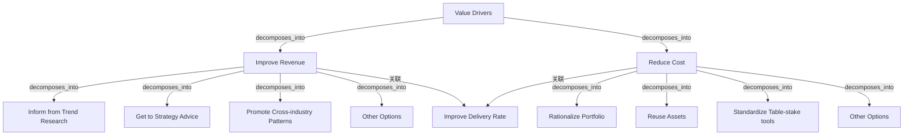

# G184/fig11-2 · EA 价值驱动（示例）

类型：`decomposition-or-organization-model`。把图 11-1 的业务价值驱动图改写成 EA 版本，示范 EA 能力如何用企业熟悉的收入/成本语言表达自身价值，从而把 EA 价值地图链接到企业价值地图，并用于路线图与挣值沟通。

英文 PDF 物理页：[110]。本页为架构语义分析，原文与原图分别保留。

## 原图与可编辑图


[完整 JSON](fig11-2.json) · [可编辑 Mermaid](fig11-2.mmd) · [仅关系图](fig11-2.relations.mmd) · [层级分解图](fig11-2.hierarchy.mmd)

图形重建表达语义，不复制源图布局。虚线表示解释、矩阵映射或分组关系，不自动表示不确定性的概率。



## 架构分析

从左向右读：Value Drivers 分成橙色 Improve Revenue 与绿色 Reduce Cost 两支。收入侧总线分出 4 条目标，成本侧总线分出 4 条目标；两组之间的橙绿渐变“Improve Delivery Rate”接在贯通两条主干的竖干上，表示两条主线共享。两个“Other Options”分别是两条分支的兜底项。

- 本图有 12 个具名或隐含元素、12 条关系和 0 条包含/分组记录。
- 本图没有可直接确认为人员直属汇报的关系；视觉上下位置、能力分解和治理职责分别读取。
- 全部标签和分支端点核对；收入/成本各有独立目标，Improve Delivery Rate通过公共竖线共享。
- 保留各条原文，包含Other Options及渐变色共享条；不把选项穷尽为规范性目标清单。
- Value Drivers→收入/成本→选项属于分解视图；无明确正负极性、权重、基数或执行顺序。
- 保留原文Get to Strategy Advice和Standardize Table-stake tools；后者指基础门槛工具，不是桌面工具。

### 如何用于项目

- 按父项展开所有直接子项，检查同层粒度、重叠和缺项。
- 保留组成、分类、能力分解与组织汇报的区别；将示例名称替换为已确认的项目对象。

### 结构所表达的逻辑

- EA 价值沿用与业务价值相同的两主干结构：提升收入与降低成本；这使得 EA 价值地图可以与图 11-1 的企业价值地图逐支对应。
- 收入侧 4 个 EA 价值目标：以趋势研究为依据、形成战略建议、推广跨行业模式、其他选项——强调洞察与决策支持。
- 成本侧 4 个目标：合理化组合、复用资产、标准化通用工具（Table-stake tools）、其他选项——强调复用、标准化与组合清理。
- “提升交付率”仍是跨两条主线的共享目标，说明 EA 既通过更好的洞察促进收入，也通过复用/标准化加快交付。
- 两个“Other Options”不是重复错误：它们分别是收入侧与成本侧的兜底项，位置不同、归属不同。
- 与图 11-1 一样，本图没有 KPI、时间轴、责任人；它是价值沟通的定性结构，不是效益测算表。
- 正文说价值要沿时间线描述，但图本身不含时间维度；时间线应另附。

## 上下级与包含

三层：根 Value Drivers；两条主线 Improve Revenue / Reduce Cost；9 个目标（收入侧 4 个、成本侧 4 个、共享 1 个）。两个 Other Options 分属上下两支，不是同一节点。

|父项|子项|层级类型|依据与解释|
|---|---|---|---|
|—|—|无视觉包含|关系中明确的组成/特化见 JSON semantic_hierarchy。|

## 全部元素与角色

|元素ID|原文名称|类型|含义|直接父项|深度|
|---|---|---|---|---|---|
|value_drivers|Value Drivers|goal|目标/成果：价值驱动因素|—||
|improve_revenue|Improve Revenue|goal|目标/成果：提升收入|—||
|reduce_cost|Reduce Cost|goal|目标/成果：降低成本|—||
|inform_trend_research|Inform from Trend Research|goal|目标/成果：以趋势研究为依据|—||
|get_strategy_advice|Get to Strategy Advice|goal|目标/成果：形成战略建议|—||
|promote_cross_industry|Promote Cross-industry Patterns|goal|目标/成果：推广跨行业模式|—||
|other_options_revenue|Other Options|goal|目标/成果：其他选项（收入侧）|—||
|improve_delivery_rate|Improve Delivery Rate|goal|同时连接收入与成本两条主干，是图中唯一的共享目标。|—||
|rationalize_portfolio|Rationalize Portfolio|goal|目标/成果：合理化组合|—||
|reuse_assets|Reuse Assets|goal|目标/成果：复用资产|—||
|standardize_tablestake|Standardize Table-stake tools|goal|table-stake tools 指基础/通用（table-stakes）工具，不是“桌面工具”。|—||
|other_options_cost|Other Options|goal|目标/成果：其他选项（成本侧）|—||

## 全部关系

细实线正交折线，箭头指向被分解出的目标；表示“分解/贡献”。收入与成本共用一条竖干连接“Improve Delivery Rate”，该目标只有一个入箭头，但竖干与两支都相连，表示共享。无虚线、无图例。

|主体|语义关系|客体|显式线/隐式|原文标签|依据|
|---|---|---|---|---|---|
|价值驱动因素|decomposes_into|提升收入|显式连线||箭头为价值驱动因素展开，非组织组成；共享交付率由收入与成本间的公共竖线单箭头接入，没有正负极性或量化因果。|
|价值驱动因素|decomposes_into|降低成本|显式连线||箭头为价值驱动因素展开，非组织组成；共享交付率由收入与成本间的公共竖线单箭头接入，没有正负极性或量化因果。|
|提升收入|decomposes_into|以趋势研究为依据|显式连线||箭头为价值驱动因素展开，非组织组成；共享交付率由收入与成本间的公共竖线单箭头接入，没有正负极性或量化因果。|
|提升收入|decomposes_into|形成战略建议|显式连线||箭头为价值驱动因素展开，非组织组成；共享交付率由收入与成本间的公共竖线单箭头接入，没有正负极性或量化因果。|
|提升收入|decomposes_into|推广跨行业模式|显式连线||箭头为价值驱动因素展开，非组织组成；共享交付率由收入与成本间的公共竖线单箭头接入，没有正负极性或量化因果。|
|提升收入|decomposes_into|其他选项（收入侧）|显式连线||箭头为价值驱动因素展开，非组织组成；共享交付率由收入与成本间的公共竖线单箭头接入，没有正负极性或量化因果。|
|降低成本|decomposes_into|合理化组合|显式连线||箭头为价值驱动因素展开，非组织组成；共享交付率由收入与成本间的公共竖线单箭头接入，没有正负极性或量化因果。|
|降低成本|decomposes_into|复用资产|显式连线||箭头为价值驱动因素展开，非组织组成；共享交付率由收入与成本间的公共竖线单箭头接入，没有正负极性或量化因果。|
|降低成本|decomposes_into|标准化通用工具|显式连线||箭头为价值驱动因素展开，非组织组成；共享交付率由收入与成本间的公共竖线单箭头接入，没有正负极性或量化因果。|
|降低成本|decomposes_into|其他选项（成本侧）|显式连线||箭头为价值驱动因素展开，非组织组成；共享交付率由收入与成本间的公共竖线单箭头接入，没有正负极性或量化因果。|
|提升收入|关联|提升交付率|显式连线||箭头为价值驱动因素展开，非组织组成；共享交付率由收入与成本间的公共竖线单箭头接入，没有正负极性或量化因果。|
|降低成本|关联|提升交付率|显式连线||箭头为价值驱动因素展开，非组织组成；共享交付率由收入与成本间的公共竖线单箭头接入，没有正负极性或量化因果。|

## 本轮语义修正

- 箭头为价值驱动因素展开，非组织组成；共享交付率由收入与成本间的公共竖线单箭头接入，没有正负极性或量化因果。
- 箭头为价值驱动因素展开，非组织组成；共享交付率由收入与成本间的公共竖线单箭头接入，没有正负极性或量化因果。
- 箭头为价值驱动因素展开，非组织组成；共享交付率由收入与成本间的公共竖线单箭头接入，没有正负极性或量化因果。
- 箭头为价值驱动因素展开，非组织组成；共享交付率由收入与成本间的公共竖线单箭头接入，没有正负极性或量化因果。
- 箭头为价值驱动因素展开，非组织组成；共享交付率由收入与成本间的公共竖线单箭头接入，没有正负极性或量化因果。
- 箭头为价值驱动因素展开，非组织组成；共享交付率由收入与成本间的公共竖线单箭头接入，没有正负极性或量化因果。
- 箭头为价值驱动因素展开，非组织组成；共享交付率由收入与成本间的公共竖线单箭头接入，没有正负极性或量化因果。
- 箭头为价值驱动因素展开，非组织组成；共享交付率由收入与成本间的公共竖线单箭头接入，没有正负极性或量化因果。
- 箭头为价值驱动因素展开，非组织组成；共享交付率由收入与成本间的公共竖线单箭头接入，没有正负极性或量化因果。
- 箭头为价值驱动因素展开，非组织组成；共享交付率由收入与成本间的公共竖线单箭头接入，没有正负极性或量化因果。
- 箭头为价值驱动因素展开，非组织组成；共享交付率由收入与成本间的公共竖线单箭头接入，没有正负极性或量化因果。
- 箭头为价值驱动因素展开，非组织组成；共享交付率由收入与成本间的公共竖线单箭头接入，没有正负极性或量化因果。

## 误读检查

- 不要把两个“Other Options”合并成一个；它们分别是收入侧与成本侧的兜底项。
- “Standardize Table-stake tools”不是“利益相关者表”，table-stake 指基础/通用（table-stakes）工具；不要按字面译成“桌面工具”。
- “Improve Delivery Rate”不是第三条主线，而是共享目标。
- 图没有时间线；SVG 底部所谓的“成熟度提升→决策质量→交付速度→成本与风险下降”因果链不是原图内容。
- 中文稿引用的 figs/g184_fig11-2.svg 是四个泛化收益框，不能据此理解 EA 价值与业务价值两支的对应关系。

## 原文证据

### [PDF 第 108 页](../../../documents/G184.md#page-108)

> The value of EA is realized over a period. See the sample value driver document for business (Figure 11-1) and EA (Figure 11-2). Either a pictorial or verbal description of the value delivered by the EA Capability and the personnel constituting the EA Capability team along a timeline will be useful in creating the plan.
### [PDF 第 110 页](../../../documents/G184.md#page-110)

> Figure 11-2: Modified Version of Business Value Diagram to Represent EA Value
### [PDF 第 111 页](../../../documents/G184.md#page-111)

> The ratio of projects or resources employed in the enterprise is normally several magnitudes higher than the capacity of the team providing the EA Capability. To replicate key efforts of the team providing the EA Capability, a capability model provides the template with which the EA function can be scaled to cover the entire enterprise.
> While there are some publicly available EA Capability models, such as NASCIO or the World-Class Enterprise Architecture White Paper, none of them can be directly applied to an enterprise. Context under which they were developed never really matches an enterprise, but they provide a great foundation. Experience shows that using existing capability models in the enterprise or publicly available models as a reference or base accelerates assessment, delivery, and adoption. Analyze these models in terms of the EA Capability context and purpose before selecting the base. Starting with a single model and adding or modifying to meet specific needs of the enterprise vastly reduces time to finalize.

## 来源与分析状态

所有元素/关系均有来源定位；未把历史解释重命名为本轮逐线视觉确认。源图与语义图是两种视图，布局不证明汇报或因果。

源 PDF SHA-256：`85fe5653767b184c3c8c9c1bef9f5738adbb2bf6661fb50ee95e72d16bc9f614`。

源图记录：[原始解释与转录](../../../figures/G184/fig11-2.json)。

```json
{
  "quality": {
    "graph_integrity": "checked",
    "semantic_analysis": "typed-graph-and-context-analysis",
    "visual_review": "source-content-audited",
    "notice_zh": "所有元素/关系均有来源定位；未把历史解释重命名为本轮逐线视觉确认。源图与语义图是两种视图，布局不证明汇报或因果。"
  },
  "source_uncertainty": {
    "confidence": "high",
    "uncertainties_zh": [
      "“Improve Delivery Rate”只接一个入箭头，但竖干同时连接两条主线；本分析按“共享目标”理解，图中无文字说明。",
      "“Table-stake tools”语义按 table-stakes（基础/通用工具）理解，图中未解释。",
      "中文标签为本分析拟定；中文稿的重绘 SVG 未沿用这些标签。"
    ],
    "analyzed_from": [
      "英文 PDF 第 110 页原图截图与 2×2 放大分块",
      "英文 PDF 第 108、110 页正文",
      "中文稿 G184e_领导者指南_建立并演进EA能力.md 第 1274–1280 行",
      "figs/g184_fig11-2.svg 源码"
    ],
    "date": "2026-10-31"
  },
  "source_conflicts": []
}
```
