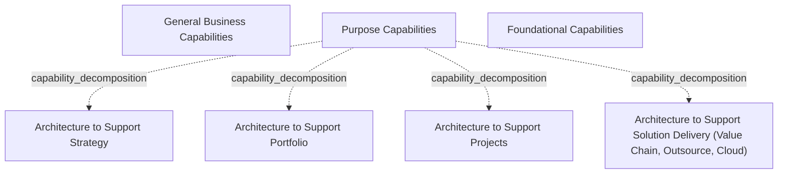

# G184/fig11-3 · EA 能力模型示例（一）

类型：`decomposition-or-organization-model`。给出一个按“目的”组织的 EA 能力模型样例：把 EA 能力分成所有企业共有的通用业务能力、按 EA 章程目的划分的目的能力，以及支撑前两者的基础能力；用于评估需要多少架构师覆盖哪些能力。正文说明各目的下所需的具体能力不在本图中列出。

英文 PDF 物理页：[112]。本页为架构语义分析，原文与原图分别保留。

## 原图与可编辑图


[完整 JSON](fig11-3.json) · [可编辑 Mermaid](fig11-3.mmd) · [仅关系图](fig11-3.relations.mmd) · [层级分解图](fig11-3.hierarchy.mmd)

图形重建表达语义，不复制源图布局。虚线表示解释、矩阵映射或分组关系，不自动表示不确定性的概率。



## 架构分析

从上到下读三条蓝色带：最上“General Business Capabilities”，中间“Purpose Capabilities”，最下“Foundational Capabilities”。只有中间带被展开：四个彩色框从左到右是四种目的能力，分别支持战略、组合、项目、解决方案交付；最右侧框还括注了价值链、外包、云三个示例场景。三层之间没有连线，上下顺序是分类层级而非流程顺序。

- 本图有 7 个具名或隐含元素、0 条关系和 4 条包含/分组记录。
- 包含/分组树最大深度为 1；根节点为 通用业务能力、目的能力、基础能力。
- 本图没有可直接确认为人员直属汇报的关系；视觉上下位置、能力分解和治理职责分别读取。
- 原图靠嵌套表达结构，没有连线；新语义图将包含单独显式化，不补造流程、数据流或依赖。
- 包含分组后有 3 个连通分量；分离可能源于图例、并列分类或独立示例，未自动补边。
- 3横带与4目的框共7标签完整；Solution Delivery括号原文Value Chain, Outsource, Cloud完整保留；无连接线。
- 112页明确每种目的所需具体能力未在本文件呈现，此图不能作为完整的目的能力分解。

### 如何用于项目

- 按父项展开所有直接子项，检查同层粒度、重叠和缺项。
- 保留组成、分类、能力分解与组织汇报的区别；将示例名称替换为已确认的项目对象。

### 结构所表达的逻辑

- 模型的第一维是“目的”：EA 能力可以支持战略、组合、项目或解决方案交付，四个目的并列。
- 通用业务能力与基础能力是横向的共有层：前者是所有企业都需要的业务能力，后者是支撑 EA 工作的基础能力；图中只画了层名，没有展开内容。
- 目的能力层是唯一展开的层，说明本样例的重点是“EA 为什么目的服务”，而不是逐项能力清单。
- “Architecture to Support Solution Delivery”括注 Value Chain、Outsource、Cloud，给出该目的常见的三种交付情境。
- 四个目的框颜色不同但无图例，颜色不表示成熟度、优先级或先后。
- 正文明确：支持每个目的所需的具体能力不在本文档中给出；不能把四个框当作完整的能力清单。

## 上下级与包含

三层纵向分类：General Business Capabilities（顶层）、Purpose Capabilities（中层）、Foundational Capabilities（底层）。中层内部包含四个并列的目的能力框，均以 Purpose Capabilities 为父容器；四个框之间没有上下级关系。

|父项|子项|层级类型|依据与解释|
|---|---|---|---|
|目的能力|支持战略的架构|capability_decomposition|同类能力的包含分解；能力实例与能力类型另以实例化关系记录。|
|目的能力|支持组合的架构|capability_decomposition|同类能力的包含分解；能力实例与能力类型另以实例化关系记录。|
|目的能力|支持项目的架构|capability_decomposition|同类能力的包含分解；能力实例与能力类型另以实例化关系记录。|
|目的能力|支持解决方案交付的架构（价值链、外包、云）|capability_decomposition|同类能力的包含分解；能力实例与能力类型另以实例化关系记录。|

## 全部元素与角色

|元素ID|原文名称|类型|含义|直接父项|深度|
|---|---|---|---|---|---|
|general_business_capabilities|General Business Capabilities|capability|所有企业共有的业务能力层；图中未展开具体能力。|—||
|purpose_capabilities|Purpose Capabilities|capability|按 EA 章程目的划分的能力层，包含四个并列目的能力框。|—||
|arch_support_strategy|Architecture to Support Strategy|capability|能力：支持战略的架构|目的能力|1|
|arch_support_portfolio|Architecture to Support Portfolio|capability|能力：支持组合的架构|目的能力|1|
|arch_support_projects|Architecture to Support Projects|capability|能力：支持项目的架构|目的能力|1|
|arch_support_solution_delivery|Architecture to Support Solution Delivery (Value Chain, Outsource, Cloud)|capability|能力：支持解决方案交付的架构（价值链、外包、云）|目的能力|1|
|foundational_capabilities|Foundational Capabilities|capability|支撑通用业务能力与目的能力的基础层；图中未展开具体能力。|—||

## 全部关系

图中没有任何连线或箭头。层级只由三条横向色带的上下堆叠与中层的内嵌表达；“目的能力”对“通用/基础能力”的关系是分类并列，不是组成或依赖。

|主体|语义关系|客体|显式线/隐式|原文标签|依据|
|---|---|---|---|---|---|

## 误读检查

- 不要从上到下读成成熟度等级或实施顺序：三层是能力分类，不是演进阶段。
- 通用业务能力与基础能力带是空的，并不表示企业不需要这些能力，而是正文说明具体能力不在本图展开。
- 四个目的能力不是彼此包含的 sub-capability，而是四种并列的 EA 目的。
- 颜色没有图例，不能据此判断哪个目的更重要。
- 不要把本图与图 11-4 混淆：11-3 按目的分层，11-4 按经典架构域分四列；中文稿的 fig11-3 PNG 实际显示的是 11-4。

## 原文证据

### [PDF 第 112 页](../../../documents/G184.md#page-112)

> This model aligns to purpose. The purpose could be focused on operating EA or delivering value from EA viz., operational capabilities, and separates common Foundational Capabilities or General Business Capabilities. The capabilities required to support each of the purposes are not presented in this document.
> The model shown in Figure 11-4 aligns to classic architecture domains and development of architecture to support strategy. When applied to an enterprise that manufactures packaging material for food products, “monitor future trends” would mean how to improve the shelf life of products using techniques developed for defense use. Inputs from such monitoring could call for changes to business and technology architecture – retooling the plants, scouting for new raw material suppliers, and new processes. Obsolescence of a product can arise from regulatory changes – like a ban on use of plastic bags or CFC-based coolants in air conditioners and refrigerators. In this connected world of distributed sourcing and just-in-time manufacturing, a focus on IT infrastructure is required to track any impacts arising from disruptions in the supply chain.
### [PDF 第 113 页](../../../documents/G184.md#page-113)

> While a capability model makes it easy to establish an approach to measure the efficiency and outcome of the EA efforts, alternative approaches like process control or Balanced Scorecard are equally effective.

## 来源与分析状态

所有元素/关系均有来源定位；未把历史解释重命名为本轮逐线视觉确认。源图与语义图是两种视图，布局不证明汇报或因果。

源 PDF SHA-256：`85fe5653767b184c3c8c9c1bef9f5738adbb2bf6661fb50ee95e72d16bc9f614`。

源图记录：[原始解释与转录](../../../figures/G184/fig11-3.json)。

```json
{
  "quality": {
    "graph_integrity": "checked",
    "semantic_analysis": "typed-graph-and-context-analysis",
    "visual_review": "source-content-audited",
    "notice_zh": "所有元素/关系均有来源定位；未把历史解释重命名为本轮逐线视觉确认。源图与语义图是两种视图，布局不证明汇报或因果。"
  },
  "source_uncertainty": {
    "confidence": "high",
    "uncertainties_zh": [
      "四个目的能力框的颜色无图例，无法确认颜色是否仅用于区分。",
      "原图未说明“通用业务能力”和“基础能力”是否也按目的细分；本分析只按图中可见的三层处理。"
    ],
    "analyzed_from": [
      "英文 PDF 第 112 页图 11-3 截图（figctx 裁切）与第 112–113 页正文",
      "中文稿 G184e_领导者指南_建立并演进EA能力.md 第 928–936 行",
      "figs/zh/g184e_fig11-3_zh.svg 源码",
      "figs/g184e_fig11-3_en.png 与 figs/zh/g184e_fig11-3_zh.png（确认二者实为图 11-4）"
    ],
    "date": "2026-10-31"
  },
  "source_conflicts": []
}
```
