# G184/fig11-4 · EA 能力模型示例（二）

类型：`decomposition-or-organization-model`。给出另一种 EA 能力模型样例：不按 EA 目的分层，而按经典架构域与“支持战略的架构开发”组织成四个能力域，逐项列出能力/活动，供领导者评估团队需要覆盖哪些能力、配置多少架构师。

英文 PDF 物理页：[112]。本页为架构语义分析，原文与原图分别保留。

## 原图与可编辑图


[完整 JSON](fig11-4.json) · [可编辑 Mermaid](fig11-4.mmd) · [仅关系图](fig11-4.relations.mmd) · [层级分解图](fig11-4.hierarchy.mmd)

图形重建表达语义，不复制源图布局。虚线表示解释、矩阵映射或分组关系，不自动表示不确定性的概率。

```mermaid
flowchart TB
  %% Semantic reconstruction; see original source image for exact layout.
  n0["Manage Planning &amp; Strategy"]
  n1["Maintain Strategic Planning Process"]
  n2["Manage Strategic Plan"]
  n3["Monitor Future Trends (technology &amp; business)"]
  n4["Develop Tactical Plans to maintain value &amp; relevance"]
  n5["Manage Service &amp; Operating Models"]
  n6["Manage Enterprise Knowledge Retention Policies"]
  n7["Manage Enterprise Architecture"]
  n8["Manage Team Capacity"]
  n9["Manage EA Scope"]
  n10["Manage Business Architecture"]
  n11["Manage Data Architecture"]
  n12["Manage Applications Architecture"]
  n13["Manage Technology Architecture"]
  n14["Manage Security Architecture"]
  n15["Manage Standards"]
  n16["Analyze &amp; Mitigate Enterprise Gaps"]
  n17["Manage Architecture Knowledge Base"]
  n18["Performance Future State Analysis"]
  n19["Develop Mitigation Plans"]
  n20["Manage Business Case"]
  n21["Develop Roadmaps"]
  n22["Engage in IT &amp; Project/Program Operations"]
  n23["Plan for Obsolescence"]
  n24["Provide Oversight &amp; Value"]
  n25["Manage Architecture Board"]
  n26["Provide External Oversight to IT &amp; Strategy"]
  n27["Define &amp; Manage Performance Metrics"]
  n28["Manage Communication &amp; Collaboration Approach"]
  n29["Measure Architect &amp; Architecture Success"]
  n0 -.->|"分组"| n1
  n0 -.->|"分组"| n2
  n0 -.->|"分组"| n3
  n0 -.->|"分组"| n4
  n0 -.->|"分组"| n5
  n0 -.->|"分组"| n6
  n7 -.->|"分组"| n8
  n7 -.->|"分组"| n9
  n7 -.->|"分组"| n10
  n7 -.->|"分组"| n11
  n7 -.->|"分组"| n12
  n7 -.->|"分组"| n13
  n7 -.->|"分组"| n14
  n7 -.->|"分组"| n15
  n16 -.->|"分组"| n17
  n16 -.->|"分组"| n18
  n16 -.->|"分组"| n19
  n16 -.->|"分组"| n20
  n16 -.->|"分组"| n21
  n16 -.->|"分组"| n22
  n16 -.->|"分组"| n23
  n24 -.->|"分组"| n25
  n24 -.->|"分组"| n26
  n24 -.->|"分组"| n27
  n24 -.->|"分组"| n28
  n24 -.->|"分组"| n29
```



## 架构分析

从左到右读四个紫色列，每列顶部深色带是能力域名称，下面是从上到下的能力/活动清单。四列是并列的，列内条目也没有序号；不要按列或按行读成流程。图没有任何箭头，列与列之间、条目与条目之间都没有画出的依赖关系。

- 本图有 30 个具名或隐含元素、0 条关系和 26 条包含/分组记录。
- 包含/分组树最大深度为 1；根节点为 管理规划与战略、管理企业架构、分析与缓解企业差距、提供监督与价值。
- 本图没有可直接确认为人员直属汇报的关系；视觉上下位置、能力分解和治理职责分别读取。
- 原图靠嵌套表达结构，没有连线；新语义图将包含单独显式化，不补造流程、数据流或依赖。
- 包含分组后有 4 个连通分量；分离可能源于图例、并列分类或独立示例，未自动补边。
- 4个紫色卡片、26项文本完整；四列分别6/8/7/5项，无流程连线。
- 标题与卡内文字是能力分类，不是按行顺序执行；保留原文Performance Future State Analysis，不静默修正文法或替换成Perform。
- 112页将其称为通用业务能力示例，不把示例集合误当唯一强制EA能力模型。

### 如何用于项目

- 按父项展开所有直接子项，检查同层粒度、重叠和缺项。
- 保留组成、分类、能力分解与组织汇报的区别；将示例名称替换为已确认的项目对象。

### 结构所表达的逻辑

- 四个能力域并列：管理规划与战略、管理企业架构、分析与缓解企业差距、提供监督与价值。
- 第二列是核心架构域集合：团队容量、EA 范围、业务/数据/应用/技术/安全架构、标准，覆盖经典架构分层。
- 第一列偏向战略与规划：维护战略规划流程、管理战略计划、监测未来趋势、制定战术计划、管理服务与运营模式、管理企业知识留存政策。
- 第三列偏向差距与变革：架构知识库、绩效未来状态分析、缓解计划、商业论证、路线图、参与 IT 与项目/项目群运营、淘汰规划。
- 第四列偏向治理与价值：架构委员会、向 IT 与战略提供外部监督、绩效指标、沟通与协作方式、衡量架构师与架构成功。
- 条目总数为 26 项；它们的能力粒度不完全一致（有的是流程，有的是产出，有的是治理机制），模型是覆盖清单而非严格分类法。
- 正文用食品包装材料制造商说明“监测未来趋势”的具体含义：把国防领域的技术用于延长保质期；监管禁令（塑料袋、CFC 制冷剂）会导致产品淘汰，分布式采购与准时制生产则要求关注 IT 基础设施。

## 上下级与包含

两层：第 1 层是四个并列能力域（列标题）；第 2 层是各域下的能力/活动条目，共 26 项。四列之间没有上下级或先后关系；列内条目是平铺清单，不是分解树。

|父项|子项|层级类型|依据与解释|
|---|---|---|---|
|管理规划与战略|维护战略规划流程|classified_under|列标题用于分类；没有封闭容器，也不表示业务上下级。|
|管理规划与战略|管理战略计划|classified_under|列标题用于分类；没有封闭容器，也不表示业务上下级。|
|管理规划与战略|监测未来趋势（技术与业务）|classified_under|列标题用于分类；没有封闭容器，也不表示业务上下级。|
|管理规划与战略|制定战术计划以保持价值与相关性|classified_under|列标题用于分类；没有封闭容器，也不表示业务上下级。|
|管理规划与战略|管理服务与运营模式|classified_under|列标题用于分类；没有封闭容器，也不表示业务上下级。|
|管理规划与战略|管理企业知识留存政策|classified_under|列标题用于分类；没有封闭容器，也不表示业务上下级。|
|管理企业架构|管理团队容量|classified_under|列标题用于分类；没有封闭容器，也不表示业务上下级。|
|管理企业架构|管理 EA 范围|classified_under|列标题用于分类；没有封闭容器，也不表示业务上下级。|
|管理企业架构|管理业务架构|classified_under|列标题用于分类；没有封闭容器，也不表示业务上下级。|
|管理企业架构|管理数据架构|classified_under|列标题用于分类；没有封闭容器，也不表示业务上下级。|
|管理企业架构|管理应用架构|classified_under|列标题用于分类；没有封闭容器，也不表示业务上下级。|
|管理企业架构|管理技术架构|classified_under|列标题用于分类；没有封闭容器，也不表示业务上下级。|
|管理企业架构|管理安全架构|classified_under|列标题用于分类；没有封闭容器，也不表示业务上下级。|
|管理企业架构|管理标准|classified_under|列标题用于分类；没有封闭容器，也不表示业务上下级。|
|分析与缓解企业差距|管理架构知识库|classified_under|列标题用于分类；没有封闭容器，也不表示业务上下级。|
|分析与缓解企业差距|绩效未来状态分析|classified_under|列标题用于分类；没有封闭容器，也不表示业务上下级。|
|分析与缓解企业差距|制定缓解计划|classified_under|列标题用于分类；没有封闭容器，也不表示业务上下级。|
|分析与缓解企业差距|管理商业论证|classified_under|列标题用于分类；没有封闭容器，也不表示业务上下级。|
|分析与缓解企业差距|制定路线图|classified_under|列标题用于分类；没有封闭容器，也不表示业务上下级。|
|分析与缓解企业差距|参与 IT 与项目/项目群运营|classified_under|列标题用于分类；没有封闭容器，也不表示业务上下级。|
|分析与缓解企业差距|淘汰规划|classified_under|列标题用于分类；没有封闭容器，也不表示业务上下级。|
|提供监督与价值|管理架构委员会|classified_under|列标题用于分类；没有封闭容器，也不表示业务上下级。|
|提供监督与价值|向 IT 与战略提供外部监督|classified_under|列标题用于分类；没有封闭容器，也不表示业务上下级。|
|提供监督与价值|定义与管理绩效指标|classified_under|列标题用于分类；没有封闭容器，也不表示业务上下级。|
|提供监督与价值|管理沟通与协作方式|classified_under|列标题用于分类；没有封闭容器，也不表示业务上下级。|
|提供监督与价值|衡量架构师与架构成功|classified_under|列标题用于分类；没有封闭容器，也不表示业务上下级。|

## 全部元素与角色

|元素ID|原文名称|类型|含义|直接父项|深度|
|---|---|---|---|---|---|
|col_planning_strategy|Manage Planning & Strategy|capability|能力：管理规划与战略|—||
|maintain_strategic_planning_process|Maintain Strategic Planning Process|capability|能力：维护战略规划流程|管理规划与战略|1|
|manage_strategic_plan|Manage Strategic Plan|capability|能力：管理战略计划|管理规划与战略|1|
|monitor_future_trends|Monitor Future Trends (technology & business)|capability|能力：监测未来趋势（技术与业务）|管理规划与战略|1|
|develop_tactical_plans|Develop Tactical Plans to maintain value & relevance|capability|能力：制定战术计划以保持价值与相关性|管理规划与战略|1|
|manage_service_operating_models|Manage Service & Operating Models|capability|能力：管理服务与运营模式|管理规划与战略|1|
|manage_knowledge_retention_policies|Manage Enterprise Knowledge Retention Policies|capability|能力：管理企业知识留存政策|管理规划与战略|1|
|col_enterprise_architecture|Manage Enterprise Architecture|capability|能力：管理企业架构|—||
|manage_team_capacity|Manage Team Capacity|capability|能力：管理团队容量|管理企业架构|1|
|manage_ea_scope|Manage EA Scope|capability|能力：管理 EA 范围|管理企业架构|1|
|manage_business_architecture|Manage Business Architecture|capability|能力：管理业务架构|管理企业架构|1|
|manage_data_architecture|Manage Data Architecture|capability|能力：管理数据架构|管理企业架构|1|
|manage_applications_architecture|Manage Applications Architecture|capability|能力：管理应用架构|管理企业架构|1|
|manage_technology_architecture|Manage Technology Architecture|capability|能力：管理技术架构|管理企业架构|1|
|manage_security_architecture|Manage Security Architecture|capability|能力：管理安全架构|管理企业架构|1|
|manage_standards|Manage Standards|capability|能力：管理标准|管理企业架构|1|
|col_gap_mitigation|Analyze & Mitigate Enterprise Gaps|capability|能力：分析与缓解企业差距|—||
|manage_architecture_knowledge_base|Manage Architecture Knowledge Base|capability|能力：管理架构知识库|分析与缓解企业差距|1|
|performance_future_state_analysis|Performance Future State Analysis|capability|能力：绩效未来状态分析|分析与缓解企业差距|1|
|develop_mitigation_plans|Develop Mitigation Plans|capability|能力：制定缓解计划|分析与缓解企业差距|1|
|manage_business_case|Manage Business Case|capability|能力：管理商业论证|分析与缓解企业差距|1|
|develop_roadmaps|Develop Roadmaps|capability|能力：制定路线图|分析与缓解企业差距|1|
|engage_it_project_program_operations|Engage in IT & Project/Program Operations|capability|能力：参与 IT 与项目/项目群运营|分析与缓解企业差距|1|
|plan_for_obsolescence|Plan for Obsolescence|capability|能力：淘汰规划|分析与缓解企业差距|1|
|col_oversight_value|Provide Oversight & Value|capability|能力：提供监督与价值|—||
|manage_architecture_board|Manage Architecture Board|capability|能力：管理架构委员会|提供监督与价值|1|
|provide_external_oversight|Provide External Oversight to IT & Strategy|capability|能力：向 IT 与战略提供外部监督|提供监督与价值|1|
|define_manage_performance_metrics|Define & Manage Performance Metrics|capability|能力：定义与管理绩效指标|提供监督与价值|1|
|manage_communication_collaboration|Manage Communication & Collaboration Approach|capability|能力：管理沟通与协作方式|提供监督与价值|1|
|measure_architect_architecture_success|Measure Architect & Architecture Success|capability|能力：衡量架构师与架构成功|提供监督与价值|1|

## 全部关系

图中没有任何连线或箭头。分组只由“条目位于哪一列”表达；列内顺序只是排版顺序，不表示时间、优先级或成熟度。

|主体|语义关系|客体|显式线/隐式|原文标签|依据|
|---|---|---|---|---|---|

## 误读检查

- 不要把四列读成四个阶段或成熟度等级；它们是并列的能力域。
- 列内条目没有编号，不要按从上到下理解为执行顺序。
- “Manage Standards”与各架构域条目并列，不要误认为它是所有架构域的父项。
- “Performance Future State Analysis”是“绩效未来状态分析”，不是泛泛的“未来状态分析”；中文 SVG 漏译了 Performance。
- “Engage in IT & Project/Program Operations”是一句完整能力描述，不要拆成“参与 IT”和“项目/项目群运营”两个独立能力。
- 本图与图 11-3 是两种替代模型，不是同一模型的两部分；中文稿的 fig11-3 PNG 实际显示的是本图。

## 原文证据

### [PDF 第 112 页](../../../documents/G184.md#page-112)

> The model shown in Figure 11-4 aligns to classic architecture domains and development of architecture to support strategy. When applied to an enterprise that manufactures packaging material for food products, “monitor future trends” would mean how to improve the shelf life of products using techniques developed for defense use. Inputs from such monitoring could call for changes to business and technology architecture – retooling the plants, scouting for new raw material suppliers, and new processes. Obsolescence of a product can arise from regulatory changes – like a ban on use of plastic bags or CFC-based coolants in air conditioners and refrigerators. In this connected world of distributed sourcing and just-in-time manufacturing, a focus on IT infrastructure is required to track any impacts arising from disruptions in the supply chain.
### [PDF 第 113 页](../../../documents/G184.md#page-113)

> While a capability model makes it easy to establish an approach to measure the efficiency and outcome of the EA efforts, alternative approaches like process control or Balanced Scorecard are equally effective.

## 来源与分析状态

所有元素/关系均有来源定位；未把历史解释重命名为本轮逐线视觉确认。源图与语义图是两种视图，布局不证明汇报或因果。

源 PDF SHA-256：`85fe5653767b184c3c8c9c1bef9f5738adbb2bf6661fb50ee95e72d16bc9f614`。

源图记录：[原始解释与转录](../../../figures/G184/fig11-4.json)。

```json
{
  "quality": {
    "graph_integrity": "checked",
    "semantic_analysis": "typed-graph-and-context-analysis",
    "visual_review": "source-content-audited",
    "notice_zh": "所有元素/关系均有来源定位；未把历史解释重命名为本轮逐线视觉确认。源图与语义图是两种视图，布局不证明汇报或因果。"
  },
  "source_uncertainty": {
    "confidence": "high",
    "uncertainties_zh": [
      "条目粒度不一致（流程、产出、治理机制混列），原图未说明分类规则。",
      "中文 SVG 漏译 “Performance”，本分析按原图与中文 PNG 补为“绩效未来状态分析”。",
      "“Table-stake”只出现在图 11-2；本图无此词，不涉及。"
    ],
    "analyzed_from": [
      "英文 PDF 第 112 页图 11-4 截图（整页概览 + 嵌入 PNG）",
      "英文 PDF 第 112–113 页正文",
      "中文稿 G184e_领导者指南_建立并演进EA能力.md 第 928–936 行",
      "figs/zh/g184e_fig11-4_zh.svg、figs/g184e_fig11-4_en.png、figs/zh/g184e_fig11-4_zh.png"
    ],
    "date": "2026-10-31"
  },
  "source_conflicts": []
}
```
