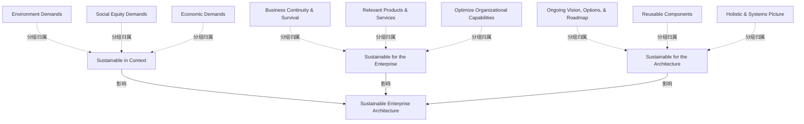

# G184/fig12-1 · 可持续的 EA

类型：`architecture-concept-or-system-model`。在“维持与成熟”一节给出可持续 EA 的概念框架：EA 能力要同时对外部语境、对企业、对架构自身可持续，三者共同汇聚为可持续的企业架构。它把“可持续”从单一的环境议题扩展为三维判断标准。

英文 PDF 物理页：[118]。本页为架构语义分析，原文与原图分别保留。

## 原图与可编辑图


[完整 JSON](fig12-1.json) · [可编辑 Mermaid](fig12-1.mmd) · [仅关系图](fig12-1.relations.mmd) · [层级分解图](fig12-1.hierarchy.mmd)

图形重建表达语义，不复制源图布局。虚线表示解释、矩阵映射或分组关系，不自动表示不确定性的概率。



## 架构分析

从中心蓝色圆“Sustainable Enterprise Architecture”读起，它是三个维度的汇合点。左侧橙色“Sustainable in Context”、上方绿色“Sustainable for the Enterprise”、右侧洋红“Sustainable for the Architecture”各用一个粗块箭头指向中心。每个圆角框旁边还有三块同色系的小条，是该维度的具体内容；小条与圆角框之间没有画线，靠颜色与邻近关系分组。

- 本图有 13 个具名或隐含元素、12 条关系和 0 条包含/分组记录。
- 本图没有可直接确认为人员直属汇报的关系；视觉上下位置、能力分解和治理职责分别读取。
- 13个节点/文字标签完整；仅3条粗箭头从三个可持续性框指向中心EA。
- 9项同色说明按3+3+3分组，未绘制连线；颜色不表示风险或成熟度等级。
- 118–119页讨论可持续EA能力的语境及企业/架构相关性，不提供量化评估指标。

### 如何用于项目

- 围绕作者目的读取本图实体、分组与连线，并用对应原文限定其含义。
- 把参考模型与项目事实分开，实际范围、约束、值和责任须有项目证据。

### 结构所表达的逻辑

- 三个维度缺一不可：语境中的可持续（对外部环境）、企业的可持续（对业务存续与价值）、架构的可持续（对架构自身可复用、可演进）。
- “语境中的可持续”对应三重底线：环境需求、社会公平需求、经济需求。
- “企业的可持续”对应业务连续性与生存、相关产品与服务、优化组织能力，强调 EA 要支撑企业存续与竞争力。
- “架构的可持续”对应持续的愿景/选项/路线图、可复用组件、整体与系统图景，强调架构资产与决策机制能长期复用。
- 三个维度都以粗箭头指向中心，表示它们是“可持续企业架构”的构成条件，而不是先后步骤。
- 三个说明条没有连线，不能读成“需求→维度→架构”的数据流；它们只是各维度的展开说明。
- 图中没有时间轴、成熟度等级或度量指标；可持续性是定性框架，具体度量需另行设计。

## 上下级与包含

中心一层：Sustainable Enterprise Architecture。外围三个并列维度：Sustainable in Context、Sustainable for the Enterprise、Sustainable for the Architecture。每个维度旁各有三条同色系说明条（共 9 条），是维度的展开，不是第三层子能力。

|父项|子项|层级类型|依据与解释|
|---|---|---|---|
|—|—|无视觉包含|关系中明确的组成/特化见 JSON semantic_hierarchy。|

## 全部元素与角色

|元素ID|原文名称|类型|含义|直接父项|深度|
|---|---|---|---|---|---|
|sustainable_ea|Sustainable Enterprise Architecture|architecture|架构：可持续的企业架构|—||
|sustainable_in_context|Sustainable in Context|concept|概念：语境中的可持续|—||
|sustainable_for_enterprise|Sustainable for the Enterprise|concept|概念：企业的可持续|—||
|sustainable_for_architecture|Sustainable for the Architecture|concept|概念：架构的可持续|—||
|environment_demands|Environment Demands|requirement|需求：环境需求|—||
|social_equity_demands|Social Equity Demands|requirement|需求：社会公平需求|—||
|economic_demands|Economic Demands|requirement|需求：经济需求|—||
|business_continuity_survival|Business Continuity & Survival|goal|目标/成果：业务连续性与生存|—||
|relevant_products_services|Relevant Products & Services|goal|目标/成果：相关产品与服务|—||
|optimize_organizational_capabilities|Optimize Organizational Capabilities|goal|目标/成果：优化组织能力|—||
|ongoing_vision_options_roadmap|Ongoing Vision, Options, & Roadmap|goal|目标/成果：持续的愿景、选项与路线图|—||
|reusable_components|Reusable Components|goal|目标/成果：可复用组件|—||
|holistic_systems_picture|Holistic & Systems Picture|goal|目标/成果：整体与系统图景|—||

## 全部关系

三条粗块箭头全部指向中心，表示三个维度共同支撑/汇入可持续的企业架构；箭头不是数据流或流程顺序。九条说明条与三个圆角框之间没有画线，分组仅由颜色和左右/上方的邻近位置表达（隐含关系）。

|主体|语义关系|客体|显式线/隐式|原文标签|依据|
|---|---|---|---|---|---|
|语境中的可持续|影响|可持续的企业架构|显式连线||左侧橙色粗块箭头向右下指向中心圆。|
|企业的可持续|影响|可持续的企业架构|显式连线||上方绿色粗块箭头向下指向中心圆。|
|架构的可持续|影响|可持续的企业架构|显式连线||右侧洋红粗块箭头向左下指向中心圆。|
|环境需求|分组归属|语境中的可持续|implicit||9项附近同色说明文字是语境/企业/架构三类可持续性的内容，无对应连线，不构成独立已证实因果。|
|社会公平需求|分组归属|语境中的可持续|implicit||9项附近同色说明文字是语境/企业/架构三类可持续性的内容，无对应连线，不构成独立已证实因果。|
|经济需求|分组归属|语境中的可持续|implicit||9项附近同色说明文字是语境/企业/架构三类可持续性的内容，无对应连线，不构成独立已证实因果。|
|业务连续性与生存|分组归属|企业的可持续|implicit||9项附近同色说明文字是语境/企业/架构三类可持续性的内容，无对应连线，不构成独立已证实因果。|
|相关产品与服务|分组归属|企业的可持续|implicit||9项附近同色说明文字是语境/企业/架构三类可持续性的内容，无对应连线，不构成独立已证实因果。|
|优化组织能力|分组归属|企业的可持续|implicit||9项附近同色说明文字是语境/企业/架构三类可持续性的内容，无对应连线，不构成独立已证实因果。|
|持续的愿景、选项与路线图|分组归属|架构的可持续|implicit||9项附近同色说明文字是语境/企业/架构三类可持续性的内容，无对应连线，不构成独立已证实因果。|
|可复用组件|分组归属|架构的可持续|implicit||9项附近同色说明文字是语境/企业/架构三类可持续性的内容，无对应连线，不构成独立已证实因果。|
|整体与系统图景|分组归属|架构的可持续|implicit||9项附近同色说明文字是语境/企业/架构三类可持续性的内容，无对应连线，不构成独立已证实因果。|

## 本轮语义修正

- 9项附近同色说明文字是语境/企业/架构三类可持续性的内容，无对应连线，不构成独立已证实因果。
- 9项附近同色说明文字是语境/企业/架构三类可持续性的内容，无对应连线，不构成独立已证实因果。
- 9项附近同色说明文字是语境/企业/架构三类可持续性的内容，无对应连线，不构成独立已证实因果。
- 9项附近同色说明文字是语境/企业/架构三类可持续性的内容，无对应连线，不构成独立已证实因果。
- 9项附近同色说明文字是语境/企业/架构三类可持续性的内容，无对应连线，不构成独立已证实因果。
- 9项附近同色说明文字是语境/企业/架构三类可持续性的内容，无对应连线，不构成独立已证实因果。
- 9项附近同色说明文字是语境/企业/架构三类可持续性的内容，无对应连线，不构成独立已证实因果。
- 9项附近同色说明文字是语境/企业/架构三类可持续性的内容，无对应连线，不构成独立已证实因果。
- 9项附近同色说明文字是语境/企业/架构三类可持续性的内容，无对应连线，不构成独立已证实因果。

## 误读检查

- 不要按顺时针或从上到下读成流程；三个维度同时成立，没有先后。
- “Sustainable in Context”不只是环境议题，它同时包含环境、社会公平、经济三重需求。
- 右侧“Sustainable for the Architecture”不是“架构专业”的意思，而是“架构自身可持续”（可复用、可演进）。
- 不要把九条说明条当作输入或输出；它们只是三个维度的内容展开，且图中没有连线。
- 中文稿未引用的 figs/g184_fig12-1.svg 是一张六步路线图，与本图无关，不能替代原图。
- 中文 PNG 多个标签为浅底白字、对比度极低，读图时应以英文原图或标签对照表为准。

## 原文证据

### [PDF 第 118 页](../../../documents/G184.md#page-118)

> To sustain and mature the EA Capability, the Leader should assess the capacity to execute and validate the possibility of change in charter or scope with the sponsors:
> • A function-centric EA – focus would be on appropriate business and process architecture, technology sourcing, and cost of operations
### [PDF 第 119 页](../../../documents/G184.md#page-119)

> enterprise decides to broaden its footprint. In this case, the focus should be about retention and repeat business from the same set of customers. Several techniques can be employed from the public relations and project management playbook to achieve this. Measure quantitatively and qualitatively to communicate every small improvement and value addition the EA Capability team has delivered in terms that are close to the primary and secondary consumer of the EA services. To sustain EA Capability, you need to focus on why, when, and how EA activities are performed and how the output produced by the team providing the EA Capability is being consumed and by whom.
> When the sponsorship is challenging, the focus should be on soft-selling, like communicating the need to subscribe to a retirement or insurance plan. One of the successful methods employed when sponsorship has been insufficient is to develop a roadmap and an implementation plan with reasonable financial projections and present them to executives when annual budget preparations are being initiated. Take time to understand or infer the strategy and direction of the enterprise from annual results, analyst calls, and objective statements of top 20 projects. Use this understanding to build a roadmap for at least one key business unit: if the focus is on improving sales, do it for marketing and sales; if the focus is operational cost management, create one for the operations team. There is heavy cost on acquiring sponsors. In a re-boot scenario, the cost is multi-fold higher.

## 来源与分析状态

所有元素/关系均有来源定位；未把历史解释重命名为本轮逐线视觉确认。源图与语义图是两种视图，布局不证明汇报或因果。

源 PDF SHA-256：`85fe5653767b184c3c8c9c1bef9f5738adbb2bf6661fb50ee95e72d16bc9f614`。

源图记录：[原始解释与转录](../../../figures/G184/fig12-1.json)。

```json
{
  "quality": {
    "graph_integrity": "checked",
    "semantic_analysis": "typed-graph-and-context-analysis",
    "visual_review": "source-content-audited",
    "notice_zh": "所有元素/关系均有来源定位；未把历史解释重命名为本轮逐线视觉确认。源图与语义图是两种视图，布局不证明汇报或因果。"
  },
  "source_uncertainty": {
    "confidence": "high",
    "uncertainties_zh": [
      "九条说明条与三个圆角框之间没有连线，分组由颜色/位置推断；是否存在更细的一一对应关系，图中未说明。",
      "“Sustainable in Context”的“Context”指企业外部环境还是架构语境，原文未定义；本分析按外部环境（环境/社会/经济需求）理解。",
      "中文 PNG 对比度差且“持续的愿景、选项与路线图”底框丢失，具体字形以英文原图与标签表为准。"
    ],
    "analyzed_from": [
      "英文 PDF 第 118 页原图截图与 2×2 放大分块",
      "英文 PDF 第 118 页正文（12.5 节）",
      "中文稿 G184e_领导者指南_建立并演进EA能力.md 第 1377–1405 行（含图内标签对照表）",
      "figs/zh/g184e_fig12-1_zh.png、figs/g184e_fig12-1_en.png、figs/g184_fig12-1.svg"
    ],
    "date": "2026-10-31"
  },
  "source_conflicts": []
}
```
