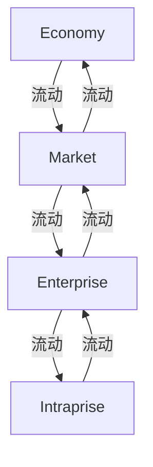

# G184/fig3-1 · 商业企业的语境

类型：`process-or-method-model`。说明商业企业所处的语境：企业活动于市场之中，市场又嵌在更大的经济体中；企业内部单元再从企业接受工作与资源，并回交工作产品与成本。作者用这张图界定 EA 与 EA 能力必须理解的外部与内部交互，并紧接着指出公共、政府、国防企业的语境与此不同。

英文 PDF 物理页：[23]。本页为架构语义分析，原文与原图分别保留。

## 原图与可编辑图


[完整 JSON](fig3-1.json) · [可编辑 Mermaid](fig3-1.mmd) · [仅关系图](fig3-1.relations.mmd) · [层级分解图](fig3-1.hierarchy.mmd)

图形重建表达语义，不复制源图布局。虚线表示解释、矩阵映射或分组关系，不自动表示不确定性的概率。



## 架构分析

从左上角的 Economy 读起，沿对角线向右下走到 Intraprise，这是由外到内的四个语境层级。每一对相邻框之间有两条方向相反的箭头：靠右/靠下的标签描述去程交换，靠左/靠上的标签描述回程交换。例如 Economy 右下方的箭头带“Economic Growth, Laws, Regulations, Taxes, and Incentives”，Market 左上方那条箭头带“Trade, Jobs, and Tax Revenues”。图中没有总框，也没有跨层箭头。

- 本图有 4 个具名或隐含元素、6 条关系和 0 条包含/分组记录。
- 本图没有可直接确认为人员直属汇报的关系；视觉上下位置、能力分解和治理职责分别读取。
- 4个标签完整：Economy、Market、Enterprise、Intraprise；6条单向折线箭头分别构成相邻两个层次之间的来回交换。
- 全部6条连线标签按原词保存；四框排列没有包围关系，不是组织直属汇报。

### 如何用于项目

- 按阶段/事件/行为关系读取入口、出口、责任和产物；检查循环与例外路径。
- 工作流先后不表示组织管理权；在项目中显式记录条件和完成标准。

### 结构所表达的逻辑

- 四个语境层级是 Economy（经济）→ Market（市场）→ Enterprise（企业）→ Intraprise（企业内部），沿对角线自上而下、自左而右排列，表示由外到内的观察范围。
- 相邻层级两两双向交换：经济向市场提供经济增长、法律、法规、税收与激励，市场向经济回交贸易、就业与税收。
- 市场向企业提供需求、竞争与收入，企业向市场回交产品与服务供给、收益。
- 企业向企业内部单元下达工作、任务与资源，企业内部单元向企业回交工作产品与成本。
- 图中只有相邻层对的往返箭头，没有跨层连线，也没有形成闭合回路；它表达的是交换关系，不是价值流或流程顺序。
- 图题把语境限定为“商业企业”（Commercial Enterprise）；正文说明公共、政府、国防企业的语境不同，本文档整体按营利、上市、公共国防或社会部门企业假设。
- Intraprise 按尾注 [2] 定义为“企业内部按地理或逻辑划分、职能不一定延伸到企业边界之外的自治职能组合”，多个 intraprise 构成一个 enterprise。
- 图内的 © The Open Group 与尾注 [1] 表明该图源自 Rouse 2012 年的企业转型演讲，不是 TOGAF 自创的参考模型。

## 上下级与包含

视觉上是四个并列的语境层级，不是嵌套包含：Economy 和 Market 属于企业外部语境，Enterprise 和 Intraprise 属于组织范围。Intraprise 与 Enterprise 分开画、地位并列，但语义上多个 intraprise 构成一个 enterprise（尾注 [2]），所以不能把它读成企业之外的一个独立组织。

|父项|子项|层级类型|依据与解释|
|---|---|---|---|
|—|—|无视觉包含|关系中明确的组成/特化见 JSON semantic_hierarchy。|

## 全部元素与角色

|元素ID|原文名称|类型|含义|直接父项|深度|
|---|---|---|---|---|---|
|economy|Economy|actor|最外层的经济语境；向市场提供经济增长、法律、法规、税收与激励，并从市场获得贸易、就业与税收。|—||
|market|Market|actor|企业所处的市场；承接经济条件并向经济回交贸易、就业与税收，向企业提出需求、竞争与收入，并从企业获得产品、服务与收益。|—||
|enterprise|Enterprise|organization_unit|本文档定义的 enterprise（组织的最高描述层级，不等同法律或职能边界）；向企业内部单元分配工作、任务与资源。|—||
|intraprise|Intraprise|organization_unit|企业内按地理或逻辑划分的自治职能组合（尾注 [2]）；多个 intraprise 构成一个 enterprise，向企业回交工作产品与成本。|—||

## 全部关系

共六条黑色实线箭头，全部是相邻层级之间的单向交换，两两成对、方向相反：Economy→Market（向下）、Market→Economy（向上）、Market→Enterprise（向下）、Enterprise→Market（向上）、Enterprise→Intraprise（向下）、Intraprise→Enterprise（向上）。箭头旁的文字就是该方向传递的内容；箭头没有线型或颜色区分。

|主体|语义关系|客体|显式线/隐式|原文标签|依据|
|---|---|---|---|---|---|
|经济|流动|市场|显式连线|Economic Growth, Laws, Regulations, Taxes, and Incentives|从 Economy 右侧出线、向下折入 Market 顶部。|
|市场|流动|经济|显式连线|Trade, Jobs, and Tax Revenues|从 Market 左侧出线、向上折入 Economy 底部。|
|市场|流动|企业|显式连线|Demand, Competition, and Revenues|从 Market 右侧出线、向下折入 Enterprise 顶部。|
|企业|流动|市场|显式连线|Supply of Products, and Services, Earnings|从 Enterprise 左侧出线、向上折入 Market 底部。|
|企业|流动|企业内部|显式连线|Work, Assignments, and Resources|从 Enterprise 右侧出线、向下折入 Intraprise 顶部。|
|企业内部|流动|企业|显式连线|Work Products and Costs|从 Intraprise 左侧出线、向上折入 Enterprise 底部。|

## 误读检查

- 不要把四个框读成包含关系（例如以为 Intraprise 画在 Enterprise 里面）；它们是阶梯排列的并列范围，包含只体现在语义上（多个 intraprise 构成 enterprise）。
- 不要把四个框读成流程阶段或价值链环节；箭头是双向交换，不是一条从左到右的流程。
- 不要把“需求、竞争与收入”与“产品与服务供给、收益”看成同一方向；它们是一对相反箭头，前者由市场流向企业，后者由企业流向市场。
- 不要把 Intraprise 当作企业内的一个部门框；它是与 Enterprise 并列画出的范围层级，尾注给出了专门定义。
- 中文稿 L623 把本图插在 7.1 节“创建框架目录”中，是错位引用；本图实际属于 3.2 节“什么是企业？”，正文语境在中文稿 L153。
- 中文资产把顶部标签压缩成“法规税收与激励”并留下重叠小字，还断开了一处折线，不能据它理解完整的交换内容。

## 原文证据

### [PDF 第 22 页](../../../documents/G184.md#page-22)

> This chapter describes the general concepts used throughout this document.
> This document is written for a Leader – the person tasked to lead the establishment and/or evolution of an EA Capability. We have selected the term Leader deliberately to reflect the role, rather than one of the myriad titles in an enterprise the Leader may have. Key to the successful establishment of an EA Capability is the Leader’s ability to step back from his or her current operational context to seek broader perspective before making a decision and then following through with the decision to lead the change.
### [PDF 第 23 页](../../../documents/G184.md#page-23)

> Public agencies, government, and defense organizations all benefit from EA. This document does not comprehensively address all nuances or outlier aspects for government, defense, or not-for-profit enterprises, mainly not to distract the reader with alternate methods or special focus. This document assumes the reader is associated with a profit-making, publicly traded, public defense, or social sector enterprise. If not, the reader will have to make a few adjustments to context and motivation. This document may be updated in the future to focus on the special needs of public organizations.
> In short, an EA Capability is the ability to develop, use, and sustain the architecture of a particular enterprise, and use the architecture to govern change.
### [PDF 第 28 页](../../../documents/G184.md#page-28)

> [1] Derived from a presentation entitled Enterprise Transformation – An Architecture-Based Approach, by William B Rouse at The Open Group Conference, January 2012. [2] Intraprise – a geographically or logically defined grouping of autonomous functions within an enterprise with functions not necessarily reaching outside the boundaries of the enterprise. Several intraprises constitute an enterprise. [3] Adapted from The Open Group White Paper: World-Class Enterprise Architecture and The Open Group White Paper: World-Class EA: A Leader’s Approach to Establishing and Evolving an EA Capability [W160] [4] Delivery is the act of taking something to a place. Deployment is organizing and sending people or things to be used for a particular purpose. Architecture is supporting the act of delivery. Value is realized upon deployment and use of a solution. Hence, the difference is use of terms. [5] The State of Enterprise Architecture Forrester Research Reports [2011], [2014], and [2016] EA Summit Proceedings [Gartner, 2015], and Corporate Executive Board Websites [Corporate Executive Board].

## 来源与分析状态

所有元素/关系均有来源定位；未把历史解释重命名为本轮逐线视觉确认。源图与语义图是两种视图，布局不证明汇报或因果。

源 PDF SHA-256：`85fe5653767b184c3c8c9c1bef9f5738adbb2bf6661fb50ee95e72d16bc9f614`。

源图记录：[原始解释与转录](../../../figures/G184/fig3-1.json)。

```json
{
  "quality": {
    "graph_integrity": "checked",
    "semantic_analysis": "typed-graph-and-context-analysis",
    "visual_review": "source-content-audited",
    "notice_zh": "所有元素/关系均有来源定位；未把历史解释重命名为本轮逐线视觉确认。源图与语义图是两种视图，布局不证明汇报或因果。"
  },
  "source_uncertainty": {
    "confidence": "high",
    "uncertainties_zh": [
      "“Intraprise”的中文译名采用中文资产中的“企业内部”；尾注定义为“企业内部按地理或逻辑划分的自治职能组合”，该译名只表达了位置、未表达自治组合的含义。",
      "骨架把本图归到 7.1 节（中文稿 L623 的重复占位图），但图与 3.2 节正文对应；section_en 已按实际章节填写，section_zh/md_lines 仍沿用骨架位置，未能改写。",
      "图中四个框是并列范围而非嵌套；Intraprise 与 Enterprise 的语义包含只来自尾注，图中没有画出包含线。",
      "顶部“Economic Growth...”标签字号较小且换行多，已用 2x2 放大块逐字核对，未发现缺词。"
    ],
    "analyzed_from": [
      "英文 PDF 第 23 页图 3-1 截图与 2x2 放大分块",
      "英文 PDF 第 22、23、28 页正文与尾注",
      "中文稿 G184e_领导者指南_建立并演进EA能力.md 第 140-175 行、第 610-625 行",
      "figs/zh/g184e_fig3-1_zh.png 逐块放大对照"
    ],
    "date": "2026-10-31"
  },
  "source_conflicts": []
}
```
