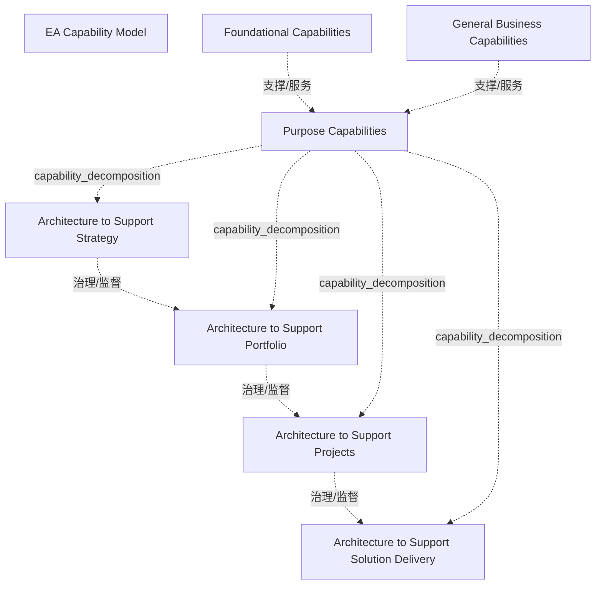

# G184/fig3-2 · EA 能力模型

类型：`decomposition-or-organization-model`。第 3.3 节定义“EA 能力”后，用这张改编自《世界级企业架构》白皮书的模型说明：EA 能力是为一种或多种目的专门建立的，并把与目的相关的能力同通用业务能力、基础能力分开。紧接着的正文逐条解释四种目的。本图是全书的核心模型，第 9 章（图 9-2）对它做分解，第 11 章（图 11-3、11-4）给出样例。

英文 PDF 物理页：[24]。本页为架构语义分析，原文与原图分别保留。

## 原图与可编辑图


[完整 JSON](fig3-2.json) · [可编辑 Mermaid](fig3-2.mmd) · [仅关系图](fig3-2.relations.mmd) · [层级分解图](fig3-2.hierarchy.mmd)

图形重建表达语义，不复制源图布局。虚线表示解释、矩阵映射或分组关系，不自动表示不确定性的概率。



## 架构分析

自上而下看三条蓝色横带：顶部“通用业务能力”、中部“目的能力”、底部“基础能力”。中部横带内从左到右的 4 个彩色框是四种目的能力；按正文，从左到右范围由宽到窄（战略跨多个组合，解决方案交付只涉及单个项目或其一部分）。图中没有任何线条，归属关系只由“框在横带内”表达。

- 本图有 8 个具名或隐含元素、5 条关系和 4 条包含/分组记录。
- 包含/分组树最大深度为 1；根节点为 EA 能力（模型整体）、通用业务能力、目的能力、基础能力。
- 本图没有可直接确认为人员直属汇报的关系；视觉上下位置、能力分解和治理职责分别读取。
- 治理边回答谁提供约束、指导或监督；它们与岗位汇报边分别存储。
- 包含分组后有 2 个连通分量；分离可能源于图例、并列分类或独立示例，未自动补边。
- 7个实际标签：3横带和Purpose带内4张目的能力卡；EA Capability Model只是图题、没有总外框。
- 原图没有箭头或数值；四种支持目的可并存，不意味着必须按固定生命周期依次进行。

### 如何用于项目

- 按父项展开所有直接子项，检查同层粒度、重叠和缺项。
- 保留组成、分类、能力分解与组织汇报的区别；将示例名称替换为已确认的项目对象。

### 结构所表达的逻辑

- 正文前提：EA 能力是为支持一种或多种目的而专门建立的；通常有四种宽泛目的，即中部的 4 个框。一个 EA 能力不必同时覆盖全部四种。
- 支持战略的架构：交付目标架构，制定 3–10 年的变革路线图；通常跨越多个变革项目群或组合，用于识别变革举措、设定职权范围、识别协同，并经由组合与项目群治理战略的执行。
- 支持组合的架构：支持跨职能、多阶段、多项目的变革举措；通常跨越单个组合，用于识别项目、设定其职权范围、对齐方法、识别协同并治理项目执行。
- 支持项目的架构：支持企业的项目交付方法；通常跨越单个项目，用于明确项目目的与价值、识别协同与未来依赖方面的需求、确保符合架构治理，并支持项目间的集成与对齐。
- 支持解决方案交付的架构：通常是单个项目或其中的重要部分，用于定义变更如何设计与交付、识别约束/控制/架构需求，并作为变更的治理框架。尾注 [4] 区分“交付（delivery）”与“部署（deployment）”：架构支持交付行为，价值在解决方案部署并使用后才实现。
- 四种目的从左到右逐级向下：尾注说明支持战略的架构为支持组合的架构界定范围，并依次向下传递（cascades down）；中文稿第 8.1 节补充，支持的决策层级越高，所需细节与一致性越低，越接近解决方案交付则越高。
- 通用业务能力与基础能力不随目的变化，是与目的能力分开列出的公共能力。正文指出 EA 能力像任何业务一样要执行财务预算、团队发展、风险管理、绩效管理等通用活动，且 EA 不是独立能力，要依靠人力资源、市场、产品研究等职能支撑。
- 本文档把 EA 能力当作管理概念使用，明确不讨论 EA 部门或其他组织要素；模型中的框是能力，不是部门或团队。

## 上下级与包含

两层嵌套。第 1 层是三类能力（三条横带）：通用业务能力、目的能力、基础能力，共同构成 EA 能力（整体由图题表示，图中没有总框）。第 2 层只出现在目的能力横带内：四个目的能力框。顶部和底部横带在本图中没有展开下级能力，它们的分解见图 9-2。

|父项|子项|层级类型|依据与解释|
|---|---|---|---|
|目的能力|支持战略的架构|capability_decomposition|同类能力的包含分解；能力实例与能力类型另以实例化关系记录。|
|目的能力|支持组合的架构|capability_decomposition|同类能力的包含分解；能力实例与能力类型另以实例化关系记录。|
|目的能力|支持项目的架构|capability_decomposition|同类能力的包含分解；能力实例与能力类型另以实例化关系记录。|
|目的能力|支持解决方案交付的架构|capability_decomposition|同类能力的包含分解；能力实例与能力类型另以实例化关系记录。|

### 治理范围

|父项/范围/类型|子项/责任对象/实例|语义|
|---|---|---|
|支持战略的架构|支持组合的架构|governs|
|支持组合的架构|支持项目的架构|governs|
|支持项目的架构|支持解决方案交付的架构|governs|

## 全部元素与角色

|元素ID|原文名称|类型|含义|直接父项|深度|
|---|---|---|---|---|---|
|ea_capability|EA Capability Model|concept|从图题生成的整体模型索引，不是原图中的具名方框。|—||
|band_general|General Business Capabilities|capability|EA 能力像任何业务一样需要的通用能力（正文举例：财务预算、团队发展、风险管理、绩效管理），多为企业共享职能。本图不展开下级能力。中文稿 L1312 译作“一般业务能力”。|—||
|band_purpose|Purpose Capabilities|capability|与 EA 能力所支持的目的直接相关的能力，内含 4 个目的框。|—||
|band_foundational|Foundational Capabilities|capability|不随目的变化、支撑各目的的公共 EA 能力。本图不展开下级能力。|—||
|p_strategy|Architecture to Support Strategy|capability|交付目标架构与 3–10 年变革路线图；通常跨多个变革项目群或组合。|目的能力|1|
|p_portfolio|Architecture to Support Portfolio|capability|支持跨职能、多阶段、多项目的变革举措；通常跨单个组合。|目的能力|1|
|p_projects|Architecture to Support Projects|capability|支持企业的项目交付方法；通常跨单个项目。原图写作复数 Projects，正文写作 EA to support Project。|目的能力|1|
|p_solution|Architecture to Support Solution Delivery|capability|支持解决方案的部署；通常是单个项目或其重要部分，作为变更的治理框架。|目的能力|1|

## 全部关系

图中没有任何连线或箭头。横带上下堆叠和框的左右排列只表示分类与排序。关系清单中的“基础/通用业务能力支撑目的能力”和“上一级目的为下一级界定范围并治理”都是依据正文推断的隐含关系（explicit: false）。

|主体|语义关系|客体|显式线/隐式|原文标签|依据|
|---|---|---|---|---|---|
|基础能力|支撑/服务|目的能力|implicit||三个横带和四个目的能力之间没有连接线；这是依据正文对EA能力目的的概念关系，不是图中流程/治理箭头。|
|通用业务能力|支撑/服务|目的能力|implicit||三个横带和四个目的能力之间没有连接线；这是依据正文对EA能力目的的概念关系，不是图中流程/治理箭头。|
|支持战略的架构|治理/监督|支持组合的架构|implicit||三个横带和四个目的能力之间没有连接线；这是依据正文对EA能力目的的概念关系，不是图中流程/治理箭头。|
|支持组合的架构|治理/监督|支持项目的架构|implicit||三个横带和四个目的能力之间没有连接线；这是依据正文对EA能力目的的概念关系，不是图中流程/治理箭头。|
|支持项目的架构|治理/监督|支持解决方案交付的架构|implicit||三个横带和四个目的能力之间没有连接线；这是依据正文对EA能力目的的概念关系，不是图中流程/治理箭头。|

## 本轮语义修正

- 三个横带和四个目的能力之间没有连接线；这是依据正文对EA能力目的的概念关系，不是图中流程/治理箭头。
- 三个横带和四个目的能力之间没有连接线；这是依据正文对EA能力目的的概念关系，不是图中流程/治理箭头。
- 三个横带和四个目的能力之间没有连接线；这是依据正文对EA能力目的的概念关系，不是图中流程/治理箭头。
- 三个横带和四个目的能力之间没有连接线；这是依据正文对EA能力目的的概念关系，不是图中流程/治理箭头。
- 三个横带和四个目的能力之间没有连接线；这是依据正文对EA能力目的的概念关系，不是图中流程/治理箭头。

## 误读检查

- 不要把 4 个目的框理解为必须依次完成的步骤或成熟度阶梯；它们是 EA 能力可以选择支持的目的，左右顺序只反映范围由宽到窄。
- 4 个框的颜色（黄、绿、橙、紫红）只用于区分目的，没有图例，不代表状态、优先级或红黄绿评估。
- 三条横带的上下次序没有图例说明，不表示汇报关系或数据流向；“基础能力”在底部只说明它是底层支撑。
- 模型描述的是能力，不是组织结构：原文明确不讨论 EA 部门；EA 团队的组织位置见图 5-1、图 9-1。
- 中文稿第 3.3 节没有收录本图，也删去了紧随其后的四种目的说明；同样的四种目的只在中文稿第 5.2 节（L296–301）以文字出现。

## 原文证据

### [PDF 第 23 页](../../../documents/G184.md#page-23)

> Public agencies, government, and defense organizations all benefit from EA. This document does not comprehensively address all nuances or outlier aspects for government, defense, or not-for-profit enterprises, mainly not to distract the reader with alternate methods or special focus. This document assumes the reader is associated with a profit-making, publicly traded, public defense, or social sector enterprise. If not, the reader will have to make a few adjustments to context and motivation. This document may be updated in the future to focus on the special needs of public organizations.
> In short, an EA Capability is the ability to develop, use, and sustain the architecture of a particular enterprise, and use the architecture to govern change.
### [PDF 第 24 页](../../../documents/G184.md#page-24)

> Using the capability model in the World-Class Enterprise Architecture White Paper [W160] as a base, we assume that an EA Capability is established specifically to support one or more purposes. Typically, there are four broad purposes of an EA Capability:
> • EA to support Strategy: Deliver EA to provide a target architecture, and develop roadmaps of change over a three to ten-year period
### [PDF 第 25 页](../../../documents/G184.md#page-25)

> Whether the enterprise is embarking on establishing an EA Capability for the first time, is enhancing or re-booting an existing EA Capability, this document provides an approach to lead the EA Capability lifecycle and maturity. In all cases, the best practice is to establish a roadmap that provides an end- state and a set of capability increments.
> At the time of writing, the most common EA Capability industry practice is a re-boot after a failed attempt to establish an EA Capability.[5] When enhancing an existing EA Capability or performing a re- boot, it is recommended to perform the activities described in Chapter 4 and Chapter 5 . These activities assist in identifying the pitfalls prior efforts ran into, and strongly influence the external Communication Plan and Roadmap. The following questions exemplify oversimplified thinking in an EA lifecycle:
### [PDF 第 26 页](../../../documents/G184.md#page-26)

> The World-Class Enterprise Architecture White Paper highlights that there is no single correct scope, level of detail, or purpose for an EA. Different enterprises will expect their EA to guide change at different levels within the enterprise.
> Herein lies a pair of substantive challenges. First, recognizing that the range, scope, and scale of an EA are as broad as the scope and scale of enterprises and their change programs. Second, the ability to develop, use, and sustain the required EA will be equally as broad. Later in this document, various approaches to scope (strategy, portfolio, or project), the effort, and an approach to enhance the positive impact of EA are discussed.
### [PDF 第 28 页](../../../documents/G184.md#page-28)

> [1] Derived from a presentation entitled Enterprise Transformation – An Architecture-Based Approach, by William B Rouse at The Open Group Conference, January 2012. [2] Intraprise – a geographically or logically defined grouping of autonomous functions within an enterprise with functions not necessarily reaching outside the boundaries of the enterprise. Several intraprises constitute an enterprise. [3] Adapted from The Open Group White Paper: World-Class Enterprise Architecture and The Open Group White Paper: World-Class EA: A Leader’s Approach to Establishing and Evolving an EA Capability [W160] [4] Delivery is the act of taking something to a place. Deployment is organizing and sending people or things to be used for a particular purpose. Architecture is supporting the act of delivery. Value is realized upon deployment and use of a solution. Hence, the difference is use of terms. [5] The State of Enterprise Architecture Forrester Research Reports [2011], [2014], and [2016] EA Summit Proceedings [Gartner, 2015], and Corporate Executive Board Websites [Corporate Executive Board].
### [PDF 第 56 页](../../../documents/G184.md#page-56)

> [1] Depth as used in this document relates to the level of detail each “purpose” architecture is scoped to explore based on its parent. Architecture for strategy scopes architecture for portfolio and cascades down. Architecture work for a particular purpose can be performed at any level of detail, although the extremes are rare. Always remember the distinction between scoping and outcome intent. [2] Successful Leaders are linguistically nimble. Often particular techniques place extreme pressure on a word. Technique practitioners will instinctively defend the technique’s value by defending the specialized use of key terminology. The term “function” is one such word. This Guide distinguishes between words used in a general manner and when a specialized meaning is required. For “function”, this Guide relies on a general meaning, referring to elements of an organization such as HR, Finance, Sales, Plant Management, and Operations as functions. See Section 4.2.3 on the function-based organization model or Merriam-Webster Dictionary’s first meaning for function: “the special purpose or activity for which a thing exists or is used”. Successful Leaders need to be able to seamlessly switch back and forth between the specialized language of particular techniques and the generalized language of everyday communication.
### [PDF 第 84 页](../../../documents/G184.md#page-84)

> This document now addresses the matter of having an architecture board or a governance council. Chapter 6 discussed the composition of the team and its functions. Regarding the purpose and approach to staffing the architecture board, apply the separation of duties principle. The architecture board is equivalent to the “board of directors” of the EA Capability’s business-in-a-business. Members of the governance team should have direct influence over the direction of the business or the outcome of the initiatives architected by the EA. This body sets and manages overall direction for the enterprise. It is not a successful pattern to embed rights for certain classes of architecture decisions in this body. For example, defining the constitution of an architecture building block, solution building block, or a trade-off decision around directory services or assembly line layouts is better decided at the extended EA team level.
> The EA Capability, like any other business, must carry out a basic set of general actions. This includes things like finance and budgeting, team development, risk management, and performance management. All of these must be adapted to the specific EA Capability and enterprise. In most enterprises these functions are shared, and EA should benefit from tapping into these teams. Occasionally, to scale the reach of the EA functions, it may be necessary to franchise some of the activities to teams outside the team providing the EA Capability.
### [PDF 第 111 页](../../../documents/G184.md#page-111)

> The ratio of projects or resources employed in the enterprise is normally several magnitudes higher than the capacity of the team providing the EA Capability. To replicate key efforts of the team providing the EA Capability, a capability model provides the template with which the EA function can be scaled to cover the entire enterprise.
> While there are some publicly available EA Capability models, such as NASCIO or the World-Class Enterprise Architecture White Paper, none of them can be directly applied to an enterprise. Context under which they were developed never really matches an enterprise, but they provide a great foundation. Experience shows that using existing capability models in the enterprise or publicly available models as a reference or base accelerates assessment, delivery, and adoption. Analyze these models in terms of the EA Capability context and purpose before selecting the base. Starting with a single model and adding or modifying to meet specific needs of the enterprise vastly reduces time to finalize.
### [PDF 第 112 页](../../../documents/G184.md#page-112)

> This model aligns to purpose. The purpose could be focused on operating EA or delivering value from EA viz., operational capabilities, and separates common Foundational Capabilities or General Business Capabilities. The capabilities required to support each of the purposes are not presented in this document.
> The model shown in Figure 11-4 aligns to classic architecture domains and development of architecture to support strategy. When applied to an enterprise that manufactures packaging material for food products, “monitor future trends” would mean how to improve the shelf life of products using techniques developed for defense use. Inputs from such monitoring could call for changes to business and technology architecture – retooling the plants, scouting for new raw material suppliers, and new processes. Obsolescence of a product can arise from regulatory changes – like a ban on use of plastic bags or CFC-based coolants in air conditioners and refrigerators. In this connected world of distributed sourcing and just-in-time manufacturing, a focus on IT infrastructure is required to track any impacts arising from disruptions in the supply chain.

## 来源与分析状态

所有元素/关系均有来源定位；未把历史解释重命名为本轮逐线视觉确认。源图与语义图是两种视图，布局不证明汇报或因果。

源 PDF SHA-256：`85fe5653767b184c3c8c9c1bef9f5738adbb2bf6661fb50ee95e72d16bc9f614`。

源图记录：[原始解释与转录](../../../figures/G184/fig3-2.json)。

```json
{
  "quality": {
    "graph_integrity": "checked",
    "semantic_analysis": "typed-graph-and-context-analysis",
    "visual_review": "source-content-audited",
    "notice_zh": "所有元素/关系均有来源定位；未把历史解释重命名为本轮逐线视觉确认。源图与语义图是两种视图，布局不证明汇报或因果。"
  },
  "source_uncertainty": {
    "confidence": "high",
    "uncertainties_zh": [
      "图中没有连线；三层之间的“支撑”关系和四种目的之间的“逐级界定范围/治理”关系都由正文推断，已标为隐含关系。",
      "中文译名需统一：中文稿正文 L1312 作“一般业务能力”，中文 SVG（图 9-2、11-3）作“通用业务能力”，本文件取后者；“Architecture to Support X”在正文中作“支持 X 的架构”（L872、L1123），在中文 SVG 中作“架构支持 X”。"
    ],
    "analyzed_from": [
      "英文 PDF 第 24 页原图截图（220 dpi）",
      "英文 PDF 第 23–24 页正文、第 28 页尾注 [3][4]、第 47 页（第 5.2 节）、第 56 页尾注 [1]、第 84、111–112 页",
      "中文稿 G184e_领导者指南_建立并演进EA能力.md 第 155–161、294–310、660、1312 行（本图未被中文稿引用）",
      "G186/fig3-3 英文原图截图（对照）"
    ],
    "date": "2026-10-31"
  },
  "source_conflicts": []
}
```
