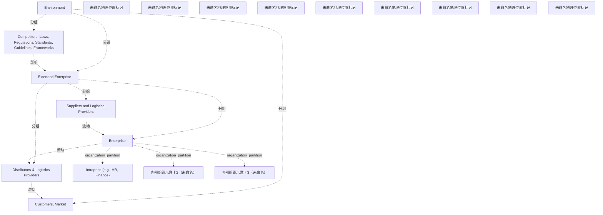

# G184/fig4-2 · 扩展企业

类型：`architecture-concept-or-system-model`。第 4.2.3 节讨论企业的组织模型。作者指出企业可能经由独立代理、伙伴、供应商采购原材料或补充人力，领导者要为每类“延伸”建立关键联系人及其地点的目录；本图示意需要记录的组织模型可能的样子，原文强调它不是绝对参照。

英文 PDF 物理页：[36]。本页为架构语义分析，原文与原图分别保留。

## 原图与可编辑图


[完整 JSON](fig4-2.json) · [可编辑 Mermaid](fig4-2.mmd) · [仅关系图](fig4-2.relations.mmd) · [层级分解图](fig4-2.hierarchy.mmd)

图形重建表达语义，不复制源图布局。虚线表示解释、矩阵映射或分组关系，不自动表示不确定性的概率。



## 架构分析

由外向内读四层嵌套：最外层深蓝“环境”，其中左侧是外部约束框（竞争对手、法律、法规、标准、指南、框架），右侧是“客户、市场”，中间是浅蓝“扩展企业”；扩展企业内左为“供应商与物流提供商”、右为“分销商与物流提供商”、中间为“企业”；企业内是层叠的“企业内部单元（如人力资源、财务）”卡片。黄色定位图标表示团队可能所在的地理位置。从左到右大致是供应链的上下游。图中没有连线。

- 本图有 19 个具名或隐含元素、4 条关系和 9 条包含/分组记录。
- 包含/分组树最大深度为 3；根节点为 环境、未命名地理位置标记、未命名地理位置标记、未命名地理位置标记、未命名地理位置标记、未命名地理位置标记、未命名地理位置标记、未命名地理位置标记、未命名地理位置标记、未命名地理位置标记。
- 本图没有可直接确认为人员直属汇报的关系；视觉上下位置、能力分解和治理职责分别读取。
- 包含分组后有 10 个连通分量；分离可能源于图例、并列分类或独立示例，未自动补边。
- 8个原有标签及嵌套区域完整核对，补录2张无名后层组织卡和9个黄色地理位置图钉。
- Environment包含竞争/法规、扩展企业、客户/市场；Extended Enterprise包含供应商、企业、分销物流。
- 图注明确黄色图钉表示地点，不能称风险或提醒；原图无供应链方向箭头。

### 如何用于项目

- 围绕作者目的读取本图实体、分组与连线，并用对应原文限定其含义。
- 把参考模型与项目事实分开，实际范围、约束、值和责任须有项目证据。

### 结构所表达的逻辑

- 四层嵌套表示范围：环境 ⊃ 扩展企业 ⊃ 企业 ⊃ 企业内部单元。第 3.2 节说明企业边界的定义有意保持灵活，可以涵盖由使命或供应链连接的不同组织。
- 企业内部单元（Intraprise）：第 3 章尾注 [2] 定义为企业内按地理或逻辑划分的一组自治职能，其职能不一定越出企业边界；若干 Intraprise 组成一个企业。图中三张层叠卡片各带一个定位图标，表示企业内有多个这样的单元，可能分布在不同地点。
- 扩展企业包括企业本身，以及上游的供应商与物流提供商和下游的分销商与物流提供商。正文说企业可能经由独立代理、伙伴、供应商采购原材料或补充人力，领导者应为每类“延伸”整理关键联系人及其地点的目录。
- 环境层在扩展企业之外：一侧是竞争对手和法律、法规、标准、指南、框架等外部约束（第 4.2.2 节建议为适用的合规要求、法规和行业标准建立目录），另一侧是客户与市场。
- 黄色定位图标表示团队可能运营的地理位置（图注）。正文要求同时记录地点、与客户的接近程度与交互方式、创新价值，以及数据主权（员工、客户、伙伴或收入数据能否跨地缘政治边界共享）、供应商和伙伴。
- 默认的组织模型应反映业务线或业务单元；建立这种扩展视图有助于为业务架构或成本结构管理制定备选可行方案。
- 正文随后区分三类组织模型：职能型（按 Porter 价值链分成营销、销售、制造、财务、人力资源等纵向单元）、产品型（按产品线划分，公共职能可重复设置或共享）和矩阵型（项目型执行为主）。图中“如人力资源、财务”的内部单元即职能型单元的例子。

## 上下级与包含

按范围嵌套共四层：第 0 层环境；第 1 层扩展企业，以及与它并列、位于环境层内的外部约束框和客户/市场框；第 2 层是扩展企业内的供应商与物流提供商、企业、分销商与物流提供商；第 3 层是企业内的企业内部单元（层叠多张）。嵌套表示“在其范围之内”，不是汇报关系。

|父项|子项|层级类型|依据与解释|
|---|---|---|---|
|环境|竞争对手、法律、法规、标准、指南、框架|visual_grouping|框、泳道、域或分类组的成员归属；没有额外证据不提升为业务组合或管理关系。|
|环境|扩展企业|visual_grouping|框、泳道、域或分类组的成员归属；没有额外证据不提升为业务组合或管理关系。|
|环境|客户、市场|visual_grouping|框、泳道、域或分类组的成员归属；没有额外证据不提升为业务组合或管理关系。|
|扩展企业|供应商与物流提供商|visual_grouping|框、泳道、域或分类组的成员归属；没有额外证据不提升为业务组合或管理关系。|
|扩展企业|企业|visual_grouping|框、泳道、域或分类组的成员归属；没有额外证据不提升为业务组合或管理关系。|
|扩展企业|分销商与物流提供商|visual_grouping|框、泳道、域或分类组的成员归属；没有额外证据不提升为业务组合或管理关系。|
|企业|企业内部单元（Intraprise，如人力资源、财务）|organization_partition|组织单元的组成/分区；此处不自动证明岗位直属汇报。|
|企业|内部组织示意卡2（未命名）|organization_partition|组织单元的组成/分区；此处不自动证明岗位直属汇报。|
|企业|内部组织示意卡3（未命名）|organization_partition|组织单元的组成/分区；此处不自动证明岗位直属汇报。|

## 全部元素与角色

|元素ID|原文名称|类型|含义|直接父项|深度|
|---|---|---|---|---|---|
|environment|Environment|group|分组：环境|—||
|external_constraints|Competitors, Laws, Regulations, Standards, Guidelines, Frameworks|other|扩展企业之外的竞争者与外部约束（法规、标准、指南、框架）。|环境|1|
|extended_enterprise|Extended Enterprise|group|分组：扩展企业|环境|1|
|customers_market|Customers, Market|actor|参与者：客户、市场|环境|1|
|suppliers|Suppliers and Logistics Providers|actor|参与者：供应商与物流提供商|扩展企业|2|
|enterprise|Enterprise|organization_unit|组织单元：企业|扩展企业|2|
|distributors|Distributors & Logistics Providers|actor|参与者：分销商与物流提供商|扩展企业|2|
|intraprise|Intraprise (e.g., HR, Finance)|organization_unit|企业内按地理或逻辑划分的一组自治职能（第 3 章尾注 [2]）。中文稿图 3-1 的中文 PNG 译作“企业内部”。|企业|3|
|intraprise_card_2|内部组织示意卡2（未命名）|organization_unit|源图显示叠置的多个组织卡片；不是已知的具体部门名称。|企业|3|
|intraprise_card_3|内部组织示意卡3（未命名）|organization_unit|源图显示叠置的多个组织卡片；不是已知的具体部门名称。|企业|3|
|pin_suppliers_1|未命名地理位置标记|location|第36页图注明确黄色图钉代表团队可能工作的地理位置；没有地名。|—||
|pin_suppliers_2|未命名地理位置标记|location|第36页图注明确黄色图钉代表团队可能工作的地理位置；没有地名。|—||
|pin_suppliers_3|未命名地理位置标记|location|第36页图注明确黄色图钉代表团队可能工作的地理位置；没有地名。|—||
|pin_distributors_1|未命名地理位置标记|location|第36页图注明确黄色图钉代表团队可能工作的地理位置；没有地名。|—||
|pin_distributors_2|未命名地理位置标记|location|第36页图注明确黄色图钉代表团队可能工作的地理位置；没有地名。|—||
|pin_distributors_3|未命名地理位置标记|location|第36页图注明确黄色图钉代表团队可能工作的地理位置；没有地名。|—||
|pin_intraprise_1|未命名地理位置标记|location|第36页图注明确黄色图钉代表团队可能工作的地理位置；没有地名。|—||
|pin_intraprise_card_2_1|未命名地理位置标记|location|第36页图注明确黄色图钉代表团队可能工作的地理位置；没有地名。|—||
|pin_intraprise_card_3_1|未命名地理位置标记|location|第36页图注明确黄色图钉代表团队可能工作的地理位置；没有地名。|—||

### 供应商与物流提供商：属性

```json
{
  "location_pins": 3
}
```

### 分销商与物流提供商：属性

```json
{
  "location_pins": 3
}
```

### 企业内部单元（Intraprise，如人力资源、财务）：属性

```json
{
  "stacked_cards": 3,
  "location_pins": 3
}
```

## 全部关系

图中没有连线或箭头。包含关系由框的嵌套表达（记在 parent 中）。关系清单中的供应链流向（供应商 → 企业 → 分销商 → 客户）和外部约束对扩展企业的影响，都是依据左右排列和正文推断的隐含关系。

|主体|语义关系|客体|显式线/隐式|原文标签|依据|
|---|---|---|---|---|---|
|供应商与物流提供商|流动|企业|implicit||原图仅有嵌套区域及并列方块，未画供应链/约束箭头；旧边仅保留为上下文解释。|
|企业|流动|分销商与物流提供商|implicit||原图仅有嵌套区域及并列方块，未画供应链/约束箭头；旧边仅保留为上下文解释。|
|分销商与物流提供商|流动|客户、市场|implicit||原图仅有嵌套区域及并列方块，未画供应链/约束箭头；旧边仅保留为上下文解释。|
|竞争对手、法律、法规、标准、指南、框架|影响|扩展企业|implicit||原图仅有嵌套区域及并列方块，未画供应链/约束箭头；旧边仅保留为上下文解释。|

## 本轮语义修正

- 原图仅有嵌套区域及并列方块，未画供应链/约束箭头；旧边仅保留为上下文解释。
- 原图仅有嵌套区域及并列方块，未画供应链/约束箭头；旧边仅保留为上下文解释。
- 原图仅有嵌套区域及并列方块，未画供应链/约束箭头；旧边仅保留为上下文解释。
- 原图仅有嵌套区域及并列方块，未画供应链/约束箭头；旧边仅保留为上下文解释。

## 误读检查

- 嵌套框表示范围边界，不是组织汇报层级。
- 客户/市场与竞争对手/法规位于扩展企业之外的环境层，不属于扩展企业。
- 黄色图标表示地理位置，不是风险或警示标记；图注没有给出具体地点或图标数量的含义。
- 层叠卡片表示企业内的多个内部单元（依据 Intraprise 的定义推断），不是同一单元的多个版本。
- 扩展企业的边界不等于法律或所有权边界：第 3.2 节说明企业的定义不与组织的法律或职能边界绑定。
- 中文稿第 4.2.3 节（L231–233）把英文本节压缩为一段概述，没有收录本图和图注。

## 原文证据

### [PDF 第 22 页](../../../documents/G184.md#page-22)

> This chapter describes the general concepts used throughout this document.
> This document is written for a Leader – the person tasked to lead the establishment and/or evolution of an EA Capability. We have selected the term Leader deliberately to reflect the role, rather than one of the myriad titles in an enterprise the Leader may have. Key to the successful establishment of an EA Capability is the Leader’s ability to step back from his or her current operational context to seek broader perspective before making a decision and then following through with the decision to lead the change.
### [PDF 第 28 页](../../../documents/G184.md#page-28)

> [1] Derived from a presentation entitled Enterprise Transformation – An Architecture-Based Approach, by William B Rouse at The Open Group Conference, January 2012. [2] Intraprise – a geographically or logically defined grouping of autonomous functions within an enterprise with functions not necessarily reaching outside the boundaries of the enterprise. Several intraprises constitute an enterprise. [3] Adapted from The Open Group White Paper: World-Class Enterprise Architecture and The Open Group White Paper: World-Class EA: A Leader’s Approach to Establishing and Evolving an EA Capability [W160] [4] Delivery is the act of taking something to a place. Deployment is organizing and sending people or things to be used for a particular purpose. Architecture is supporting the act of delivery. Value is realized upon deployment and use of a solution. Hence, the difference is use of terms. [5] The State of Enterprise Architecture Forrester Research Reports [2011], [2014], and [2016] EA Summit Proceedings [Gartner, 2015], and Corporate Executive Board Websites [Corporate Executive Board].
### [PDF 第 35 页](../../../documents/G184.md#page-35)

> and financial structuring of these three units may replicate best practices of one another across each unit. The global holding company may be performing a coordination function to assure viability of the organization’s business model to its investors.
> While capturing the operating model, it is essential to explore and document the value of products or services or both delivered by the enterprise, its target market, value chain, revenue generation model, and the strategic advantage of the enterprise. Another dimension to consider while creating the operating model is the core nature of the business such as a manufacturing, marketing, sales and distribution services, professional services, community business, or public utility core nature. Value chain and revenue generation models will be covered in detail later in this document.
### [PDF 第 36 页](../../../documents/G184.md#page-36)

> Depending on the nature of business, the enterprise may be procuring raw materials or augmenting its work force via independent agents, partners, vendors, or all of the above. The Leader will have to create a catalog of key contacts and their locations for each type of “extension” to the enterprise. The version of organization model which needs to be documented may look like Figure 4-2, but this model is not an absolute reference.
### [PDF 第 37 页](../../../documents/G184.md#page-37)

> Performing an analysis of the current organization model informs how the enterprise prefers to employ human resources. Variants include grouping by skill set, by outcome, by line of business, or some by outsourcing non-essential functions. Understanding the mix of expertise and experience levels enables identification of intellectual property the enterprise wants to protect. Such analysis can be done in subsequent iterations of understanding the organization model. Creating an extended view as shown in Figure 4-2 will enable development of alternate viable options for business architecture or cost structure management.

## 来源与分析状态

所有元素/关系均有来源定位；未把历史解释重命名为本轮逐线视觉确认。源图与语义图是两种视图，布局不证明汇报或因果。

源 PDF SHA-256：`85fe5653767b184c3c8c9c1bef9f5738adbb2bf6661fb50ee95e72d16bc9f614`。

源图记录：[原始解释与转录](../../../figures/G184/fig4-2.json)。

```json
{
  "quality": {
    "graph_integrity": "checked",
    "semantic_analysis": "typed-graph-and-context-analysis",
    "visual_review": "source-content-audited",
    "notice_zh": "所有元素/关系均有来源定位；未把历史解释重命名为本轮逐线视觉确认。源图与语义图是两种视图，布局不证明汇报或因果。"
  },
  "source_uncertainty": {
    "confidence": "high",
    "uncertainties_zh": [
      "图中没有连线；供应链方向和外部约束的影响都由左右排列和正文推断。",
      "Intraprise 没有通行中文译名；本文件译作“企业内部单元”，中文稿图 3-1 的中文 PNG 作“企业内部”。"
    ],
    "analyzed_from": [
      "英文 PDF 第 36 页原图截图（220 dpi）及图注",
      "英文 PDF 第 22、28（尾注 [2]）、36–37 页正文",
      "中文稿 G184e_领导者指南_建立并演进EA能力.md 第 147–153、227–233 行（本图未被中文稿引用）",
      "G184/fig3-1 英文原图与 figs/zh/g184e_fig3-1_zh.png（对照术语）"
    ],
    "date": "2026-10-31"
  },
  "source_conflicts": []
}
```
