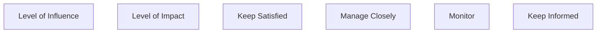

# G184/fig4-3 · PMI 影响力矩阵

类型：`analytical-view`。第 4.2.6 节要求领导者理解企业的问责模型与决策模型，以便在利益相关者之间做权衡决策。作者引用 PMI 的 2×2 矩阵，用来梳理企业内各成员的期望、利益、在 EA 中的角色以及在 EA 能力中的角色，并据此确定与每类利益相关者打交道的方式。

英文 PDF 物理页：[40]。本页为架构语义分析，原文与原图分别保留。

## 原图与可编辑图


[完整 JSON](fig4-3.json) · [可编辑 Mermaid](fig4-3.mmd) · [仅关系图](fig4-3.relations.mmd) · [层级分解图](fig4-3.hierarchy.mmd)

图形重建表达语义，不复制源图布局。虚线表示解释、矩阵映射或分组关系，不自动表示不确定性的概率。



## 架构分析

先看两个轴：左侧向上的灰色箭头是“影响力水平（Level of Influence）”，底部向右的灰色箭头是“影响程度（Level of Impact）”。四个象限按两轴高低组合：左上“令其满意”（影响力高、影响程度低）、右上“重点管理”（两者都高）、左下“监督”（两者都低）、右下“随时告知”（影响力低、影响程度高）。轴只有方向，没有刻度；图中没有标出具体的利益相关者。

- 本图有 6 个具名或隐含元素、0 条关系和 0 条包含/分组记录。
- 本图没有可直接确认为人员直属汇报的关系；视觉上下位置、能力分解和治理职责分别读取。
- 包含分组后有 6 个连通分量；分离可能源于图例、并列分类或独立示例，未自动补边。
- 2轴与4策略标签完整，原图无Low/High字样，矩阵高低来自轴箭头方向。
- 纵轴Level of Influence、横轴Level of Impact，不能替换为常见的Power/Interest矩阵而改变源图语义。
- 四块均为相同灰色，不代表风险热度；没有任何象限之间的流程连线。

### 如何用于项目

- 围绕作者目的读取本图实体、分组与连线，并用对应原文限定其含义。
- 把参考模型与项目事实分开，实际范围、约束、值和责任须有项目证据。

### 结构所表达的逻辑

- 两个维度：影响力水平与影响程度；每个利益相关者按两者高低落入一个象限，象限名称就是对其采取的管理策略。
- 重点管理（Manage Closely）：影响力和影响程度都高，需要投入最多精力、密切合作。
- 令其满意（Keep Satisfied）：影响力高但影响程度低，要满足其需要，但不必在细节上频繁打扰。
- 随时告知（Keep Informed）：影响程度高但影响力低，要持续通报情况。
- 监督（Monitor）：两者都低，只需关注其变化。以上四条策略的含义按 PMBOK 的通常用法解释，原图只给出名称。
- 正文说这个矩阵涵盖企业内各成员的期望、利益、在 EA 中的角色和在 EA 能力中的角色；问责模型在 EA 能力的赞助与对它的期望之间取得平衡，是跨利益相关者做权衡决策的关键。
- 正文示例：GAAP 变更是按期还是提前采用，由 CFO 与法律顾问共同决定；某台机器是否升级推荐的安全软件，由数据中心管理员与信息安全人员共同决定；EA 能力团队通常处在这些层级之间。
- 正文建议还可用 SCORE、RACI 等模型识别和记录角色与问责；角色和问责应对应到关注点而不是项目，并明确组织边界与决策边界。

## 上下级与包含

没有上下级。四个象限是同级的利益相关者类别，位置由两轴的高低组合决定。

|父项|子项|层级类型|依据与解释|
|---|---|---|---|
|—|—|无视觉包含|关系中明确的组成/特化见 JSON semantic_hierarchy。|

## 全部元素与角色

|元素ID|原文名称|类型|含义|直接父项|深度|
|---|---|---|---|---|---|
|axis_influence|Level of Influence|metric|度量：影响力水平|—||
|axis_impact|Level of Impact|metric|度量：影响程度|—||
|q_keep_satisfied|Keep Satisfied|concept|概念：令其满意|—||
|q_manage_closely|Manage Closely|concept|概念：重点管理|—||
|q_monitor|Monitor|concept|概念：监督|—||
|q_keep_informed|Keep Informed|concept|概念：随时告知|—||

### 影响力水平：属性

```json
{
  "direction": "自下而上递增"
}
```

### 影响程度：属性

```json
{
  "direction": "自左向右递增"
}
```

### 令其满意：属性

```json
{
  "influence": "High",
  "impact": "Low"
}
```

### 重点管理：属性

```json
{
  "influence": "High",
  "impact": "High"
}
```

### 监督：属性

```json
{
  "influence": "Low",
  "impact": "Low"
}
```

### 随时告知：属性

```json
{
  "influence": "Low",
  "impact": "High"
}
```

## 全部关系

图中只有两个轴向箭头，表示数值递增方向，不是流程或因果。四个象限之间没有连线；关系清单为空，每个象限的两轴取值写在元素属性和表格中。

|主体|语义关系|客体|显式线/隐式|原文标签|依据|
|---|---|---|---|---|---|

## 四个象限（按原图转录）

```json
{
  "id": "t_quadrants",
  "title_zh": "四个象限（按原图转录）",
  "columns": [
    "象限（策略）",
    "影响力水平",
    "影响程度",
    "位置"
  ],
  "rows": [
    [
      "令其满意 Keep Satisfied",
      "高",
      "低",
      "左上"
    ],
    [
      "重点管理 Manage Closely",
      "高",
      "高",
      "右上"
    ],
    [
      "监督 Monitor",
      "低",
      "低",
      "左下"
    ],
    [
      "随时告知 Keep Informed",
      "低",
      "高",
      "右下"
    ]
  ],
  "notes_zh": "原图每个象限只有策略名称，没有说明文字；轴只有方向箭头，没有 Low/High 刻度，高低由箭头方向读出。"
}
```

## 误读检查

- “令其满意”在左上（影响力高、影响程度低），“随时告知”在右下（影响力低、影响程度高），二者容易记反。
- Influence 与 Impact 中文都可译作“影响”，但是两个不同的轴：纵轴是影响力（Influence），横轴是影响程度（Impact）。
- 图中没有刻度，也没有标出具体利益相关者；它是分类框架，不是某个企业的利益相关者分布图。
- 本图回答“如何与各类利益相关者打交道”，不是 RACI 那样的责任分配矩阵，也不规定决策权。
- 中文稿第 4.2.6 节（L243–245）把英文本节压缩为一段，没有收录本图，也没有提到 PMI 矩阵和 SCORE/RACI。

## 原文证据

### [PDF 第 40 页](../../../documents/G184.md#page-40)

> Depending upon the inclination of the enterprise, models like SCORE and RACI can be used to identify and document roles and accountability. The Project Management Institute (PMI) proposes a 2x2 matrix shown in Figure 4-3, which accounts for expectations, interests, the role in EA, and the role in the EA Capability for various members within the enterprise.
### [PDF 第 45 页](../../../documents/G184.md#page-45)

> • Enable decision-making – it is important to set precedence during trade-off discussions and authority of tie-breaking if it must occur
> • Align the enterprise – principles take subjectivity and bias out of the equation and drive critical conversations that are objective and aligned to the enterprise’s values

## 来源与分析状态

所有元素/关系均有来源定位；未把历史解释重命名为本轮逐线视觉确认。源图与语义图是两种视图，布局不证明汇报或因果。

源 PDF SHA-256：`85fe5653767b184c3c8c9c1bef9f5738adbb2bf6661fb50ee95e72d16bc9f614`。

源图记录：[原始解释与转录](../../../figures/G184/fig4-3.json)。

```json
{
  "quality": {
    "graph_integrity": "checked",
    "semantic_analysis": "typed-graph-and-context-analysis",
    "visual_review": "source-content-audited",
    "notice_zh": "所有元素/关系均有来源定位；未把历史解释重命名为本轮逐线视觉确认。源图与语义图是两种视图，布局不证明汇报或因果。"
  },
  "source_uncertainty": {
    "confidence": "high",
    "uncertainties_zh": [
      "四种策略的中文译名（重点管理、令其满意、随时告知、监督）参照 PMBOK 中文版的常见译法，由解析者拟定；中文稿未收录本图。",
      "原图只给策略名称，key_points 中对各策略含义的解释按 PMBOK 的通常用法补充。"
    ],
    "analyzed_from": [
      "英文 PDF 第 40 页原图截图（220 dpi）",
      "英文 PDF 第 40 页正文（第 4.2.6 节）、第 45 页第 4 章尾注 [2]",
      "中文稿 G184e_领导者指南_建立并演进EA能力.md 第 243–245 行（本图未被中文稿引用）"
    ],
    "date": "2026-10-31"
  },
  "source_conflicts": []
}
```
