# G184/fig5-1 · EA 团队常见的组织归属

类型：`decomposition-or-organization-model`。第 5.3.1 节讨论 EA 能力团队在组织模型中的对齐：不同的对齐会影响 EA 能力的初始范围与影响、架构评审委员会的构成、治理模型和实现价值的时间。本图用六张组织架构图具体展示三种常见变体中 EA 团队挂在哪里。

英文 PDF 物理页：[51, 52]。本页为架构语义分析，原文与原图分别保留。

## 原图与可编辑图


[完整 JSON](fig5-1.json) · [可编辑 Mermaid](fig5-1.mmd) · [仅关系图](fig5-1.relations.mmd) · [层级分解图](fig5-1.hierarchy.mmd)

图形重建表达语义，不复制源图布局。虚线表示解释、矩阵映射或分组关系，不自动表示不确定性的概率。

```mermaid
flowchart TB
  %% Semantic reconstruction; see original source image for exact layout.
  n0["Function-Centric EA"]
  n1["职能为中心 · 上图：EA 分布在各职能下"]
  n2["CEO"]
  n3["Other Cx’s"]
  n4["Marketing"]
  n5["Finance"]
  n6["Product Development"]
  n7["Operations"]
  n8["IT Delivery"]
  n9["Enterprise Architecture"]
  n10["Enterprise Architecture"]
  n11["Enterprise Architecture"]
  n12["Enterprise Architecture"]
  n13["Enterprise Architecture"]
  n14["Enterprise Architecture"]
  n15["职能为中心 · 下图：EA 归属主导职能（运营）"]
  n16["CEO"]
  n17["Other Cx’s"]
  n18["Marketing"]
  n19["Finance"]
  n20["Product Development"]
  n21["Operations"]
  n22["IT Delivery"]
  n23["Enterprise Architecture"]
  n24["IT-Centric EA"]
  n25["IT 为中心 · 上图：EA 在 IT 交付之下，与 IT PMO 并列"]
  n26["CEO"]
  n27["Strategy"]
  n28["Marketing"]
  n29["Finance"]
  n30["Product Development"]
  n31["Operations"]
  n32["IT Delivery"]
  n33["Other CxO’s"]
  n34["PMO"]
  n35["IT PMO"]
  n36["Enterprise Architecture"]
  n37["IT 为中心 · 下图：IT 交付在运营之下，EA 在 IT 交付之下"]
  n38["CEO"]
  n39["Other CxO’s"]
  n40["Marketing"]
  n41["Finance"]
  n42["Product Development"]
  n43["Operations"]
  n44["IT Delivery"]
  n45["Enterprise Architecture"]
  n46["Strategy-Centric EA"]
  n47["战略为中心 · 上图：EA 在战略之下"]
  n48["CEO"]
  n49["Strategy"]
  n50["Marketing"]
  n51["Finance"]
  n52["Product Development"]
  n53["Operations"]
  n54["IT Delivery"]
  n55["Other CxO’s"]
  n56["Enterprise Architecture"]
  n57["战略为中心 · 下图：EA 在运营之下"]
  n58["CEO"]
  n59["Strategy"]
  n60["Marketing"]
  n61["Finance"]
  n62["Product Development"]
  n63["Operations"]
  n64["IT Delivery"]
  n65["Other CxO’s"]
  n66["Enterprise Architecture"]
  n3 -->|"汇报于"| n2
  n4 -->|"汇报于"| n2
  n5 -->|"汇报于"| n2
  n6 -->|"汇报于"| n2
  n7 -->|"汇报于"| n2
  n8 -->|"汇报于"| n2
  n9 ---|"关联"| n3
  n10 ---|"关联"| n4
  n11 ---|"关联"| n5
  n12 ---|"关联"| n6
  n13 ---|"关联"| n7
  n14 ---|"关联"| n8
  n17 -->|"汇报于"| n16
  n18 -->|"汇报于"| n16
  n19 -->|"汇报于"| n16
  n20 -->|"汇报于"| n16
  n21 -->|"汇报于"| n16
  n22 -->|"汇报于"| n21
  n23 -->|"汇报于"| n21
  n22 ---|"关联"| n23
  n27 -->|"汇报于"| n26
  n28 -->|"汇报于"| n26
  n29 -->|"汇报于"| n26
  n30 -->|"汇报于"| n26
  n31 -->|"汇报于"| n26
  n32 -->|"汇报于"| n26
  n33 -->|"汇报于"| n26
  n34 -->|"汇报于"| n31
  n35 -->|"汇报于"| n32
  n36 -->|"汇报于"| n32
  n34 ---|"关联"| n35
  n35 ---|"关联"| n36
  n39 -->|"汇报于"| n38
  n40 -->|"汇报于"| n38
  n41 -->|"汇报于"| n38
  n42 -->|"汇报于"| n38
  n43 -->|"汇报于"| n38
  n44 -->|"汇报于"| n43
  n45 -->|"汇报于"| n44
  n45 ---|"关联"| n39
  n45 ---|"关联"| n40
  n45 ---|"关联"| n41
  n45 ---|"关联"| n42
  n49 -->|"汇报于"| n48
  n50 -->|"汇报于"| n48
  n51 -->|"汇报于"| n48
  n52 -->|"汇报于"| n48
  n53 -->|"汇报于"| n48
  n54 -->|"汇报于"| n48
  n56 -->|"汇报于"| n49
  n59 -->|"汇报于"| n58
  n60 -->|"汇报于"| n58
  n61 -->|"汇报于"| n58
  n62 -->|"汇报于"| n58
  n63 -->|"汇报于"| n58
  n64 -->|"汇报于"| n58
  n66 -->|"汇报于"| n63
  n0 -.->|"分组"| n1
  n1 -.->|"分组"| n2
  n1 -.->|"分组"| n3
  n1 -.->|"分组"| n4
  n1 -.->|"分组"| n5
  n1 -.->|"分组"| n6
  n1 -.->|"分组"| n7
  n1 -.->|"分组"| n8
  n1 -.->|"分组"| n9
  n1 -.->|"分组"| n10
  n1 -.->|"分组"| n11
  n1 -.->|"分组"| n12
  n1 -.->|"分组"| n13
  n1 -.->|"分组"| n14
  n0 -.->|"分组"| n15
  n15 -.->|"分组"| n16
  n15 -.->|"分组"| n17
  n15 -.->|"分组"| n18
  n15 -.->|"分组"| n19
  n15 -.->|"分组"| n20
  n15 -.->|"分组"| n21
  n15 -.->|"分组"| n22
  n15 -.->|"分组"| n23
  n24 -.->|"分组"| n25
  n25 -.->|"分组"| n26
  n25 -.->|"分组"| n27
  n25 -.->|"分组"| n28
  n25 -.->|"分组"| n29
  n25 -.->|"分组"| n30
  n25 -.->|"分组"| n31
  n25 -.->|"分组"| n32
  n25 -.->|"分组"| n33
  n25 -.->|"分组"| n34
  n25 -.->|"分组"| n35
  n25 -.->|"分组"| n36
  n24 -.->|"分组"| n37
  n37 -.->|"分组"| n38
  n37 -.->|"分组"| n39
  n37 -.->|"分组"| n40
  n37 -.->|"分组"| n41
  n37 -.->|"分组"| n42
  n37 -.->|"分组"| n43
  n37 -.->|"分组"| n44
  n37 -.->|"分组"| n45
  n46 -.->|"分组"| n47
  n47 -.->|"分组"| n48
  n47 -.->|"分组"| n49
  n47 -.->|"分组"| n50
  n47 -.->|"分组"| n51
  n47 -.->|"分组"| n52
  n47 -.->|"分组"| n53
  n47 -.->|"分组"| n54
  n47 -.->|"分组"| n55
  n47 -.->|"分组"| n56
  n46 -.->|"分组"| n57
  n57 -.->|"分组"| n58
  n57 -.->|"分组"| n59
  n57 -.->|"分组"| n60
  n57 -.->|"分组"| n61
  n57 -.->|"分组"| n62
  n57 -.->|"分组"| n63
  n57 -.->|"分组"| n64
  n57 -.->|"分组"| n65
  n57 -.->|"分组"| n66
```



## 架构分析

先区分职能为中心、IT为中心、战略为中心三块，每块比较两个变体。浅蓝框是EA团队；顺实线找组织归属，虚线只读为对齐/协作关联。不同模型不能由EA的屏幕高度直接判断。

- 本图有 67 个具名或隐含元素、57 条关系和 64 条包含/分组记录。
- 包含/分组树最大深度为 2；根节点为 职能为中心的 EA、IT 为中心的 EA、战略为中心的 EA。
- 保留来源解释中的 44 条汇报/组织归属关系，其主体类型为 {'organization_unit': 40, 'role': 4}；组织单元不是具体员工，来源示例不能变成项目现行人事结构。
- 包含分组后有 3 个连通分量；分离可能源于图例、并列分类或独立示例，未自动补边。
- 逐一复核全部3裁剪中的6个组织图、58个实际组织/EA框、3种图外标题与6个编辑性分图索引。
- 44条实线和13条虚线端点一致；13虚线均无箭头，未擅自指定人事汇报。
- 战略型两个Other CxO’s框确实孤立，公共CEO横线止于IT Delivery，不补造这两条组织连接。
- 标题/分图分组解除视觉包含推断，与实线组织汇报关系独立保存；82页明确资金/汇报与能力对齐/执行可分离。

### 如何用于项目

- 按父项展开所有直接子项，检查同层粒度、重叠和缺项。
- 保留组成、分类、能力分解与组织汇报的区别；将示例名称替换为已确认的项目对象。

### 结构所表达的逻辑

- 图中有三种对齐模型（职能为中心、IT 为中心、战略为中心），每种画两张组织架构图作为变体；浅蓝框标出 EA 团队在组织中的位置。正文说当今交付 EA 能力的团队大多属于这三种之一，企业也会有特有的变体或混合形态。
- 职能为中心：上图中 EA 分布在每个职能纵向之下（6 个以虚线挂靠的 EA 框），正文说由其中一个团队整合全部 EA 活动；下图中 EA 属于企业的主导或关键职能（这里是运营），与 IT 交付同级。此时宜从各职能单元抽调成员，成员仍向各自的职能或区域业务领导汇报。第 5 章尾注 [2] 说明“职能”取一般含义，指人力资源、财务、销售、工厂管理、运营等组织单元。
- IT 为中心：EA 与 IT 组织对齐，不论 IT 叫什么名字。上图中 IT 交付直属 CEO，EA 与 IT PMO 同在 IT 交付之下，并以虚线与 IT PMO 及运营下的 PMO 协作；下图中 IT 交付隶属运营，EA 在第三层，另以虚线服务其他高管、市场营销、财务、产品开发。正文说 IT 向 CFO 汇报时 EA 章程偏向运营效率与成本控制，IT 向交付或市场营销汇报时偏向敏捷与效率。
- 战略为中心：EA 可与公司战略、整体运营或财务对齐，并按章程（持续增长、运营效率、成本与风险降低）向企业其他部分提供服务。上图 EA 直属战略，下图 EA 直属运营；正文提到的“与财务对齐”没有画出。
- 所采用的模型决定 EA 能力的初始范围与影响，并影响架构评审委员会的构成、治理模型和实现价值的时间。每种模型支持不同的目标、授权与约束；随着目标和战略变化，EA 团队可从一种模型转到另一种。
- 存在多个 EA 团队时，仍只有一个 EA 能力、一位领导者；各团队的汇报与资金层级可以与 EA 能力目标的对齐和执行分开。
- 为简洁起见，图中没有单独画出项目管理、质量等团队；它们与 EA 一样是共享职能，可假定采用相似的模型（PMO 只出现在 IT 为中心的上图中）。
- 本轮复核将10条上下虚线从汇报边降为无向关联；虚线缺少专用图例，因此其确定权责保持未指定。

## 上下级与包含

三种对齐模型各含两个组织图示例；面板分组与组织实线汇报分别建模。实线组织树从CEO向下展开；虚线不进入汇报树。

|父项|子项|层级类型|依据与解释|
|---|---|---|---|
|职能为中心的 EA|职能为中心 · 上图：EA 分布在各职能下|classified_under|为区分三类模型的六个独立组织图而建立的版面分组；没有外围容器框，不是实体直属汇报。直属组织关系另由实线建模。|
|职能为中心 · 上图：EA 分布在各职能下|首席执行官（CEO）|classified_under|为区分三类模型的六个独立组织图而建立的版面分组；没有外围容器框，不是实体直属汇报。直属组织关系另由实线建模。|
|职能为中心 · 上图：EA 分布在各职能下|其他高管（CxO）|classified_under|为区分三类模型的六个独立组织图而建立的版面分组；没有外围容器框，不是实体直属汇报。直属组织关系另由实线建模。|
|职能为中心 · 上图：EA 分布在各职能下|市场营销|classified_under|为区分三类模型的六个独立组织图而建立的版面分组；没有外围容器框，不是实体直属汇报。直属组织关系另由实线建模。|
|职能为中心 · 上图：EA 分布在各职能下|财务|classified_under|为区分三类模型的六个独立组织图而建立的版面分组；没有外围容器框，不是实体直属汇报。直属组织关系另由实线建模。|
|职能为中心 · 上图：EA 分布在各职能下|产品开发|classified_under|为区分三类模型的六个独立组织图而建立的版面分组；没有外围容器框，不是实体直属汇报。直属组织关系另由实线建模。|
|职能为中心 · 上图：EA 分布在各职能下|运营|classified_under|为区分三类模型的六个独立组织图而建立的版面分组；没有外围容器框，不是实体直属汇报。直属组织关系另由实线建模。|
|职能为中心 · 上图：EA 分布在各职能下|IT 交付|classified_under|为区分三类模型的六个独立组织图而建立的版面分组；没有外围容器框，不是实体直属汇报。直属组织关系另由实线建模。|
|职能为中心 · 上图：EA 分布在各职能下|企业架构（EA 团队）|classified_under|为区分三类模型的六个独立组织图而建立的版面分组；没有外围容器框，不是实体直属汇报。直属组织关系另由实线建模。|
|职能为中心 · 上图：EA 分布在各职能下|企业架构（EA 团队）|classified_under|为区分三类模型的六个独立组织图而建立的版面分组；没有外围容器框，不是实体直属汇报。直属组织关系另由实线建模。|
|职能为中心 · 上图：EA 分布在各职能下|企业架构（EA 团队）|classified_under|为区分三类模型的六个独立组织图而建立的版面分组；没有外围容器框，不是实体直属汇报。直属组织关系另由实线建模。|
|职能为中心 · 上图：EA 分布在各职能下|企业架构（EA 团队）|classified_under|为区分三类模型的六个独立组织图而建立的版面分组；没有外围容器框，不是实体直属汇报。直属组织关系另由实线建模。|
|职能为中心 · 上图：EA 分布在各职能下|企业架构（EA 团队）|classified_under|为区分三类模型的六个独立组织图而建立的版面分组；没有外围容器框，不是实体直属汇报。直属组织关系另由实线建模。|
|职能为中心 · 上图：EA 分布在各职能下|企业架构（EA 团队）|classified_under|为区分三类模型的六个独立组织图而建立的版面分组；没有外围容器框，不是实体直属汇报。直属组织关系另由实线建模。|
|职能为中心的 EA|职能为中心 · 下图：EA 归属主导职能（运营）|classified_under|为区分三类模型的六个独立组织图而建立的版面分组；没有外围容器框，不是实体直属汇报。直属组织关系另由实线建模。|
|职能为中心 · 下图：EA 归属主导职能（运营）|首席执行官（CEO）|classified_under|为区分三类模型的六个独立组织图而建立的版面分组；没有外围容器框，不是实体直属汇报。直属组织关系另由实线建模。|
|职能为中心 · 下图：EA 归属主导职能（运营）|其他高管（CxO）|classified_under|为区分三类模型的六个独立组织图而建立的版面分组；没有外围容器框，不是实体直属汇报。直属组织关系另由实线建模。|
|职能为中心 · 下图：EA 归属主导职能（运营）|市场营销|classified_under|为区分三类模型的六个独立组织图而建立的版面分组；没有外围容器框，不是实体直属汇报。直属组织关系另由实线建模。|
|职能为中心 · 下图：EA 归属主导职能（运营）|财务|classified_under|为区分三类模型的六个独立组织图而建立的版面分组；没有外围容器框，不是实体直属汇报。直属组织关系另由实线建模。|
|职能为中心 · 下图：EA 归属主导职能（运营）|产品开发|classified_under|为区分三类模型的六个独立组织图而建立的版面分组；没有外围容器框，不是实体直属汇报。直属组织关系另由实线建模。|
|职能为中心 · 下图：EA 归属主导职能（运营）|运营|classified_under|为区分三类模型的六个独立组织图而建立的版面分组；没有外围容器框，不是实体直属汇报。直属组织关系另由实线建模。|
|职能为中心 · 下图：EA 归属主导职能（运营）|IT 交付|classified_under|为区分三类模型的六个独立组织图而建立的版面分组；没有外围容器框，不是实体直属汇报。直属组织关系另由实线建模。|
|职能为中心 · 下图：EA 归属主导职能（运营）|企业架构（EA 团队）|classified_under|为区分三类模型的六个独立组织图而建立的版面分组；没有外围容器框，不是实体直属汇报。直属组织关系另由实线建模。|
|IT 为中心的 EA|IT 为中心 · 上图：EA 在 IT 交付之下，与 IT PMO 并列|classified_under|为区分三类模型的六个独立组织图而建立的版面分组；没有外围容器框，不是实体直属汇报。直属组织关系另由实线建模。|
|IT 为中心 · 上图：EA 在 IT 交付之下，与 IT PMO 并列|首席执行官（CEO）|classified_under|为区分三类模型的六个独立组织图而建立的版面分组；没有外围容器框，不是实体直属汇报。直属组织关系另由实线建模。|
|IT 为中心 · 上图：EA 在 IT 交付之下，与 IT PMO 并列|战略|classified_under|为区分三类模型的六个独立组织图而建立的版面分组；没有外围容器框，不是实体直属汇报。直属组织关系另由实线建模。|
|IT 为中心 · 上图：EA 在 IT 交付之下，与 IT PMO 并列|市场营销|classified_under|为区分三类模型的六个独立组织图而建立的版面分组；没有外围容器框，不是实体直属汇报。直属组织关系另由实线建模。|
|IT 为中心 · 上图：EA 在 IT 交付之下，与 IT PMO 并列|财务|classified_under|为区分三类模型的六个独立组织图而建立的版面分组；没有外围容器框，不是实体直属汇报。直属组织关系另由实线建模。|
|IT 为中心 · 上图：EA 在 IT 交付之下，与 IT PMO 并列|产品开发|classified_under|为区分三类模型的六个独立组织图而建立的版面分组；没有外围容器框，不是实体直属汇报。直属组织关系另由实线建模。|
|IT 为中心 · 上图：EA 在 IT 交付之下，与 IT PMO 并列|运营|classified_under|为区分三类模型的六个独立组织图而建立的版面分组；没有外围容器框，不是实体直属汇报。直属组织关系另由实线建模。|
|IT 为中心 · 上图：EA 在 IT 交付之下，与 IT PMO 并列|IT 交付|classified_under|为区分三类模型的六个独立组织图而建立的版面分组；没有外围容器框，不是实体直属汇报。直属组织关系另由实线建模。|
|IT 为中心 · 上图：EA 在 IT 交付之下，与 IT PMO 并列|其他高管（CxO）|classified_under|为区分三类模型的六个独立组织图而建立的版面分组；没有外围容器框，不是实体直属汇报。直属组织关系另由实线建模。|
|IT 为中心 · 上图：EA 在 IT 交付之下，与 IT PMO 并列|项目管理办公室（PMO）|classified_under|为区分三类模型的六个独立组织图而建立的版面分组；没有外围容器框，不是实体直属汇报。直属组织关系另由实线建模。|
|IT 为中心 · 上图：EA 在 IT 交付之下，与 IT PMO 并列|IT 项目管理办公室（IT PMO）|classified_under|为区分三类模型的六个独立组织图而建立的版面分组；没有外围容器框，不是实体直属汇报。直属组织关系另由实线建模。|
|IT 为中心 · 上图：EA 在 IT 交付之下，与 IT PMO 并列|企业架构（EA 团队）|classified_under|为区分三类模型的六个独立组织图而建立的版面分组；没有外围容器框，不是实体直属汇报。直属组织关系另由实线建模。|
|IT 为中心的 EA|IT 为中心 · 下图：IT 交付在运营之下，EA 在 IT 交付之下|classified_under|为区分三类模型的六个独立组织图而建立的版面分组；没有外围容器框，不是实体直属汇报。直属组织关系另由实线建模。|
|IT 为中心 · 下图：IT 交付在运营之下，EA 在 IT 交付之下|首席执行官（CEO）|classified_under|为区分三类模型的六个独立组织图而建立的版面分组；没有外围容器框，不是实体直属汇报。直属组织关系另由实线建模。|
|IT 为中心 · 下图：IT 交付在运营之下，EA 在 IT 交付之下|其他高管（CxO）|classified_under|为区分三类模型的六个独立组织图而建立的版面分组；没有外围容器框，不是实体直属汇报。直属组织关系另由实线建模。|
|IT 为中心 · 下图：IT 交付在运营之下，EA 在 IT 交付之下|市场营销|classified_under|为区分三类模型的六个独立组织图而建立的版面分组；没有外围容器框，不是实体直属汇报。直属组织关系另由实线建模。|
|IT 为中心 · 下图：IT 交付在运营之下，EA 在 IT 交付之下|财务|classified_under|为区分三类模型的六个独立组织图而建立的版面分组；没有外围容器框，不是实体直属汇报。直属组织关系另由实线建模。|
|IT 为中心 · 下图：IT 交付在运营之下，EA 在 IT 交付之下|产品开发|classified_under|为区分三类模型的六个独立组织图而建立的版面分组；没有外围容器框，不是实体直属汇报。直属组织关系另由实线建模。|
|IT 为中心 · 下图：IT 交付在运营之下，EA 在 IT 交付之下|运营|classified_under|为区分三类模型的六个独立组织图而建立的版面分组；没有外围容器框，不是实体直属汇报。直属组织关系另由实线建模。|
|IT 为中心 · 下图：IT 交付在运营之下，EA 在 IT 交付之下|IT 交付|classified_under|为区分三类模型的六个独立组织图而建立的版面分组；没有外围容器框，不是实体直属汇报。直属组织关系另由实线建模。|
|IT 为中心 · 下图：IT 交付在运营之下，EA 在 IT 交付之下|企业架构（EA 团队）|classified_under|为区分三类模型的六个独立组织图而建立的版面分组；没有外围容器框，不是实体直属汇报。直属组织关系另由实线建模。|
|战略为中心的 EA|战略为中心 · 上图：EA 在战略之下|classified_under|为区分三类模型的六个独立组织图而建立的版面分组；没有外围容器框，不是实体直属汇报。直属组织关系另由实线建模。|
|战略为中心 · 上图：EA 在战略之下|首席执行官（CEO）|classified_under|为区分三类模型的六个独立组织图而建立的版面分组；没有外围容器框，不是实体直属汇报。直属组织关系另由实线建模。|
|战略为中心 · 上图：EA 在战略之下|战略|classified_under|为区分三类模型的六个独立组织图而建立的版面分组；没有外围容器框，不是实体直属汇报。直属组织关系另由实线建模。|
|战略为中心 · 上图：EA 在战略之下|市场营销|classified_under|为区分三类模型的六个独立组织图而建立的版面分组；没有外围容器框，不是实体直属汇报。直属组织关系另由实线建模。|
|战略为中心 · 上图：EA 在战略之下|财务|classified_under|为区分三类模型的六个独立组织图而建立的版面分组；没有外围容器框，不是实体直属汇报。直属组织关系另由实线建模。|
|战略为中心 · 上图：EA 在战略之下|产品开发|classified_under|为区分三类模型的六个独立组织图而建立的版面分组；没有外围容器框，不是实体直属汇报。直属组织关系另由实线建模。|
|战略为中心 · 上图：EA 在战略之下|运营|classified_under|为区分三类模型的六个独立组织图而建立的版面分组；没有外围容器框，不是实体直属汇报。直属组织关系另由实线建模。|
|战略为中心 · 上图：EA 在战略之下|IT 交付|classified_under|为区分三类模型的六个独立组织图而建立的版面分组；没有外围容器框，不是实体直属汇报。直属组织关系另由实线建模。|
|战略为中心 · 上图：EA 在战略之下|其他高管（CxO）|classified_under|为区分三类模型的六个独立组织图而建立的版面分组；没有外围容器框，不是实体直属汇报。直属组织关系另由实线建模。|
|战略为中心 · 上图：EA 在战略之下|企业架构（EA 团队）|classified_under|为区分三类模型的六个独立组织图而建立的版面分组；没有外围容器框，不是实体直属汇报。直属组织关系另由实线建模。|
|战略为中心的 EA|战略为中心 · 下图：EA 在运营之下|classified_under|为区分三类模型的六个独立组织图而建立的版面分组；没有外围容器框，不是实体直属汇报。直属组织关系另由实线建模。|
|战略为中心 · 下图：EA 在运营之下|首席执行官（CEO）|classified_under|为区分三类模型的六个独立组织图而建立的版面分组；没有外围容器框，不是实体直属汇报。直属组织关系另由实线建模。|
|战略为中心 · 下图：EA 在运营之下|战略|classified_under|为区分三类模型的六个独立组织图而建立的版面分组；没有外围容器框，不是实体直属汇报。直属组织关系另由实线建模。|
|战略为中心 · 下图：EA 在运营之下|市场营销|classified_under|为区分三类模型的六个独立组织图而建立的版面分组；没有外围容器框，不是实体直属汇报。直属组织关系另由实线建模。|
|战略为中心 · 下图：EA 在运营之下|财务|classified_under|为区分三类模型的六个独立组织图而建立的版面分组；没有外围容器框，不是实体直属汇报。直属组织关系另由实线建模。|
|战略为中心 · 下图：EA 在运营之下|产品开发|classified_under|为区分三类模型的六个独立组织图而建立的版面分组；没有外围容器框，不是实体直属汇报。直属组织关系另由实线建模。|
|战略为中心 · 下图：EA 在运营之下|运营|classified_under|为区分三类模型的六个独立组织图而建立的版面分组；没有外围容器框，不是实体直属汇报。直属组织关系另由实线建模。|
|战略为中心 · 下图：EA 在运营之下|IT 交付|classified_under|为区分三类模型的六个独立组织图而建立的版面分组；没有外围容器框，不是实体直属汇报。直属组织关系另由实线建模。|
|战略为中心 · 下图：EA 在运营之下|其他高管（CxO）|classified_under|为区分三类模型的六个独立组织图而建立的版面分组；没有外围容器框，不是实体直属汇报。直属组织关系另由实线建模。|
|战略为中心 · 下图：EA 在运营之下|企业架构（EA 团队）|classified_under|为区分三类模型的六个独立组织图而建立的版面分组；没有外围容器框，不是实体直属汇报。直属组织关系另由实线建模。|

### 明确汇报关系

|父项/范围/类型|子项/责任对象/实例|语义|
|---|---|---|
|首席执行官（CEO）|其他高管（CxO）|reports_to|
|首席执行官（CEO）|市场营销|reports_to|
|首席执行官（CEO）|财务|reports_to|
|首席执行官（CEO）|产品开发|reports_to|
|首席执行官（CEO）|运营|reports_to|
|首席执行官（CEO）|IT 交付|reports_to|
|首席执行官（CEO）|其他高管（CxO）|reports_to|
|首席执行官（CEO）|市场营销|reports_to|
|首席执行官（CEO）|财务|reports_to|
|首席执行官（CEO）|产品开发|reports_to|
|首席执行官（CEO）|运营|reports_to|
|运营|IT 交付|reports_to|
|运营|企业架构（EA 团队）|reports_to|
|首席执行官（CEO）|战略|reports_to|
|首席执行官（CEO）|市场营销|reports_to|
|首席执行官（CEO）|财务|reports_to|
|首席执行官（CEO）|产品开发|reports_to|
|首席执行官（CEO）|运营|reports_to|
|首席执行官（CEO）|IT 交付|reports_to|
|首席执行官（CEO）|其他高管（CxO）|reports_to|
|运营|项目管理办公室（PMO）|reports_to|
|IT 交付|IT 项目管理办公室（IT PMO）|reports_to|
|IT 交付|企业架构（EA 团队）|reports_to|
|首席执行官（CEO）|其他高管（CxO）|reports_to|
|首席执行官（CEO）|市场营销|reports_to|
|首席执行官（CEO）|财务|reports_to|
|首席执行官（CEO）|产品开发|reports_to|
|首席执行官（CEO）|运营|reports_to|
|运营|IT 交付|reports_to|
|IT 交付|企业架构（EA 团队）|reports_to|
|首席执行官（CEO）|战略|reports_to|
|首席执行官（CEO）|市场营销|reports_to|
|首席执行官（CEO）|财务|reports_to|
|首席执行官（CEO）|产品开发|reports_to|
|首席执行官（CEO）|运营|reports_to|
|首席执行官（CEO）|IT 交付|reports_to|
|战略|企业架构（EA 团队）|reports_to|
|首席执行官（CEO）|战略|reports_to|
|首席执行官（CEO）|市场营销|reports_to|
|首席执行官（CEO）|财务|reports_to|
|首席执行官（CEO）|产品开发|reports_to|
|首席执行官（CEO）|运营|reports_to|
|首席执行官（CEO）|IT 交付|reports_to|
|运营|企业架构（EA 团队）|reports_to|

## 全部元素与角色

|元素ID|原文名称|类型|含义|直接父项|深度|
|---|---|---|---|---|---|
|p_fc|Function-Centric EA|group|面板标题（原图中为图上方的文字标题），下含两张组织架构图。|—||
|fc_a|职能为中心 · 上图：EA 分布在各职能下|index|无可见标签/边框的编辑性分图索引；对应独立组织图变体，不是源图实体。|职能为中心的 EA|1|
|fc_a_ceo|CEO|role|角色：首席执行官（CEO）|职能为中心 · 上图：EA 分布在各职能下|2|
|fc_a_other_cx|Other Cx’s|role|角色：其他高管（CxO）|职能为中心 · 上图：EA 分布在各职能下|2|
|fc_a_marketing|Marketing|organization_unit|组织单元：市场营销|职能为中心 · 上图：EA 分布在各职能下|2|
|fc_a_finance|Finance|organization_unit|组织单元：财务|职能为中心 · 上图：EA 分布在各职能下|2|
|fc_a_product_dev|Product Development|organization_unit|组织单元：产品开发|职能为中心 · 上图：EA 分布在各职能下|2|
|fc_a_operations|Operations|organization_unit|组织单元：运营|职能为中心 · 上图：EA 分布在各职能下|2|
|fc_a_it_delivery|IT Delivery|organization_unit|组织单元：IT 交付|职能为中心 · 上图：EA 分布在各职能下|2|
|fc_a_ea_other_cx|Enterprise Architecture|organization_unit|EA 团队位置：每个职能下各有一个 EA 框，以虚线挂在职能之下（共 6 个，代表分布在各职能纵向中的 EA，正文说由其中一个团队整合全部 EA 活动）。|职能为中心 · 上图：EA 分布在各职能下|2|
|fc_a_ea_marketing|Enterprise Architecture|organization_unit|EA 团队位置：每个职能下各有一个 EA 框，以虚线挂在职能之下（共 6 个，代表分布在各职能纵向中的 EA，正文说由其中一个团队整合全部 EA 活动）。|职能为中心 · 上图：EA 分布在各职能下|2|
|fc_a_ea_finance|Enterprise Architecture|organization_unit|EA 团队位置：每个职能下各有一个 EA 框，以虚线挂在职能之下（共 6 个，代表分布在各职能纵向中的 EA，正文说由其中一个团队整合全部 EA 活动）。|职能为中心 · 上图：EA 分布在各职能下|2|
|fc_a_ea_product_dev|Enterprise Architecture|organization_unit|EA 团队位置：每个职能下各有一个 EA 框，以虚线挂在职能之下（共 6 个，代表分布在各职能纵向中的 EA，正文说由其中一个团队整合全部 EA 活动）。|职能为中心 · 上图：EA 分布在各职能下|2|
|fc_a_ea_operations|Enterprise Architecture|organization_unit|EA 团队位置：每个职能下各有一个 EA 框，以虚线挂在职能之下（共 6 个，代表分布在各职能纵向中的 EA，正文说由其中一个团队整合全部 EA 活动）。|职能为中心 · 上图：EA 分布在各职能下|2|
|fc_a_ea_it_delivery|Enterprise Architecture|organization_unit|EA 团队位置：每个职能下各有一个 EA 框，以虚线挂在职能之下（共 6 个，代表分布在各职能纵向中的 EA，正文说由其中一个团队整合全部 EA 活动）。|职能为中心 · 上图：EA 分布在各职能下|2|
|fc_b|职能为中心 · 下图：EA 归属主导职能（运营）|index|无可见标签/边框的编辑性分图索引；对应独立组织图变体，不是源图实体。|职能为中心的 EA|1|
|fc_b_ceo|CEO|role|角色：首席执行官（CEO）|职能为中心 · 下图：EA 归属主导职能（运营）|2|
|fc_b_other_cx|Other Cx’s|role|角色：其他高管（CxO）|职能为中心 · 下图：EA 归属主导职能（运营）|2|
|fc_b_marketing|Marketing|organization_unit|组织单元：市场营销|职能为中心 · 下图：EA 归属主导职能（运营）|2|
|fc_b_finance|Finance|organization_unit|组织单元：财务|职能为中心 · 下图：EA 归属主导职能（运营）|2|
|fc_b_product_dev|Product Development|organization_unit|组织单元：产品开发|职能为中心 · 下图：EA 归属主导职能（运营）|2|
|fc_b_operations|Operations|organization_unit|组织单元：运营|职能为中心 · 下图：EA 归属主导职能（运营）|2|
|fc_b_it_delivery|IT Delivery|organization_unit|组织单元：IT 交付|职能为中心 · 下图：EA 归属主导职能（运营）|2|
|fc_b_ea|Enterprise Architecture|organization_unit|EA 团队位置：以实线直属运营（作为主导职能），与 IT 交付同级，二者之间有一条虚线。|职能为中心 · 下图：EA 归属主导职能（运营）|2|
|p_it|IT-Centric EA|group|面板标题（原图中为图上方的文字标题），下含两张组织架构图。|—||
|it_a|IT 为中心 · 上图：EA 在 IT 交付之下，与 IT PMO 并列|index|无可见标签/边框的编辑性分图索引；对应独立组织图变体，不是源图实体。|IT 为中心的 EA|1|
|it_a_ceo|CEO|role|角色：首席执行官（CEO）|IT 为中心 · 上图：EA 在 IT 交付之下，与 IT PMO 并列|2|
|it_a_strategy|Strategy|organization_unit|组织单元：战略|IT 为中心 · 上图：EA 在 IT 交付之下，与 IT PMO 并列|2|
|it_a_marketing|Marketing|organization_unit|组织单元：市场营销|IT 为中心 · 上图：EA 在 IT 交付之下，与 IT PMO 并列|2|
|it_a_finance|Finance|organization_unit|组织单元：财务|IT 为中心 · 上图：EA 在 IT 交付之下，与 IT PMO 并列|2|
|it_a_product_dev|Product Development|organization_unit|组织单元：产品开发|IT 为中心 · 上图：EA 在 IT 交付之下，与 IT PMO 并列|2|
|it_a_operations|Operations|organization_unit|组织单元：运营|IT 为中心 · 上图：EA 在 IT 交付之下，与 IT PMO 并列|2|
|it_a_it_delivery|IT Delivery|organization_unit|组织单元：IT 交付|IT 为中心 · 上图：EA 在 IT 交付之下，与 IT PMO 并列|2|
|it_a_other_cx|Other CxO’s|role|角色：其他高管（CxO）|IT 为中心 · 上图：EA 在 IT 交付之下，与 IT PMO 并列|2|
|it_a_pmo|PMO|organization_unit|组织单元：项目管理办公室（PMO）|IT 为中心 · 上图：EA 在 IT 交付之下，与 IT PMO 并列|2|
|it_a_it_pmo|IT PMO|organization_unit|组织单元：IT 项目管理办公室（IT PMO）|IT 为中心 · 上图：EA 在 IT 交付之下，与 IT PMO 并列|2|
|it_a_ea|Enterprise Architecture|organization_unit|EA 团队位置：以实线直属 IT 交付，与 IT PMO 同级；虚线依次连接运营下的 PMO、IT PMO 与 EA。|IT 为中心 · 上图：EA 在 IT 交付之下，与 IT PMO 并列|2|
|it_b|IT 为中心 · 下图：IT 交付在运营之下，EA 在 IT 交付之下|index|无可见标签/边框的编辑性分图索引；对应独立组织图变体，不是源图实体。|IT 为中心的 EA|1|
|it_b_ceo|CEO|role|角色：首席执行官（CEO）|IT 为中心 · 下图：IT 交付在运营之下，EA 在 IT 交付之下|2|
|it_b_other_cx|Other CxO’s|role|角色：其他高管（CxO）|IT 为中心 · 下图：IT 交付在运营之下，EA 在 IT 交付之下|2|
|it_b_marketing|Marketing|organization_unit|组织单元：市场营销|IT 为中心 · 下图：IT 交付在运营之下，EA 在 IT 交付之下|2|
|it_b_finance|Finance|organization_unit|组织单元：财务|IT 为中心 · 下图：IT 交付在运营之下，EA 在 IT 交付之下|2|
|it_b_product_dev|Product Development|organization_unit|组织单元：产品开发|IT 为中心 · 下图：IT 交付在运营之下，EA 在 IT 交付之下|2|
|it_b_operations|Operations|organization_unit|组织单元：运营|IT 为中心 · 下图：IT 交付在运营之下，EA 在 IT 交付之下|2|
|it_b_it_delivery|IT Delivery|organization_unit|组织单元：IT 交付|IT 为中心 · 下图：IT 交付在运营之下，EA 在 IT 交付之下|2|
|it_b_ea|Enterprise Architecture|organization_unit|EA 团队位置：位于第三层，实线汇报给 IT 交付（IT 交付再汇报给运营）；另以虚线连到其他高管、市场营销、财务、产品开发。|IT 为中心 · 下图：IT 交付在运营之下，EA 在 IT 交付之下|2|
|p_st|Strategy-Centric EA|group|面板标题（原图中为图上方的文字标题），下含两张组织架构图。|—||
|st_a|战略为中心 · 上图：EA 在战略之下|index|无可见标签/边框的编辑性分图索引；对应独立组织图变体，不是源图实体。|战略为中心的 EA|1|
|st_a_ceo|CEO|role|角色：首席执行官（CEO）|战略为中心 · 上图：EA 在战略之下|2|
|st_a_strategy|Strategy|organization_unit|组织单元：战略|战略为中心 · 上图：EA 在战略之下|2|
|st_a_marketing|Marketing|organization_unit|组织单元：市场营销|战略为中心 · 上图：EA 在战略之下|2|
|st_a_finance|Finance|organization_unit|组织单元：财务|战略为中心 · 上图：EA 在战略之下|2|
|st_a_product_dev|Product Development|organization_unit|组织单元：产品开发|战略为中心 · 上图：EA 在战略之下|2|
|st_a_operations|Operations|organization_unit|组织单元：运营|战略为中心 · 上图：EA 在战略之下|2|
|st_a_it_delivery|IT Delivery|organization_unit|组织单元：IT 交付|战略为中心 · 上图：EA 在战略之下|2|
|st_a_other_cx|Other CxO’s|role|原图中此框与 CEO 之间没有连线（另四张图都有），应是绘图省略。|战略为中心 · 上图：EA 在战略之下|2|
|st_a_ea|Enterprise Architecture|organization_unit|EA 团队位置：以实线直属战略职能。|战略为中心 · 上图：EA 在战略之下|2|
|st_b|战略为中心 · 下图：EA 在运营之下|index|无可见标签/边框的编辑性分图索引；对应独立组织图变体，不是源图实体。|战略为中心的 EA|1|
|st_b_ceo|CEO|role|角色：首席执行官（CEO）|战略为中心 · 下图：EA 在运营之下|2|
|st_b_strategy|Strategy|organization_unit|组织单元：战略|战略为中心 · 下图：EA 在运营之下|2|
|st_b_marketing|Marketing|organization_unit|组织单元：市场营销|战略为中心 · 下图：EA 在运营之下|2|
|st_b_finance|Finance|organization_unit|组织单元：财务|战略为中心 · 下图：EA 在运营之下|2|
|st_b_product_dev|Product Development|organization_unit|组织单元：产品开发|战略为中心 · 下图：EA 在运营之下|2|
|st_b_operations|Operations|organization_unit|组织单元：运营|战略为中心 · 下图：EA 在运营之下|2|
|st_b_it_delivery|IT Delivery|organization_unit|组织单元：IT 交付|战略为中心 · 下图：EA 在运营之下|2|
|st_b_other_cx|Other CxO’s|role|原图中此框与 CEO 之间没有连线（另四张图都有），应是绘图省略。|战略为中心 · 下图：EA 在运营之下|2|
|st_b_ea|Enterprise Architecture|organization_unit|EA 团队位置：以实线直属运营（正文：战略为中心时 EA 可与公司战略、整体运营或财务对齐）。|战略为中心 · 下图：EA 在运营之下|2|

### 企业架构（EA 团队）：属性

```json
{
  "ea_team": true
}
```

### 企业架构（EA 团队）：属性

```json
{
  "ea_team": true
}
```

### 企业架构（EA 团队）：属性

```json
{
  "ea_team": true
}
```

### 企业架构（EA 团队）：属性

```json
{
  "ea_team": true
}
```

### 企业架构（EA 团队）：属性

```json
{
  "ea_team": true
}
```

### 企业架构（EA 团队）：属性

```json
{
  "ea_team": true
}
```

### 企业架构（EA 团队）：属性

```json
{
  "ea_team": true
}
```

### 企业架构（EA 团队）：属性

```json
{
  "ea_team": true
}
```

### 企业架构（EA 团队）：属性

```json
{
  "ea_team": true
}
```

### 企业架构（EA 团队）：属性

```json
{
  "ea_team": true
}
```

### 企业架构（EA 团队）：属性

```json
{
  "ea_team": true
}
```

## 全部关系

蓝色实线无箭头，按组织图上下位置表示组织归属/汇报（下级→上级）。虚线的连接可直接观察，但图中无图例明确其汇报性质；所有13条虚线记录为无向关联，正文支持组织对齐或协作的背景，不能据此确定具体人员汇报。

|主体|语义关系|客体|显式线/隐式|原文标签|依据|
|---|---|---|---|---|---|
|其他高管（CxO）|汇报于|首席执行官（CEO）|显式连线||实线：直接汇报（下级 → 上级）|
|市场营销|汇报于|首席执行官（CEO）|显式连线||实线：直接汇报（下级 → 上级）|
|财务|汇报于|首席执行官（CEO）|显式连线||实线：直接汇报（下级 → 上级）|
|产品开发|汇报于|首席执行官（CEO）|显式连线||实线：直接汇报（下级 → 上级）|
|运营|汇报于|首席执行官（CEO）|显式连线||实线：直接汇报（下级 → 上级）|
|IT 交付|汇报于|首席执行官（CEO）|显式连线||实线：直接汇报（下级 → 上级）|
|企业架构（EA 团队）|关联|其他高管（CxO）|显式连线||原图有虚线无箭头，但没有给出虚线代表人事汇报的图例；第9.2节说明组织对齐、协作与汇报层级可以分开。保存明确连接为关联，不将其升级为直属或间接汇报。|
|企业架构（EA 团队）|关联|市场营销|显式连线||原图有虚线无箭头，但没有给出虚线代表人事汇报的图例；第9.2节说明组织对齐、协作与汇报层级可以分开。保存明确连接为关联，不将其升级为直属或间接汇报。|
|企业架构（EA 团队）|关联|财务|显式连线||原图有虚线无箭头，但没有给出虚线代表人事汇报的图例；第9.2节说明组织对齐、协作与汇报层级可以分开。保存明确连接为关联，不将其升级为直属或间接汇报。|
|企业架构（EA 团队）|关联|产品开发|显式连线||原图有虚线无箭头，但没有给出虚线代表人事汇报的图例；第9.2节说明组织对齐、协作与汇报层级可以分开。保存明确连接为关联，不将其升级为直属或间接汇报。|
|企业架构（EA 团队）|关联|运营|显式连线||原图有虚线无箭头，但没有给出虚线代表人事汇报的图例；第9.2节说明组织对齐、协作与汇报层级可以分开。保存明确连接为关联，不将其升级为直属或间接汇报。|
|企业架构（EA 团队）|关联|IT 交付|显式连线||原图有虚线无箭头，但没有给出虚线代表人事汇报的图例；第9.2节说明组织对齐、协作与汇报层级可以分开。保存明确连接为关联，不将其升级为直属或间接汇报。|
|其他高管（CxO）|汇报于|首席执行官（CEO）|显式连线||实线：直接汇报（下级 → 上级）|
|市场营销|汇报于|首席执行官（CEO）|显式连线||实线：直接汇报（下级 → 上级）|
|财务|汇报于|首席执行官（CEO）|显式连线||实线：直接汇报（下级 → 上级）|
|产品开发|汇报于|首席执行官（CEO）|显式连线||实线：直接汇报（下级 → 上级）|
|运营|汇报于|首席执行官（CEO）|显式连线||实线：直接汇报（下级 → 上级）|
|IT 交付|汇报于|运营|显式连线||实线：直接汇报（下级 → 上级）|
|企业架构（EA 团队）|汇报于|运营|显式连线||实线：直接汇报（下级 → 上级）|
|IT 交付|关联|企业架构（EA 团队）|显式连线||同级之间的水平虚线：协作/协调关系，无方向|
|战略|汇报于|首席执行官（CEO）|显式连线||实线：直接汇报（下级 → 上级）|
|市场营销|汇报于|首席执行官（CEO）|显式连线||实线：直接汇报（下级 → 上级）|
|财务|汇报于|首席执行官（CEO）|显式连线||实线：直接汇报（下级 → 上级）|
|产品开发|汇报于|首席执行官（CEO）|显式连线||实线：直接汇报（下级 → 上级）|
|运营|汇报于|首席执行官（CEO）|显式连线||实线：直接汇报（下级 → 上级）|
|IT 交付|汇报于|首席执行官（CEO）|显式连线||实线：直接汇报（下级 → 上级）|
|其他高管（CxO）|汇报于|首席执行官（CEO）|显式连线||实线：直接汇报（下级 → 上级）|
|项目管理办公室（PMO）|汇报于|运营|显式连线||实线：直接汇报（下级 → 上级）|
|IT 项目管理办公室（IT PMO）|汇报于|IT 交付|显式连线||实线：直接汇报（下级 → 上级）|
|企业架构（EA 团队）|汇报于|IT 交付|显式连线||实线：直接汇报（下级 → 上级）|
|项目管理办公室（PMO）|关联|IT 项目管理办公室（IT PMO）|显式连线||同级之间的水平虚线：协作/协调关系，无方向|
|IT 项目管理办公室（IT PMO）|关联|企业架构（EA 团队）|显式连线||同级之间的水平虚线：协作/协调关系，无方向|
|其他高管（CxO）|汇报于|首席执行官（CEO）|显式连线||实线：直接汇报（下级 → 上级）|
|市场营销|汇报于|首席执行官（CEO）|显式连线||实线：直接汇报（下级 → 上级）|
|财务|汇报于|首席执行官（CEO）|显式连线||实线：直接汇报（下级 → 上级）|
|产品开发|汇报于|首席执行官（CEO）|显式连线||实线：直接汇报（下级 → 上级）|
|运营|汇报于|首席执行官（CEO）|显式连线||实线：直接汇报（下级 → 上级）|
|IT 交付|汇报于|运营|显式连线||实线：直接汇报（下级 → 上级）|
|企业架构（EA 团队）|汇报于|IT 交付|显式连线||实线：直接汇报（下级 → 上级）|
|企业架构（EA 团队）|关联|其他高管（CxO）|显式连线||原图有虚线无箭头，但没有给出虚线代表人事汇报的图例；第9.2节说明组织对齐、协作与汇报层级可以分开。保存明确连接为关联，不将其升级为直属或间接汇报。|
|企业架构（EA 团队）|关联|市场营销|显式连线||原图有虚线无箭头，但没有给出虚线代表人事汇报的图例；第9.2节说明组织对齐、协作与汇报层级可以分开。保存明确连接为关联，不将其升级为直属或间接汇报。|
|企业架构（EA 团队）|关联|财务|显式连线||原图有虚线无箭头，但没有给出虚线代表人事汇报的图例；第9.2节说明组织对齐、协作与汇报层级可以分开。保存明确连接为关联，不将其升级为直属或间接汇报。|
|企业架构（EA 团队）|关联|产品开发|显式连线||原图有虚线无箭头，但没有给出虚线代表人事汇报的图例；第9.2节说明组织对齐、协作与汇报层级可以分开。保存明确连接为关联，不将其升级为直属或间接汇报。|
|战略|汇报于|首席执行官（CEO）|显式连线||实线：直接汇报（下级 → 上级）|
|市场营销|汇报于|首席执行官（CEO）|显式连线||实线：直接汇报（下级 → 上级）|
|财务|汇报于|首席执行官（CEO）|显式连线||实线：直接汇报（下级 → 上级）|
|产品开发|汇报于|首席执行官（CEO）|显式连线||实线：直接汇报（下级 → 上级）|
|运营|汇报于|首席执行官（CEO）|显式连线||实线：直接汇报（下级 → 上级）|
|IT 交付|汇报于|首席执行官（CEO）|显式连线||实线：直接汇报（下级 → 上级）|
|企业架构（EA 团队）|汇报于|战略|显式连线||实线：直接汇报（下级 → 上级）|
|战略|汇报于|首席执行官（CEO）|显式连线||实线：直接汇报（下级 → 上级）|
|市场营销|汇报于|首席执行官（CEO）|显式连线||实线：直接汇报（下级 → 上级）|
|财务|汇报于|首席执行官（CEO）|显式连线||实线：直接汇报（下级 → 上级）|
|产品开发|汇报于|首席执行官（CEO）|显式连线||实线：直接汇报（下级 → 上级）|
|运营|汇报于|首席执行官（CEO）|显式连线||实线：直接汇报（下级 → 上级）|
|IT 交付|汇报于|首席执行官（CEO）|显式连线||实线：直接汇报（下级 → 上级）|
|企业架构（EA 团队）|汇报于|运营|显式连线||实线：直接汇报（下级 → 上级）|

## 六张组织架构图中 EA 团队的位置

```json
{
  "id": "t_ea_placement",
  "title_zh": "六张组织架构图中 EA 团队的位置",
  "columns": [
    "面板",
    "图",
    "EA 的实线上级",
    "EA 的虚线连接",
    "与正文的对应"
  ],
  "rows": [
    [
      "职能为中心",
      "上图",
      "无（6 个 EA 框各以虚线挂在一个职能下）",
      "其他高管、市场营销、财务、产品开发、运营、IT 交付",
      "EA 分属各职能纵向，由其中一个团队整合全部 EA 活动"
    ],
    [
      "职能为中心",
      "下图",
      "运营",
      "与 IT 交付之间一条水平虚线",
      "EA 属于企业的主导或关键职能"
    ],
    [
      "IT 为中心",
      "上图",
      "IT 交付（与 IT PMO 同级）",
      "IT PMO；IT PMO 再以虚线连运营下的 PMO",
      "EA 与 IT 组织对齐；IT 直属 CEO"
    ],
    [
      "IT 为中心",
      "下图",
      "IT 交付（IT 交付隶属运营）",
      "其他高管、市场营销、财务、产品开发",
      "EA 仍随 IT，但 IT 隶属某个业务职能；章程随 IT 的归属而变"
    ],
    [
      "战略为中心",
      "上图",
      "战略",
      "无",
      "EA 与公司战略对齐"
    ],
    [
      "战略为中心",
      "下图",
      "运营",
      "无",
      "EA 与整体运营对齐（正文提到的“与财务对齐”未画出）"
    ]
  ],
  "notes_zh": "所有 CEO 直属框均以实线连到 CEO，只有战略为中心两张图中的“其他高管”框没有连线。"
}
```

## 本轮语义修正

- 原图有虚线无箭头，但没有给出虚线代表人事汇报的图例；第9.2节说明组织对齐、协作与汇报层级可以分开。保存明确连接为关联，不将其升级为直属或间接汇报。
- 原图有虚线无箭头，但没有给出虚线代表人事汇报的图例；第9.2节说明组织对齐、协作与汇报层级可以分开。保存明确连接为关联，不将其升级为直属或间接汇报。
- 原图有虚线无箭头，但没有给出虚线代表人事汇报的图例；第9.2节说明组织对齐、协作与汇报层级可以分开。保存明确连接为关联，不将其升级为直属或间接汇报。
- 原图有虚线无箭头，但没有给出虚线代表人事汇报的图例；第9.2节说明组织对齐、协作与汇报层级可以分开。保存明确连接为关联，不将其升级为直属或间接汇报。
- 原图有虚线无箭头，但没有给出虚线代表人事汇报的图例；第9.2节说明组织对齐、协作与汇报层级可以分开。保存明确连接为关联，不将其升级为直属或间接汇报。
- 原图有虚线无箭头，但没有给出虚线代表人事汇报的图例；第9.2节说明组织对齐、协作与汇报层级可以分开。保存明确连接为关联，不将其升级为直属或间接汇报。
- 原图有虚线无箭头，但没有给出虚线代表人事汇报的图例；第9.2节说明组织对齐、协作与汇报层级可以分开。保存明确连接为关联，不将其升级为直属或间接汇报。
- 原图有虚线无箭头，但没有给出虚线代表人事汇报的图例；第9.2节说明组织对齐、协作与汇报层级可以分开。保存明确连接为关联，不将其升级为直属或间接汇报。
- 原图有虚线无箭头，但没有给出虚线代表人事汇报的图例；第9.2节说明组织对齐、协作与汇报层级可以分开。保存明确连接为关联，不将其升级为直属或间接汇报。
- 原图有虚线无箭头，但没有给出虚线代表人事汇报的图例；第9.2节说明组织对齐、协作与汇报层级可以分开。保存明确连接为关联，不将其升级为直属或间接汇报。

## 误读检查

- EA团队不是企业架构模型本身。
- 虚线并不自动表示间接汇报，图例未规定其精确权责。
- 多个EA团队仍可属于一个EA能力并由统一Leader指导；各团队reporting/funding层级可以与能力alignment/execution分开。
- Other CxO在战略两图中没有可见连接；缺线不能作为已确认汇报关系。
- 中文旧稿只展示部分变体；应以本页全部三个原图裁剪为准。

## 原文证据

### [PDF 第 50 页](../../../documents/G184.md#page-50)

> Most teams delivering an EA Capability today fall under one of the three variants – function-centric, strategy-centric, or IT-centric, as shown in Figure 5-1. As with all conceptual models, there will be variations or hybrids specific to an enterprise. For example, participants in the team may be aligned to one team, and the contributing members may be aligned with line of business (function-centric) teams.
### [PDF 第 51 页](../../../documents/G184.md#page-51)

### [PDF 第 52 页](../../../documents/G184.md#page-52)

> Each model supports a different set of objectives, empowerment, and constraints for the EA Capability team, as they are reflections of the outcome expectations from the EA. Having such a model does not preclude the charter for a team providing the EA Capability from addressing other aspects. When the expectation is such, there exists a possibility for alignment hierarchy for the EA Capability team to shift from one model to another as objectives and strategies change. The Leader must be cognizant of a coherent or mixed bag of expectations and charter to define appropriate execution methods.
> A high-functioning EA Capability requires cross-discipline function behavior and engagement in other processes of the enterprise. These processes include corporate governance, fiscal control, customer and stakeholder engagement, and project management. Further, Martin van den Berg and Marlies van Steenbergen [van den Berg & van Steenbergen, 2006] highlight the need to cover individualistic architect functions like consulting, mentoring, commitment, motivation, and persistence. The EA Capability team must have sufficient capacity and diversity of domain knowledge, soft skills, and context to be successful.
### [PDF 第 56 页](../../../documents/G184.md#page-56)

> [1] Depth as used in this document relates to the level of detail each “purpose” architecture is scoped to explore based on its parent. Architecture for strategy scopes architecture for portfolio and cascades down. Architecture work for a particular purpose can be performed at any level of detail, although the extremes are rare. Always remember the distinction between scoping and outcome intent. [2] Successful Leaders are linguistically nimble. Often particular techniques place extreme pressure on a word. Technique practitioners will instinctively defend the technique’s value by defending the specialized use of key terminology. The term “function” is one such word. This Guide distinguishes between words used in a general manner and when a specialized meaning is required. For “function”, this Guide relies on a general meaning, referring to elements of an organization such as HR, Finance, Sales, Plant Management, and Operations as functions. See Section 4.2.3 on the function-based organization model or Merriam-Webster Dictionary’s first meaning for function: “the special purpose or activity for which a thing exists or is used”. Successful Leaders need to be able to seamlessly switch back and forth between the specialized language of particular techniques and the generalized language of everyday communication.
### [PDF 第 80 页](../../../documents/G184.md#page-80)

> and Chapter 10. It is more than likely that the enterprise already has individual people or teams that perform these functions embedded in other broader functions. To build cross-team alignment, it is necessary to identify the teams or individuals who perform strategy development and program management.
> Most likely, the sponsor of the EA Capability has already defined how the team interfaces with the rest of the enterprise. Figure 9-1 shows some of the variants of organizational alignment of a team providing the EA Capability in the industry. They are used to convey an idea and do not account for preferences like customer segment, product lines, or country and geography an enterprise may have. It is likely that the enterprise is experimenting with EA and has chartered the Leader to work with external consultants and service providers. This document does not take into account where the professionals come from.
### [PDF 第 81 页](../../../documents/G184.md#page-81)

> from an HR management perspective, and report to respective functional or regional business leaders.
### [PDF 第 82 页](../../../documents/G184.md#page-82)

> In an IT-centric model, EA is normally aligned to the IT organization, irrespective of how it is named. The charter for the team may vary depending upon how IT is structured within the organization. When IT is aligned to the CFO, the charter for the EA team may be driving operational efficiency and cost control. When IT is aligned to delivery or marketing, the charter is more likely to focus on agility and efficiency. Understand the context, and draw members with process analysis and cost management expertise or deep functional knowledge of operations.
> When there are multiple EA teams, there is one EA Capability and there should be one Leader. All teams should work under the guidance of this Leader and collaborate. The reporting and funding hierarchies of the teams can be separated from alignment and execution against EA Capability objectives.

## 来源与分析状态

所有元素/关系均有来源定位；未把历史解释重命名为本轮逐线视觉确认。源图与语义图是两种视图，布局不证明汇报或因果。

源 PDF SHA-256：`85fe5653767b184c3c8c9c1bef9f5738adbb2bf6661fb50ee95e72d16bc9f614`。

源图记录：[原始解释与转录](../../../figures/G184/fig5-1.json)。

```json
{
  "quality": {
    "graph_integrity": "checked",
    "semantic_analysis": "typed-graph-and-context-analysis",
    "visual_review": "source-content-audited",
    "notice_zh": "所有元素/关系均有来源定位；未把历史解释重命名为本轮逐线视觉确认。源图与语义图是两种视图，布局不证明汇报或因果。"
  },
  "source_uncertainty": {
    "confidence": "high",
    "uncertainties_zh": [
      "虚线的含义（上下为间接汇报或服务，左右为同级协作）原图没有图例，按组织架构图惯例推断。",
      "战略为中心两张图中“其他高管”框没有连线，按绘图省略处理，没有补画汇报关系。",
      "原图职能为中心面板写作“Other Cx’s”，其余面板写作“Other CxO’s”，照录。"
    ],
    "analyzed_from": [
      "英文 PDF 第 51–52 页三块原图截图（170/220 dpi）及 IT 为中心面板的放大分块",
      "英文 PDF 第 50、52 页正文（第 5.3.1 节）、第 56 页第 5 章尾注 [2]、第 80–82 页（第 9.2 节，同一组图）",
      "PDF 嵌入图像比对：第 51/52 页与第 81/82 页为同一组 xref",
      "中文稿 G184e_领导者指南_建立并演进EA能力.md 第 366–394 行（含图内标签对照）、第 824–856 行",
      "figs/g184e_fig5-1_en.png、figs/zh/g184e_fig5-1_zh.png、figs/zh/g184e_fig9-1_zh.png（逐项比较）、figs/g184_fig5-1.svg 文字"
    ],
    "date": "2026-10-31"
  },
  "source_conflicts": []
}
```
