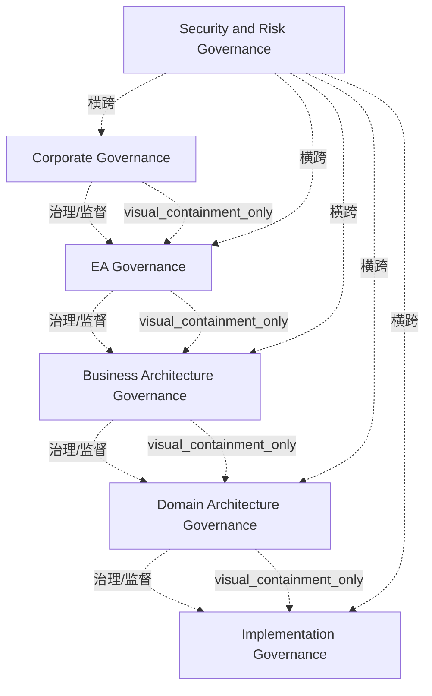

# G184/fig6-1 · 可能的治理层级

类型：`decomposition-or-organization-model`。第 6.1.1 节要求识别并定义适当的治理层级，明确治理什么、如何、何时，以及升级到哪一层寻求救济。本图给出可能的层级划分，提示企业很可能已为其中部分或全部层级定义了流程，EA 治理要放进这个层级体系里考虑。

英文 PDF 物理页：[61]。本页为架构语义分析，原文与原图分别保留。

## 原图与可编辑图


[完整 JSON](fig6-1.json) · [可编辑 Mermaid](fig6-1.mmd) · [仅关系图](fig6-1.relations.mmd) · [层级分解图](fig6-1.hierarchy.mmd)

图形重建表达语义，不复制源图布局。虚线表示解释、矩阵映射或分组关系，不自动表示不确定性的概率。



## 架构分析

由外向内读：最外圈“公司治理”，向内依次是“EA 治理”“业务架构治理”“域架构治理”，最内的浅蓝圆是“实施治理”。外层包住内层，表示较高层级约束较低层级。中部那条横穿所有圆的半透明灰带是“安全与风险治理”，它不是第六层，而是横切所有层级的治理关注。

- 本图有 6 个具名或隐含元素、9 条关系和 4 条包含/分组记录。
- 包含/分组树最大深度为 4；根节点为 公司治理、安全与风险治理。
- 本图没有可直接确认为人员直属汇报的关系；视觉上下位置、能力分解和治理职责分别读取。
- 治理边回答谁提供约束、指导或监督；它们与岗位汇报边分别存储。
- 5个嵌套治理范围与1条横切治理带完整核对，无连线/箭头。
- 正文60页说明上层与横切层约束下层；61页明确架构利益相关者保有目标架构及豁免/执行的决策权，不能把此图解作EA委员会拥有全部决策权。

### 如何用于项目

- 按父项展开所有直接子项，检查同层粒度、重叠和缺项。
- 保留组成、分类、能力分解与组织汇报的区别；将示例名称替换为已确认的项目对象。

### 结构所表达的逻辑

- 五个治理层级由外向内嵌套：公司治理 ⊃ EA 治理 ⊃ 业务架构治理 ⊃ 域架构治理 ⊃ 实施治理。正文说较低层级偏战术，较高层级约束较低层级，所以外圈约束内圈。
- 安全与风险治理是横贯所有层级的横带，属于横切的治理关注；正文说横切层级与较高层级一样约束较低层级。
- 每个层级都要明确治理什么、如何治理、何时治理，以及向哪一层升级寻求救济；层级内没有救济机制，会失去有效控制和局部自治。
- 企业很可能已为图中部分或全部层级定义了流程；领导者要识别这些流程，而不是另起一套。
- 决策权：目标架构、救济与强制执行的决策权始终属于架构的利益相关者，即使最低层级也是如此；EA 治理委员会拥有流程，以及对目标架构工作完整性与置信度的建议权。常见失败模式是 EA 治理委员会自认为拥有这些决策权。
- 正文引用 ISO/IEC 38500 把治理定义为“指导并控制当前与未来状态的体系”，并说治理是人人承诺遵守的决策层级体系；本图就是这种层级体系的一个划分。

## 上下级与包含

五层视觉嵌套，即约束范围的层级：第 1 层公司治理（最外），第 2 层 EA 治理，第 3 层业务架构治理，第 4 层域架构治理，第 5 层实施治理（最内）。安全与风险治理不在嵌套链中，它横跨全部五层。

|父项|子项|层级类型|依据与解释|
|---|---|---|---|
|公司治理|EA 治理|visual_containment_only|保存原图解释中的包含；业务关系类型需要图例或正文进一步限定。|
|EA 治理|业务架构治理|visual_containment_only|保存原图解释中的包含；业务关系类型需要图例或正文进一步限定。|
|业务架构治理|域架构治理|visual_containment_only|保存原图解释中的包含；业务关系类型需要图例或正文进一步限定。|
|域架构治理|实施治理|visual_containment_only|保存原图解释中的包含；业务关系类型需要图例或正文进一步限定。|

### 治理范围

|父项/范围/类型|子项/责任对象/实例|语义|
|---|---|---|
|公司治理|EA 治理|governs|
|EA 治理|业务架构治理|governs|
|业务架构治理|域架构治理|governs|
|域架构治理|实施治理|governs|

## 全部元素与角色

|元素ID|原文名称|类型|含义|直接父项|深度|
|---|---|---|---|---|---|
|corporate_gov|Corporate Governance|concept|概念：公司治理|—||
|ea_gov|EA Governance|concept|概念：EA 治理|公司治理|1|
|ba_gov|Business Architecture Governance|concept|概念：业务架构治理|EA 治理|2|
|domain_gov|Domain Architecture Governance|concept|概念：域架构治理|业务架构治理|3|
|impl_gov|Implementation Governance|concept|概念：实施治理|域架构治理|4|
|sec_risk_gov|Security and Risk Governance|concept|横切关注，跨越全部五个层级。|—||

## 全部关系

图中没有连线或箭头。圆的嵌套表示外层约束内层（记为 governs，隐含）；横带与各圆重叠表示安全与风险治理横切各层（同样记为 governs，隐含）。正文中的“向更高层级升级寻求救济”方向与之相反（内层 → 外层），图中没有画出。

|主体|语义关系|客体|显式线/隐式|原文标签|依据|
|---|---|---|---|---|---|
|公司治理|治理/监督|EA 治理|implicit||前四条来自嵌套与正文高层约束低层的治理说明；后五条由横向安全/风险治理带贯穿各层表达，无独立箭头。|
|EA 治理|治理/监督|业务架构治理|implicit||前四条来自嵌套与正文高层约束低层的治理说明；后五条由横向安全/风险治理带贯穿各层表达，无独立箭头。|
|业务架构治理|治理/监督|域架构治理|implicit||前四条来自嵌套与正文高层约束低层的治理说明；后五条由横向安全/风险治理带贯穿各层表达，无独立箭头。|
|域架构治理|治理/监督|实施治理|implicit||前四条来自嵌套与正文高层约束低层的治理说明；后五条由横向安全/风险治理带贯穿各层表达，无独立箭头。|
|安全与风险治理|横跨|公司治理|implicit||前四条来自嵌套与正文高层约束低层的治理说明；后五条由横向安全/风险治理带贯穿各层表达，无独立箭头。|
|安全与风险治理|横跨|EA 治理|implicit||前四条来自嵌套与正文高层约束低层的治理说明；后五条由横向安全/风险治理带贯穿各层表达，无独立箭头。|
|安全与风险治理|横跨|业务架构治理|implicit||前四条来自嵌套与正文高层约束低层的治理说明；后五条由横向安全/风险治理带贯穿各层表达，无独立箭头。|
|安全与风险治理|横跨|域架构治理|implicit||前四条来自嵌套与正文高层约束低层的治理说明；后五条由横向安全/风险治理带贯穿各层表达，无独立箭头。|
|安全与风险治理|横跨|实施治理|implicit||前四条来自嵌套与正文高层约束低层的治理说明；后五条由横向安全/风险治理带贯穿各层表达，无独立箭头。|

## 本轮语义修正

- 前四条来自嵌套与正文高层约束低层的治理说明；后五条由横向安全/风险治理带贯穿各层表达，无独立箭头。
- 前四条来自嵌套与正文高层约束低层的治理说明；后五条由横向安全/风险治理带贯穿各层表达，无独立箭头。
- 前四条来自嵌套与正文高层约束低层的治理说明；后五条由横向安全/风险治理带贯穿各层表达，无独立箭头。
- 前四条来自嵌套与正文高层约束低层的治理说明；后五条由横向安全/风险治理带贯穿各层表达，无独立箭头。
- 前四条来自嵌套与正文高层约束低层的治理说明；后五条由横向安全/风险治理带贯穿各层表达，无独立箭头。
- 前四条来自嵌套与正文高层约束低层的治理说明；后五条由横向安全/风险治理带贯穿各层表达，无独立箭头。
- 前四条来自嵌套与正文高层约束低层的治理说明；后五条由横向安全/风险治理带贯穿各层表达，无独立箭头。
- 前四条来自嵌套与正文高层约束低层的治理说明；后五条由横向安全/风险治理带贯穿各层表达，无独立箭头。
- 前四条来自嵌套与正文高层约束低层的治理说明；后五条由横向安全/风险治理带贯穿各层表达，无独立箭头。

## 误读检查

- 嵌套圆表示约束范围（外层约束内层），不是组织汇报线，也不是时间先后。
- 灰色横带不是第六个层级，而是横切所有层级的安全与风险治理。
- 圆的颜色由深到浅只用来区分层级，没有图例，不表示重要性或资源多少。
- 正文第 6.2 节说“即使在最低层级（技术架构治理）”，图中没有“技术架构治理”这一名称；图中最内层是“实施治理”，技术架构治理按理属于“域架构治理”一层（推断）。
- 中文稿引用的 figs/g184_fig6-1.svg 是另一种示意：3 个并列方框和自拟说明，缺少原图全部 6 个标签、嵌套结构和横切的安全与风险治理，不能据它理解本图。

## 原文证据

### [PDF 第 59 页](../../../documents/G184.md#page-59)

> This document now turns to the enterprise’s approach to decision-making, direction, and control. It discusses the process of governance, roles, and responsibilities as they pertain to the architecture process model in Chapter 10. Governance (decision-making, direction setting, and control) is addressed so early in this document to have clarity on the objectives. From this point onward, every action a Leader takes should be validated against this objective to stay relevant and focused on the outcome – not the ceremony of activities to be performed. A Leader should be very clear on what to report and to whom.
> It is likely that the existing governance and support models of an enterprise will need to change to obtain the most value from the EA Capability. Understanding the enterprise’s required architecture governance requires the following questions to be answered:
### [PDF 第 60 页](../../../documents/G184.md#page-60)

> It is likely that the enterprise already has processes defined for some or all of the tiers shown in Figure 6-1.
### [PDF 第 61 页](../../../documents/G184.md#page-61)

> A common failure pattern is to establish an EA governance board that believes it maintains decision rights about the target architecture, change to the architecture, relief, and enforcement. Decision rights about the target architecture, relief, and enforcement are always vested in the architecture’s stakeholders. Successful teams providing the EA Capability make sure that even within the lowest tier (technology architecture governance), stakeholders own the decision rights. An EA governance board owns process, and a recommendation regarding completeness and confidence in the work that led to the target architecture.
> The short decision-tree checklist for an EA board to require an architect to answer when assessing a target architecture is given below. Note that it may sound natural to start anywhere on this checklist or pursue answers to these questions simultaneously. Experience has shown this approach to create more work than making governance invisible; however, it has proved to be effective. Notice the choice of words at the beginning of the paragraph. This is a “decision-tree” presented in free flow text format for readability. All questions are mandatory. As in any decision-tree, a negative response may force you to re-enter the tree at a higher level.

## 来源与分析状态

所有元素/关系均有来源定位；未把历史解释重命名为本轮逐线视觉确认。源图与语义图是两种视图，布局不证明汇报或因果。

源 PDF SHA-256：`85fe5653767b184c3c8c9c1bef9f5738adbb2bf6661fb50ee95e72d16bc9f614`。

源图记录：[原始解释与转录](../../../figures/G184/fig6-1.json)。

```json
{
  "quality": {
    "graph_integrity": "checked",
    "semantic_analysis": "typed-graph-and-context-analysis",
    "visual_review": "source-content-audited",
    "notice_zh": "所有元素/关系均有来源定位；未把历史解释重命名为本轮逐线视觉确认。源图与语义图是两种视图，布局不证明汇报或因果。"
  },
  "source_uncertainty": {
    "confidence": "high",
    "uncertainties_zh": [
      "图中没有连线；“外层约束内层”“横带横切各层”依据正文“横切或较高层级约束较低层级”推断。",
      "正文第 6.2 节提到的“最低层级（技术架构治理）”在图中没有对应名称，与图中最内层“实施治理”不一致。"
    ],
    "analyzed_from": [
      "英文 PDF 第 61 页原图截图（220 dpi）",
      "英文 PDF 第 59–61 页正文（第 6 章引言、6.1、6.1.1、6.2 节）",
      "中文稿 G184e_领导者指南_建立并演进EA能力.md 第 483–505 行",
      "figs/g184_fig6-1.svg 源码"
    ],
    "date": "2026-10-31"
  },
  "source_conflicts": []
}
```
