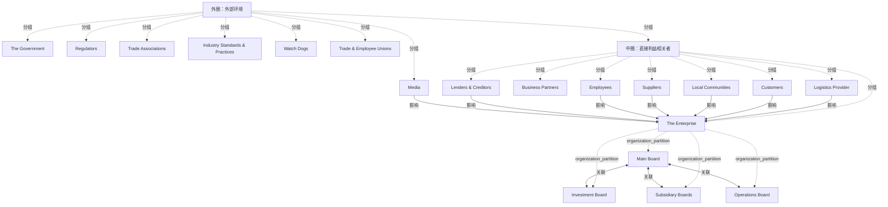

# G184/fig6-2 · 影响治理的外部与内部交互

类型：`architecture-concept-or-system-model`。第 6.3 节建议重新描绘现有流程，展示企业中发生的各种交互，以识别应治理什么。本图展示企业中可能存在、用于管理内外部交互的治理委员会：这些交互带来跨企业内外的信息交换，每一种信息的传播或消费都可能创造价值或带来风险。领导者的第一步是确认这些现有治理机制是否存在，以及哪些可以用来纳入 EA 治理。

英文 PDF 物理页：[65]。本页为架构语义分析，原文与原图分别保留。

## 原图与可编辑图


[完整 JSON](fig6-2.json) · [可编辑 Mermaid](fig6-2.mmd) · [仅关系图](fig6-2.relations.mmd) · [层级分解图](fig6-2.hierarchy.mmd)

图形重建表达语义，不复制源图布局。虚线表示解释、矩阵映射或分组关系，不自动表示不确定性的概率。



## 架构分析

由外向内读三层圆。外圈是外部环境：政府、监管机构、行业协会、行业标准与实践、监督机构、行业与员工工会，顶部的媒体也在外圈。中圈是直接利益相关者：贷款方与债权人、业务伙伴、供应商、物流提供商、客户、当地社区、员工。内圈是“企业”，其中董事会在上，投资委员会、子公司董事会、运营委员会在下，用双向箭头与董事会相连。指向内圈的单向箭头表示哪些外部主体与企业或某个委员会交互。

- 本图有 21 个具名或隐含元素、10 条关系和 20 条包含/分组记录。
- 包含/分组树最大深度为 3；根节点为 外圈：外部环境。
- 本图没有可直接确认为人员直属汇报的关系；视觉上下位置、能力分解和治理职责分别读取。
- 外环7类因素、次环7类相关方、企业及4委员会共21个节点/范围完整。
- 7条外来箭头指向企业内部；3条委员会双向箭头逐端点核对。没有把所有外环标签都补成连线。
- 外围圆环是外部语境分类，Main Board与三个委员会是同在企业内的实际圆形节点；不生成个人汇报表。

### 如何用于项目

- 围绕作者目的读取本图实体、分组与连线，并用对应原文限定其含义。
- 把参考模型与项目事实分开，实际范围、约束、值和责任须有项目证据。

### 结构所表达的逻辑

- 三层结构：内圈是企业自身的治理机构；中圈是与企业直接往来的利益相关者；外圈是政府、监管、行业组织等更大的外部环境。
- 7 条单向箭头从外向内：媒体、贷款方与债权人、员工、供应商指向企业整体；当地社区、客户、物流提供商的箭头分别朝向投资委员会、子公司董事会、运营委员会。正文说这些交互造成企业内外的信息交换，每种信息交换都可能创造价值或带来风险，治理框架要规定由谁、在何时指导和控制哪类信息交换。
- 业务伙伴和外圈的政府、监管机构、行业协会、行业标准与实践、监督机构、工会没有画箭头；它们以位置表示构成企业所处的外部环境与约束。
- 企业内部治理机构：董事会与投资委员会、子公司董事会、运营委员会之间各有一条双向箭头，表示相互交互。
- 第一步是确认图中这些现有治理机制是否存在，以及哪些可以用来纳入 EA 治理；有时可以修改现有治理机构的章程，把架构治理纳入其中。按 TOGAF 术语，架构治理机构称为架构委员会。
- 治理框架要平衡企业战术运营与战略运营的需要；执行责任和执行发生的组织层级因 EA 能力的章程而异。
- 治理由机制、流程和团队构成，架构师和利益相关者借此表达利益、行使合法权利、履行义务并调解分歧。要识别、制定并发布基本政策、原则和规则；所定义的原则应与企业运营的规模、复杂性、结构、经济重要性和风险状况相称。

## 上下级与包含

三层视觉嵌套：外圈（外部环境，7 个主体，含顶部的媒体）⊃ 中圈（直接利益相关者，7 个）⊃ 内圈“企业”（董事会 + 3 个委员会）。圆环表示与企业的远近，不是组织隶属关系；内圈中董事会画在上方，但图中只用双向箭头表示它与各委员会交互，没有画出上下级。

|父项|子项|层级类型|依据与解释|
|---|---|---|---|
|外圈：外部环境|政府|visual_grouping|框、泳道、域或分类组的成员归属；没有额外证据不提升为业务组合或管理关系。|
|外圈：外部环境|媒体|visual_grouping|框、泳道、域或分类组的成员归属；没有额外证据不提升为业务组合或管理关系。|
|外圈：外部环境|监管机构|visual_grouping|框、泳道、域或分类组的成员归属；没有额外证据不提升为业务组合或管理关系。|
|外圈：外部环境|行业协会|visual_grouping|框、泳道、域或分类组的成员归属；没有额外证据不提升为业务组合或管理关系。|
|外圈：外部环境|行业标准与实践|visual_grouping|框、泳道、域或分类组的成员归属；没有额外证据不提升为业务组合或管理关系。|
|外圈：外部环境|监督机构（Watchdogs）|visual_grouping|框、泳道、域或分类组的成员归属；没有额外证据不提升为业务组合或管理关系。|
|外圈：外部环境|行业与员工工会|visual_grouping|框、泳道、域或分类组的成员归属；没有额外证据不提升为业务组合或管理关系。|
|外圈：外部环境|中圈：直接利益相关者|visual_grouping|框、泳道、域或分类组的成员归属；没有额外证据不提升为业务组合或管理关系。|
|中圈：直接利益相关者|贷款方与债权人|visual_grouping|框、泳道、域或分类组的成员归属；没有额外证据不提升为业务组合或管理关系。|
|中圈：直接利益相关者|业务伙伴|visual_grouping|框、泳道、域或分类组的成员归属；没有额外证据不提升为业务组合或管理关系。|
|中圈：直接利益相关者|供应商|visual_grouping|框、泳道、域或分类组的成员归属；没有额外证据不提升为业务组合或管理关系。|
|中圈：直接利益相关者|物流提供商|visual_grouping|框、泳道、域或分类组的成员归属；没有额外证据不提升为业务组合或管理关系。|
|中圈：直接利益相关者|客户|visual_grouping|框、泳道、域或分类组的成员归属；没有额外证据不提升为业务组合或管理关系。|
|中圈：直接利益相关者|当地社区|visual_grouping|框、泳道、域或分类组的成员归属；没有额外证据不提升为业务组合或管理关系。|
|中圈：直接利益相关者|员工|visual_grouping|框、泳道、域或分类组的成员归属；没有额外证据不提升为业务组合或管理关系。|
|中圈：直接利益相关者|企业|visual_grouping|框、泳道、域或分类组的成员归属；没有额外证据不提升为业务组合或管理关系。|
|企业|董事会|organization_partition|组织单元的组成/分区；此处不自动证明岗位直属汇报。|
|企业|投资委员会|organization_partition|组织单元的组成/分区；此处不自动证明岗位直属汇报。|
|企业|子公司董事会|organization_partition|组织单元的组成/分区；此处不自动证明岗位直属汇报。|
|企业|运营委员会|organization_partition|组织单元的组成/分区；此处不自动证明岗位直属汇报。|

## 全部元素与角色

|元素ID|原文名称|类型|含义|直接父项|深度|
|---|---|---|---|---|---|
|ring_outer|外圈：外部环境|group|图中没有标题，由所含主体推断。|—||
|government|The Government|actor|参与者：政府|外圈：外部环境|1|
|media|Media|actor|参与者：媒体|外圈：外部环境|1|
|regulators|Regulators|actor|参与者：监管机构|外圈：外部环境|1|
|trade_assoc|Trade Associations|actor|参与者：行业协会|外圈：外部环境|1|
|industry_std|Industry Standards & Practices|principle|原则：行业标准与实践|外圈：外部环境|1|
|watch_dogs|Watch Dogs|actor|参与者：监督机构（Watchdogs）|外圈：外部环境|1|
|unions|Trade & Employee Unions|actor|参与者：行业与员工工会|外圈：外部环境|1|
|ring_middle|中圈：直接利益相关者|group|图中没有标题，由所含主体推断。|外圈：外部环境|1|
|lenders|Lenders & Creditors|stakeholder|利益相关者：贷款方与债权人|中圈：直接利益相关者|2|
|partners|Business Partners|stakeholder|利益相关者：业务伙伴|中圈：直接利益相关者|2|
|suppliers|Suppliers|stakeholder|利益相关者：供应商|中圈：直接利益相关者|2|
|logistics|Logistics Provider|stakeholder|利益相关者：物流提供商|中圈：直接利益相关者|2|
|customers|Customers|stakeholder|利益相关者：客户|中圈：直接利益相关者|2|
|communities|Local Communities|stakeholder|利益相关者：当地社区|中圈：直接利益相关者|2|
|employees|Employees|stakeholder|利益相关者：员工|中圈：直接利益相关者|2|
|enterprise|The Enterprise|organization_unit|组织单元：企业|中圈：直接利益相关者|2|
|main_board|Main Board|organization_unit|组织单元：董事会|企业|3|
|investment_board|Investment Board|organization_unit|组织单元：投资委员会|企业|3|
|subsidiary_boards|Subsidiary Boards|organization_unit|组织单元：子公司董事会|企业|3|
|operations_board|Operations Board|organization_unit|组织单元：运营委员会|企业|3|

## 全部关系

单向箭头（7 条）：起点在外部主体标签处，箭头指向企业或某个委员会，记为 influence（交互影响治理），from = 外部主体。双向箭头（3 条）：董事会与投资委员会、子公司董事会、运营委员会之间的相互交互，记为 flow、arrow = both。三个圆环本身只划分层次，不是关系线。

|主体|语义关系|客体|显式线/隐式|原文标签|依据|
|---|---|---|---|---|---|
|媒体|影响|企业|显式连线||自上而下穿过中圈，止于“The Enterprise”标题上方|
|贷款方与债权人|影响|企业|显式连线||影响|
|员工|影响|企业|显式连线||影响|
|供应商|影响|企业|显式连线||影响|
|当地社区|影响|企业|显式连线||下方3条外部影响箭头终止在企业圆内、相应委员会圆下方；并未接入委员会圈，不将邻近位置误作端点。|
|客户|影响|企业|显式连线||下方3条外部影响箭头终止在企业圆内、相应委员会圆下方；并未接入委员会圈，不将邻近位置误作端点。|
|物流提供商|影响|企业|显式连线||下方3条外部影响箭头终止在企业圆内、相应委员会圆下方；并未接入委员会圈，不将邻近位置误作端点。|
|董事会|关联|投资委员会|显式连线||Main Board与另外三个board之间是双向箭头，表示内部相互作用，不是单向汇报或信息流。|
|董事会|关联|子公司董事会|显式连线||Main Board与另外三个board之间是双向箭头，表示内部相互作用，不是单向汇报或信息流。|
|董事会|关联|运营委员会|显式连线||Main Board与另外三个board之间是双向箭头，表示内部相互作用，不是单向汇报或信息流。|

## 本轮语义修正

- 下方3条外部影响箭头终止在企业圆内、相应委员会圆下方；并未接入委员会圈，不将邻近位置误作端点。
- 下方3条外部影响箭头终止在企业圆内、相应委员会圆下方；并未接入委员会圈，不将邻近位置误作端点。
- 下方3条外部影响箭头终止在企业圆内、相应委员会圆下方；并未接入委员会圈，不将邻近位置误作端点。
- Main Board与另外三个board之间是双向箭头，表示内部相互作用，不是单向汇报或信息流。
- Main Board与另外三个board之间是双向箭头，表示内部相互作用，不是单向汇报或信息流。
- Main Board与另外三个board之间是双向箭头，表示内部相互作用，不是单向汇报或信息流。

## 误读检查

- 箭头表示交互与信息交换对治理的影响，不是汇报线或控制线。
- 业务伙伴和外圈多数主体没有箭头，不表示它们与企业没有交互；图只画出若干例子。
- 内圈四个圆是企业的治理机构（董事会、委员会），不是业务部门。中文稿引用的中文图把 Main Board 译为“主要委员会”，应为董事会。
- 中文稿引用的 figs/zh/g184e_fig6-2_zh.png 被标签框遮住了 3 条箭头和两个委员会的大部分，图注又写“英文原图”，据它会漏掉贷款方、当地社区、物流提供商这三条交互。
- 本图不是 The Open Group 原创，来源为 Applied Corporate Governance（Kendall & Kendall, 2013）。

## 原文证据

### [PDF 第 64 页](../../../documents/G184.md#page-64)

> Redrawing the existing processes to showcase various interactions happening in an enterprise will help identify what should be governed. Figure 6-2 shows possible governance boards that exist in an enterprise to manage internal and external interactions. These interactions impact the business and hence the EA. These interactions result in exchange of information within and outside the enterprise, brokered via different mediums. Each kind of information dissemination or consumption could enable value or pose risk. The governance framework defines who will direct and control what kind of information exchange and when.
### [PDF 第 65 页](../../../documents/G184.md#page-65)

> The governance framework should balance the needs of tactical and strategic operations of the enterprise. The enforcement responsibility and organizational level where enforcement happens will vary based on the charter for the EA Capability. The first step is to confirm the existence of existing governance mechanisms as shown in Figure 6-2,[1] and determine which can be leveraged to include EA governance. At times, it may be possible to change the charter of an existing governance body to include architecture governance. In TOGAF terms, the architecture governance body is called the architecture board. The rest of the discussion in this chapter applies whether a Leader is creating a new or leveraging an existing body.
### [PDF 第 68 页](../../../documents/G184.md#page-68)

> Governance often results in a change, either to current effort or future efforts. Organizational and architecture change management should account for triggers and provide a timeline to implement the change from governance decisions. Imagine opening a faucet for hot water in the morning. Other control mechanisms sense the opening of the faucet, and it takes a while for the hot water to start flowing out of the faucet – flushing out the cold water in the line. Governance operates in a similar way at times, and its process should also account for long lead times for corrective actions to take effect.
> All governance decisions and scope are not the same – for example, business architecture decisions will impact operational processes and cost, or when the goal has to be restated, scope of impact and governance decisions are the same. Nor will the level of decision-making – operational to strategic – impact the scope of change.

## 来源与分析状态

所有元素/关系均有来源定位；未把历史解释重命名为本轮逐线视觉确认。源图与语义图是两种视图，布局不证明汇报或因果。

源 PDF SHA-256：`85fe5653767b184c3c8c9c1bef9f5738adbb2bf6661fb50ee95e72d16bc9f614`。

源图记录：[原始解释与转录](../../../figures/G184/fig6-2.json)。

```json
{
  "quality": {
    "graph_integrity": "checked",
    "semantic_analysis": "typed-graph-and-context-analysis",
    "visual_review": "source-content-audited",
    "notice_zh": "所有元素/关系均有来源定位；未把历史解释重命名为本轮逐线视觉确认。源图与语义图是两种视图，布局不证明汇报或因果。"
  },
  "source_uncertainty": {
    "confidence": "high",
    "uncertainties_zh": [
      "当地社区、客户、物流提供商三条箭头止于对应委员会的圆外附近，没有触到圆；按最近的委员会记录目标，也可能只是泛指企业。",
      "Main Board、Investment Board、Subsidiary Boards、Operations Board 的中文译名（董事会、投资委员会、子公司董事会、运营委员会）由解析者拟定；外圈、中圈的分组名称图中没有，由所含主体推断。"
    ],
    "analyzed_from": [
      "英文 PDF 第 65 页原图截图（220 dpi）及左下放大分块",
      "英文 PDF 第 64–65 页正文（第 6.3 节）、第 68 页第 6 章尾注 [1]",
      "中文稿 G184e_领导者指南_建立并演进EA能力.md 第 529–541 行",
      "figs/zh/g184e_fig6-2_zh.png（逐项比较）"
    ],
    "date": "2026-10-31"
  },
  "source_conflicts": []
}
```
