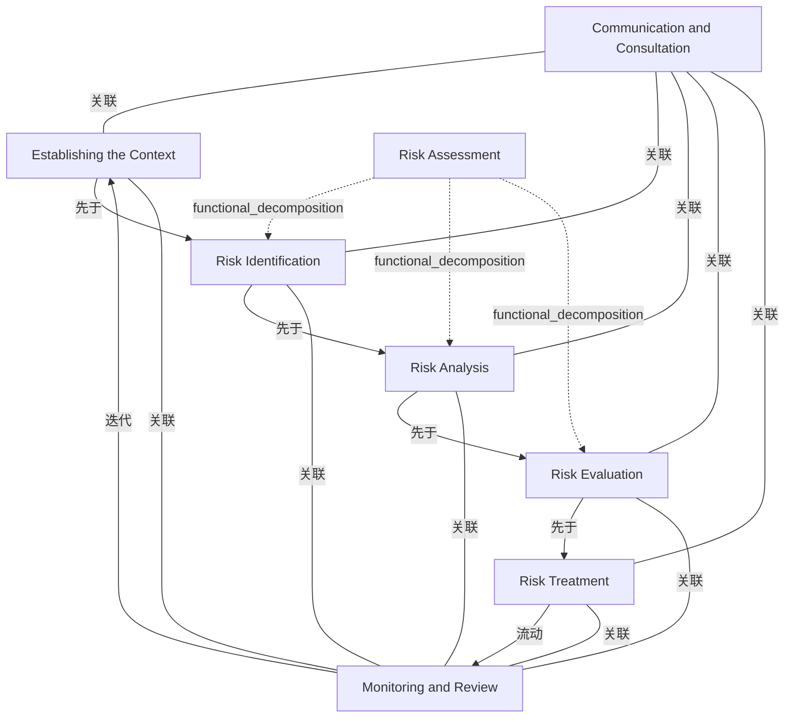

# G184/fig6-3 · ISO 31000 风险管理标准模型

类型：`process-or-method-model`。第 6.4 节要求 EA 能力与企业风险管理（ERM）紧密集成。第 6.4.2 节把 ISO 31000 作为 ERM 的权威标准介绍，并强调风险管理应深入嵌入所有业务活动，是持续的生命周期而不是孤立活动；本图给出该标准的风险管理过程模型，供领导者理解企业 ERM 的结构，并据此确定 EA 治理如何与之衔接。

英文 PDF 物理页：[67]。本页为架构语义分析，原文与原图分别保留。

## 原图与可编辑图


[完整 JSON](fig6-3.json) · [可编辑 Mermaid](fig6-3.mmd) · [仅关系图](fig6-3.relations.mmd) · [层级分解图](fig6-3.hierarchy.mmd)

图形重建表达语义，不复制源图布局。虚线表示解释、矩阵映射或分组关系，不自动表示不确定性的概率。



## 架构分析

先读中间一列，自上而下：建立情境 → 风险评估（大框内依次为风险识别 → 风险分析 → 风险评价）→ 风险应对。再看底部：风险应对的箭头折向右侧“监督与评审”；顶部：监督与评审的箭头折回“建立情境”，构成循环。左侧“沟通与咨询”和右侧“监督与评审”是通高竖框，用横线连到中间 5 个步骤，表示它们伴随每一步。各框右上角的空心箭头只是过程图标，不表示流向。

- 本图有 8 个具名或隐含元素、16 条关系和 3 条包含/分组记录。
- 包含/分组树最大深度为 1；根节点为 沟通与咨询、监督与评审、建立情境、风险评估、风险应对。
- 本图没有可直接确认为人员直属汇报的关系；视觉上下位置、能力分解和治理职责分别读取。
- 8个框标签、4条阶段向下箭头、2个反馈回路、两侧各5条无向横线全部核对。
- Risk Assessment仅包围识别、分析、评价；小空心箭头图标不是额外流程连接。
- 原文定义持续风险管理生命周期，不能把咨询与监控误作只在开始/结束执行的独立阶段。

### 如何用于项目

- 按阶段/事件/行为关系读取入口、出口、责任和产物；检查循环与例外路径。
- 工作流先后不表示组织管理权；在项目中显式记录条件和完成标准。

### 结构所表达的逻辑

- 主过程有 5 步：建立情境、风险识别、风险分析、风险评价、风险应对；其中识别、分析、评价三步合称风险评估。
- 沟通与咨询、监督与评审是两项持续活动，与每个步骤都相连，贯穿整个过程，而不是某一步之后才做。
- 风险应对的结果进入监督与评审，监督与评审又反馈到建立情境，形成闭环：正文强调风险管理是持续的生命周期，而不是孤立活动。
- ISO 31000 把风险定义为“不确定性对目标的影响”，即任何偏离预期的结果；有效风险管理的核心是围绕预期目标进行管理，降低不确定性，并在正面与负面结果之间取得平衡。
- EA 能力的核心作用之一是营造一种环境，使运营风险得到优化，以实现最大业务收益和最小业务损失；这需要理解 ERM 的范围与关注点并与之紧密集成。
- 正文要求回答：企业的风险偏好和风险容忍度是什么；谁认可风险评估、谁认可风险应对计划。这些问题分别对应图中的风险评估与风险应对环节。
- （背景知识）图中步骤名称与 ISO 31000:2009 的过程模型一致；2018 版把“建立情境”扩展为“范围、情境与准则”，并增加了“记录与报告”。

## 上下级与包含

两层：风险评估是一个分组框，内含风险识别、风险分析、风险评价三个子过程；其余步骤与两侧持续活动都是同级过程。

|父项|子项|层级类型|依据与解释|
|---|---|---|---|
|风险评估|风险识别|functional_decomposition|同类功能/过程/服务的嵌套分解；不推断执行顺序。|
|风险评估|风险分析|functional_decomposition|同类功能/过程/服务的嵌套分解；不推断执行顺序。|
|风险评估|风险评价|functional_decomposition|同类功能/过程/服务的嵌套分解；不推断执行顺序。|

## 全部元素与角色

|元素ID|原文名称|类型|含义|直接父项|深度|
|---|---|---|---|---|---|
|comm_consult|Communication and Consultation|process|流程：沟通与咨询|—||
|monitor_review|Monitoring and Review|process|流程：监督与评审|—||
|context|Establishing the Context|process|流程：建立情境|—||
|risk_assessment|Risk Assessment|process|分组框，内含识别、分析、评价三个子过程。|—||
|identification|Risk Identification|process|流程：风险识别|风险评估|1|
|analysis|Risk Analysis|process|流程：风险分析|风险评估|1|
|evaluation|Risk Evaluation|process|流程：风险评价|风险评估|1|
|treatment|Risk Treatment|process|流程：风险应对|—||

## 全部关系

带实心箭头的线表示先后顺序：建立情境 → 风险识别 → 风险分析 → 风险评价 → 风险应对（第一条和最后一条分别穿过风险评估框的上、下边），以及两条折线回路：风险应对 → 监督与评审、监督与评审 → 建立情境。两侧竖框与每个步骤之间的横线没有箭头，表示该持续活动伴随此步骤，记为 association、无方向。各框右上角的空心箭头是过程图标，不是连线。

|主体|语义关系|客体|显式线/隐式|原文标签|依据|
|---|---|---|---|---|---|
|建立情境|先于|风险识别|显式连线||穿过风险评估框上边|
|风险识别|先于|风险分析|显式连线||先于|
|风险分析|先于|风险评价|显式连线||先于|
|风险评价|先于|风险应对|显式连线||穿过风险评估框下边|
|风险应对|流动|监督与评审|显式连线||底部折线：风险应对的结果进入监督与评审|
|监督与评审|迭代|建立情境|显式连线||顶部折线：监督与评审反馈到建立情境，构成循环|
|沟通与咨询|关联|建立情境|显式连线||关联|
|沟通与咨询|关联|风险识别|显式连线||关联|
|沟通与咨询|关联|风险分析|显式连线||关联|
|沟通与咨询|关联|风险评价|显式连线||关联|
|沟通与咨询|关联|风险应对|显式连线||关联|
|监督与评审|关联|建立情境|显式连线||关联|
|监督与评审|关联|风险识别|显式连线||关联|
|监督与评审|关联|风险分析|显式连线||关联|
|监督与评审|关联|风险评价|显式连线||关联|
|监督与评审|关联|风险应对|显式连线||关联|

## 误读检查

- 框右上角的空心箭头不表示流向，只是过程图标（背景知识：ArchiMate 风格的业务流程记法）。
- 两侧竖框与步骤之间的横线没有箭头，表示伴随与参与，不是单向的信息流。
- “风险评估”是三个子过程的分组，不是在风险识别之前的独立一步。
- 监督与评审回到建立情境的回路说明过程是循环的，不要读成从上到下只走一遍。
- 本图与 G152 图 3-3 是同一张图；G152 的图题注明 ISO 31000:2009，引用较新的 ISO 31000:2018 时步骤名称有变化（见背景知识）。

## 原文证据

### [PDF 第 66 页](../../../documents/G184.md#page-66)

> A central role of the EA Capability is to facilitate creation of an environment where operational risk can be optimized for maximum business benefit and minimum business loss. This requires close integration with the enterprise’s risk management approach and an understanding of the scope and interests of Enterprise Risk Management(ERM). Tight integration with ERM facilitates tilting the EA to improve realization of objectives, and the reduction of uncertainty.
> Consideration of ERM in the context of governance is driven by the foundation that governance is a decision-making process, with a defined structure of relationships to direct and control the enterprise to achieve stated goals. The process by which direction and control is provided should imbibe equality of concern and transparency, protecting the rights and interests of the business.
### [PDF 第 67 页](../../../documents/G184.md#page-67)

> The definitive standard for Enterprise Risk Management (ERM) – the ISO 31000 standard – outlines a risk management approach to aiding decision-making by taking account of uncertainty and the effect of this uncertainty reaching the enterprise’s objectives. Following the ISO 31000 standard approach ensures that risk management is embedded deeply and firmly in all business activities. It also states that it is a continuous lifecycle rather than an isolated activity.
> The process should be documented in such a way that information about when and which approval, enforcement, and relief mechanisms should be deployed should be as self-explanatory, transparent, and effective as needed. In selecting an existing governance body, consider the simplicity of process and its effectiveness.
### [PDF 第 68 页](../../../documents/G184.md#page-68)

> Governance often results in a change, either to current effort or future efforts. Organizational and architecture change management should account for triggers and provide a timeline to implement the change from governance decisions. Imagine opening a faucet for hot water in the morning. Other control mechanisms sense the opening of the faucet, and it takes a while for the hot water to start flowing out of the faucet – flushing out the cold water in the line. Governance operates in a similar way at times, and its process should also account for long lead times for corrective actions to take effect.
> All governance decisions and scope are not the same – for example, business architecture decisions will impact operational processes and cost, or when the goal has to be restated, scope of impact and governance decisions are the same. Nor will the level of decision-making – operational to strategic – impact the scope of change.

## 来源与分析状态

所有元素/关系均有来源定位；未把历史解释重命名为本轮逐线视觉确认。源图与语义图是两种视图，布局不证明汇报或因果。

源 PDF SHA-256：`85fe5653767b184c3c8c9c1bef9f5738adbb2bf6661fb50ee95e72d16bc9f614`。

源图记录：[原始解释与转录](../../../figures/G184/fig6-3.json)。

```json
{
  "quality": {
    "graph_integrity": "checked",
    "semantic_analysis": "typed-graph-and-context-analysis",
    "visual_review": "source-content-audited",
    "notice_zh": "所有元素/关系均有来源定位；未把历史解释重命名为本轮逐线视觉确认。源图与语义图是两种视图，布局不证明汇报或因果。"
  },
  "source_uncertainty": {
    "confidence": "high",
    "uncertainties_zh": [
      "框右上角空心箭头按 ArchiMate 风格的过程图标解释（背景知识），原图没有图例。",
      "本文档图题没有写 ISO 31000 的版本，“2009 版”依据 G152 中同一张图的图题。"
    ],
    "analyzed_from": [
      "英文 PDF 第 67 页原图截图（220 dpi）",
      "G152 英文 PDF 第 24 页图 3-3 原图截图及中部放大（对照）",
      "英文 PDF 第 66–67 页正文（第 6.4、6.4.1、6.4.2 节）、第 68 页第 6 章尾注 [2]",
      "中文稿 G184e_领导者指南_建立并演进EA能力.md 第 543–577 行",
      "figs/zh/g184e_fig6-3_zh.png（逐项比较）、figs/zh/g184e_fig6-3_zh.svg 源码"
    ],
    "date": "2026-10-31"
  },
  "source_conflicts": []
}
```
