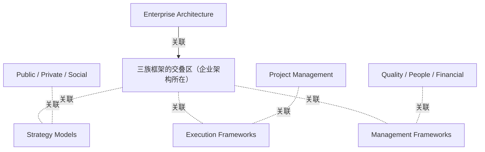

# G184/fig7-1 · 框架族之间的关系（TOGAF 标准——ADM 技术图 3-1 [C220] 的抽象视图）

类型：`analytical-view`。说明框架族之间的关系：企业按经济、问责与执行模型把框架分组后，会得到类似本图的重叠视图；EA 能力不是第四类独立框架，而是位于战略、执行、管理三族框架的交集，需要同时吸收三者的成果，并在缺口处补位。图题说明它是 TOGAF 标准——ADM 技术图 3-1 [C220] 的抽象视图。

英文 PDF 物理页：[70]。本页为架构语义分析，原文与原图分别保留。

## 原图与可编辑图


[完整 JSON](fig7-1.json) · [可编辑 Mermaid](fig7-1.mmd) · [仅关系图](fig7-1.relations.mmd) · [层级分解图](fig7-1.hierarchy.mmd)

图形重建表达语义，不复制源图布局。虚线表示解释、矩阵映射或分组关系，不自动表示不确定性的概率。



## 架构分析

先看三个大圆：上方浅蓝圆是 Strategy Models（战略模型），左下浅绿圆是 Execution Frameworks（执行框架），右下浅粉圆是 Management Frameworks（管理框架）；三圆两两重叠。中央深色小圆落在三圆共同交叠处，右侧“Enterprise Architecture”用引线箭头指向它，表示 EA 位于三族交集。圆外的三段文字各自贴近一个圆，示意该族框架的典型语境或示例。图中没有其他连线。

- 本图有 8 个具名或隐含元素、7 条关系和 0 条包含/分组记录。
- 本图没有可直接确认为人员直属汇报的关系；视觉上下位置、能力分解和治理职责分别读取。
- 3个大圈代表Strategy Models、Execution Frameworks、Management Frameworks；中央额外小圈表示EA，不能简单当作严格三集合交集。
- 外侧Public/Private/Social、Project Management、Quality/People/Financial是对应示例注记。
- 箭头是图注引线，不是Enterprise Architecture向某对象产生架构依赖。

### 如何用于项目

- 围绕作者目的读取本图实体、分组与连线，并用对应原文限定其含义。
- 把参考模型与项目事实分开，实际范围、约束、值和责任须有项目证据。

### 结构所表达的逻辑

- 三个框架族分别是战略模型、执行框架、管理框架；它们相互交叠而不是互斥分类。
- Enterprise Architecture 画在三圆共同交集处，说明 EA 同时涉及战略、执行与管理三类框架，不是与它们并列的第四类框架。
- 圆外注记与三个圆一一对应：Public / Private / Social 贴近战略模型，Project Management 贴近执行框架，Quality / People / Financial 贴近管理框架；它们说明各族的典型适用范围或示例，没有引线连接。
- 图题明确本图是 TOGAF 标准——ADM 技术图 3-1 [C220] 的抽象视图，不是完整的框架映射表。
- 正文用“重叠视图”描述按经济、问责与执行模型（如风险、会计、规划）对框架分组的结果，并强调要厘清从每个框架、方法或技术中究竟需要什么。
- 7.2 节据此提出“融入/补位”策略：其他框架已提供规划、变更治理与收益实现的成果时，EA 能力融入；出现缺口时，EA 能力补位并调整路线图。
- 圆的大小与交叠面积没有量化含义，图中也没有图例；不要据此判断框架数量、成熟度或重要性。

## 上下级与包含

没有上下级。三个大圆是并列的框架族，中央小圆是三者交集而非某个大圆的下级；圆外三段文字是旁注，不是层级节点。图中唯一的方向符号是“Enterprise Architecture”到中央小圆的标签引线。

|父项|子项|层级类型|依据与解释|
|---|---|---|---|
|—|—|无视觉包含|关系中明确的组成/特化见 JSON semantic_hierarchy。|

## 全部元素与角色

|元素ID|原文名称|类型|含义|直接父项|深度|
|---|---|---|---|---|---|
|fw_strategy|Strategy Models|group|三类框架族之一：战略模型；圆外上方注记为 Public / Private / Social。|—||
|fw_execution|Execution Frameworks|group|三类框架族之一：执行框架；圆外左下方注记为 Project Management。|—||
|fw_management|Management Frameworks|group|三类框架族之一：管理框架；圆外右下方注记为 Quality / People / Financial。|—||
|ea_overlap|三族框架的交叠区（企业架构所在）|concept|位于三个大圆的共同交集，表示 Enterprise Architecture；圆本身不带文字，由右侧引线标签命名。|—||
|ea_label|Enterprise Architecture|note|图内唯一的文字标签加引线箭头；箭头指向中央深色小圆。|—||
|ctx_sector|Public / Private / Social|note|贴近战略模型圆的无引线注记，示意该族框架跨越公共、私营与社会部门语境（含义据位置推断）。|—||
|ctx_project|Project Management|note|贴近执行框架圆的无引线注记，项目管理是其典型示例（含义据位置推断）。|—||
|ctx_quality|Quality / People / Financial|note|贴近管理框架圆的无引线注记，示意该族覆盖质量、人员与财务等管理领域（含义据位置推断）。|—||

## 全部关系

只有一个画出的箭头：从右侧“Enterprise Architecture”文字指向中央深色小圆，属于标签引线，不表示流程方向。三个大圆之间的关系完全由圆的重叠表达，没有连线；圆外注记与圆之间也没有连线，对应关系由位置推断。

|主体|语义关系|客体|显式线/隐式|原文标签|依据|
|---|---|---|---|---|---|
|企业架构|关联|三族框架的交叠区（企业架构所在）|显式连线||唯一独立箭头从Enterprise Architecture文字指向中央阴影圆，用于注释；其他关系由重叠或附近文字表达。|
|三族框架的交叠区（企业架构所在）|关联|战略模型|implicit||唯一独立箭头从Enterprise Architecture文字指向中央阴影圆，用于注释；其他关系由重叠或附近文字表达。|
|三族框架的交叠区（企业架构所在）|关联|执行框架|implicit||唯一独立箭头从Enterprise Architecture文字指向中央阴影圆，用于注释；其他关系由重叠或附近文字表达。|
|三族框架的交叠区（企业架构所在）|关联|管理框架|implicit||唯一独立箭头从Enterprise Architecture文字指向中央阴影圆，用于注释；其他关系由重叠或附近文字表达。|
|公共/私营/社会|关联|战略模型|implicit||唯一独立箭头从Enterprise Architecture文字指向中央阴影圆，用于注释；其他关系由重叠或附近文字表达。|
|项目管理|关联|执行框架|implicit||唯一独立箭头从Enterprise Architecture文字指向中央阴影圆，用于注释；其他关系由重叠或附近文字表达。|
|质量/人员/财务|关联|管理框架|implicit||唯一独立箭头从Enterprise Architecture文字指向中央阴影圆，用于注释；其他关系由重叠或附近文字表达。|

## 本轮语义修正

- 唯一独立箭头从Enterprise Architecture文字指向中央阴影圆，用于注释；其他关系由重叠或附近文字表达。
- 唯一独立箭头从Enterprise Architecture文字指向中央阴影圆，用于注释；其他关系由重叠或附近文字表达。
- 唯一独立箭头从Enterprise Architecture文字指向中央阴影圆，用于注释；其他关系由重叠或附近文字表达。
- 唯一独立箭头从Enterprise Architecture文字指向中央阴影圆，用于注释；其他关系由重叠或附近文字表达。
- 唯一独立箭头从Enterprise Architecture文字指向中央阴影圆，用于注释；其他关系由重叠或附近文字表达。
- 唯一独立箭头从Enterprise Architecture文字指向中央阴影圆，用于注释；其他关系由重叠或附近文字表达。
- 唯一独立箭头从Enterprise Architecture文字指向中央阴影圆，用于注释；其他关系由重叠或附近文字表达。

## 误读检查

- 不要把 Enterprise Architecture 读成第四个圆或第四类框架；它是三个框架族的交集。
- 不要把圆的大小或交叠面积当作框架数量、成熟度、重要性或覆盖比例；图中没有任何量化编码。
- 不要把圆外注记（Public/Private/Social、Project Management、Quality/People/Financial）当作三个独立框架节点；它们是各族的语境/示例说明，且没有引线。
- 不要把“Enterprise Architecture”的引线箭头理解为 EA 指向战略模型或从战略模型获取输入；它只是把标签指向中央小圆。
- 不要把本图当作 TOGAF ADM 技术图 3-1 的完整复制；图题说明它只是抽象视图，细节需回到 [C220]。
- 中文资产把“Enterprise Architecture”排成两行，箭头仍指向中央圆，不要误读为指向右侧某个圆。

## 原文证据

### [PDF 第 69 页](../../../documents/G184.md#page-69)

> Group the frameworks against the econometric, accountability, and execution models like risk, accounting, and planning. The grouping may create an overlap view similar to Figure 7-1. Rationalize what is needed from each framework, method, or technique for effective operationalization of recommendations from the EA Capability (attaining the target state).
### [PDF 第 70 页](../../../documents/G184.md#page-70)

> Figure 7-1: Relationships Across Framework Families (this figure is an abstracted view of the TOGAF Standard

## 来源与分析状态

所有元素/关系均有来源定位；未把历史解释重命名为本轮逐线视觉确认。源图与语义图是两种视图，布局不证明汇报或因果。

源 PDF SHA-256：`85fe5653767b184c3c8c9c1bef9f5738adbb2bf6661fb50ee95e72d16bc9f614`。

源图记录：[原始解释与转录](../../../figures/G184/fig7-1.json)。

```json
{
  "quality": {
    "graph_integrity": "checked",
    "semantic_analysis": "typed-graph-and-context-analysis",
    "visual_review": "source-content-audited",
    "notice_zh": "所有元素/关系均有来源定位；未把历史解释重命名为本轮逐线视觉确认。源图与语义图是两种视图，布局不证明汇报或因果。"
  },
  "source_uncertainty": {
    "confidence": "high",
    "uncertainties_zh": [
      "圆外三段注记（Public/Private/Social、Project Management、Quality/People/Financial）没有引线或图例，其确切作用（适用范围、示例框架族、还是输入来源）只能按位置推断，标为 implicit。",
      "骨架的 title_en 在“TOGAF Standard”处被截断；完整图题见英文 PDF 第 70 页图注，本分析未改写 title_en。",
      "图题引用的 TOGAF Standard – ADM Techniques Figure 3-1 [C220] 不在当前图表库中，无法建立跨文档 related_figures 链接。",
      "中央深色小圆没有自己的文字，其含义由右侧“Enterprise Architecture”引线确定；该箭头按标签引线处理。",
      "三圆交叠面积与圆的大小是否编码任何比例，图中无说明，未作推断。"
    ],
    "analyzed_from": [
      "英文 PDF 第 70 页图 7-1 截图与 2x2 放大分块",
      "英文 PDF 第 69、70 页正文",
      "中文稿 G184e_领导者指南_建立并演进EA能力.md 第 610-621 行",
      "figs/zh/g184e_fig7-1_zh.png"
    ],
    "date": "2026-10-31"
  },
  "source_conflicts": []
}
```
