# G184/fig9-2 · EA 能力模型的分解

类型：`decomposition-or-organization-model`。回答“EA 能力由哪些能力/活动构成”：在 9.3 节用一张高层视图说明 EA 能力既有 EA 专有的目的能力，也有任何业务都需要的通用业务能力与共同的基础能力；团队结构、技能与共享职能的配置都要以此为依据。

英文 PDF 物理页：[83]。本页为架构语义分析，原文与原图分别保留。

## 原图与可编辑图


[完整 JSON](fig9-2.json) · [可编辑 Mermaid](fig9-2.mmd) · [仅关系图](fig9-2.relations.mmd) · [层级分解图](fig9-2.hierarchy.mmd)

图形重建表达语义，不复制源图布局。虚线表示解释、矩阵映射或分组关系，不自动表示不确定性的概率。

```mermaid
flowchart TB
  %% Semantic reconstruction; see original source image for exact layout.
  n0["General Business Capabilities"]
  n1["Leadership"]
  n2["Performance Management"]
  n3["HR Management"]
  n4["Organization Model"]
  n5["etc."]
  n6["Purpose Capabilities"]
  n7["Architecture to Support Strategy"]
  n8["Develop Architecture"]
  n9["Govern Subordinate Architecture"]
  n10["Architecture to Support Portfolio"]
  n11["Develop Architecture (Consume Superior Architecture)"]
  n12["Govern Subordinate Architecture"]
  n13["Architecture to Support Projects"]
  n14["Develop Architecture (Consume Superior Architecture)"]
  n15["Govern Projects &amp; Design"]
  n16["Architecture to Support Solution Delivery"]
  n17["Develop Architecture (Consume Superior Architecture)"]
  n18["Support Procurement"]
  n19["Foundational Capabilities"]
  n20["Architecture Contents (Model)"]
  n21["Architecture Contents (Template &amp; Repository)"]
  n22["Governance"]
  n23["Process Integration"]
  n24["EA Techniques (Stakeholder, Risk, Trade-off, etc.)"]
  n0 -.->|"capability_decomposition"| n1
  n0 -.->|"capability_decomposition"| n2
  n0 -.->|"capability_decomposition"| n3
  n0 -.->|"capability_decomposition"| n4
  n0 -.->|"visual_containment_only"| n5
  n6 -.->|"capability_decomposition"| n7
  n7 -.->|"capability_decomposition"| n8
  n7 -.->|"capability_decomposition"| n9
  n6 -.->|"capability_decomposition"| n10
  n10 -.->|"capability_decomposition"| n11
  n10 -.->|"capability_decomposition"| n12
  n6 -.->|"capability_decomposition"| n13
  n13 -.->|"capability_decomposition"| n14
  n13 -.->|"capability_decomposition"| n15
  n6 -.->|"capability_decomposition"| n16
  n16 -.->|"capability_decomposition"| n17
  n16 -.->|"capability_decomposition"| n18
  n19 -.->|"capability_decomposition"| n20
  n19 -.->|"capability_decomposition"| n21
  n19 -.->|"capability_decomposition"| n22
  n19 -.->|"capability_decomposition"| n23
  n19 -.->|"capability_decomposition"| n24
```



## 架构分析

自上而下读三条蓝色横带。顶部“通用业务能力”带内是 5 个白框；中部“目的能力”带内是 4 个彩色列，从左到右为支持战略、支持组合、支持项目、支持解决方案交付，每列下方有 2 个白色子能力框；底部“基础能力”带内是 5 个白框。所有归属只由“框在带内/列内”表达，图中没有箭头。

- 本图有 25 个具名或隐含元素、0 条关系和 22 条包含/分组记录。
- 包含/分组树最大深度为 2；根节点为 通用业务能力、目的能力、基础能力。
- 本图没有可直接确认为人员直属汇报的关系；视觉上下位置、能力分解和治理职责分别读取。
- 原图靠嵌套表达结构，没有连线；新语义图将包含单独显式化，不补造流程、数据流或依赖。
- 包含分组后有 3 个连通分量；分离可能源于图例、并列分类或独立示例，未自动补边。
- 25个标签逐项核对：3横带、5通用能力、4目的能力及各2项内部功能、5基础能力。
- Develop Architecture在4种目的中为独立出现，后三者明确消费上位架构；图中无箭头。
- Support Procurement只位于Solution Delivery框；不能因下层排列推断所有目的都有同一采购责任。

### 如何用于项目

- 按父项展开所有直接子项，检查同层粒度、重叠和缺项。
- 保留组成、分类、能力分解与组织汇报的区别；将示例名称替换为已确认的项目对象。

### 结构所表达的逻辑

- 三类能力并列：通用业务能力（领导力、绩效管理、人力资源管理、组织模型、等）、目的能力、基础能力。
- 目的能力有四列，对应四种架构目的：支持战略、支持组合、支持项目、支持解决方案交付；四列从左到右覆盖范围由宽到窄（背景知识，见图 3-2 的说明）。
- 四列的子能力有共性也有差异：每列都有“开发架构”；第 2–4 列注明“消费上级架构”；第 1–2 列治理下级架构，第 3 列治理项目与设计，第 4 列支持采购。
- 只有“支持战略”列的“开发架构”不注明消费上级架构，因为它是最高层目的；这正对应图 3-2 中四种目的逐级向下界定范围的逻辑（背景知识）。
- 基础能力是跨目的的共同底座：架构内容（模型）、架构内容（模板与存储库）、治理、流程集成、EA 技术（利益相关者、风险、权衡等）。
- 通用业务能力是任何业务都需要的共享职能（正文举例财务与预算、团队发展、风险管理、绩效管理），不是 EA 专有；多数企业由共享团队提供。
- 顶部最后一个框与底部“EA 技术”括号中的“等”都表示开放列表，不是名为“等”的具体能力。
- 图中没有连线，说明这是分类分解而非流程或依赖图；正文另述活动之间的相互关系，不能从本图读出先后顺序。

## 上下级与包含

三层结构（目的能力部分到第三层）：三条横带（L1：通用业务能力 / 目的能力 / 基础能力）→ 带内的能力框（L2）。目的能力横带多一层：4 个彩色目的能力框（L2）各自包含 2 个白色子能力框（L3）。三条横带之上没有总框，整体（EA 能力模型）由三条横带共同表示。

|父项|子项|层级类型|依据与解释|
|---|---|---|---|
|通用业务能力|领导力|capability_decomposition|同类能力的包含分解；能力实例与能力类型另以实例化关系记录。|
|通用业务能力|绩效管理|capability_decomposition|同类能力的包含分解；能力实例与能力类型另以实例化关系记录。|
|通用业务能力|人力资源管理|capability_decomposition|同类能力的包含分解；能力实例与能力类型另以实例化关系记录。|
|通用业务能力|组织模型|capability_decomposition|同类能力的包含分解；能力实例与能力类型另以实例化关系记录。|
|通用业务能力|等（其他通用能力）|visual_containment_only|保存原图解释中的包含；业务关系类型需要图例或正文进一步限定。|
|目的能力|支持战略的架构|capability_decomposition|同类能力的包含分解；能力实例与能力类型另以实例化关系记录。|
|支持战略的架构|开发架构|capability_decomposition|同类能力的包含分解；能力实例与能力类型另以实例化关系记录。|
|支持战略的架构|治理下级架构|capability_decomposition|同类能力的包含分解；能力实例与能力类型另以实例化关系记录。|
|目的能力|支持组合的架构|capability_decomposition|同类能力的包含分解；能力实例与能力类型另以实例化关系记录。|
|支持组合的架构|开发架构（消费上级架构）|capability_decomposition|同类能力的包含分解；能力实例与能力类型另以实例化关系记录。|
|支持组合的架构|治理下级架构|capability_decomposition|同类能力的包含分解；能力实例与能力类型另以实例化关系记录。|
|目的能力|支持项目的架构|capability_decomposition|同类能力的包含分解；能力实例与能力类型另以实例化关系记录。|
|支持项目的架构|开发架构（消费上级架构）|capability_decomposition|同类能力的包含分解；能力实例与能力类型另以实例化关系记录。|
|支持项目的架构|治理项目与设计|capability_decomposition|同类能力的包含分解；能力实例与能力类型另以实例化关系记录。|
|目的能力|支持解决方案交付的架构|capability_decomposition|同类能力的包含分解；能力实例与能力类型另以实例化关系记录。|
|支持解决方案交付的架构|开发架构（消费上级架构）|capability_decomposition|同类能力的包含分解；能力实例与能力类型另以实例化关系记录。|
|支持解决方案交付的架构|支持采购|capability_decomposition|同类能力的包含分解；能力实例与能力类型另以实例化关系记录。|
|基础能力|架构内容（模型）|capability_decomposition|同类能力的包含分解；能力实例与能力类型另以实例化关系记录。|
|基础能力|架构内容（模板与存储库）|capability_decomposition|同类能力的包含分解；能力实例与能力类型另以实例化关系记录。|
|基础能力|治理|capability_decomposition|同类能力的包含分解；能力实例与能力类型另以实例化关系记录。|
|基础能力|流程集成|capability_decomposition|同类能力的包含分解；能力实例与能力类型另以实例化关系记录。|
|基础能力|EA 技术（利益相关者、风险、权衡等）|capability_decomposition|同类能力的包含分解；能力实例与能力类型另以实例化关系记录。|

## 全部元素与角色

|元素ID|原文名称|类型|含义|直接父项|深度|
|---|---|---|---|---|---|
|band_general|General Business Capabilities|capability|任何业务都需要的通用能力，多为企业共享职能；本图列出 5 项（含“等”）。|—||
|cap_leadership|Leadership|capability|能力：领导力|通用业务能力|1|
|cap_performance|Performance Management|capability|能力：绩效管理|通用业务能力|1|
|cap_hr|HR Management|capability|能力：人力资源管理|通用业务能力|1|
|cap_org_model|Organization Model|capability|能力：组织模型|通用业务能力|1|
|cap_etc|etc.|note|开放列表占位，不是具体能力名称。|通用业务能力|1|
|band_purpose|Purpose Capabilities|capability|与 EA 能力所支持的目的直接相关的能力；含四种目的，从左到右范围由宽到窄。|—||
|pur_strategy|Architecture to Support Strategy|capability|交付目标架构与长期变革路线图，通常跨越多个组合/项目群。|目的能力|1|
|strat_develop|Develop Architecture|capability|本列唯一不注明“消费上级架构”的开发架构，因为支持战略是最上层目的。|支持战略的架构|2|
|strat_govern|Govern Subordinate Architecture|capability|能力：治理下级架构|支持战略的架构|2|
|pur_portfolio|Architecture to Support Portfolio|capability|支持跨职能、多阶段、多项目的变革举措，通常跨越单个组合。|目的能力|1|
|port_develop|Develop Architecture (Consume Superior Architecture)|capability|能力：开发架构（消费上级架构）|支持组合的架构|2|
|port_govern|Govern Subordinate Architecture|capability|能力：治理下级架构|支持组合的架构|2|
|pur_projects|Architecture to Support Projects|capability|支持企业项目交付方法，通常跨越单个项目。|目的能力|1|
|proj_develop|Develop Architecture (Consume Superior Architecture)|capability|能力：开发架构（消费上级架构）|支持项目的架构|2|
|proj_govern|Govern Projects & Design|capability|能力：治理项目与设计|支持项目的架构|2|
|pur_solution|Architecture to Support Solution Delivery|capability|通常是单个项目或其中的重要部分，定义变更如何设计与交付。|目的能力|1|
|sol_develop|Develop Architecture (Consume Superior Architecture)|capability|能力：开发架构（消费上级架构）|支持解决方案交付的架构|2|
|sol_procure|Support Procurement|capability|能力：支持采购|支持解决方案交付的架构|2|
|band_foundational|Foundational Capabilities|capability|不随目的变化、支撑各目的的公共 EA 能力；本图列出 5 项。|—||
|found_contents_model|Architecture Contents (Model)|capability|能力：架构内容（模型）|基础能力|1|
|found_contents_repo|Architecture Contents (Template & Repository)|capability|能力：架构内容（模板与存储库）|基础能力|1|
|found_governance|Governance|capability|能力：治理|基础能力|1|
|found_process_integration|Process Integration|capability|能力：流程集成|基础能力|1|
|found_ea_techniques|EA Techniques (Stakeholder, Risk, Trade-off, etc.)|capability|能力：EA 技术（利益相关者、风险、权衡等）|基础能力|1|

## 全部关系

图中没有任何连线或箭头。上下堆叠表示三类能力的分类，左右排列表示同一类内的并列或目的范围由宽到窄；彩色列包住两个白框表示子能力归属。颜色只用于区分四种目的，没有图例，也不表示成熟度或差距。

|主体|语义关系|客体|显式线/隐式|原文标签|依据|
|---|---|---|---|---|---|

## 误读检查

- 不要把三条横带读成时间顺序、成熟度阶段或 ADM 阶段；它们是能力类别。
- 不要以为“支持战略”列少了“消费上级架构”是遗漏；它是最上层目的，没有更高的上级架构可消费。
- 不要把“等”当作一个具体能力，也不要把“EA 技术”括号中的“等”当作省略了关键内容。
- 不要把四种目的列的颜色读成热力图或差距编码；图中没有图例，颜色只作区分。
- 不要把本图当作组织架构图；框是能力/活动，不是部门或岗位（正文明确本文档不讨论 EA 部门）。
- 中文稿引用的 SVG 是结构忠实的重绘；同目录的 zh PNG 有英文残留叠字，不能作为理解依据。

## 原文证据

### [PDF 第 82 页](../../../documents/G184.md#page-82)

> The structure of the team providing the EA Capability depends on the activities to be performed against the charter. Figure 9-2 summarizes a high-level view of activities and suggests some of their relationships to each other. Skills required to build and use have different requirements with few overlaps.
### [PDF 第 83 页](../../../documents/G184.md#page-83)

> An interesting aspect of leading an EA Capability is the need to apply EA services to the EA Capability. This document is based upon the premise that a properly architected EA Capability out-performs an ad hoc organizational design. In fact, this document follows an approach applicable to architecture to support portfolio to define and describe the required EA Capability. The EA Capability will create and revise a unified EA strategy and accompanying EA plans, and will produce an integrated EA roadmap. This activity must grasp the current state and future direction of the business and its supporting systems, and have ongoing interactions with the people who are responsible for achieving the target state across several enterprise functions.
> A certain amount of the EA Capability must be in place before architecture work can start; consequently, boot-strapping is necessary. For a budding EA Capability team, there will be an expectation to build a roadmap to develop the capability and to produce usable architecture. The Leader will have to pay attention and track these as separate efforts.
### [PDF 第 84 页](../../../documents/G184.md#page-84)

> This document now addresses the matter of having an architecture board or a governance council. Chapter 6 discussed the composition of the team and its functions. Regarding the purpose and approach to staffing the architecture board, apply the separation of duties principle. The architecture board is equivalent to the “board of directors” of the EA Capability’s business-in-a-business. Members of the governance team should have direct influence over the direction of the business or the outcome of the initiatives architected by the EA. This body sets and manages overall direction for the enterprise. It is not a successful pattern to embed rights for certain classes of architecture decisions in this body. For example, defining the constitution of an architecture building block, solution building block, or a trade-off decision around directory services or assembly line layouts is better decided at the extended EA team level.
> The EA Capability, like any other business, must carry out a basic set of general actions. This includes things like finance and budgeting, team development, risk management, and performance management. All of these must be adapted to the specific EA Capability and enterprise. In most enterprises these functions are shared, and EA should benefit from tapping into these teams. Occasionally, to scale the reach of the EA functions, it may be necessary to franchise some of the activities to teams outside the team providing the EA Capability.

## 来源与分析状态

所有元素/关系均有来源定位；未把历史解释重命名为本轮逐线视觉确认。源图与语义图是两种视图，布局不证明汇报或因果。

源 PDF SHA-256：`85fe5653767b184c3c8c9c1bef9f5738adbb2bf6661fb50ee95e72d16bc9f614`。

源图记录：[原始解释与转录](../../../figures/G184/fig9-2.json)。

```json
{
  "quality": {
    "graph_integrity": "checked",
    "semantic_analysis": "typed-graph-and-context-analysis",
    "visual_review": "source-content-audited",
    "notice_zh": "所有元素/关系均有来源定位；未把历史解释重命名为本轮逐线视觉确认。源图与语义图是两种视图，布局不证明汇报或因果。"
  },
  "source_uncertainty": {
    "confidence": "high",
    "uncertainties_zh": [
      "三条横带之上没有总框；“EA 能力模型”是图题给出的整体，未作为元素补画。",
      "正文把图中的方框称为“活动”（activities），而图题与模型称“能力”（capabilities）；元素类型按图题取 capability。",
      "“Govern Projects & Design”“Support Procurement”“Process Integration”等中文译名由解析者拟定，中文稿未逐项给出对照；已尽量沿用图 3-2 与 SVG 的译法。",
      "“支持战略的架构”在中文稿中写作“支持战略的架构开发”，SVG 写作“架构支持战略”；本分析采用与图 3-2 一致的名词形式。",
      "顶部“等”与“EA 技术”括号内的“等”都是开放列表，未展开为具体能力。"
    ],
    "analyzed_from": [
      "英文 PDF 第 83 页图 9-2 截图与 3x3 放大分块",
      "英文 PDF 第 82、83 页正文",
      "中文稿 G184e_领导者指南_建立并演进EA能力.md 第 859-876 行",
      "figs/zh/g184e_fig9-2_zh.svg 源码与渲染",
      "figs/zh/g184e_fig9-2_zh.png"
    ],
    "date": "2026-10-31"
  },
  "source_conflicts": []
}
```
