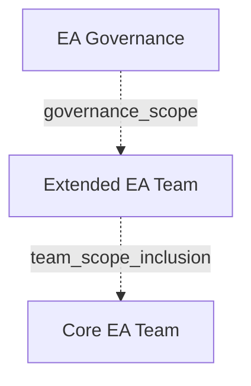

# G184/fig9-3 · 执行 EA 能力的团队

类型：`decomposition-or-organization-model`。说明“谁在执行 EA 能力”：最外层是治理机构（正文称架构委员会或治理委员会），中间是包含各域专家与跨学科人员的扩展 EA 团队，内层是聚焦战略、流程与建议的核心团队。作者用同心圆强调三者是范围与职责的包含关系，而不是三个互不相干的部门。

英文 PDF 物理页：[84]。本页为架构语义分析，原文与原图分别保留。

## 原图与可编辑图


[完整 JSON](fig9-3.json) · [可编辑 Mermaid](fig9-3.mmd) · [仅关系图](fig9-3.relations.mmd) · [层级分解图](fig9-3.hierarchy.mmd)

图形重建表达语义，不复制源图布局。虚线表示解释、矩阵映射或分组关系，不自动表示不确定性的概率。



## 架构分析

从外向内读三个同心圆：最外圈深青色是 EA Governance（EA 治理），中间蓝色是 Extended EA Team（扩展 EA 团队），最内圈浅蓝色是 Core EA Team（核心 EA 团队）。没有箭头；圆的大小与嵌套关系表示范围由大到小、内层被外层包含。

- 本图有 3 个具名或隐含元素、0 条关系和 2 条包含/分组记录。
- 包含/分组树最大深度为 2；根节点为 EA 治理。
- 本图没有可直接确认为人员直属汇报的关系；视觉上下位置、能力分解和治理职责分别读取。
- 原图靠嵌套表达结构，没有连线；新语义图将包含单独显式化，不补造流程、数据流或依赖。
- 3同心范围标签完整；只有范围嵌套，没有连线或人员数量。
- 83页说核心团队专注策略、过程、建议；领域职能专家可属于扩展团队。84页要求治理职责分离，不能由同心圈直接断定组织编制。

### 如何用于项目

- 按父项展开所有直接子项，检查同层粒度、重叠和缺项。
- 保留组成、分类、能力分解与组织汇报的区别；将示例名称替换为已确认的项目对象。

### 结构所表达的逻辑

- 三层同心嵌套：EA 治理包住扩展 EA 团队，扩展 EA 团队包住核心 EA 团队。
- EA 治理对应正文的架构委员会/治理委员会，相当于 EA 能力这个“企业中的企业”的董事会，设定并管理企业的总体方向。
- 扩展 EA 团队包含业务、信息、应用、技术与安全等主要域的专家，也可包含战略规划者、财务与市场分析师、业务线领导、主题专家及服务/支持人员。
- 核心团队聚焦战略、流程与建议，是日常架构工作的最小核心。
- 正文强调职责分离：构建块构成、目录服务或装配线布局等具体架构决策，更适合在扩展 EA 团队层面决定，不应把这类决策权嵌入治理机构。
- 图中只表达范围嵌套，不表达汇报线、人数、全职/兼职或资金关系；同心圆的面积也没有数量含义。
- 正文补充：多个 EA 团队时仍只有一个 EA 能力、一个领导者；各团队的汇报与资金体系可以不同，但都要在该领导者指导下协作（背景知识，见 9.2 节）。

## 上下级与包含

三层嵌套：EA 治理（L1）⊃ 扩展 EA 团队（L2）⊃ 核心 EA 团队（L3）。语义上是范围/职责的包含，不是组织汇报层级；图中没有画出任何汇报线。

|父项|子项|层级类型|依据与解释|
|---|---|---|---|
|EA 治理|扩展 EA 团队|governance_scope|外围是EA Governance治理范围，不是名为EA Governance的人员部门。|
|扩展 EA 团队|核心 EA 团队|team_scope_inclusion|核心团队在扩展团队范围内；图中不规定岗位直属汇报。|

## 全部元素与角色

|元素ID|原文名称|类型|含义|直接父项|深度|
|---|---|---|---|---|---|
|ea_governance|EA Governance|organization_unit|EA 能力的治理层；正文对应架构委员会/治理委员会，设定并管理总体方向，不嵌入具体架构决策权。|—||
|extended_ea_team|Extended EA Team|organization_unit|包含业务、信息、应用、技术与安全等域专家，以及战略规划、财务/市场分析、业务线领导、主题专家等跨学科人员。|EA 治理|1|
|core_ea_team|Core EA Team|organization_unit|聚焦战略、流程与建议的最小核心团队。|扩展 EA 团队|2|

## 全部关系

图中没有连线或箭头。三个同心圆的包含关系完全由“圆套圆”的几何位置表达；外层圆环本身代表治理层，不是背景。

|主体|语义关系|客体|显式线/隐式|原文标签|依据|
|---|---|---|---|---|---|

## 误读检查

- 不要把三层读成三个汇报层级或三个独立部门；图中没有汇报线，正文也没有说核心团队向扩展团队汇报。
- 不要因为核心团队画得最小就认为它最不重要；它是日常架构工作的核心，外两层提供治理与专家支持。
- 不要以为治理层包办所有架构决策；正文明确具体构建块与权衡决策应在扩展 EA 团队层面做。
- 不要把圆环面积当作人数或预算比例；图中没有量化编码。
- 中文资产把最内圈“Core EA Team”保留英文，不要误以为内圈没有中文名或另有含义。

## 原文证据

### [PDF 第 82 页](../../../documents/G184.md#page-82)

> In an IT-centric model, EA is normally aligned to the IT organization, irrespective of how it is named. The charter for the team may vary depending upon how IT is structured within the organization. When IT is aligned to the CFO, the charter for the EA team may be driving operational efficiency and cost control. When IT is aligned to delivery or marketing, the charter is more likely to focus on agility and efficiency. Understand the context, and draw members with process analysis and cost management expertise or deep functional knowledge of operations.
> When there are multiple EA teams, there is one EA Capability and there should be one Leader. All teams should work under the guidance of this Leader and collaborate. The reporting and funding hierarchies of the teams can be separated from alignment and execution against EA Capability objectives.
### [PDF 第 83 页](../../../documents/G184.md#page-83)

> An interesting aspect of leading an EA Capability is the need to apply EA services to the EA Capability. This document is based upon the premise that a properly architected EA Capability out-performs an ad hoc organizational design. In fact, this document follows an approach applicable to architecture to support portfolio to define and describe the required EA Capability. The EA Capability will create and revise a unified EA strategy and accompanying EA plans, and will produce an integrated EA roadmap. This activity must grasp the current state and future direction of the business and its supporting systems, and have ongoing interactions with the people who are responsible for achieving the target state across several enterprise functions.
> A certain amount of the EA Capability must be in place before architecture work can start; consequently, boot-strapping is necessary. For a budding EA Capability team, there will be an expectation to build a roadmap to develop the capability and to produce usable architecture. The Leader will have to pay attention and track these as separate efforts.
### [PDF 第 84 页](../../../documents/G184.md#page-84)

> This document now addresses the matter of having an architecture board or a governance council. Chapter 6 discussed the composition of the team and its functions. Regarding the purpose and approach to staffing the architecture board, apply the separation of duties principle. The architecture board is equivalent to the “board of directors” of the EA Capability’s business-in-a-business. Members of the governance team should have direct influence over the direction of the business or the outcome of the initiatives architected by the EA. This body sets and manages overall direction for the enterprise. It is not a successful pattern to embed rights for certain classes of architecture decisions in this body. For example, defining the constitution of an architecture building block, solution building block, or a trade-off decision around directory services or assembly line layouts is better decided at the extended EA team level.
> The EA Capability, like any other business, must carry out a basic set of general actions. This includes things like finance and budgeting, team development, risk management, and performance management. All of these must be adapted to the specific EA Capability and enterprise. In most enterprises these functions are shared, and EA should benefit from tapping into these teams. Occasionally, to scale the reach of the EA functions, it may be necessary to franchise some of the activities to teams outside the team providing the EA Capability.
### [PDF 第 85 页](../../../documents/G184.md#page-85)

> Every enterprise has a predefined set of roles and responsibilities. If one already exists, use it, test waters, and refine it. While refining, start with defining roles and then think of titles. From a simple people portability and recruitment point of view, it is imperative that you keep the functional titles and roles in common with industry standard titles. It is best practice to separate functional titles from pay grades.
> Consider context, charter, culture, clarity of expectations, collaboration, communication and co- ordination, separation of concerns, control, competence, and creative innovation while defining each of the roles and responsibilities.

## 来源与分析状态

所有元素/关系均有来源定位；未把历史解释重命名为本轮逐线视觉确认。源图与语义图是两种视图，布局不证明汇报或因果。

源 PDF SHA-256：`85fe5653767b184c3c8c9c1bef9f5738adbb2bf6661fb50ee95e72d16bc9f614`。

源图记录：[原始解释与转录](../../../figures/G184/fig9-3.json)。

```json
{
  "quality": {
    "graph_integrity": "checked",
    "semantic_analysis": "typed-graph-and-context-analysis",
    "visual_review": "source-content-audited",
    "notice_zh": "所有元素/关系均有来源定位；未把历史解释重命名为本轮逐线视觉确认。源图与语义图是两种视图，布局不证明汇报或因果。"
  },
  "source_uncertainty": {
    "confidence": "high",
    "uncertainties_zh": [
      "图中没有箭头；“三层是范围包含而非汇报层级”的判断依据同心圆版式与正文的职责分离表述，未在图中明示。",
      "EA 治理是否等同于正文的架构委员会/治理委员会，正文只作类比（“相当于董事会”），图中未写全称。",
      "扩展 EA 团队与核心团队的具体人员构成来自正文，图中只有层次名称。"
    ],
    "analyzed_from": [
      "英文 PDF 第 84 页图 9-3 截图与 2x2 放大分块",
      "英文 PDF 第 83、84 页正文",
      "中文稿 G184e_领导者指南_建立并演进EA能力.md 第 859-884 行",
      "figs/zh/g184e_fig9-3_zh.png"
    ],
    "date": "2026-10-31"
  },
  "source_conflicts": []
}
```
