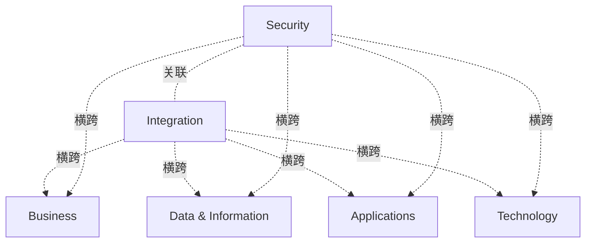

# G184/fig9-4 · 普遍接受的域

类型：`analytical-view`。界定本文档所说的（架构）域及其范围：业务、数据与信息、应用、技术四个域各占一格并给出关注点；集成（外圆）与安全（内圆）覆盖在四域之上，表示它们与四个域都相交，而不是第五个独立域。正文特别提醒：圆的重叠不表示一个域是另一个域的子集。

英文 PDF 物理页：[90]。本页为架构语义分析，原文与原图分别保留。

## 原图与可编辑图


[完整 JSON](fig9-4.json) · [可编辑 Mermaid](fig9-4.mmd) · [仅关系图](fig9-4.relations.mmd) · [层级分解图](fig9-4.hierarchy.mmd)

图形重建表达语义，不复制源图布局。虚线表示解释、矩阵映射或分组关系，不自动表示不确定性的概率。



## 架构分析

先看四个色块：左上蓝色 Business、右上橙色 Data & Information、右下绿色 Applications、左下灰色 Technology；每个色块除域名外还有一段说明该域关注什么。再看中央的两个圆：较大的橙色圆 Integration，其内部是深色圆 Security。两个圆都跨在四个色块的交界处，表示与四域都接触；Security 画在 Integration 里面只是叠放，正文明确否认子集关系。

- 本图有 6 个具名或隐含元素、9 条关系和 0 条包含/分组记录。
- 本图没有可直接确认为人员直属汇报的关系；视觉上下位置、能力分解和治理职责分别读取。
- 6个域名及6段域范围说明逐句核对；业务/数据/技术/应用四块、Integration橙圈、Security中心圈。
- 第90页明确可视化并非子集关系；不把Security在Integration内解释为业务组成或组织隶属。

### 如何用于项目

- 围绕作者目的读取本图实体、分组与连线，并用对应原文限定其含义。
- 把参考模型与项目事实分开，实际范围、约束、值和责任须有项目证据。

### 结构所表达的逻辑

- 四个域及关注点：Business 处理应当做或正在做什么，以及在哪里、如何、为何做；Data & Information 关注哪些数据需要采集、作为决策依据并被引用。
- Applications 关注应采用何种自动化与简化、正在使用什么；Technology 关注使用哪些机械与设施，包括计算、供暖与制冷。
- 中央 Integration 圆说明如何在企业内外移动数据/信息；它覆盖四个色块，表示集成是跨域的。
- 中央 Security 圆说明谁可以查看/执行什么、以及何时；它是横切关注点，贯穿整个 EA。
- 正文明确：图中的可视化不表示一个域是另一个域的子集；含义是集成域与安全域“触及”业务、数据、应用与技术域。
- 安全架构影响并告知业务、应用、数据与技术架构；它可能组织在架构范围之外，但部分内容必须与架构整合开发。
- 四个色块没有顺序、层级或成熟度含义，位置只表示四个并列域；两个圆的大小与覆盖面积也没有量化含义。

## 上下级与包含

没有上下级。四个域是并列的色块；Integration 与 Security 是两个覆盖圆。Security 圆画在 Integration 圆之内，但正文明确否认子集关系，因此不设 parent，也不把它当作 Integration 的子域。

|父项|子项|层级类型|依据与解释|
|---|---|---|---|
|—|—|无视觉包含|关系中明确的组成/特化见 JSON semantic_hierarchy。|

## 全部元素与角色

|元素ID|原文名称|类型|含义|直接父项|深度|
|---|---|---|---|---|---|
|domain_business|Business|architecture|Deals with what should or is being done and where, how, and why（处理应当做或正在做什么，以及在哪里、如何、为何做）。|—||
|domain_data|Data & Information|architecture|What data matters to be captured, base decisions upon, and referenced（哪些数据重要、需要采集，作为决策依据并被引用）。|—||
|domain_applications|Applications|architecture|What kind of automation, simplification should be employed and are in use（应采用何种自动化与简化，以及正在使用什么）。|—||
|domain_technology|Technology|architecture|Kinds of machinery and facilities, including computing, heating, cooling are in use（使用哪些机械与设施，包括计算、供暖与制冷）。|—||
|integration|Integration|architecture|How to move data/information within & outside the Enterprise（如何在企业内外移动数据/信息）。|—||
|security|Security|architecture|Who to get to see/do what & when（谁可以查看/执行什么，以及何时）；横切四个域，不表示子集。|—||

## 全部关系

图中没有连线或箭头。关系由圆与色块的重叠表达：Integration 与 Security 都跨四个域，表示与四域相交；Security 在 Integration 内部只是图形叠放，不代表包含。

|主体|语义关系|客体|显式线/隐式|原文标签|依据|
|---|---|---|---|---|---|
|集成|横跨|业务域|implicit||第90页明确这些域不是彼此子集；中心重叠表示Integration/Security接触四域，无独立连线。|
|集成|横跨|数据与信息域|implicit||第90页明确这些域不是彼此子集；中心重叠表示Integration/Security接触四域，无独立连线。|
|集成|横跨|应用域|implicit||第90页明确这些域不是彼此子集；中心重叠表示Integration/Security接触四域，无独立连线。|
|集成|横跨|技术域|implicit||第90页明确这些域不是彼此子集；中心重叠表示Integration/Security接触四域，无独立连线。|
|安全|横跨|业务域|implicit||第90页明确这些域不是彼此子集；中心重叠表示Integration/Security接触四域，无独立连线。|
|安全|横跨|数据与信息域|implicit||第90页明确这些域不是彼此子集；中心重叠表示Integration/Security接触四域，无独立连线。|
|安全|横跨|应用域|implicit||第90页明确这些域不是彼此子集；中心重叠表示Integration/Security接触四域，无独立连线。|
|安全|横跨|技术域|implicit||第90页明确这些域不是彼此子集；中心重叠表示Integration/Security接触四域，无独立连线。|
|安全|关联|集成|implicit||第90页明确这些域不是彼此子集；中心重叠表示Integration/Security接触四域，无独立连线。|

## 本轮语义修正

- 第90页明确这些域不是彼此子集；中心重叠表示Integration/Security接触四域，无独立连线。
- 第90页明确这些域不是彼此子集；中心重叠表示Integration/Security接触四域，无独立连线。
- 第90页明确这些域不是彼此子集；中心重叠表示Integration/Security接触四域，无独立连线。
- 第90页明确这些域不是彼此子集；中心重叠表示Integration/Security接触四域，无独立连线。
- 第90页明确这些域不是彼此子集；中心重叠表示Integration/Security接触四域，无独立连线。
- 第90页明确这些域不是彼此子集；中心重叠表示Integration/Security接触四域，无独立连线。
- 第90页明确这些域不是彼此子集；中心重叠表示Integration/Security接触四域，无独立连线。
- 第90页明确这些域不是彼此子集；中心重叠表示Integration/Security接触四域，无独立连线。
- 第90页明确这些域不是彼此子集；中心重叠表示Integration/Security接触四域，无独立连线。

## 误读检查

- 不要把 Security 圆读成 Integration 的子域或子集；正文明确说该可视化不表示一个域是另一个域的子集。
- 不要把四个色块读成四层堆叠、成熟度阶段或流程顺序；它们是并列的四个架构域。
- 不要把 Integration 当作第五个架构域；正文把它与 Security 一起描述为触及四域的集成/横切关注点。
- 不要把安全圆画得更小、更靠内理解为安全只作用于局部；它覆盖四个域的交界处。
- 图中央偏右的“© The Open Group”落在绿色应用块内，是版权水印，不是应用域的内容。
- 中文资产的文字被切成碎片并相互遮挡，不能据其措辞理解各域定义；应以英文原图为准。

## 原文证据

### [PDF 第 89 页](../../../documents/G184.md#page-89)

> For the purpose of this document, the (architecture) domains are limited to business, data (and information), application, technology (infrastructure and integration), and security. This view is based on the meaning of the word domain as “a field of thought, action, influence”. This definition is very similar to terms defined in the TOGAF framework. See Figure 9-4 for details on the scope of each of these architectural sub-domains.
### [PDF 第 90 页](../../../documents/G184.md#page-90)

> In Figure 9-4, the visualization does not convey that one domain is a subset of the other. The idea is that integration and security domains touch business, data, application, and technology domains. Security architecture is a cross-cutting concern, pervasive through the whole EA.

## 来源与分析状态

所有元素/关系均有来源定位；未把历史解释重命名为本轮逐线视觉确认。源图与语义图是两种视图，布局不证明汇报或因果。

源 PDF SHA-256：`85fe5653767b184c3c8c9c1bef9f5738adbb2bf6661fb50ee95e72d16bc9f614`。

源图记录：[原始解释与转录](../../../figures/G184/fig9-4.json)。

```json
{
  "quality": {
    "graph_integrity": "checked",
    "semantic_analysis": "typed-graph-and-context-analysis",
    "visual_review": "source-content-audited",
    "notice_zh": "所有元素/关系均有来源定位；未把历史解释重命名为本轮逐线视觉确认。源图与语义图是两种视图，布局不证明汇报或因果。"
  },
  "source_uncertainty": {
    "confidence": "high",
    "uncertainties_zh": [
      "Integration 与 Security 的圆画在四个色块之上，其与各域的重叠范围是示意性的，没有精确边界；“触及”四个域依据正文而非圆的实际覆盖面积。",
      "Security 位于 Integration 圆内，但正文明确否认子集关系；本分析未设 parent，只记录一条说明性的 association。",
      "四个色块的顺序（业务、数据、应用、技术）与象限位置是否对应某种标准布局，图中无说明；本分析只按视觉位置记录。",
      "各域的长句说明在图中是段落文字，本分析将其完整写入 description_zh，中文为解析者转述。"
    ],
    "analyzed_from": [
      "英文 PDF 第 90 页图 9-4 截图与 2x2 放大分块",
      "英文 PDF 第 89、90 页正文",
      "中文稿 G184e_领导者指南_建立并演进EA能力.md 第 983-1004 行",
      "figs/zh/g184e_fig9-4_zh.png"
    ],
    "date": "2026-10-31"
  },
  "source_conflicts": []
}
```
