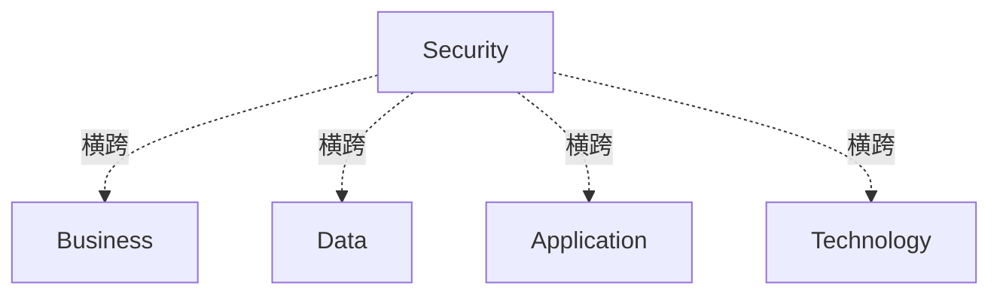

# G184/fig9-5 · 安全作为贯穿架构的横切关注点

类型：`architecture-concept-or-system-model`。用最简的叠加图说明安全架构的定位：四个架构域横向分层，安全以一条竖列同时穿过四层，因此是横切关注点；它为四个域提供安全、隐私与运营风险视角，并影响/输入四个域。

英文 PDF 物理页：[91]。本页为架构语义分析，原文与原图分别保留。

## 原图与可编辑图


[完整 JSON](fig9-5.json) · [可编辑 Mermaid](fig9-5.mmd) · [仅关系图](fig9-5.relations.mmd) · [层级分解图](fig9-5.hierarchy.mmd)

图形重建表达语义，不复制源图布局。虚线表示解释、矩阵映射或分组关系，不自动表示不确定性的概率。



## 架构分析

自上而下读四条灰色横条：Business、Data、Application、Technology，它们是四个架构域（层）。然后把视线移到中间偏右的浅色竖列 Security：它从第一层上方一直延伸到第四层下方，压过四条横条，表示安全同时作用于四层，而不是其中某一层。图中没有箭头，关系完全由覆盖/穿过表达。

- 本图有 5 个具名或隐含元素、4 条关系和 0 条包含/分组记录。
- 本图没有可直接确认为人员直属汇报的关系；视觉上下位置、能力分解和治理职责分别读取。
- 5个标签完整，安全贯穿业务、数据、应用、技术四域；无图例、连线、基数或时间轴。

### 如何用于项目

- 围绕作者目的读取本图实体、分组与连线，并用对应原文限定其含义。
- 把参考模型与项目事实分开，实际范围、约束、值和责任须有项目证据。

### 结构所表达的逻辑

- 四条横条自上而下为业务、数据、应用、技术，顺序与 TOGAF 的四个架构域一致。
- Security 是一条竖列，覆盖全部四层并上下超出堆叠范围，强调它不受任一架构域边界限制。
- 安全不是第五个架构域，而是横切关注点，贯穿整个 EA。
- 正文：安全架构影响并告知业务、应用、数据与技术架构；它可能常在企业架构范围之外组织，但其部分内容必须与架构整合开发。
- 竖列遮住横条中段只是前后叠放，不表示四层在此断开或缺失。
- 图中没有说明竖列上下超出的额外含义（例如代表架构范围之外的安全组织），不要过度解读。

## 上下级与包含

四个域并列堆叠，没有上下级包含；Security 是跨四域的竖列，不是四域之上的第五层，也不是某一个域的子元素。

|父项|子项|层级类型|依据与解释|
|---|---|---|---|
|—|—|无视觉包含|关系中明确的组成/特化见 JSON semantic_hierarchy。|

## 全部元素与角色

|元素ID|原文名称|类型|含义|直接父项|深度|
|---|---|---|---|---|---|
|business|Business|architecture|业务架构域，图中以第一层横条表示。|—||
|data|Data|architecture|数据架构域，图中以第二层横条表示。|—||
|application|Application|architecture|应用架构域，图中以第三层横条表示。|—||
|technology|Technology|architecture|技术架构域，图中以第四层横条表示。|—||
|security|Security|architecture|代表安全架构：安全、隐私与运营风险视角的视图/视角/制品集合；横切四个架构域。|—||

## 全部关系

图中没有连线或箭头。横切关系由竖列覆盖四条横条表达；竖列的白色填充遮住横条中段是绘制层次（前景/背景），不是关系线。

|主体|语义关系|客体|显式线/隐式|原文标签|依据|
|---|---|---|---|---|---|
|安全（横切关注点）|横跨|业务层|implicit||Security纵框重叠四域横框，正文支持横切关注点，不是箭头或数据流。|
|安全（横切关注点）|横跨|数据层|implicit||Security纵框重叠四域横框，正文支持横切关注点，不是箭头或数据流。|
|安全（横切关注点）|横跨|应用层|implicit||Security纵框重叠四域横框，正文支持横切关注点，不是箭头或数据流。|
|安全（横切关注点）|横跨|技术层|implicit||Security纵框重叠四域横框，正文支持横切关注点，不是箭头或数据流。|

## 本轮语义修正

- Security纵框重叠四域横框，正文支持横切关注点，不是箭头或数据流。
- Security纵框重叠四域横框，正文支持横切关注点，不是箭头或数据流。
- Security纵框重叠四域横框，正文支持横切关注点，不是箭头或数据流。
- Security纵框重叠四域横框，正文支持横切关注点，不是箭头或数据流。

## 误读检查

- 不要把 Security 当作第五层或第五个架构域；它是横切关注点。
- 不要把竖列遮住横条读成四层在此中断；横条在竖列后面是连续的。
- 不要因为竖列位置偏右就以为它只作用于应用/技术层；它覆盖全部四层。
- 不要把竖列上下超出堆叠范围解释为“安全在架构之外”的正式编码；图内没有这个说明。
- 中文资产在文字后留下浅色矩形补丁且字号不一，这是本地化痕迹，不是图中的语义编码。

## 原文证据

### [PDF 第 90 页](../../../documents/G184.md#page-90)

> As a cross-cutting concern, the security architecture impacts and informs business, application, data, and technology architectures. The security architecture may often be organized outside of the architecture scope, yet parts of it need to be developed in an integrated fashion with the architecture. See Figure 9-5 for a view of how the layers interact with each other, and a cross-cutting concern.
### [PDF 第 91 页](../../../documents/G184.md#page-91)

> Figure 9-5: Security as a Cross-Cutting Concern through the Architecture

## 来源与分析状态

所有元素/关系均有来源定位；未把历史解释重命名为本轮逐线视觉确认。源图与语义图是两种视图，布局不证明汇报或因果。

源 PDF SHA-256：`85fe5653767b184c3c8c9c1bef9f5738adbb2bf6661fb50ee95e72d16bc9f614`。

源图记录：[原始解释与转录](../../../figures/G184/fig9-5.json)。

```json
{
  "quality": {
    "graph_integrity": "checked",
    "semantic_analysis": "typed-graph-and-context-analysis",
    "visual_review": "source-content-audited",
    "notice_zh": "所有元素/关系均有来源定位；未把历史解释重命名为本轮逐线视觉确认。源图与语义图是两种视图，布局不证明汇报或因果。"
  },
  "source_uncertainty": {
    "confidence": "high",
    "uncertainties_zh": [
      "图中没有箭头；“Security 影响四个域”的方向依据正文 impacts and informs，而非图内符号。",
      "四条横条称为“层”还是“域”，正文在 9.5.2 节两种说法都用；本分析把 label_zh 定为“层”，description 说明它们是架构域。",
      "Security 竖列上下超出堆叠范围是否有额外含义（如代表架构范围之外的安全组织），图内无说明，未作推断。",
      "中文资产的文字补丁与字号差异不改变结构，但会影响阅读观感。"
    ],
    "analyzed_from": [
      "英文 PDF 第 91 页图 9-5 截图与 2x2 放大分块",
      "英文 PDF 第 90、91 页正文",
      "中文稿 G184e_领导者指南_建立并演进EA能力.md 第 996-1014 行",
      "figs/zh/g184e_fig9-5_zh.png",
      "figs/ai/G152/fig4-1.json（同图分析）"
    ],
    "date": "2026-10-31"
  },
  "source_conflicts": []
}
```
