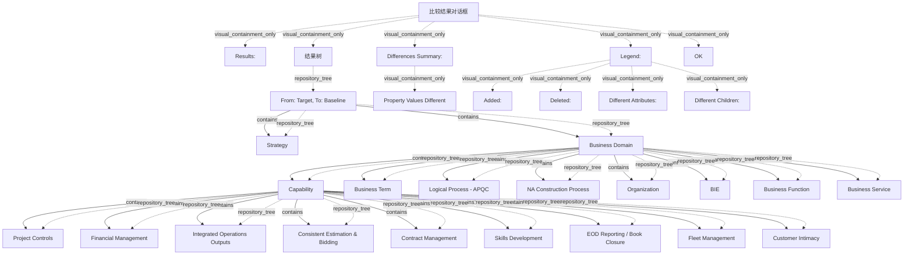

# G186/fig13-1 · 使用存储库管理路线图——识别变更

类型：`decomposition-or-organization-model`。示范第 13.2 节：以与实施无关的参考模型为基础，用存储库工具识别架构组件属性或组件目录的变更，从而在联邦式团队间协调并沟通架构变更的影响。

英文 PDF 物理页：[132]。本页为架构语义分析，原文与原图分别保留。

## 原图与可编辑图


[完整 JSON](fig13-1.json) · [可编辑 Mermaid](fig13-1.mmd) · [仅关系图](fig13-1.relations.mmd) · [层级分解图](fig13-1.hierarchy.mmd)

图形重建表达语义，不复制源图布局。虚线表示解释、矩阵映射或分组关系，不自动表示不确定性的概率。



## 架构分析

先读顶部“From: Target, To: Baseline”，确认比较是从目标架构到基线架构。再看结果树：Business Domain 展开后是 Capability，Capability 下展开九个二级能力。文字底色是差异类型：黄色表示子项不同，蓝色表示属性不同。最后看 Differences Summary（此处只有 Property Values Different）和右下角 Legend；绿色=新增、红色=删除、黄色=子项不同、蓝色=属性不同。

- 本图有 31 个具名或隐含元素、19 条关系和 30 条包含/分组记录。
- 包含/分组树最大深度为 5；根节点为 比较结果对话框。
- 本图没有可直接确认为人员直属汇报的关系；视觉上下位置、能力分解和治理职责分别读取。
- 所有窗口文字、树节点和4色图例核对；纠正7条父子边：Business Term、Logical Process、NA Construction、Organization、BIE、Business Function、Business Service均属Business Domain。
- BIE带加号为折叠节点，Business Function/Service不是其子级；最末Business Service部分被窗口裁切，保持可见范围。
- 图例绿色Added、红色Deleted、浅蓝Different Attributes、黄色Different Children；图例色块存在不代表本次结果实际有新增/删除。
- 13-1比较方向Target→Baseline；13-2为Baseline→Target，不能把二者当相同方向。
- 浅蓝6能力属性差异、黄色2父节点子项差异完整；未高亮仅表示当前结果未标记，不能宣称无任何业务变化。

### 如何用于项目

- 按父项展开所有直接子项，检查同层粒度、重叠和缺项。
- 保留组成、分类、能力分解与组织汇报的区别；将示例名称替换为已确认的项目对象。

### 结构所表达的逻辑

- 比较方向是 Target→Baseline（目标→基线），不是常见的基线→目标；读差异前必须先确认 From/To，否则会把变更方向读反。
- Business Domain 与 Capability 两级显示黄色（子项不同），表示其下级组成发生变化，而不是这两个节点自身属性变化。
- Capability 下九个二级能力中，Project Controls、Integrated Operations Outputs、Consistent Estimation & Bidding、Contract Management、EOD Reporting / Book Closure、Customer Intimacy 六项为蓝色（属性不同）。
- Financial Management、Skills Development、Fleet Management 三项未高亮，表示在本比较中属性与子项均未变化。
- Business Term、Logical Process - APQC、NA Construction Process、Organization、BIE 等分支处于折叠状态；折叠不等于没有变更。
- 差异摘要只写“Property Values Different”，与树上的蓝色属性差异对应；本次比较没有列出新增或删除项。
- 图例四种颜色是差异类型的唯一依据，颜色深浅不代表严重程度或优先级。

## 上下级与包含

结果树四层：比较根（From/To）→ 顶层目录（Strategy、Business Domain、Business Term、Logical Process - APQC、NA Construction Process、Organization、BIE）→ Capability → 九个二级能力；BIE 下另有 Business Function、Business Service 两个子项。包含关系由缩进、+/- 展开图标和细连接线表示。

|父项|子项|层级类型|依据与解释|
|---|---|---|---|
|比较结果对话框|结果：|visual_containment_only|保存原图解释中的包含；业务关系类型需要图例或正文进一步限定。|
|比较结果对话框|结果树|visual_containment_only|保存原图解释中的包含；业务关系类型需要图例或正文进一步限定。|
|结果树|从：目标，到：基线|repository_tree|由树控件缩进和分支线编码的导航父级，不是框内空间包含或企业业务组成。|
|从：目标，到：基线|战略|repository_tree|由树控件缩进和分支线编码的导航父级，不是框内空间包含或企业业务组成。|
|从：目标，到：基线|业务域|repository_tree|由树控件缩进和分支线编码的导航父级，不是框内空间包含或企业业务组成。|
|业务域|能力|repository_tree|由树控件缩进和分支线编码的导航父级，不是框内空间包含或企业业务组成。|
|能力|项目控制|repository_tree|由树控件缩进和分支线编码的导航父级，不是框内空间包含或企业业务组成。|
|能力|财务管理|repository_tree|由树控件缩进和分支线编码的导航父级，不是框内空间包含或企业业务组成。|
|能力|集成运营输出|repository_tree|由树控件缩进和分支线编码的导航父级，不是框内空间包含或企业业务组成。|
|能力|一致估算与投标|repository_tree|由树控件缩进和分支线编码的导航父级，不是框内空间包含或企业业务组成。|
|能力|合同管理|repository_tree|由树控件缩进和分支线编码的导航父级，不是框内空间包含或企业业务组成。|
|能力|技能发展|repository_tree|由树控件缩进和分支线编码的导航父级，不是框内空间包含或企业业务组成。|
|能力|日终报告/账务关闭|repository_tree|由树控件缩进和分支线编码的导航父级，不是框内空间包含或企业业务组成。|
|能力|车队管理|repository_tree|由树控件缩进和分支线编码的导航父级，不是框内空间包含或企业业务组成。|
|能力|客户亲密度|repository_tree|由树控件缩进和分支线编码的导航父级，不是框内空间包含或企业业务组成。|
|业务域|业务术语|repository_tree|截图缩进及左侧连续树干表明与Capability同为Business Domain子节点；BIE是折叠加号，不能含有后续两行。|
|业务域|逻辑流程 - APQC|repository_tree|截图缩进及左侧连续树干表明与Capability同为Business Domain子节点；BIE是折叠加号，不能含有后续两行。|
|业务域|NA 建造流程|repository_tree|截图缩进及左侧连续树干表明与Capability同为Business Domain子节点；BIE是折叠加号，不能含有后续两行。|
|业务域|组织|repository_tree|截图缩进及左侧连续树干表明与Capability同为Business Domain子节点；BIE是折叠加号，不能含有后续两行。|
|业务域|BIE|repository_tree|截图缩进及左侧连续树干表明与Capability同为Business Domain子节点；BIE是折叠加号，不能含有后续两行。|
|业务域|业务职能|repository_tree|截图缩进及左侧连续树干表明与Capability同为Business Domain子节点；BIE是折叠加号，不能含有后续两行。|
|业务域|业务服务|repository_tree|截图缩进及左侧连续树干表明与Capability同为Business Domain子节点；BIE是折叠加号，不能含有后续两行。|
|比较结果对话框|差异摘要：|visual_containment_only|保存原图解释中的包含；业务关系类型需要图例或正文进一步限定。|
|差异摘要：|属性值不同|visual_containment_only|保存原图解释中的包含；业务关系类型需要图例或正文进一步限定。|
|比较结果对话框|图例：|visual_containment_only|保存原图解释中的包含；业务关系类型需要图例或正文进一步限定。|
|图例：|新增：|visual_containment_only|保存原图解释中的包含；业务关系类型需要图例或正文进一步限定。|
|图例：|删除：|visual_containment_only|保存原图解释中的包含；业务关系类型需要图例或正文进一步限定。|
|图例：|属性不同：|visual_containment_only|保存原图解释中的包含；业务关系类型需要图例或正文进一步限定。|
|图例：|子项不同：|visual_containment_only|保存原图解释中的包含；业务关系类型需要图例或正文进一步限定。|
|比较结果对话框|确定|visual_containment_only|保存原图解释中的包含；业务关系类型需要图例或正文进一步限定。|

## 全部元素与角色

|元素ID|原文名称|类型|含义|直接父项|深度|
|---|---|---|---|---|---|
|dlg|比较结果对话框|application|工具截图窗口，带米色外框。|—||
|results_label|Results:|note|说明：结果：|比较结果对话框|1|
|result_tree|结果树|group|带滚动条的可展开结果列表。|比较结果对话框|1|
|root_compare|From: Target, To: Baseline|artifact|比较根节点；原图文字“Baseline”应译为基线而非现状。|结果树|2|
|strategy|Strategy|group|分组：战略|从：目标，到：基线|3|
|business_domain|Business Domain|group|分组：业务域|从：目标，到：基线|3|
|capability|Capability|capability|能力：能力|业务域|4|
|cap_project_controls|Project Controls|capability|能力：项目控制|能力|5|
|cap_financial_mgmt|Financial Management|capability|能力：财务管理|能力|5|
|cap_integrated_ops|Integrated Operations Outputs|capability|能力：集成运营输出|能力|5|
|cap_estimation_bidding|Consistent Estimation & Bidding|capability|能力：一致估算与投标|能力|5|
|cap_contract_mgmt|Contract Management|capability|能力：合同管理|能力|5|
|cap_skills_dev|Skills Development|capability|能力：技能发展|能力|5|
|cap_eod_reporting|EOD Reporting / Book Closure|capability|能力：日终报告/账务关闭|能力|5|
|cap_fleet_mgmt|Fleet Management|capability|能力：车队管理|能力|5|
|cap_customer_intimacy|Customer Intimacy|capability|能力：客户亲密度|能力|5|
|business_term|Business Term|data|信息/数据：业务术语|业务域|4|
|logical_process_apqc|Logical Process - APQC|process|流程：逻辑流程 - APQC|业务域|4|
|na_construction_process|NA Construction Process|process|流程：NA 建造流程|业务域|4|
|organization|Organization|organization_unit|组织单元：组织|业务域|4|
|bie|BIE|data|原图未展开该缩写；其下展开 Business Function 与 Business Service。|业务域|4|
|business_function|Business Function|function|功能：业务职能|业务域|4|
|business_service|Business Service|service|原图中被结果区下边缘截断，只露出上半行。|业务域|4|
|differences_summary|Differences Summary:|note|说明：差异摘要：|比较结果对话框|1|
|property_values_different|Property Values Different|note|说明：属性值不同|差异摘要：|2|
|legend_box|Legend:|note|说明：图例：|比较结果对话框|1|
|legend_added|Added:|note|说明：新增：|图例：|2|
|legend_deleted|Deleted:|note|说明：删除：|图例：|2|
|legend_diff_attributes|Different Attributes:|note|说明：属性不同：|图例：|2|
|legend_diff_children|Different Children:|note|说明：子项不同：|图例：|2|
|ok_button|OK|note|说明：确定|比较结果对话框|1|

### 业务域：属性

```json
{
  "highlight": "yellow",
  "legend_meaning": "Different Children"
}
```

### 能力：属性

```json
{
  "highlight": "yellow",
  "legend_meaning": "Different Children"
}
```

### 项目控制：属性

```json
{
  "diff": "different_attributes"
}
```

### 财务管理：属性

```json
{
  "diff": "unchanged"
}
```

### 集成运营输出：属性

```json
{
  "diff": "different_attributes"
}
```

### 一致估算与投标：属性

```json
{
  "diff": "different_attributes"
}
```

### 合同管理：属性

```json
{
  "diff": "different_attributes"
}
```

### 技能发展：属性

```json
{
  "diff": "unchanged"
}
```

### 日终报告/账务关闭：属性

```json
{
  "diff": "different_attributes"
}
```

### 车队管理：属性

```json
{
  "diff": "unchanged"
}
```

### 客户亲密度：属性

```json
{
  "diff": "different_attributes"
}
```

### 新增：：属性

```json
{
  "swatch_color": "green",
  "role": "legend-not-instance"
}
```

### 删除：：属性

```json
{
  "swatch_color": "red",
  "role": "legend-not-instance"
}
```

### 属性不同：：属性

```json
{
  "swatch_color": "light-blue",
  "role": "legend-not-instance"
}
```

### 子项不同：：属性

```json
{
  "swatch_color": "yellow",
  "role": "legend-not-instance"
}
```

## 全部关系

图中没有箭头。树的包含关系由缩进、+/- 图标和浅灰连接线表达；“差异”由文字底色表达（黄色子项不同、蓝色属性不同），不是连线。右侧滚动条只表示结果列表还有未显示内容。

|主体|语义关系|客体|显式线/隐式|原文标签|依据|
|---|---|---|---|---|---|
|从：目标，到：基线|contains|战略|显式连线||软件树控件的分支表示存储库导航层级，不表示企业实体组成、流程或人员汇报。|
|从：目标，到：基线|contains|业务域|显式连线||软件树控件的分支表示存储库导航层级，不表示企业实体组成、流程或人员汇报。|
|业务域|contains|业务术语|显式连线||纠正树层级：这些行与Capability同级，均在Business Domain下；不是根级或BIE下级。|
|业务域|contains|逻辑流程 - APQC|显式连线||纠正树层级：这些行与Capability同级，均在Business Domain下；不是根级或BIE下级。|
|业务域|contains|NA 建造流程|显式连线||纠正树层级：这些行与Capability同级，均在Business Domain下；不是根级或BIE下级。|
|业务域|contains|组织|显式连线||纠正树层级：这些行与Capability同级，均在Business Domain下；不是根级或BIE下级。|
|业务域|contains|BIE|显式连线||纠正树层级：这些行与Capability同级，均在Business Domain下；不是根级或BIE下级。|
|业务域|contains|能力|显式连线||软件树控件的分支表示存储库导航层级，不表示企业实体组成、流程或人员汇报。|
|能力|contains|项目控制|显式连线||软件树控件的分支表示存储库导航层级，不表示企业实体组成、流程或人员汇报。|
|能力|contains|财务管理|显式连线||软件树控件的分支表示存储库导航层级，不表示企业实体组成、流程或人员汇报。|
|能力|contains|集成运营输出|显式连线||软件树控件的分支表示存储库导航层级，不表示企业实体组成、流程或人员汇报。|
|能力|contains|一致估算与投标|显式连线||软件树控件的分支表示存储库导航层级，不表示企业实体组成、流程或人员汇报。|
|能力|contains|合同管理|显式连线||软件树控件的分支表示存储库导航层级，不表示企业实体组成、流程或人员汇报。|
|能力|contains|技能发展|显式连线||软件树控件的分支表示存储库导航层级，不表示企业实体组成、流程或人员汇报。|
|能力|contains|日终报告/账务关闭|显式连线||软件树控件的分支表示存储库导航层级，不表示企业实体组成、流程或人员汇报。|
|能力|contains|车队管理|显式连线||软件树控件的分支表示存储库导航层级，不表示企业实体组成、流程或人员汇报。|
|能力|contains|客户亲密度|显式连线||软件树控件的分支表示存储库导航层级，不表示企业实体组成、流程或人员汇报。|
|业务域|contains|业务职能|显式连线||纠正树层级：这些行与Capability同级，均在Business Domain下；不是根级或BIE下级。|
|业务域|contains|业务服务|显式连线||纠正树层级：这些行与Capability同级，均在Business Domain下；不是根级或BIE下级。|

## Capability 下九个二级能力的差异状态

```json
{
  "id": "t_capability_diff",
  "title_zh": "Capability 下九个二级能力的差异状态",
  "columns": [
    "二级能力（英文）",
    "二级能力（中文）",
    "高亮颜色",
    "差异类型"
  ],
  "rows": [
    [
      "Project Controls",
      "项目控制",
      "浅蓝",
      "Different Attributes（属性不同）"
    ],
    [
      "Financial Management",
      "财务管理",
      "无",
      "未高亮（本比较中未见变化）"
    ],
    [
      "Integrated Operations Outputs",
      "集成运营输出",
      "浅蓝",
      "Different Attributes（属性不同）"
    ],
    [
      "Consistent Estimation & Bidding",
      "一致估算与投标",
      "浅蓝",
      "Different Attributes（属性不同）"
    ],
    [
      "Contract Management",
      "合同管理",
      "浅蓝",
      "Different Attributes（属性不同）"
    ],
    [
      "Skills Development",
      "技能发展",
      "无",
      "未高亮（本比较中未见变化）"
    ],
    [
      "EOD Reporting / Book Closure",
      "日终报告/账务关闭",
      "浅蓝",
      "Different Attributes（属性不同）"
    ],
    [
      "Fleet Management",
      "车队管理",
      "无",
      "未高亮（本比较中未见变化）"
    ],
    [
      "Customer Intimacy",
      "客户亲密度",
      "浅蓝",
      "Different Attributes（属性不同）"
    ]
  ],
  "notes_zh": "Business Domain 与 Capability 两个父节点为黄色（Different Children）。差异摘要只列 Property Values Different。"
}
```

## 本轮语义修正

- 软件树控件的分支表示存储库导航层级，不表示企业实体组成、流程或人员汇报。
- 软件树控件的分支表示存储库导航层级，不表示企业实体组成、流程或人员汇报。
- 纠正树层级：这些行与Capability同级，均在Business Domain下；不是根级或BIE下级。
- 纠正树层级：这些行与Capability同级，均在Business Domain下；不是根级或BIE下级。
- 纠正树层级：这些行与Capability同级，均在Business Domain下；不是根级或BIE下级。
- 纠正树层级：这些行与Capability同级，均在Business Domain下；不是根级或BIE下级。
- 纠正树层级：这些行与Capability同级，均在Business Domain下；不是根级或BIE下级。
- 软件树控件的分支表示存储库导航层级，不表示企业实体组成、流程或人员汇报。
- 软件树控件的分支表示存储库导航层级，不表示企业实体组成、流程或人员汇报。
- 软件树控件的分支表示存储库导航层级，不表示企业实体组成、流程或人员汇报。
- 软件树控件的分支表示存储库导航层级，不表示企业实体组成、流程或人员汇报。
- 软件树控件的分支表示存储库导航层级，不表示企业实体组成、流程或人员汇报。
- 软件树控件的分支表示存储库导航层级，不表示企业实体组成、流程或人员汇报。
- 软件树控件的分支表示存储库导航层级，不表示企业实体组成、流程或人员汇报。
- 软件树控件的分支表示存储库导航层级，不表示企业实体组成、流程或人员汇报。
- 软件树控件的分支表示存储库导航层级，不表示企业实体组成、流程或人员汇报。
- 软件树控件的分支表示存储库导航层级，不表示企业实体组成、流程或人员汇报。
- 纠正树层级：这些行与Capability同级，均在Business Domain下；不是根级或BIE下级。
- 纠正树层级：这些行与Capability同级，均在Business Domain下；不是根级或BIE下级。

## 误读检查

- 黄色不是“重要”，蓝色不是“已选中”；它们是两种不同的差异类型。
- 不要把六个蓝色能力理解为全部变更；折叠分支中可能还有未显示的变更。
- 不要把 Target→Baseline 读成 Baseline→Target；图 13-1 与图 13-2 的方向正好相反。
- 中文 SVG 把 Business Function、Business Service 也涂成蓝色，英文原图没有高亮，不能据此认为这两项属性发生变化。
- 中文 PNG 的高亮错位（车队管理被涂蓝、客户亲近未涂蓝），不能作为判断差异的依据。

## 原文证据

### [PDF 第 131 页](../../../documents/G186.md#page-131)

> Until now, this document made the effort and process simple by describing most of the concepts using a linear time scale. It gave an impression that creating a well aligned set of work packages vectored by business cycle and planning horizon gives you potential transition states and a near linear roadmap. Recall this simple statement made in Chapter 5 in the context of the EA Repository: “Baseline provides reference for all change. The target state is what stakeholders have approved. Transition states are partially realized targets between current state and target state. Mix the four characteristics of the EA Landscape: breadth, depth, time, and recency. Mix the different Architecture Projects that can work on the same subject at different times and at different levels of detail.” That’s the only hint to indicate real-world complexity.
> In addition to characteristics, other organizational factors that add to complexity are:
### [PDF 第 132 页](../../../documents/G186.md#page-132)

> Basing all of the architectures on an implementation-neutral reference model allows impact of modifications to a specific architecture to be identified easily. As shown in Figure 13-1, the EA Repository tool could provide support to identify the change, whether it is to one of the attributes of an architectural component or a modification to the catalog of components. While working with a federated team, uses of such a tool and use of common reference models can go a long way to coordinate and communicate the impact of architecture changes. Within the roadmap, it is better to keep the analysis patterns consistent.
### [PDF 第 133 页](../../../documents/G186.md#page-133)

> This same concept of comparing architectures can be used to create and analyze year-over-year modifications to the architecture. In Figure 13-2, the EA Repository tool in use allows the Practitioner to trace a change to the baseline or the revised version.
> When creating the roadmap, pay attention to impact of change. Any change, when introduced, will tarnish the efficiency, overall throughput, and sometimes call for duplicative investments. Such short- term negative impacts can mask deviations from the roadmap. Inject appropriate markers to identify any unintended sub-optimization or deviations from the roadmap. The value and outcome map should present the time to value and gain/loss at the end of the planning horizon.

## 来源与分析状态

所有元素/关系均有来源定位；未把历史解释重命名为本轮逐线视觉确认。源图与语义图是两种视图，布局不证明汇报或因果。

源 PDF SHA-256：`ed1c26faba5023a8d1b32b0ec893d75a3bb1d7a6508e99fa56ded079585d922a`。

源图记录：[原始解释与转录](../../../figures/G186/fig13-1.json)。

```json
{
  "quality": {
    "graph_integrity": "checked",
    "semantic_analysis": "typed-graph-and-context-analysis",
    "visual_review": "source-content-audited",
    "notice_zh": "所有元素/关系均有来源定位；未把历史解释重命名为本轮逐线视觉确认。源图与语义图是两种视图，布局不证明汇报或因果。"
  },
  "source_uncertainty": {
    "confidence": "high",
    "uncertainties_zh": [
      "原图是位图截图，部分文字（尤其 Business Service 行）被结果区下边缘截断，无法确认其完整标签与是否有高亮。",
      "“BIE”缩写在原图中未展开，含义未在图中说明；本分析按原样记录，未臆测全称。",
      "差异摘要框只有一行“Property Values Different”，无法判断是否还有更多摘要被滚动条隐藏。"
    ],
    "analyzed_from": [
      "英文 PDF 第 132 页图 13-1 截图（整图与 2x2 放大块）",
      "英文 PDF 第 132 页正文",
      "中文稿 G186e_实践者方法_按TOGAF_ADM开发企业架构.md 第 1789–1833 行",
      "figs/zh/g186e_fig13-1_zh.png 与 figs/zh/g186e_fig13-1_zh.svg"
    ],
    "date": "2026-10-31"
  },
  "source_conflicts": []
}
```
