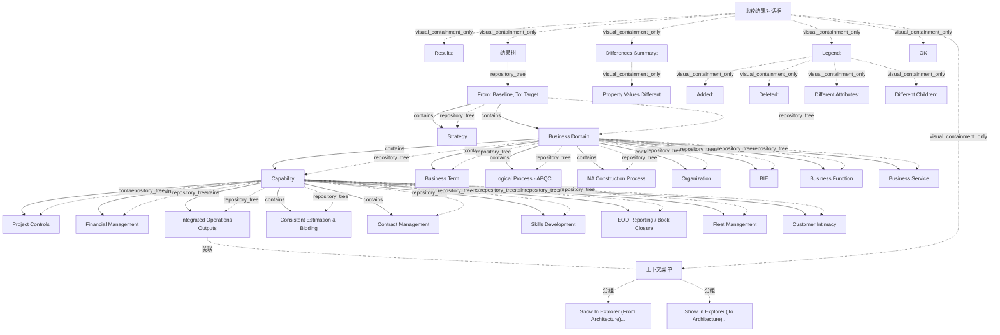

# G186/fig13-2 · 架构的影响分析

类型：`decomposition-or-organization-model`。示范第 13.2 节的同一比较概念如何用于逐年修改分析：工具允许实践者把变更追溯到基线或修订版本；图 13-2 在结果树上打开 Show In Explorer 菜单，用于定位源架构或目标架构。

英文 PDF 物理页：[133]。本页为架构语义分析，原文与原图分别保留。

## 原图与可编辑图


[完整 JSON](fig13-2.json) · [可编辑 Mermaid](fig13-2.mmd) · [仅关系图](fig13-2.relations.mmd) · [层级分解图](fig13-2.hierarchy.mmd)

图形重建表达语义，不复制源图布局。虚线表示解释、矩阵映射或分组关系，不自动表示不确定性的概率。



## 架构分析

先读顶部“From: Baseline, To: Target”，注意方向与图 13-1 相反。树与颜色规则相同：黄色=子项不同，蓝色=属性不同。结果树第三行“Integrated Operations Outputs”被深蓝选中，右键菜单覆盖在树上：第一项定位源架构，第二项定位目标架构，第二项当前高亮。最后看差异摘要与图例。

- 本图有 34 个具名或隐含元素、20 条关系和 33 条包含/分组记录。
- 包含/分组树最大深度为 5；根节点为 比较结果对话框。
- 本图没有可直接确认为人员直属汇报的关系；视觉上下位置、能力分解和治理职责分别读取。
- 所有窗口文字、树节点和4色图例核对；纠正7条父子边：Business Term、Logical Process、NA Construction、Organization、BIE、Business Function、Business Service均属Business Domain。
- BIE带加号为折叠节点，Business Function/Service不是其子级；最末Business Service部分被窗口裁切，保持可见范围。
- 图例绿色Added、红色Deleted、浅蓝Different Attributes、黄色Different Children；图例色块存在不代表本次结果实际有新增/删除。
- 13-1比较方向Target→Baseline；13-2为Baseline→Target，不能把二者当相同方向。
- 浅蓝6能力属性差异、黄色2父节点子项差异完整；未高亮仅表示当前结果未标记，不能宣称无任何业务变化。
- 选中Integrated Operations Outputs并打开两个Show In Explorer菜单项；菜单遮挡三行标签的尾部，完整转录依据相邻13-1同一树而非声称本图全部可见。

### 如何用于项目

- 按父项展开所有直接子项，检查同层粒度、重叠和缺项。
- 保留组成、分类、能力分解与组织汇报的区别；将示例名称替换为已确认的项目对象。

### 结构所表达的逻辑

- 比较方向是 Baseline→Target（基线→目标），与图 13-1 的 Target→Baseline 正好相反；这是逐年/版本间影响分析的常见方向。
- 结果树与图 13-1 相同：Business Domain、Capability 为黄色（子项不同）；九个二级能力中六个为蓝色（属性不同），三个未高亮。
- “Integrated Operations Outputs”整行处于深蓝选中状态，菜单由该行触发；选中状态与“属性不同”的浅蓝色是两种不同的视觉编码。
- 菜单提供两项命令：Show In Explorer (From Architecture)… 与 Show In Explorer (To Architecture)…；后者高亮，表示当前指向目标架构。
- 正文说明该工具允许把变更追溯到基线或修订版本，因此本图用于分析架构的逐年修改影响。
- 菜单只是导航命令，不改变比较结果；差异摘要仍只列 Property Values Different。
- 折叠分支（Business Term、Logical Process - APQC、NA Construction Process、Organization、BIE）中可能还有未显示的差异。

## 上下级与包含

结果树四层：比较根（From/To）→ 顶层目录 → Capability → 九个二级能力；BIE 下另有 Business Function、Business Service。上下文菜单是浮在树上的临时控件，不属于树层级。

|父项|子项|层级类型|依据与解释|
|---|---|---|---|
|比较结果对话框|结果：|visual_containment_only|保存原图解释中的包含；业务关系类型需要图例或正文进一步限定。|
|比较结果对话框|结果树|visual_containment_only|保存原图解释中的包含；业务关系类型需要图例或正文进一步限定。|
|结果树|从：基线，到：目标|repository_tree|由树控件缩进和分支线编码的导航父级，不是框内空间包含或企业业务组成。|
|从：基线，到：目标|战略|repository_tree|由树控件缩进和分支线编码的导航父级，不是框内空间包含或企业业务组成。|
|从：基线，到：目标|业务域|repository_tree|由树控件缩进和分支线编码的导航父级，不是框内空间包含或企业业务组成。|
|业务域|能力|repository_tree|由树控件缩进和分支线编码的导航父级，不是框内空间包含或企业业务组成。|
|能力|项目控制|repository_tree|由树控件缩进和分支线编码的导航父级，不是框内空间包含或企业业务组成。|
|能力|财务管理|repository_tree|由树控件缩进和分支线编码的导航父级，不是框内空间包含或企业业务组成。|
|能力|集成运营输出|repository_tree|由树控件缩进和分支线编码的导航父级，不是框内空间包含或企业业务组成。|
|能力|一致估算与投标|repository_tree|由树控件缩进和分支线编码的导航父级，不是框内空间包含或企业业务组成。|
|能力|合同管理|repository_tree|由树控件缩进和分支线编码的导航父级，不是框内空间包含或企业业务组成。|
|能力|技能发展|repository_tree|由树控件缩进和分支线编码的导航父级，不是框内空间包含或企业业务组成。|
|能力|日终报告/账务关闭|repository_tree|由树控件缩进和分支线编码的导航父级，不是框内空间包含或企业业务组成。|
|能力|车队管理|repository_tree|由树控件缩进和分支线编码的导航父级，不是框内空间包含或企业业务组成。|
|能力|客户亲密度|repository_tree|由树控件缩进和分支线编码的导航父级，不是框内空间包含或企业业务组成。|
|业务域|业务术语|repository_tree|截图缩进及左侧连续树干表明与Capability同为Business Domain子节点；BIE是折叠加号，不能含有后续两行。|
|业务域|逻辑流程 - APQC|repository_tree|截图缩进及左侧连续树干表明与Capability同为Business Domain子节点；BIE是折叠加号，不能含有后续两行。|
|业务域|NA 建造流程|repository_tree|截图缩进及左侧连续树干表明与Capability同为Business Domain子节点；BIE是折叠加号，不能含有后续两行。|
|业务域|组织|repository_tree|截图缩进及左侧连续树干表明与Capability同为Business Domain子节点；BIE是折叠加号，不能含有后续两行。|
|业务域|BIE|repository_tree|截图缩进及左侧连续树干表明与Capability同为Business Domain子节点；BIE是折叠加号，不能含有后续两行。|
|业务域|业务职能|repository_tree|截图缩进及左侧连续树干表明与Capability同为Business Domain子节点；BIE是折叠加号，不能含有后续两行。|
|业务域|业务服务|repository_tree|截图缩进及左侧连续树干表明与Capability同为Business Domain子节点；BIE是折叠加号，不能含有后续两行。|
|比较结果对话框|上下文菜单|visual_containment_only|保存原图解释中的包含；业务关系类型需要图例或正文进一步限定。|
|上下文菜单|在资源管理器中显示（源架构）……|visual_grouping|框、泳道、域或分类组的成员归属；没有额外证据不提升为业务组合或管理关系。|
|上下文菜单|在资源管理器中显示（目标架构）……|visual_grouping|框、泳道、域或分类组的成员归属；没有额外证据不提升为业务组合或管理关系。|
|比较结果对话框|差异摘要：|visual_containment_only|保存原图解释中的包含；业务关系类型需要图例或正文进一步限定。|
|差异摘要：|属性值不同|visual_containment_only|保存原图解释中的包含；业务关系类型需要图例或正文进一步限定。|
|比较结果对话框|图例：|visual_containment_only|保存原图解释中的包含；业务关系类型需要图例或正文进一步限定。|
|图例：|新增：|visual_containment_only|保存原图解释中的包含；业务关系类型需要图例或正文进一步限定。|
|图例：|删除：|visual_containment_only|保存原图解释中的包含；业务关系类型需要图例或正文进一步限定。|
|图例：|属性不同：|visual_containment_only|保存原图解释中的包含；业务关系类型需要图例或正文进一步限定。|
|图例：|子项不同：|visual_containment_only|保存原图解释中的包含；业务关系类型需要图例或正文进一步限定。|
|比较结果对话框|确定|visual_containment_only|保存原图解释中的包含；业务关系类型需要图例或正文进一步限定。|

## 全部元素与角色

|元素ID|原文名称|类型|含义|直接父项|深度|
|---|---|---|---|---|---|
|dlg|比较结果对话框|application|工具截图窗口，带米色外框。|—||
|results_label|Results:|note|说明：结果：|比较结果对话框|1|
|result_tree|结果树|group|分组：结果树|比较结果对话框|1|
|root_compare|From: Baseline, To: Target|artifact|比较根节点；方向与图 13-1 相反。|结果树|2|
|strategy|Strategy|group|分组：战略|从：基线，到：目标|3|
|business_domain|Business Domain|group|分组：业务域|从：基线，到：目标|3|
|capability|Capability|capability|能力：能力|业务域|4|
|cap_project_controls|Project Controls|capability|能力：项目控制|能力|5|
|cap_financial_mgmt|Financial Management|capability|能力：财务管理|能力|5|
|cap_integrated_ops|Integrated Operations Outputs|capability|能力：集成运营输出|能力|5|
|cap_estimation_bidding|Consistent Estimation & Bidding|capability|能力：一致估算与投标|能力|5|
|cap_contract_mgmt|Contract Management|capability|能力：合同管理|能力|5|
|cap_skills_dev|Skills Development|capability|能力：技能发展|能力|5|
|cap_eod_reporting|EOD Reporting / Book Closure|capability|能力：日终报告/账务关闭|能力|5|
|cap_fleet_mgmt|Fleet Management|capability|能力：车队管理|能力|5|
|cap_customer_intimacy|Customer Intimacy|capability|能力：客户亲密度|能力|5|
|business_term|Business Term|data|信息/数据：业务术语|业务域|4|
|logical_process_apqc|Logical Process - APQC|process|流程：逻辑流程 - APQC|业务域|4|
|na_construction_process|NA Construction Process|process|流程：NA 建造流程|业务域|4|
|organization|Organization|organization_unit|组织单元：组织|业务域|4|
|bie|BIE|data|信息/数据：BIE|业务域|4|
|business_function|Business Function|function|功能：业务职能|业务域|4|
|business_service|Business Service|service|原图中被结果区下边缘截断。|业务域|4|
|context_menu|上下文菜单|group|分组：上下文菜单|比较结果对话框|1|
|menu_show_from|Show In Explorer (From Architecture)...|note|说明：在资源管理器中显示（源架构）……|上下文菜单|2|
|menu_show_to|Show In Explorer (To Architecture)...|note|说明：在资源管理器中显示（目标架构）……|上下文菜单|2|
|differences_summary|Differences Summary:|note|说明：差异摘要：|比较结果对话框|1|
|property_values_different|Property Values Different|note|说明：属性值不同|差异摘要：|2|
|legend_box|Legend:|note|说明：图例：|比较结果对话框|1|
|legend_added|Added:|note|说明：新增：|图例：|2|
|legend_deleted|Deleted:|note|说明：删除：|图例：|2|
|legend_diff_attributes|Different Attributes:|note|说明：属性不同：|图例：|2|
|legend_diff_children|Different Children:|note|说明：子项不同：|图例：|2|
|ok_button|OK|note|说明：确定|比较结果对话框|1|

### 业务域：属性

```json
{
  "highlight": "yellow",
  "legend_meaning": "Different Children"
}
```

### 能力：属性

```json
{
  "highlight": "yellow",
  "legend_meaning": "Different Children"
}
```

### 项目控制：属性

```json
{
  "diff": "different_attributes"
}
```

### 财务管理：属性

```json
{
  "diff": "unchanged"
}
```

### 集成运营输出：属性

```json
{
  "label_visibility": "partially occluded by context menu",
  "label_completion_source": "paired figure G186/fig13-1 PDF132"
}
```

### 一致估算与投标：属性

```json
{
  "label_visibility": "partially occluded by context menu",
  "label_completion_source": "paired figure G186/fig13-1 PDF132"
}
```

### 合同管理：属性

```json
{
  "label_visibility": "partially occluded by context menu",
  "label_completion_source": "paired figure G186/fig13-1 PDF132"
}
```

### 技能发展：属性

```json
{
  "diff": "unchanged"
}
```

### 日终报告/账务关闭：属性

```json
{
  "diff": "different_attributes"
}
```

### 车队管理：属性

```json
{
  "diff": "unchanged"
}
```

### 客户亲密度：属性

```json
{
  "diff": "different_attributes"
}
```

### 新增：：属性

```json
{
  "swatch_color": "green",
  "role": "legend-not-instance"
}
```

### 删除：：属性

```json
{
  "swatch_color": "red",
  "role": "legend-not-instance"
}
```

### 属性不同：：属性

```json
{
  "swatch_color": "light-blue",
  "role": "legend-not-instance"
}
```

### 子项不同：：属性

```json
{
  "swatch_color": "yellow",
  "role": "legend-not-instance"
}
```

## 全部关系

图中没有箭头。树包含关系由缩进、+/- 图标和浅灰连接线表达；差异由文字底色表达。上下文菜单与树之间没有连线，只通过弹出位置表示“针对当前选中行”。

|主体|语义关系|客体|显式线/隐式|原文标签|依据|
|---|---|---|---|---|---|
|从：基线，到：目标|contains|战略|显式连线||软件树控件的分支表示存储库导航层级，不表示企业实体组成、流程或人员汇报。|
|从：基线，到：目标|contains|业务域|显式连线||软件树控件的分支表示存储库导航层级，不表示企业实体组成、流程或人员汇报。|
|业务域|contains|业务术语|显式连线||纠正树层级：这些行与Capability同级，均在Business Domain下；不是根级或BIE下级。|
|业务域|contains|逻辑流程 - APQC|显式连线||纠正树层级：这些行与Capability同级，均在Business Domain下；不是根级或BIE下级。|
|业务域|contains|NA 建造流程|显式连线||纠正树层级：这些行与Capability同级，均在Business Domain下；不是根级或BIE下级。|
|业务域|contains|组织|显式连线||纠正树层级：这些行与Capability同级，均在Business Domain下；不是根级或BIE下级。|
|业务域|contains|BIE|显式连线||纠正树层级：这些行与Capability同级，均在Business Domain下；不是根级或BIE下级。|
|业务域|contains|能力|显式连线||软件树控件的分支表示存储库导航层级，不表示企业实体组成、流程或人员汇报。|
|能力|contains|项目控制|显式连线||软件树控件的分支表示存储库导航层级，不表示企业实体组成、流程或人员汇报。|
|能力|contains|财务管理|显式连线||软件树控件的分支表示存储库导航层级，不表示企业实体组成、流程或人员汇报。|
|能力|contains|集成运营输出|显式连线||软件树控件的分支表示存储库导航层级，不表示企业实体组成、流程或人员汇报。|
|能力|contains|一致估算与投标|显式连线||软件树控件的分支表示存储库导航层级，不表示企业实体组成、流程或人员汇报。|
|能力|contains|合同管理|显式连线||软件树控件的分支表示存储库导航层级，不表示企业实体组成、流程或人员汇报。|
|能力|contains|技能发展|显式连线||软件树控件的分支表示存储库导航层级，不表示企业实体组成、流程或人员汇报。|
|能力|contains|日终报告/账务关闭|显式连线||软件树控件的分支表示存储库导航层级，不表示企业实体组成、流程或人员汇报。|
|能力|contains|车队管理|显式连线||软件树控件的分支表示存储库导航层级，不表示企业实体组成、流程或人员汇报。|
|能力|contains|客户亲密度|显式连线||软件树控件的分支表示存储库导航层级，不表示企业实体组成、流程或人员汇报。|
|业务域|contains|业务职能|显式连线||纠正树层级：这些行与Capability同级，均在Business Domain下；不是根级或BIE下级。|
|业务域|contains|业务服务|显式连线||纠正树层级：这些行与Capability同级，均在Business Domain下；不是根级或BIE下级。|
|集成运营输出|关联|上下文菜单|implicit||菜单覆盖选中行，表示上下文作用对象，没有从能力到菜单的连接线。|

## Capability 下九个二级能力的差异状态（比较方向 Baseline→Target）

```json
{
  "id": "t_capability_diff",
  "title_zh": "Capability 下九个二级能力的差异状态（比较方向 Baseline→Target）",
  "columns": [
    "二级能力（英文）",
    "二级能力（中文）",
    "高亮/选中",
    "差异类型"
  ],
  "rows": [
    [
      "Project Controls",
      "项目控制",
      "浅蓝",
      "Different Attributes（属性不同）"
    ],
    [
      "Financial Management",
      "财务管理",
      "无",
      "未高亮"
    ],
    [
      "Integrated Operations Outputs",
      "集成运营输出",
      "浅蓝 + 深蓝选中",
      "Different Attributes（属性不同），且为菜单作用行"
    ],
    [
      "Consistent Estimation & Bidding",
      "一致估算与投标",
      "浅蓝",
      "Different Attributes（属性不同）"
    ],
    [
      "Contract Management",
      "合同管理",
      "浅蓝",
      "Different Attributes（属性不同）"
    ],
    [
      "Skills Development",
      "技能发展",
      "无",
      "未高亮"
    ],
    [
      "EOD Reporting / Book Closure",
      "日终报告/账务关闭",
      "浅蓝",
      "Different Attributes（属性不同）"
    ],
    [
      "Fleet Management",
      "车队管理",
      "无",
      "未高亮"
    ],
    [
      "Customer Intimacy",
      "客户亲密度",
      "浅蓝",
      "Different Attributes（属性不同）"
    ]
  ],
  "notes_zh": "Business Domain 与 Capability 为黄色（Different Children）。菜单两项：Show In Explorer (From Architecture)… 与 Show In Explorer (To Architecture)…，后者高亮。"
}
```

## 本轮语义修正

- 软件树控件的分支表示存储库导航层级，不表示企业实体组成、流程或人员汇报。
- 软件树控件的分支表示存储库导航层级，不表示企业实体组成、流程或人员汇报。
- 纠正树层级：这些行与Capability同级，均在Business Domain下；不是根级或BIE下级。
- 纠正树层级：这些行与Capability同级，均在Business Domain下；不是根级或BIE下级。
- 纠正树层级：这些行与Capability同级，均在Business Domain下；不是根级或BIE下级。
- 纠正树层级：这些行与Capability同级，均在Business Domain下；不是根级或BIE下级。
- 纠正树层级：这些行与Capability同级，均在Business Domain下；不是根级或BIE下级。
- 软件树控件的分支表示存储库导航层级，不表示企业实体组成、流程或人员汇报。
- 软件树控件的分支表示存储库导航层级，不表示企业实体组成、流程或人员汇报。
- 软件树控件的分支表示存储库导航层级，不表示企业实体组成、流程或人员汇报。
- 软件树控件的分支表示存储库导航层级，不表示企业实体组成、流程或人员汇报。
- 软件树控件的分支表示存储库导航层级，不表示企业实体组成、流程或人员汇报。
- 软件树控件的分支表示存储库导航层级，不表示企业实体组成、流程或人员汇报。
- 软件树控件的分支表示存储库导航层级，不表示企业实体组成、流程或人员汇报。
- 软件树控件的分支表示存储库导航层级，不表示企业实体组成、流程或人员汇报。
- 软件树控件的分支表示存储库导航层级，不表示企业实体组成、流程或人员汇报。
- 软件树控件的分支表示存储库导航层级，不表示企业实体组成、流程或人员汇报。
- 纠正树层级：这些行与Capability同级，均在Business Domain下；不是根级或BIE下级。
- 纠正树层级：这些行与Capability同级，均在Business Domain下；不是根级或BIE下级。
- 菜单覆盖选中行，表示上下文作用对象，没有从能力到菜单的连接线。

## 误读检查

- 不要把深蓝色选中行当作第三种差异类型；选中状态只表示菜单作用对象。
- 不要把 Baseline→Target 与图 13-1 的 Target→Baseline 混为一谈。
- 菜单中的“From Architecture / To Architecture”是查看源/目标架构的命令，不是两次不同的比较运行。
- 不要因为菜单遮住了几行就认为这些行没有差异；被遮住的行仍属于结果树。
- 中文 SVG 把 Business Function、Business Service 误涂为蓝色，不能据此判断这两项属性变化。

## 原文证据

### [PDF 第 132 页](../../../documents/G186.md#page-132)

> Each distinct parent roadmap – say if there is a separate roadmap for European Union Operations and Australian Operations – name and identify them as such. Employ appropriate naming and versioning concepts for and derived roadmaps of those created for what-if analysis. Make it intuitive to identify discarded alternatives.
> The point of creating separate roadmaps is to align the scope of each Architecture Project. When the Enterprise has any one of the characteristic or organizational factors identified earlier in this chapter, it would make sense to create a separate Architecture Project and roadmap to deal with this complexity.
### [PDF 第 133 页](../../../documents/G186.md#page-133)

> This same concept of comparing architectures can be used to create and analyze year-over-year modifications to the architecture. In Figure 13-2, the EA Repository tool in use allows the Practitioner to trace a change to the baseline or the revised version.

## 来源与分析状态

所有元素/关系均有来源定位；未把历史解释重命名为本轮逐线视觉确认。源图与语义图是两种视图，布局不证明汇报或因果。

源 PDF SHA-256：`ed1c26faba5023a8d1b32b0ec893d75a3bb1d7a6508e99fa56ded079585d922a`。

源图记录：[原始解释与转录](../../../figures/G186/fig13-2.json)。

```json
{
  "quality": {
    "graph_integrity": "checked",
    "semantic_analysis": "typed-graph-and-context-analysis",
    "visual_review": "source-content-audited",
    "notice_zh": "所有元素/关系均有来源定位；未把历史解释重命名为本轮逐线视觉确认。源图与语义图是两种视图，布局不证明汇报或因果。"
  },
  "source_uncertainty": {
    "confidence": "high",
    "uncertainties_zh": [
      "菜单遮住了“集成运营输出”“一致估算与投标”“合同管理”几行的部分文字，无法确认被遮住部分是否还有额外标记。",
      "Business Service 行在原图中被结果区下边缘截断，只能看到上半行。",
      "“BIE”缩写在图中未展开，含义未说明。"
    ],
    "analyzed_from": [
      "英文 PDF 第 133 页图 13-2 截图（整图与 2x2 放大块）",
      "英文 PDF 第 133 页正文",
      "中文稿 G186e_实践者方法_按TOGAF_ADM开发企业架构.md 第 1833–1874 行",
      "figs/zh/g186e_fig13-2_zh.png 与 figs/zh/g186e_fig13-2_zh.svg"
    ],
    "date": "2026-10-31"
  },
  "source_conflicts": []
}
```
