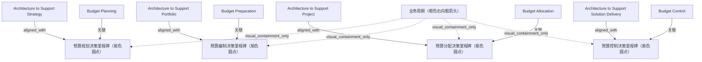

# G186/fig14-1 · 业务周期与按目的划分的架构

类型：`architecture-evolution-or-plan`。说明阶段 H 中 EA 必须赶在预算周期之前影响决策：四种架构目的与四个预算阶段一一对应，预算规划最关键、预算控制次之；错过预算窗口，架构工作就失去相关性。

英文 PDF 物理页：[136]。本页为架构语义分析，原文与原图分别保留。

## 原图与可编辑图


[完整 JSON](fig14-1.json) · [可编辑 Mermaid](fig14-1.mmd) · [仅关系图](fig14-1.relations.mmd) · [层级分解图](fig14-1.hierarchy.mmd)

图形重建表达语义，不复制源图布局。虚线表示解释、矩阵映射或分组关系，不自动表示不确定性的概率。



## 架构分析

上方从左到右是四种架构目的（战略→组合→项目→解决方案交付）；中间橙色大箭头表示业务周期的时间方向；下方从左到右是四个预算阶段。每个架构框向下有一支箭头落在橙色带上、对应紫色圆点的左侧；每个预算阶段向上有一支箭头指向该圆点。上下箭头相邻但不共点，配对靠水平位置。

- 本图有 13 个具名或隐含元素、8 条关系和 4 条包含/分组记录。
- 包含/分组树最大深度为 1；根节点为 支持战略的架构、支持组合的架构、支持项目的架构、支持解决方案交付的架构、业务周期（橙色右向粗箭头）、预算规划、预算编制、预算分配、预算控制。
- 本图没有可直接确认为人员直属汇报的关系；视觉上下位置、能力分解和治理职责分别读取。
- 4架构框、4预算标签、4紫色时点与橙色时间带共13元素完整。
- 8根黑箭头分别核对：上方4箭头指向时间带并位于各紫点左侧，下方4箭头才指向各紫点。修正上方视觉端点。
- 战略/组合/项目应在相应预算决策前完成；解决方案交付架构围绕预算控制持续运作，不把四对对齐误作ADM依次执行。

### 如何用于项目

- 为每个演进状态/工作包登记前置条件、交付物、依赖和实际决策人。
- 时间轴表达计划顺序；架构范围、已批准计划和资源承诺须另有项目证据。

### 结构所表达的逻辑

- 四种架构目的从左到右依次对应四个预算阶段：支持战略—预算规划；支持组合—预算编制；支持项目—预算分配；支持解决方案交付—预算控制。
- 橙色粗箭头表示业务周期/预算周期从左到右推进，不是 ADM 阶段顺序，也不是架构开发流程。
- 预算规划最关键：实践者的沟通一旦影响预算规划，前进路径就确定了，上层架构随后治理并约束其余活动。
- 预算控制是第二重要活动：架构师既代表实施团队的利益相关者，又是组合经理验证“进展到价值”的主题专家。
- 在资源（预算）分配之前，没有任何事项会被承诺为下一个过渡状态；来自“野外”的随机想法会试图进入流程。
- 时间要求很硬：预算规划开始前四周就已经太晚，EA 团队必须与组织的规划、预算、运营与变革流程对齐。
- 图中上下箭头并不交于同一点：上方箭头落在紫色圆点左侧，表示架构须在预算决策之前交付；下方箭头才指向圆点，圆点代表该预算阶段的决策里程碑。

## 上下级与包含

两层并列结构：上层是四种架构目的，下层是四个预算阶段；中间的橙色业务周期箭头是共同的时间参照，不构成上下级。

|父项|子项|层级类型|依据与解释|
|---|---|---|---|
|业务周期（橙色右向粗箭头）|预算规划决策里程碑（紫色圆点）|visual_containment_only|保存原图解释中的包含；业务关系类型需要图例或正文进一步限定。|
|业务周期（橙色右向粗箭头）|预算编制决策里程碑（紫色圆点）|visual_containment_only|保存原图解释中的包含；业务关系类型需要图例或正文进一步限定。|
|业务周期（橙色右向粗箭头）|预算分配决策里程碑（紫色圆点）|visual_containment_only|保存原图解释中的包含；业务关系类型需要图例或正文进一步限定。|
|业务周期（橙色右向粗箭头）|预算控制决策里程碑（紫色圆点）|visual_containment_only|保存原图解释中的包含；业务关系类型需要图例或正文进一步限定。|

## 全部元素与角色

|元素ID|原文名称|类型|含义|直接父项|深度|
|---|---|---|---|---|---|
|arch_strategy|Architecture to Support Strategy|architecture|架构：支持战略的架构|—||
|arch_portfolio|Architecture to Support Portfolio|architecture|架构：支持组合的架构|—||
|arch_project|Architecture to Support Project|architecture|架构：支持项目的架构|—||
|arch_solution|Architecture to Support Solution Delivery|architecture|架构：支持解决方案交付的架构|—||
|cycle_arrow|业务周期（橙色右向粗箭头）|time|表示业务周期从左到右推进；图上没有文字标签。|—||
|budget_planning|Budget Planning|phase|阶段：预算规划|—||
|budget_preparation|Budget Preparation|phase|阶段：预算编制|—||
|budget_allocation|Budget Allocation|phase|阶段：预算分配|—||
|budget_control|Budget Control|phase|阶段：预算控制|—||
|dot_planning|预算规划决策里程碑（紫色圆点）|event|紫色圆点，无文字。|业务周期（橙色右向粗箭头）|1|
|dot_preparation|预算编制决策里程碑（紫色圆点）|event|紫色圆点，无文字。|业务周期（橙色右向粗箭头）|1|
|dot_allocation|预算分配决策里程碑（紫色圆点）|event|紫色圆点，无文字。|业务周期（橙色右向粗箭头）|1|
|dot_control|预算控制决策里程碑（紫色圆点）|event|紫色圆点，无文字。|业务周期（橙色右向粗箭头）|1|

## 全部关系

四支向下的黑色箭头从架构目的框指向橙色业务周期带上、对应预算阶段紫色圆点的左侧，表示该目的的架构必须在预算决策之前交付/介入；四支向上的黑色箭头从预算阶段标签指向各自的紫色圆点，表示该预算阶段的决策时点。两支架头不共点，也没有连线。橙色粗箭头表示时间从左到右推进。

|主体|语义关系|客体|显式线/隐式|原文标签|依据|
|---|---|---|---|---|---|
|支持解决方案交付的架构|aligned_with|预算控制决策里程碑（紫色圆点）|显式连线||向下箭头只落到橙色时间带、紫色点之前，不直接连到决策点；按正文保存架构与预算决策的语义对齐。|
|支持项目的架构|aligned_with|预算分配决策里程碑（紫色圆点）|显式连线||向下箭头只落到橙色时间带、紫色点之前，不直接连到决策点；按正文保存架构与预算决策的语义对齐。|
|支持组合的架构|aligned_with|预算编制决策里程碑（紫色圆点）|显式连线||向下箭头只落到橙色时间带、紫色点之前，不直接连到决策点；按正文保存架构与预算决策的语义对齐。|
|支持战略的架构|aligned_with|预算规划决策里程碑（紫色圆点）|显式连线||向下箭头只落到橙色时间带、紫色点之前，不直接连到决策点；按正文保存架构与预算决策的语义对齐。|
|预算规划|关联|预算规划决策里程碑（紫色圆点）|显式连线||预算规划标签向上有箭头指向橙色带上的紫色圆点。|
|预算编制|关联|预算编制决策里程碑（紫色圆点）|显式连线||预算编制标签向上指向紫色圆点。|
|预算分配|关联|预算分配决策里程碑（紫色圆点）|显式连线||预算分配标签向上指向紫色圆点。|
|预算控制|关联|预算控制决策里程碑（紫色圆点）|显式连线||预算控制标签向上指向紫色圆点。|

## 四种架构目的与四个预算阶段的对齐

```json
{
  "id": "t_alignment",
  "title_zh": "四种架构目的与四个预算阶段的对齐",
  "columns": [
    "架构目的（英文）",
    "架构目的（中文）",
    "框颜色",
    "对应预算阶段"
  ],
  "rows": [
    [
      "Architecture to Support Strategy",
      "支持战略的架构",
      "黄色",
      "Budget Planning（预算规划）"
    ],
    [
      "Architecture to Support Portfolio",
      "支持组合的架构",
      "绿色",
      "Budget Preparation（预算编制）"
    ],
    [
      "Architecture to Support Project",
      "支持项目的架构",
      "米色",
      "Budget Allocation（预算分配）"
    ],
    [
      "Architecture to Support Solution Delivery",
      "支持解决方案交付的架构",
      "品红色",
      "Budget Control（预算控制）"
    ]
  ],
  "notes_zh": "对应关系由上下位置配对，原图没有连线把架构框直接接到预算阶段标签；两者各自用箭头指向橙色业务周期带上的相邻位置。"
}
```

## 本轮语义修正

- 向下箭头只落到橙色时间带、紫色点之前，不直接连到决策点；按正文保存架构与预算决策的语义对齐。
- 向下箭头只落到橙色时间带、紫色点之前，不直接连到决策点；按正文保存架构与预算决策的语义对齐。
- 向下箭头只落到橙色时间带、紫色点之前，不直接连到决策点；按正文保存架构与预算决策的语义对齐。
- 向下箭头只落到橙色时间带、紫色点之前，不直接连到决策点；按正文保存架构与预算决策的语义对齐。

## 误读检查

- 不要把上下两支架头看成一条双向箭头或同一个连接点：上方箭头落在圆点左侧，下方箭头指向圆点，中间没有连线。
- 不要按框的颜色推断架构类型、成熟度或优先级；颜色只是区分四种目的。
- 不要把橙色箭头读成 ADM 阶段顺序；它表示业务周期/预算周期。
- 不要把四个预算阶段读成四个架构项目阶段；它们是同一财年预算过程中的四个决策点。
- 中文本地化 PNG 上方出现的深色横带是遮盖英文标题的痕迹，不是原图的颜色编码。

## 原文证据

### [PDF 第 136 页](../../../documents/G186.md#page-136)

> Other than the first year of operation of the EA team, most subsequent architecture work is initiated from Phase H. Phase H provides ongoing review of value realization and monitoring of change. Change and failure to realize value provide entry points to the ADM. Never be late – four weeks before the start of budget planning is too late. The EA team needs to be aligned with the organization’s planning, budgeting, operational, and change processes. Figure 14-1 shows a timeline view, depicting an alignment of key decisions made during a business cycle and the purpose architectures.

## 来源与分析状态

所有元素/关系均有来源定位；未把历史解释重命名为本轮逐线视觉确认。源图与语义图是两种视图，布局不证明汇报或因果。

源 PDF SHA-256：`ed1c26faba5023a8d1b32b0ec893d75a3bb1d7a6508e99fa56ded079585d922a`。

源图记录：[原始解释与转录](../../../figures/G186/fig14-1.json)。

```json
{
  "quality": {
    "graph_integrity": "checked",
    "semantic_analysis": "typed-graph-and-context-analysis",
    "visual_review": "source-content-audited",
    "notice_zh": "所有元素/关系均有来源定位；未把历史解释重命名为本轮逐线视觉确认。源图与语义图是两种视图，布局不证明汇报或因果。"
  },
  "source_uncertainty": {
    "confidence": "medium",
    "uncertainties_zh": [
      "原图没有图例或文字说明箭头含义；“对齐/介入”的解释依据图题与第 14 章正文，属于合理推断。",
      "上下箭头不共点：上方箭头落在橙色带上，下方箭头指向紫色圆点；两者是否刻意错开、还是排版避让，原图未说明。",
      "橙色业务周期箭头没有文字标签，其含义由正文“business cycle”与四阶段预算顺序推断。"
    ],
    "analyzed_from": [
      "英文 PDF 第 136 页图 14-1 截图（整图与 2x2 放大块）",
      "英文 PDF 第 136 页正文",
      "中文稿 G186e_实践者方法_按TOGAF_ADM开发企业架构.md 第 1886–1929 行",
      "figs/zh/g186e_fig14-1_zh.png 中文化 PNG"
    ],
    "date": "2026-10-31"
  },
  "source_conflicts": []
}
```
