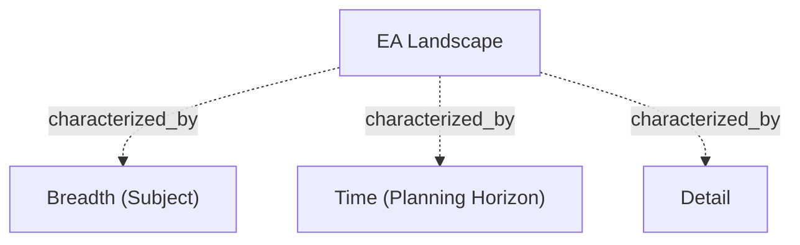

# G186/fig3-1 · EA 全景的特征

类型：`analytical-view`。作者用一张极简的立体图把“EA 全景”从抽象名词变成可想象的空间：全景不是一个架构，而是由广度、时间、详细程度三个方向张开的全部潜在架构内容；先建立这个体积概念，图 3-2 才能在其中切出一个架构项目。

英文 PDF 物理页：[28]。本页为架构语义分析，原文与原图分别保留。

## 原图与可编辑图


[完整 JSON](fig3-1.json) · [可编辑 Mermaid](fig3-1.mmd) · [仅关系图](fig3-1.relations.mmd) · [层级分解图](fig3-1.hierarchy.mmd)

图形重建表达语义，不复制源图布局。虚线表示解释、矩阵映射或分组关系，不自动表示不确定性的概率。



## 架构分析

先看立方体正面标注的 EA Landscape，它指的是整个立方体而非某一个面；再看三条从立方体左上角伸出的粗箭头，箭头指向维度增大的方向：Breadth (Subject) 沿上边缘向右上，Time (Planning Horizon) 斜穿顶面指向右前，Detail 沿左前竖边向下。图中没有第四条轴，也没有刻度；正文另外讨论的第四个特征“时效性（Recency）”只以文字出现。

- 本图有 4 个具名或隐含元素、3 条关系和 0 条包含/分组记录。
- 本图没有可直接确认为人员直属汇报的关系；视觉上下位置、能力分解和治理职责分别读取。
- 三轴标签/方向核对：Breadth (Subject)向右上，Time向右下，Detail向下；没有刻度、流程边或第四轴。
- 正文28页说明时间越长通常越少细节但非普遍规则，Recency未画成轴；真实项目形状比方块复杂。

### 如何用于项目

- 围绕作者目的读取本图实体、分组与连线，并用对应原文限定其含义。
- 把参考模型与项目事实分开，实际范围、约束、值和责任须有项目证据。

### 结构所表达的逻辑

- 立方体整体就是 EA 全景（EA Landscape），表示企业全部潜在的架构内容，而不是某一个架构或某一个存储库分区。
- 广度（Breadth，主题）是最重要的范围维度之一：可按领域、组织或举措来界定，正文说它最容易混淆。
- 时间（Time，规划期）是从现在到期望达到目标架构的时间点；正文指出规划期越长，架构通常越不详细，但这不是普遍规律。
- 详细程度（Detail）表示架构展开到多细；正文强调做到“回答当前问题所需”即可，越细交付周期（TTM）越长。
- 正文把第四个特征“时效性（Recency）”讲在同一节，但本图没有画对应的轴或标签，读图时不能从图上找到它。
- 正文特意提醒这是简化：真实的架构项目不像这样整齐的立方体，而更像“海胆”——有一个整合的中心，尖刺伸向四面八方。

## 上下级与包含

只有一层：一个 EA 全景立方体 + 三个维度属性。三条轴不是立方体的组成部分，而是描述立方体三个方向的坐标轴；图中没有上级/下级框。

|父项|子项|层级类型|依据与解释|
|---|---|---|---|
|—|—|无视觉包含|关系中明确的组成/特化见 JSON semantic_hierarchy。|

## 全部元素与角色

|元素ID|原文名称|类型|含义|直接父项|深度|
|---|---|---|---|---|---|
|ea_landscape|EA Landscape|architecture|整个立方体代表 EA 全景，即企业全部潜在的架构内容；不是某一个架构。|—||
|dim_breadth|Breadth (Subject)|concept|架构项目覆盖的主题范围，可按领域、组织或举措界定。|—||
|dim_time|Time (Planning Horizon)|concept|从当前到期望达到目标架构的时间点。|—||
|dim_detail|Detail|concept|架构展开的细致程度；做到回答当前问题所需即可。|—||

## 全部关系

图中没有连接两个元素的语义连线，只有三条粗黑箭头作为坐标轴：箭头表示该维度增大的方向，轴线贴着立方体的三条棱。立方体右侧的灰色投影只起立体感作用，没有标注，也不表示任何数据。

|主体|语义关系|客体|显式线/隐式|原文标签|依据|
|---|---|---|---|---|---|
|EA 全景|characterized_by|广度（主题）|thick|Breadth (Subject)|可见粗黑箭头是无刻度坐标轴，非EA Landscape连向维度节点的业务连接。|
|EA 全景|characterized_by|时间（规划期）|thick|Time (Planning Horizon)|可见粗黑箭头是无刻度坐标轴，非EA Landscape连向维度节点的业务连接。|
|EA 全景|characterized_by|详细程度|thick|Detail|可见粗黑箭头是无刻度坐标轴，非EA Landscape连向维度节点的业务连接。|

## 本轮语义修正

- 可见粗黑箭头是无刻度坐标轴，非EA Landscape连向维度节点的业务连接。
- 可见粗黑箭头是无刻度坐标轴，非EA Landscape连向维度节点的业务连接。
- 可见粗黑箭头是无刻度坐标轴，非EA Landscape连向维度节点的业务连接。

## 误读检查

- 不要把立方体读成“一个架构”或“架构存储库”：它是 EA 全景的总体积。
- 不要以为图上只有三个特征就否定第四个特征；Recency 在正文中明确列为第四个特征，只是没有被画成轴。
- 不要把三条箭头理解成流程或先后顺序；它们是三个正交的范围维度。
- 立方体没有刻度，不能从体积大小推断任何数量、成熟度或时间长度。
- 中文稿当前引用的 figs/g186_fig3-1.svg 是四张文字卡片，不是原图的立方体；它把图 3-2 的项目切片内容和正文别的段落混进来，不能据它理解本图。

## 原文证据

### [PDF 第 28 页](../../../documents/G186.md#page-28)

> • Time: Every architecture development project will have a planning horizon; the point in time when you expect to reach the Target Architecture
> Time creates challenges because the future is in motion. Typically, the longer the planning horizon, the less detailed the architecture. This is often true but does not provide a universal rule. Lastly, care must be taken where one or more transition architectures exist before reaching the planning horizon. The more detailed architecture must carefully conform to the guidance and constraints active at the point in time. This can be a challenge as the guidance and constraints change through different transition states.

## 来源与分析状态

所有元素/关系均有来源定位；未把历史解释重命名为本轮逐线视觉确认。源图与语义图是两种视图，布局不证明汇报或因果。

源 PDF SHA-256：`ed1c26faba5023a8d1b32b0ec893d75a3bb1d7a6508e99fa56ded079585d922a`。

源图记录：[原始解释与转录](../../../figures/G186/fig3-1.json)。

```json
{
  "quality": {
    "graph_integrity": "checked",
    "semantic_analysis": "typed-graph-and-context-analysis",
    "visual_review": "source-content-audited",
    "notice_zh": "所有元素/关系均有来源定位；未把历史解释重命名为本轮逐线视觉确认。源图与语义图是两种视图，布局不证明汇报或因果。"
  },
  "source_uncertainty": {
    "confidence": "medium",
    "uncertainties_zh": [
      "原图只画了三条轴，正文却列出四个特征；Recency 没有对应的轴或标签，只能据正文判断。",
      "立方体右侧的灰色投影没有图例或文字，无法确定它是否在暗示“时效/老化”或只是立体渲染。",
      "三条轴没有刻度，全部为定性示意；无法判断立方体描绘的是“全部潜在内容”还是某一时点的切片。",
      "“EA Landscape”文字位于正面，是否也统摄整个立方体需结合图题与正文判断。"
    ],
    "analyzed_from": [
      "英文 PDF 第 28 页图 3-1 截图（220 dpi）及 2×2 放大分块",
      "英文 PDF 第 28 页正文（Time、Recency 两段）",
      "中文稿 G186e_实践者方法_按TOGAF_ADM开发企业架构.md 第 186–195 行",
      "figs/g186_fig3-1.svg 的文本与结构"
    ],
    "date": "2026-10-31"
  },
  "source_conflicts": []
}
```
