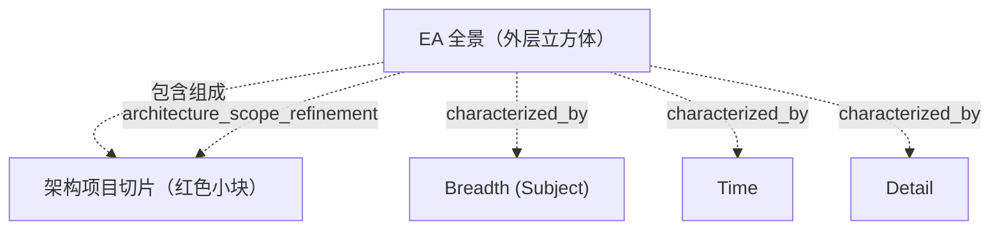

# G186/fig3-2 · 带一个架构项目的 EA 全景

类型：`analytical-view`。把图 3-1 的抽象体积落到一个具体架构项目上：项目不是整个全景，而是在广度、规划期、详细程度三个方向上各取一段的一个子体积；作者用这张图说明“架构工作请求”为何必须界定范围，以及项目产出只是填充/刷新全景的一部分。

英文 PDF 物理页：[29]。本页为架构语义分析，原文与原图分别保留。

## 原图与可编辑图


[完整 JSON](fig3-2.json) · [可编辑 Mermaid](fig3-2.mmd) · [仅关系图](fig3-2.relations.mmd) · [层级分解图](fig3-2.hierarchy.mmd)

图形重建表达语义，不复制源图布局。虚线表示解释、矩阵映射或分组关系，不自动表示不确定性的概率。



## 架构分析

先把它看成图 3-1 的同一个立方体：外框是 EA 全景，三条粗箭头仍是 Breadth (Subject)、Time、Detail。再看悬浮在内部的红色半透明小块，它就是这一个架构项目的切片。比较切片与外框在三条轴上的位置：切片在每条轴上都只占中间一段，四周都留有未覆盖的空间。图中没有文字标注这个红块，它的含义来自图题和正文。

- 本图有 5 个具名或隐含元素、4 条关系和 1 条包含/分组记录。
- 包含/分组树最大深度为 1；根节点为 EA 全景（外层立方体）、广度（主题）、时间、详细程度。
- 本图没有可直接确认为人员直属汇报的关系；视觉上下位置、能力分解和治理职责分别读取。
- 三轴标签/方向核对：Breadth (Subject)向右上，Time向右下，Detail向下；没有刻度、流程边或第四轴。
- 正文28页说明时间越长通常越少细节但非普遍规则，Recency未画成轴；真实项目形状比方块复杂。
- 外层体积与内部红色项目体积无独立文本；红块中水平分层可见但无分层名称/数量语义，不将其推为独立架构状态。
- 正文29页确定红块是项目覆盖的局部范围，未覆盖所有主题/时间/细节，受到上位架构约束。

### 如何用于项目

- 围绕作者目的读取本图实体、分组与连线，并用对应原文限定其含义。
- 把参考模型与项目事实分开，实际范围、约束、值和责任须有项目证据。

### 结构所表达的逻辑

- 红色切片只覆盖 EA 全景的一部分：不是全部主题、不是全部时期、也不是最粗或最细的所有层级。
- 切片在三条轴上都“内缩”，不贴外框边界；正文明确说示例不覆盖最粗或最细的层，也不覆盖所有时期或主题。
- 架构项目的产出是填充、替换或重申 EA 全景中这一块的内容，而不是重画整个全景。
- 切片内的所有工作都受更高层架构约束；更高层架构可能是未实现的目标、未实现的过渡，或已实现的现状。
- 若更高层架构没有显式变更，现状通常仍然有效；项目不能自行假定上层已变。
- 范围之外的工作可能有趣、未来也可能需要，但不属于本次架构举措；TTM 取决于是否守住广度、时间、详细程度三条边界。
- 立方体与切片都是示意：正文说真实情形更像海胆，尖刺伸向四面八方，而不是整齐的方块。

## 上下级与包含

视觉上是“外立方体 ⊃ 内部红色切片”的包含关系：外层是 EA 全景（全部潜在架构），内层是一个架构项目的覆盖范围。三条轴是外层立方体的维度，不是切片的子元素；图中没有画出更高层架构或产出的独立框。

|父项|子项|层级类型|依据与解释|
|---|---|---|---|
|EA 全景（外层立方体）|架构项目切片（红色小块）|architecture_scope_refinement|架构范围或细化关系；不等于人员汇报关系。|

### 业务组成与特化

|父项/范围/类型|子项/责任对象/实例|语义|
|---|---|---|
|EA 全景（外层立方体）|架构项目切片（红色小块）|composition|

## 全部元素与角色

|元素ID|原文名称|类型|含义|直接父项|深度|
|---|---|---|---|---|---|
|ea_landscape_volume|EA 全景（外层立方体）|architecture|原图未标注；由与图 3-1 相同的立方体和图题可知其为 EA 全景。|—||
|project_slice|架构项目切片（红色小块）|architecture|一个架构项目覆盖的子体积，在三条轴上各占一段；原图无文字标签。|EA 全景（外层立方体）|1|
|dim_breadth|Breadth (Subject)|concept|主题范围维度。|—||
|dim_time|Time|concept|规划期维度；本图只写 Time，未加 Planning Horizon。|—||
|dim_detail|Detail|concept|详细程度维度。|—||

### 架构项目切片（红色小块）：属性

```json
{
  "visible_form": "semi-transparent red cuboid with horizontal interior divisions and dashed outline",
  "internal_divisions_meaning": "unspecified"
}
```

## 全部关系

图中只有三条粗箭头轴（与图 3-1 相同），没有连接两个框的语义线。项目与全景的关系完全由“小块位于大块内部”这一空间包含表达；切片与外框之间的空白表示未覆盖的范围。

|主体|语义关系|客体|显式线/隐式|原文标签|依据|
|---|---|---|---|---|---|
|EA 全景（外层立方体）|包含组成|架构项目切片（红色小块）|implicit||切片位于立方体内部，表示项目只覆盖全景的一个子体积；原图没有画连线。|
|EA 全景（外层立方体）|characterized_by|广度（主题）|thick|Breadth (Subject)|可见粗黑箭头是无刻度坐标轴，非EA Landscape连向维度节点的业务连接。|
|EA 全景（外层立方体）|characterized_by|时间|thick|Time|可见粗黑箭头是无刻度坐标轴，非EA Landscape连向维度节点的业务连接。|
|EA 全景（外层立方体）|characterized_by|详细程度|thick|Detail|可见粗黑箭头是无刻度坐标轴，非EA Landscape连向维度节点的业务连接。|

## 本轮语义修正

- 可见粗黑箭头是无刻度坐标轴，非EA Landscape连向维度节点的业务连接。
- 可见粗黑箭头是无刻度坐标轴，非EA Landscape连向维度节点的业务连接。
- 可见粗黑箭头是无刻度坐标轴，非EA Landscape连向维度节点的业务连接。

## 误读检查

- 不要把红色小块读成“解决方案”“现状”或“目标状态”；它只表示一个架构项目的覆盖范围，颜色没有状态含义。
- 不要以为切片贴着外框：它在三条轴上都留有未覆盖的层与时段，这正是本图要强调的。
- 不要从红块的大小推算项目工作量或预算；图没有刻度。
- 原图没有任何文字说明红块，必须结合图题与正文，否则容易把内部小块误认成“目标架构”。
- 中文稿当前引用的 figs/g186_fig3-2.svg 已把立方体换成流程框，不能据它理解“切片在体积中的位置”。

## 原文证据

### [PDF 第 28 页](../../../documents/G186.md#page-28)

> The dimensions of the EA Landscape help us think about the EA. Keep in mind that, in most cases, it is easy to build a simplification that is not valid. Architecture Projects are not neat cubes similar to what is shown in Figure 3-2. A real representation would look more like a sea urchin – a consolidated center but with spikes going in all directions.
### [PDF 第 29 页](../../../documents/G186.md#page-29)

> Looking at Figure 3-2, the essential point is that the Architecture Project covers a specific portion of the EA Landscape – the portion defined regarding breadth, planning horizon, and detail. Prior work may already exist within the scope. The example does not cover the least or the most detailed layers, nor all time periods nor subjects. Rather the example addresses a specific portion of the landscape. The example Architecture Project will populate, or refresh, a portion of the EA Landscape. Because there is higher-level work, all work in the Architecture Project will be subject to the superior architecture. The example stops at a level of detail so the Practitioner will need to constrain the level of detail. Lastly, the example is within the total planning horizon of the Enterprise and will be constrained by what can and must be done within the planning horizon.

## 来源与分析状态

所有元素/关系均有来源定位；未把历史解释重命名为本轮逐线视觉确认。源图与语义图是两种视图，布局不证明汇报或因果。

源 PDF SHA-256：`ed1c26faba5023a8d1b32b0ec893d75a3bb1d7a6508e99fa56ded079585d922a`。

源图记录：[原始解释与转录](../../../figures/G186/fig3-2.json)。

```json
{
  "quality": {
    "graph_integrity": "checked",
    "semantic_analysis": "typed-graph-and-context-analysis",
    "visual_review": "source-content-audited",
    "notice_zh": "所有元素/关系均有来源定位；未把历史解释重命名为本轮逐线视觉确认。源图与语义图是两种视图，布局不证明汇报或因果。"
  },
  "source_uncertainty": {
    "confidence": "medium",
    "uncertainties_zh": [
      "红色切片内部可见两条水平接缝，可能是 3D 渲染的分层，也可能是表示多个详细层级；原图无标签，无法确定。",
      "切片在三条轴上的精确起止位置无法量化；只能判断它内缩、未触及外框边界。",
      "原图没有标出更高层架构或“产出”，这两层含义只能从正文补足。",
      "Time 轴箭头穿入红色切片，是透视遮挡还是刻意表达“项目处于该时段”无法区分。"
    ],
    "analyzed_from": [
      "英文 PDF 第 29 页图 3-2 截图（220 dpi）及 2×2 放大分块、切片局部 3 倍放大",
      "英文 PDF 第 29 页正文",
      "中文稿 G186e_实践者方法_按TOGAF_ADM开发企业架构.md 第 197–205 行",
      "figs/g186_fig3-2.svg 的文本与结构"
    ],
    "date": "2026-10-31"
  },
  "source_conflicts": []
}
```
