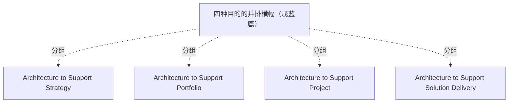

# G186/fig3-3 · 企业架构的目的

类型：`analytical-view`。把本指南采用的基于目的EA能力模型四类并列呈现，作为正文进一步解释规划期、深度和广度的分类索引。

英文 PDF 物理页：[30]。本页为架构语义分析，原文与原图分别保留。

## 原图与可编辑图


[完整 JSON](fig3-3.json) · [可编辑 Mermaid](fig3-3.mmd) · [仅关系图](fig3-3.relations.mmd) · [层级分解图](fig3-3.hierarchy.mmd)

图形重建表达语义，不复制源图布局。虚线表示解释、矩阵映射或分组关系，不自动表示不确定性的概率。



## 架构分析

从左到右读四个方框，颜色只是区分，不是编码：黄=支持战略，绿=支持组合，棕=支持项目，品红=支持解决方案交付。四个框大小相同、地位并列；从左到右大致对应规划期由长到短、覆盖范围由宽到窄，但图上没有箭头，顺序本身不表示流程。

- 本图有 5 个具名或隐含元素、0 条关系和 4 条包含/分组记录。
- 包含/分组树最大深度为 1；根节点为 四种目的的并排横幅（浅蓝底）。
- 本图没有可直接确认为人员直属汇报的关系；视觉上下位置、能力分解和治理职责分别读取。
- 原图靠嵌套表达结构，没有连线；新语义图将包含单独显式化，不补造流程、数据流或依赖。
- 浅蓝外带及4同级目的框完整；无箭头，无顺序流程。
- 30页原文typically four broad purposes，是本指南采用的四类模型，不能从图推导全世界仅允许四种EA目的。

### 如何用于项目

- 围绕作者目的读取本图实体、分组与连线，并用对应原文限定其含义。
- 把参考模型与项目事实分开，实际范围、约束、值和责任须有项目证据。

### 结构所表达的逻辑

- 四种目的并列：Architecture to Support Strategy / Portfolio / Project / Solution Delivery；它们不是层级，也不是成熟度阶段。
- 支持战略的架构交付端到端目标架构与 3–10 年变革路线图，通常跨多个变革项目群或组合。
- 支持组合的架构支持跨职能、多阶段、多项目的变革举措，通常跨单个组合。
- 支持项目的架构支持企业的项目交付方法，通常跨单个项目。
- 支持解决方案交付的架构支持解决方案部署，通常是单个项目或项目的重要部分。
- 四种目的会决定架构项目的规划期、深度与广度，以及 EA 存储库的内容；这是后文表 3-1 与图 4-1 的分类依据。
- 方框等大并不表示工作量相同；原图没有给出规模、时间或成熟度信息。

## 上下级与包含

扁平结构：一个浅蓝色横幅容器内并排四个同级方框，没有上下级、没有子项。四个目的共同构成“基于目的的 EA 能力模型”。

|父项|子项|层级类型|依据与解释|
|---|---|---|---|
|四种目的的并排横幅（浅蓝底）|支持战略的架构|visual_grouping|框、泳道、域或分类组的成员归属；没有额外证据不提升为业务组合或管理关系。|
|四种目的的并排横幅（浅蓝底）|支持组合的架构|visual_grouping|框、泳道、域或分类组的成员归属；没有额外证据不提升为业务组合或管理关系。|
|四种目的的并排横幅（浅蓝底）|支持项目的架构|visual_grouping|框、泳道、域或分类组的成员归属；没有额外证据不提升为业务组合或管理关系。|
|四种目的的并排横幅（浅蓝底）|支持解决方案交付的架构|visual_grouping|框、泳道、域或分类组的成员归属；没有额外证据不提升为业务组合或管理关系。|

## 全部元素与角色

|元素ID|原文名称|类型|含义|直接父项|深度|
|---|---|---|---|---|---|
|purposes_band|四种目的的并排横幅（浅蓝底）|group|原图没有标题的浅蓝色容器，把四个目的框在一起。|—||
|p_strategy|Architecture to Support Strategy|architecture|端到端目标架构 + 3–10 年变革路线图，跨多个项目群或组合。|四种目的的并排横幅（浅蓝底）|1|
|p_portfolio|Architecture to Support Portfolio|architecture|支持跨职能、多阶段、多项目变革，通常跨单个组合。|四种目的的并排横幅（浅蓝底）|1|
|p_project|Architecture to Support Project|architecture|支持企业项目交付方法，通常跨单个项目。|四种目的的并排横幅（浅蓝底）|1|
|p_solution|Architecture to Support Solution Delivery|architecture|支持解决方案部署，通常是单个项目或项目的重要部分。|四种目的的并排横幅（浅蓝底）|1|

## 全部关系

图中没有任何连线或箭头。唯一的视觉关系是“并排/相邻”，阅读顺序为从左到右；浅蓝色横幅把它们框为同一组。颜色没有图例，不能据此推断优先级。

|主体|语义关系|客体|显式线/隐式|原文标签|依据|
|---|---|---|---|---|---|

## 误读检查

- 不要把四个方框读成 ADM 阶段或先后步骤；它们是四种并列的架构目的。
- 不要把从左到右理解为必须按顺序经历；一个组织可以同时有多个目的，一个项目也可能横跨多个目的。
- 不要把“支持项目”和“支持解决方案交付”当成互斥：正文说后者通常是单个项目或项目的重要部分，两者范围有重叠。
- 颜色没有含义，不能把黄/绿/棕/品红当作成熟度或优先级。
- 中文图第二个、第三个方框的双重边框是本地化瑕疵，不代表原图有两个框。

## 原文证据

### [PDF 第 30 页](../../../documents/G186.md#page-30)

> A purpose-based EA Capability model identifies four purposes that typically frame the planning horizon, depth and breadth of an Architecture Project, and the contents of the EA Repository. The purpose-based EA Capability model used in this document was introduced in the World-Class Enterprise Architecture White Paper [W102] and refined in the TOGAF® Series Guide: The TOGAF Leader’s Guide to Establishing and Evolving an EA Capability [G184].
> • EA to Support Strategy: Deliver EA to provide an end-to-end Target Architecture, and develop roadmaps of change over a three to ten-year period

## 来源与分析状态

所有元素/关系均有来源定位；未把历史解释重命名为本轮逐线视觉确认。源图与语义图是两种视图，布局不证明汇报或因果。

源 PDF SHA-256：`ed1c26faba5023a8d1b32b0ec893d75a3bb1d7a6508e99fa56ded079585d922a`。

源图记录：[原始解释与转录](../../../figures/G186/fig3-3.json)。

```json
{
  "quality": {
    "graph_integrity": "checked",
    "semantic_analysis": "typed-graph-and-context-analysis",
    "visual_review": "source-content-audited",
    "notice_zh": "所有元素/关系均有来源定位；未把历史解释重命名为本轮逐线视觉确认。源图与语义图是两种视图，布局不证明汇报或因果。"
  },
  "source_uncertainty": {
    "confidence": "high",
    "uncertainties_zh": [
      "原图没有标题、图例或说明文字，四色是否另有含义无法从图上确认；按无编码处理。",
      "四个框等大，无法判断作者是否想表达范围或工作量差异；正文只说范围不同，未给比例。"
    ],
    "analyzed_from": [
      "英文 PDF 第 30 页图 3-3 截图（220 dpi）及 2×2 放大分块",
      "英文 PDF 第 30 页正文（四种目的的段落）",
      "中文稿 G186e_实践者方法_按TOGAF_ADM开发企业架构.md 第 211–233 行及标签对照表 L215–L223",
      "figs/g186e_fig3-3_en.png 与 figs/zh/g186e_fig3-3_zh.png"
    ],
    "date": "2026-10-31"
  },
  "source_conflicts": []
}
```
