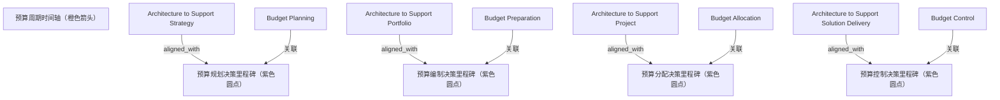

# G186/fig4-1 · 业务周期与四种架构目的的对应

类型：`architecture-evolution-or-plan`。作者用一条简化的预算周期时间线说明 EA 必须与组织既有的预算节奏对齐：支持战略、组合、项目的架构要在对应的预算决策之前完成，支持解决方案交付的架构则围绕预算控制持续运作；核心结论是“架构先于决策”。

英文 PDF 物理页：[41]。本页为架构语义分析，原文与原图分别保留。

## 原图与可编辑图


[完整 JSON](fig4-1.json) · [可编辑 Mermaid](fig4-1.mmd) · [仅关系图](fig4-1.relations.mmd) · [层级分解图](fig4-1.hierarchy.mmd)

图形重建表达语义，不复制源图布局。虚线表示解释、矩阵映射或分组关系，不自动表示不确定性的概率。



## 架构分析

先看贯穿全图的橙色粗箭头，它表示时间从左向右流动。上方四个彩色方框是四种架构目的；下方四个文字标签是预算周期的四个阶段。每个阶段在时间轴上有一个紫色圆点（决策里程碑），标签用向上的短箭头指向自己的圆点。每个目的方框用一条向下的长箭头落到时间轴上，注意落点在对应圆点的左侧——表示架构工作要在该决策点之前交付。

- 本图有 13 个具名或隐含元素、8 条关系和 0 条包含/分组记录。
- 本图没有可直接确认为人员直属汇报的关系；视觉上下位置、能力分解和治理职责分别读取。
- 包含分组后有 5 个连通分量；分离可能源于图例、并列分类或独立示例，未自动补边。
- 4架构框、4预算标签、4紫色时点与橙色时间带共13元素完整。
- 8根黑箭头分别核对：上方4箭头指向时间带并位于各紫点左侧，下方4箭头才指向各紫点。修正上方视觉端点。
- 战略/组合/项目应在相应预算决策前完成；解决方案交付架构围绕预算控制持续运作，不把四对对齐误作ADM依次执行。

### 如何用于项目

- 为每个演进状态/工作包登记前置条件、交付物、依赖和实际决策人。
- 时间轴表达计划顺序；架构范围、已批准计划和资源承诺须另有项目证据。

### 结构所表达的逻辑

- 预算周期四阶段：Budget Planning（识别需要什么、将启动哪些新举措）→ Budget Preparation（自上而下与自下而上编制支出申请）→ Budget Allocation（释放资金）→ Budget Control（持续的财务与收益实现）。
- 四种架构目的与四个预算阶段一一对齐：战略对规划、组合对编制、项目对分配、解决方案交付对控制。
- 每个目的框的下箭头落点都在对应紫色里程碑圆点的左侧，这是“架构先于决策”的图形表达；正文明确说战略/组合/项目架构要在预算决策的关键里程碑之前完成。
- 支持解决方案交付的架构不是一次性交付，而是围绕预算控制持续运作；它在图中的方框也略高，暗示持续期更长。
- 整条时间轴只有一个方向（向右），没有回路；预算周期逐年重复，但图中只画了一个周期。
- 正文强调这是简化模型：用单向流程说明关键决策里程碑之间的相互作用，真实预算过程会更反复。

## 上下级与包含

两层：上层是四个并列的架构目的（Architecture to Support …），下层是四个并列的预算阶段标签；两层通过垂直箭头一一对应。橙色时间轴是承载所有阶段的基线，不是上下级。

|父项|子项|层级类型|依据与解释|
|---|---|---|---|
|—|—|无视觉包含|关系中明确的组成/特化见 JSON semantic_hierarchy。|

## 全部元素与角色

|元素ID|原文名称|类型|含义|直接父项|深度|
|---|---|---|---|---|---|
|budget_timeline|预算周期时间轴（橙色箭头）|time|无文字的橙色粗箭头，表示时间从左向右推进。|—||
|ph_planning|Budget Planning|phase|识别需要什么、将启动哪些新举措。|—||
|ph_preparation|Budget Preparation|phase|自上而下与自下而上结合，形成各部门支出申请。|—||
|ph_allocation|Budget Allocation|phase|把资金释放给实施项目。|—||
|ph_control|Budget Control|phase|实施项目持续的财务控制与收益实现。|—||
|m_planning|预算规划决策里程碑（紫色圆点）|event|无文字；由阶段标签的向上箭头指示。|—||
|m_preparation|预算编制决策里程碑（紫色圆点）|event|无文字。|—||
|m_allocation|预算分配决策里程碑（紫色圆点）|event|无文字。|—||
|m_control|预算控制决策里程碑（紫色圆点）|event|无文字。|—||
|a_strategy|Architecture to Support Strategy|architecture|与预算规划对齐；应在预算规划决策前完成。|—||
|a_portfolio|Architecture to Support Portfolio|architecture|与预算编制对齐。|—||
|a_project|Architecture to Support Project|architecture|与预算分配对齐。|—||
|a_solution|Architecture to Support Solution Delivery|architecture|与预算控制对齐，是围绕预算控制的持续运作。|—||

## 全部关系

橙色粗箭头 = 时间方向（左→右）。四条从目的框向下的实线箭头 = 该目的的架构交付时点，落点在时间轴上。四条从预算阶段标签向上的短箭头 = 指向该阶段的决策里程碑圆点。目的框箭头落点与圆点之间的水平间距表示“提前量”。图中没有表示阶段之间因果或依赖的连线。

|主体|语义关系|客体|显式线/隐式|原文标签|依据|
|---|---|---|---|---|---|
|支持战略的架构|aligned_with|预算规划决策里程碑（紫色圆点）|显式连线||向下箭头只落到橙色时间带、紫色点之前，不直接连到决策点；按正文保存架构与预算决策的语义对齐。|
|支持组合的架构|aligned_with|预算编制决策里程碑（紫色圆点）|显式连线||向下箭头只落到橙色时间带、紫色点之前，不直接连到决策点；按正文保存架构与预算决策的语义对齐。|
|支持项目的架构|aligned_with|预算分配决策里程碑（紫色圆点）|显式连线||向下箭头只落到橙色时间带、紫色点之前，不直接连到决策点；按正文保存架构与预算决策的语义对齐。|
|支持解决方案交付的架构|aligned_with|预算控制决策里程碑（紫色圆点）|显式连线||向下箭头只落到橙色时间带、紫色点之前，不直接连到决策点；按正文保存架构与预算决策的语义对齐。|
|预算规划|关联|预算规划决策里程碑（紫色圆点）|显式连线||预算阶段标签向上的短箭头，指向它在时间轴上的圆点。|
|预算编制|关联|预算编制决策里程碑（紫色圆点）|显式连线||同上。|
|预算分配|关联|预算分配决策里程碑（紫色圆点）|显式连线||同上。|
|预算控制|关联|预算控制决策里程碑（紫色圆点）|显式连线||同上。|

## 本轮语义修正

- 向下箭头只落到橙色时间带、紫色点之前，不直接连到决策点；按正文保存架构与预算决策的语义对齐。
- 向下箭头只落到橙色时间带、紫色点之前，不直接连到决策点；按正文保存架构与预算决策的语义对齐。
- 向下箭头只落到橙色时间带、紫色点之前，不直接连到决策点；按正文保存架构与预算决策的语义对齐。
- 向下箭头只落到橙色时间带、紫色点之前，不直接连到决策点；按正文保存架构与预算决策的语义对齐。

## 误读检查

- 不要把紫色圆点读成阶段起点；它是该预算阶段的决策里程碑，阶段标签从下方指向它。
- 不要把目的框的下箭头读成“架构由预算阶段产生”；方向是架构交付到时间轴上，语义是架构先于该决策完成。
- 不要把四个阶段理解为必须严格串行、不可回退；正文说这是简化模型，只用于说明结构。
- 不要把“支持解决方案交付”放在最后理解为它只在预算控制阶段才启动；正文说它是围绕预算控制的持续运作。
- 英文 PDF 第 41 页把本图图题印成 “Figure 4-1: Characteristics of the EA Landscape”（与图 3-1 同名），这是原文的图题复制错误；第 136 页的图 14-1 是同一张图，图题正确为 Business Cycle and Architecture by Purpose。
- 中文稿当前引用的 figs/g186_fig4-1.svg 已改成四张串联卡片，看不到“落点在圆点左侧”的关键信息，不能据它理解本图。

## 原文证据

### [PDF 第 41 页](../../../documents/G186.md#page-41)

> For most organizations, the budget cycle controls change in the organization. Pragmatically, the EA team will be aligned to the budget cycle. Figure 4-1 shows a timeline view, depicting an alignment of key decisions made during a business cycle and the purpose architectures. EA for Strategy, Portfolio, and Project need to be completed before key milestones for budget decisions are made. EA for Solution Delivery is a continuous operation around budget control. The key takeaway is architecture before the decision. If you are trapped trying to architect after the decision, see Section 11.2.1.
> Figure 4-1 provides a simplified budget cycle for structuring what is universal:
### [PDF 第 43 页](../../../documents/G186.md#page-43)

> The linkage between budget preparation and Architecture to Support Portfolio is one of the strongest linkages available. Given a set of change objectives, the organization is embarking on what is a good approach – what work must be funded, what work can be deferred, and what work should be deferred. Some of the most powerful guidance to effective change an EA team can provide is to support portfolio planning and investment decision.
> Providing Architecture to Support Portfolio requires working outside the corporate planning and execution cycle. When everyone else is executing on this year’s budget, the EA team must be working on next year’s budget; they have to be ready with a roadmap at the start of the budget preparation process.

## 来源与分析状态

所有元素/关系均有来源定位；未把历史解释重命名为本轮逐线视觉确认。源图与语义图是两种视图，布局不证明汇报或因果。

源 PDF SHA-256：`ed1c26faba5023a8d1b32b0ec893d75a3bb1d7a6508e99fa56ded079585d922a`。

源图记录：[原始解释与转录](../../../figures/G186/fig4-1.json)。

```json
{
  "quality": {
    "graph_integrity": "checked",
    "semantic_analysis": "typed-graph-and-context-analysis",
    "visual_review": "source-content-audited",
    "notice_zh": "所有元素/关系均有来源定位；未把历史解释重命名为本轮逐线视觉确认。源图与语义图是两种视图，布局不证明汇报或因果。"
  },
  "source_uncertainty": {
    "confidence": "high",
    "uncertainties_zh": [
      "英文 PDF 第 41 页的图题 “Characteristics of the EA Landscape” 与图内容不符，应为 Business Cycle and Architecture by Purpose（与图 14-1 相同）；本分析按图内容解析。",
      "紫色圆点没有文字标签，只能由下方阶段标签的向上箭头判断它代表该阶段的决策里程碑。",
      "目的框下箭头落点与圆点之间的水平距离没有标尺，无法量化“提前多少”。",
      "四个方框的高度略有差异（解决方案交付更高），是否刻意表达持续时间无法确认。"
    ],
    "analyzed_from": [
      "英文 PDF 第 41 页图 4-1 截图（220 dpi）及 2×2 放大分块",
      "英文 PDF 第 41 页正文",
      "英文 PDF 第 136 页图 14-1 截图（用于确认同图与正确图题）",
      "中文稿 G186e_实践者方法_按TOGAF_ADM开发企业架构.md 第 396–410 行",
      "figs/g186_fig4-1.svg 的文本与结构"
    ],
    "date": "2026-10-31"
  },
  "source_conflicts": []
}
```
