# G186/fig5-1 · TOGAF 架构存储库

类型：`architecture-concept-or-system-model`。作者用这张总览图告诉实践者：架构存储库不是一个文件夹，而是由元模型、架构全景、解决方案全景、参考库、标准库、需求库、治理库和架构能力组成的系统；实践者日常直接打交道的是架构全景、参考库、标准库、需求库以及治理库中的合规评估。

英文 PDF 物理页：[47]。本页为架构语义分析，原文与原图分别保留。

## 原图与可编辑图


[完整 JSON](fig5-1.json) · [可编辑 Mermaid](fig5-1.mmd) · [仅关系图](fig5-1.relations.mmd) · [层级分解图](fig5-1.hierarchy.mmd)

图形重建表达语义，不复制源图布局。虚线表示解释、矩阵映射或分组关系，不自动表示不确定性的概率。

```mermaid
flowchart TB
  %% Semantic reconstruction; see original source image for exact layout.
  n0["Enterprise Repository"]
  n1["Architecture Repository"]
  n2["Architecture Metamodel"]
  n3["Architecture Method"]
  n4["Enterprise Metamodel"]
  n5["Architecture Landscape"]
  n6["Strategic Architectures"]
  n7["Segment Architectures"]
  n8["Capability Architectures"]
  n9["Solutions Landscape"]
  n10["Solution Building Blocks"]
  n11["Reference Library"]
  n12["Organization Reference Materials"]
  n13["Standards Library"]
  n14["Business Standards"]
  n15["Data Standards"]
  n16["Application Standards"]
  n17["Technology Standards"]
  n18["Architecture Requirements Repository"]
  n19["Strategic Requirements"]
  n20["Segment Requirements"]
  n21["Capability Requirements"]
  n22["Governance Repository"]
  n23["Decision Log"]
  n24["Compliance Assessments"]
  n25["Capability Assessments"]
  n26["Calendar"]
  n27["Project Portfolio"]
  n28["Performance Measurement"]
  n29["Architecture Capability"]
  n30["Skills Repository"]
  n31["Organization Structure"]
  n32["Architecture Charter"]
  n33["External Reference Models"]
  n34["External Standards"]
  n35["Architecture Board"]
  n2 -->|"治理/监督"| n5
  n5 -->|"产生/交付"| n11
  n11 -->|"流动"| n5
  n5 <-->|"关联"| n9
  n5 -->|"产生/交付"| n13
  n13 -->|"治理/监督"| n5
  n13 -->|"流动"| n11
  n33 -->|"流动"| n11
  n34 -->|"流动"| n13
  n22 -->|"治理/监督"| n5
  n22 -->|"治理/监督"| n13
  n22 <-->|"流动"| n18
  n9 <-->|"流动"| n18
  n22 <-->|"流动"| n35
  n35 -->|"治理/监督"| n29
  n0 -.->|"分组"| n1
  n1 -.->|"分组"| n2
  n2 -.->|"分组"| n3
  n2 -.->|"分组"| n4
  n1 -.->|"分组"| n5
  n5 -.->|"分组"| n6
  n5 -.->|"分组"| n7
  n5 -.->|"分组"| n8
  n1 -.->|"分组"| n9
  n9 -.->|"分组"| n10
  n1 -.->|"分组"| n11
  n11 -.->|"分组"| n12
  n1 -.->|"分组"| n13
  n13 -.->|"分组"| n14
  n13 -.->|"分组"| n15
  n13 -.->|"分组"| n16
  n13 -.->|"分组"| n17
  n1 -.->|"分组"| n18
  n18 -.->|"分组"| n19
  n18 -.->|"分组"| n20
  n18 -.->|"分组"| n21
  n1 -.->|"分组"| n22
  n22 -.->|"分组"| n23
  n22 -.->|"分组"| n24
  n22 -.->|"分组"| n25
  n22 -.->|"分组"| n26
  n22 -.->|"分组"| n27
  n22 -.->|"分组"| n28
  n1 -.->|"分组"| n29
  n29 -.->|"分组"| n30
  n29 -.->|"分组"| n31
  n29 -.->|"分组"| n32
```



## 架构分析

从左上进入：最外层浅灰是 Enterprise Repository，里面整块灰色是 Architecture Repository。先认颜色分区：绿色=元模型与架构能力，深蓝=架构全景/解决方案全景/参考库/标准库（内容库），品红=需求库与解决方案全景，紫色=治理库，灰色=外部参考模型/外部标准/架构委员会。然后顺着带文字的箭头读：元模型如何约束全景，全景如何产生参考架构与标准，外部材料如何被采纳，治理库如何治理全景与合规，架构委员会如何与治理库互动并管理架构能力。

- 本图有 36 个具名或隐含元素、15 条关系和 32 条包含/分组记录。
- 包含/分组树最大深度为 3；根节点为 企业存储库、外部参考模型、外部标准、架构委员会。
- 本图没有可直接确认为人员直属汇报的关系；视觉上下位置、能力分解和治理职责分别读取。
- 治理边回答谁提供约束、指导或监督；它们与岗位汇报边分别存储。
- 36元素与全部15条有标签关系核对；架构库内各层、3个外部对象边界一致。
- 补正Enables the enterprise为双向；保留需求/方案虚线双向、治理/需求和治理/委员会实线双向。
- External Standards仅单箭头进入标准库，水印未作为四条标准连接。
- 区分画面被动语态箭头与governs语义，治理库治理架构全景和标准合规，不能反称标准库治理治理库。
- 正文强调维护足够且必要的信息、模型和文档联系；图不能理解成所有仓库必须是独立物理数据库。

### 如何用于项目

- 围绕作者目的读取本图实体、分组与连线，并用对应原文限定其含义。
- 把参考模型与项目事实分开，实际范围、约束、值和责任须有项目证据。

### 结构所表达的逻辑

- 架构存储库位于更宽的企业存储库之内；企业存储库还包括外部参考模型、外部标准与架构委员会等外部要素。
- 架构元模型由 Architecture Method（架构方法）与 Enterprise Metamodel（企业元模型）组成，它规定“全景中的制品按框架结构化”。
- 架构全景分三层：战略架构、分段架构、能力架构；它通过“Enables the enterprise”使能解决方案全景及其解决方案构建块。
- 参考库存放组织参考材料，标准库存放业务/数据/应用/技术四类标准；两者都从外部参考模型/外部标准“采纳”材料。
- 全景与内容库之间是双向的：全景中的最佳实践产生参考架构与标准；参考架构与标准又被企业采纳回全景（Adopted by the enterprise / Standards are complied with）。
- 标准库与参考库之间还有一条“Standards have reference implementations”，说明标准需要参考实现来落地。
- 治理存储库（决策日志、合规评估、能力评估、日历、项目组合、绩效度量）治理架构全景；标准库则向下指向治理库，表示合规以标准为依据。
- 架构需求库与治理库之间交换“Drivers for the enterprise”，与解决方案全景之间用虚线双向箭头表示“Business outcomes delivered”。
- 架构委员会在存储库之外，与治理库之间是双向的“Visibility and escalation”，并“steers and manages the capability”指向架构能力。

## 上下级与包含

三层包含：Enterprise Repository ⊃ Architecture Repository ⊃ 七个分区（架构元模型、架构全景、解决方案全景、参考库、标准库、架构需求库、治理存储库）+ 架构能力。每个分区内再列具体内容项（如战略/分段/能力架构，四类标准，六个治理项，三个能力项）。外部参考模型、外部标准、架构委员会不属于架构存储库，画在外侧。

|父项|子项|层级类型|依据与解释|
|---|---|---|---|
|企业存储库|架构存储库|visual_grouping|框、泳道、域或分类组的成员归属；没有额外证据不提升为业务组合或管理关系。|
|架构存储库|架构元模型|visual_grouping|框、泳道、域或分类组的成员归属；没有额外证据不提升为业务组合或管理关系。|
|架构元模型|架构方法|visual_grouping|框、泳道、域或分类组的成员归属；没有额外证据不提升为业务组合或管理关系。|
|架构元模型|企业元模型|visual_grouping|框、泳道、域或分类组的成员归属；没有额外证据不提升为业务组合或管理关系。|
|架构存储库|架构全景|visual_grouping|框、泳道、域或分类组的成员归属；没有额外证据不提升为业务组合或管理关系。|
|架构全景|战略架构|visual_grouping|框、泳道、域或分类组的成员归属；没有额外证据不提升为业务组合或管理关系。|
|架构全景|分段架构|visual_grouping|框、泳道、域或分类组的成员归属；没有额外证据不提升为业务组合或管理关系。|
|架构全景|能力架构|visual_grouping|框、泳道、域或分类组的成员归属；没有额外证据不提升为业务组合或管理关系。|
|架构存储库|解决方案全景|visual_grouping|框、泳道、域或分类组的成员归属；没有额外证据不提升为业务组合或管理关系。|
|解决方案全景|解决方案构建块|visual_grouping|框、泳道、域或分类组的成员归属；没有额外证据不提升为业务组合或管理关系。|
|架构存储库|参考库|visual_grouping|框、泳道、域或分类组的成员归属；没有额外证据不提升为业务组合或管理关系。|
|参考库|组织参考材料|visual_grouping|框、泳道、域或分类组的成员归属；没有额外证据不提升为业务组合或管理关系。|
|架构存储库|标准库|visual_grouping|框、泳道、域或分类组的成员归属；没有额外证据不提升为业务组合或管理关系。|
|标准库|业务标准|visual_grouping|框、泳道、域或分类组的成员归属；没有额外证据不提升为业务组合或管理关系。|
|标准库|数据标准|visual_grouping|框、泳道、域或分类组的成员归属；没有额外证据不提升为业务组合或管理关系。|
|标准库|应用标准|visual_grouping|框、泳道、域或分类组的成员归属；没有额外证据不提升为业务组合或管理关系。|
|标准库|技术标准|visual_grouping|框、泳道、域或分类组的成员归属；没有额外证据不提升为业务组合或管理关系。|
|架构存储库|架构需求库|visual_grouping|框、泳道、域或分类组的成员归属；没有额外证据不提升为业务组合或管理关系。|
|架构需求库|战略需求|visual_grouping|框、泳道、域或分类组的成员归属；没有额外证据不提升为业务组合或管理关系。|
|架构需求库|分段需求|visual_grouping|框、泳道、域或分类组的成员归属；没有额外证据不提升为业务组合或管理关系。|
|架构需求库|能力需求|visual_grouping|框、泳道、域或分类组的成员归属；没有额外证据不提升为业务组合或管理关系。|
|架构存储库|治理存储库|visual_grouping|框、泳道、域或分类组的成员归属；没有额外证据不提升为业务组合或管理关系。|
|治理存储库|决策日志|visual_grouping|框、泳道、域或分类组的成员归属；没有额外证据不提升为业务组合或管理关系。|
|治理存储库|合规评估|visual_grouping|框、泳道、域或分类组的成员归属；没有额外证据不提升为业务组合或管理关系。|
|治理存储库|能力评估|visual_grouping|框、泳道、域或分类组的成员归属；没有额外证据不提升为业务组合或管理关系。|
|治理存储库|日历|visual_grouping|框、泳道、域或分类组的成员归属；没有额外证据不提升为业务组合或管理关系。|
|治理存储库|项目组合|visual_grouping|框、泳道、域或分类组的成员归属；没有额外证据不提升为业务组合或管理关系。|
|治理存储库|绩效度量|visual_grouping|框、泳道、域或分类组的成员归属；没有额外证据不提升为业务组合或管理关系。|
|架构存储库|架构能力|visual_grouping|框、泳道、域或分类组的成员归属；没有额外证据不提升为业务组合或管理关系。|
|架构能力|技能库|visual_grouping|框、泳道、域或分类组的成员归属；没有额外证据不提升为业务组合或管理关系。|
|架构能力|组织架构|visual_grouping|框、泳道、域或分类组的成员归属；没有额外证据不提升为业务组合或管理关系。|
|架构能力|架构章程|visual_grouping|框、泳道、域或分类组的成员归属；没有额外证据不提升为业务组合或管理关系。|

### 治理范围

|父项/范围/类型|子项/责任对象/实例|语义|
|---|---|---|
|架构元模型|架构全景|governs|
|标准库|架构全景|governs|
|治理存储库|架构全景|governs|
|治理存储库|标准库|governs|
|架构委员会|架构能力|governs|

存在多个父项的节点：架构全景；保留多重关系，不强行转成单父项树。

## 全部元素与角色

|元素ID|原文名称|类型|含义|直接父项|深度|
|---|---|---|---|---|---|
|enterprise_repository|Enterprise Repository|group|比架构存储库更大的企业级存储范围。|—||
|architecture_repository|Architecture Repository|group|TOGAF 架构存储库本体，包含七个分区与架构能力。|企业存储库|1|
|arch_metamodel|Architecture Metamodel|group|规定全景中的制品如何按框架结构化。|架构存储库|2|
|arch_method|Architecture Method|artifact|架构方法。|架构元模型|3|
|enterprise_metamodel|Enterprise Metamodel|artifact|企业元模型。|架构元模型|3|
|architecture_landscape|Architecture Landscape|group|战略、分段、能力三层架构的容器。|架构存储库|2|
|strategic_architectures|Strategic Architectures|architecture|架构全景的第一层。|架构全景|3|
|segment_architectures|Segment Architectures|architecture|架构全景的第二层。|架构全景|3|
|capability_architectures|Capability Architectures|architecture|架构全景的第三层。|架构全景|3|
|solutions_landscape|Solutions Landscape|group|解决方案构建块的容器。|架构存储库|2|
|solution_building_blocks|Solution Building Blocks|building_block|已实现的解决方案构建块。|解决方案全景|3|
|reference_library|Reference Library|group|参考模型、参考架构、模式等加速器材料。|架构存储库|2|
|organization_reference_materials|Organization Reference Materials|artifact|组织可用的参考材料。|参考库|3|
|standards_library|Standards Library|group|四类标准的容器。|架构存储库|2|
|business_standards|Business Standards|principle|业务标准。|标准库|3|
|data_standards|Data Standards|principle|数据标准。|标准库|3|
|application_standards|Application Standards|principle|应用标准。|标准库|3|
|technology_standards|Technology Standards|principle|技术标准。|标准库|3|
|architecture_requirements_repository|Architecture Requirements Repository|group|战略/分段/能力需求的容器。|架构存储库|2|
|strategic_requirements|Strategic Requirements|requirement|战略层需求。|架构需求库|3|
|segment_requirements|Segment Requirements|requirement|分段层需求。|架构需求库|3|
|capability_requirements|Capability Requirements|requirement|能力层需求。|架构需求库|3|
|governance_repository|Governance Repository|group|决策、合规、能力、日历、组合与绩效记录的容器。|架构存储库|2|
|decision_log|Decision Log|artifact|记录决策。|治理存储库|3|
|compliance_assessments|Compliance Assessments|artifact|合规性评估记录。|治理存储库|3|
|capability_assessments|Capability Assessments|artifact|能力评估记录。|治理存储库|3|
|calendar|Calendar|artifact|治理日程。|治理存储库|3|
|project_portfolio|Project Portfolio|artifact|项目组合记录。|治理存储库|3|
|performance_measurement|Performance Measurement|metric|绩效度量。|治理存储库|3|
|architecture_capability|Architecture Capability|group|支撑架构工作的组织能力。|架构存储库|2|
|skills_repository|Skills Repository|artifact|架构技能目录。|架构能力|3|
|organization_structure|Organization Structure|organization_unit|架构团队的组织结构。|架构能力|3|
|architecture_charter|Architecture Charter|artifact|架构能力的授权章程。|架构能力|3|
|external_reference_models|External Reference Models|group|来自企业外部的参考模型。|—||
|external_standards|External Standards|group|来自企业外部的标准。|—||
|architecture_board|Architecture Board|organization_unit|治理架构工作的委员会，不属于架构存储库。|—||

## 全部关系

共 15 条带文字的箭头：单箭头表示材料/影响的方向（如“Artifacts in the landscape are structured according to the framework”由元模型指向全景，“Enables the enterprise”由全景指向解决方案全景）；双向箭头表示持续交换（决策驱动、业务成果、可见性与上报）；虚线双向箭头只有“Business outcomes delivered”一条。被动语态的标签（The landscape is governed、Standards are complied with、Compliance is governed）要按标签读主语，箭头方向表示“受…作用”的一侧。

|主体|语义关系|客体|显式线/隐式|原文标签|依据|
|---|---|---|---|---|---|
|架构元模型|治理/监督|架构全景|显式连线|Artifacts in the landscape are structured according to the framework|从架构元模型底部向下的箭头，指入架构全景顶部。|
|架构全景|产生/交付|参考库|显式连线|Best practice creates reference architecture|由架构全景右侧指向参考库左侧。|
|参考库|流动|架构全景|显式连线|Adopted by the enterprise|参考库左侧指向架构全景右侧，与上一条方向相反，形成循环。|
|架构全景|关联|解决方案全景|显式连线|Enables the enterprise|Architecture Landscape与Solutions Landscape间Enables the enterprise线两端均有箭头；旧版单向遗漏。|
|架构全景|产生/交付|标准库|显式连线|Best practice creates standards|由架构全景右下指向标准库左侧。|
|标准库|治理/监督|架构全景|显式连线|Standards are complied with|由标准库左侧指向架构全景右下。|
|标准库|流动|参考库|显式连线|Standards have reference implementations|由标准库顶部向上的箭头指入参考库底部。|
|外部参考模型|流动|参考库|显式连线|Reference models adopted by the enterprise|由外部参考模型左侧指向参考库右侧。|
|外部标准|流动|标准库|显式连线|Standards adopted by the enterprise|External Standards到Standards Library仅有一条水平左向箭头；附近细斜线为Evaluation Copy水印，不是分别连接四类标准的额外连接。|
|治理存储库|治理/监督|架构全景|显式连线|The landscape is governed|图线向下但标签The landscape is governed为被动语态；语义治理方向与画面箭头独立表示。|
|治理存储库|治理/监督|标准库|显式连线|Compliance is governed|Compliance is governed是被动语态；保存标准库向下的画面箭头和治理语义，不倒置权责。|
|治理存储库|流动|架构需求库|显式连线|Drivers for the enterprise|源图双方均有箭头；12为虚线，其余实线。|
|解决方案全景|流动|架构需求库|显式连线|Business outcomes delivered|源图双方均有箭头；12为虚线，其余实线。|
|治理存储库|流动|架构委员会|显式连线|Visibility and escalation|源图双方均有箭头；12为虚线，其余实线。|
|架构委员会|治理/监督|架构能力|显式连线|Architecture Board steers and manages the capability|由架构委员会左侧指向架构能力右端（架构章程一行）。|

## 本轮语义修正

- Architecture Landscape与Solutions Landscape间Enables the enterprise线两端均有箭头；旧版单向遗漏。
- External Standards到Standards Library仅有一条水平左向箭头；附近细斜线为Evaluation Copy水印，不是分别连接四类标准的额外连接。
- 图线向下但标签The landscape is governed为被动语态；语义治理方向与画面箭头独立表示。
- Compliance is governed是被动语态；保存标准库向下的画面箭头和治理语义，不倒置权责。
- 源图双方均有箭头；12为虚线，其余实线。
- 源图双方均有箭头；12为虚线，其余实线。
- 源图双方均有箭头；12为虚线，其余实线。

## 误读检查

- 不要把 Architecture Landscape 当成整个存储库；它只是七个分区之一，且只含战略/分段/能力三层架构。
- 不要把 Solutions Landscape 与 Architecture Landscape 混为一谈：前者放解决方案构建块，后者放架构。
- “The landscape is governed”箭头由全景向下指入治理库，不要读成“全景治理治理库”；语义是全景受治理。
- 外部参考模型与外部标准画在架构存储库之外，它们不是存储库的内部库；架构委员会同样在外部。
- 治理库中的 Decision Log 与 Calendar、架构能力中的 Skills Repository 在中文 PNG 中被漏掉，不要据此认为原图没有这些项。
- 中文 PNG 把架构需求库标题误写成“架构存储库”，并把 Architecture Board 译成“架构董事会”；应以英文原图为准。
- 图中没有画 ADM 阶段或流程顺序；箭头表示材料与治理关系，不是时间顺序。

## 原文证据

### [PDF 第 46 页](../../../documents/G186.md#page-46)

> The TOGAF Standard identifies a broad set of materials that will be contained within the Architecture Repository (as shown in Figure 5-1). As a Practitioner, you will be directly concerned with the Architecture Landscape, Reference Library, Standards Library, Architecture Requirements Repository, and the Compliance Assessments in the Governance Repository. Typically, these are implemented by a modeling and analytic tool, and a file repository.
### [PDF 第 47 页](../../../documents/G186.md#page-47)

> A high-functioning EA team cannot deliver without using modeling and analytic software. Some Practitioners sketch diagrams casually as initial steps in understanding a system, or explaining one. Maintenance of a collection of sketches is not practical. It does not matter where they use a marker and 11” x 17” paper or spend hours connecting objects in drawing software, these sketches are not modeling and do not provide a meaningful contribution to the EA Landscape. Further, the gaps and errors inherent in casual sketching preclude considering the sketches as a model.
> Do not confuse the guidance about managing an EA Landscape and EA Repository with commentary on effective communication. Most things an EA Capability needs to represent are complex. Visualization of complex situations to support the Practitioner, the stakeholder, and others that need to be communicated with is critical. Hand sketches are one of the most powerful communication tools available to a Practitioner. Beyond ideation it is a serious error to present poorly thought-out visualizations to stakeholders and decision-makers. This document strongly recommends the inclusion of information visualization skills in any EA team to address the needs of different communities – decision-makers, implementers, and stakeholders. One of the most significant challenges to developing a high-functioning EA team is overcoming poor information management and information presentation practice.
### [PDF 第 48 页](../../../documents/G186.md#page-48)

> What is produced is either a work product that is actively consumed or the intermediate work products the Practitioner needs to produce the requested work product. Table 5-1 provides a summary of work products that are actively consumed by key Enterprise processes.

## 来源与分析状态

所有元素/关系均有来源定位；未把历史解释重命名为本轮逐线视觉确认。源图与语义图是两种视图，布局不证明汇报或因果。

源 PDF SHA-256：`ed1c26faba5023a8d1b32b0ec893d75a3bb1d7a6508e99fa56ded079585d922a`。

源图记录：[原始解释与转录](../../../figures/G186/fig5-1.json)。

```json
{
  "quality": {
    "graph_integrity": "checked",
    "semantic_analysis": "typed-graph-and-context-analysis",
    "visual_review": "source-content-audited",
    "notice_zh": "所有元素/关系均有来源定位；未把历史解释重命名为本轮逐线视觉确认。源图与语义图是两种视图，布局不证明汇报或因果。"
  },
  "source_uncertainty": {
    "confidence": "high",
    "uncertainties_zh": [
      "外部标准到标准库的多条细线在低分辨率下难以逐条确认终点；按“分别指向四类标准”记录为一条关系。",
      "“Compliance is governed”箭头从标准库底部指向治理库顶部，具体落在合规评估一行还是治理库整体，图上无法精确判断。",
      "“The landscape is governed”的箭头由全景向下指入治理库，但标签是被动语态；本分析按“全景受治理”记录为依赖关系。",
      "原图没有图例，颜色分组（绿/蓝/品红/紫/灰）是解析者据色块与文字推断。"
    ],
    "analyzed_from": [
      "英文 PDF 第 47 页图 5-1 截图（220 dpi）及 3×3 放大分块、右侧局部 3 倍放大",
      "英文 PDF 第 46–47 页正文",
      "中文稿 G186e_实践者方法_按TOGAF_ADM开发企业架构.md 第 479–528 行及标签对照表 L489–L524",
      "figs/g186e_fig5-1_en.png 与 figs/zh/g186e_fig5-1_zh.png"
    ],
    "date": "2026-10-31"
  },
  "source_conflicts": []
}
```
