# G186/fig5-10 · 开发支持解决方案交付的架构的示例项目计划

类型：`architecture-evolution-or-plan`。示范第 5.2.7 节：解决方案交付架构的路径是对齐实施者→指导交付→实现解决方案；本图说明架构如何约束设计与交付、提供一致性控制与架构需求，并治理实施与运营变更，直至关闭架构工作。

英文 PDF 物理页：[71]。本页为架构语义分析，原文与原图分别保留。

## 原图与可编辑图


[完整 JSON](fig5-10.json) · [可编辑 Mermaid](fig5-10.mmd) · [仅关系图](fig5-10.relations.mmd) · [层级分解图](fig5-10.hierarchy.mmd)

图形重建表达语义，不复制源图布局。虚线表示解释、矩阵映射或分组关系，不自动表示不确定性的概率。

```mermaid
flowchart TB
  %% Semantic reconstruction; see original source image for exact layout.
  n0["Start Architecture Project"]
  n1["Partial Capability Phase A"]
  n2["Partial Capability Level Phase B, C, D"]
  n3["Partial Capability Phase B"]
  n4["Partial Capability Phase C"]
  n5["Partial Capability Phase D"]
  n6["Partial Project Level Phase G"]
  n7["Guide Delivery"]
  n8["Partial Project Level Phases B, C, and D"]
  n9["Partial Capability Phase B"]
  n10["Partial Capability Phase C"]
  n11["Partial Capability Phase D"]
  n12["EA Capability Partial Capability Level Phases B, C, and D"]
  n13["Partial Capability Phase B"]
  n14["Partial Capability Phase C"]
  n15["Partial Capability Phase D"]
  n16["Partial Capability Level Phase E"]
  n17["Partial Capability Level Phase G"]
  n18["Realizing the Solution"]
  n19["Partial Project Level Phase H"]
  n20["Partial Project Level Phase F"]
  n21["Partial Enterprise Level Phase H"]
  n22["Partial Enterprise Level Phase H"]
  n23["Start Partial Capability Phase A"]
  n24["Verify recency"]
  n25["Reaffirm stakeholders, outcomes, timeline"]
  n26["Communicate value proposition"]
  n27["Start Partial Capability Phase A"]
  n28["Start Partial Capability Level Phase B, C, D"]
  n29["Start Partial Capability Phase B"]
  n30["Elaborate architecture specification"]
  n31["Reaffirm risk controls"]
  n32["Communicate Solution Building Blocks"]
  n33["Complete Partial Capability Phase B"]
  n34["Start Partial Capability Phase C"]
  n35["Elaborate architecture specification"]
  n36["Reaffirm risk controls"]
  n37["Communicate Solution Building Blocks"]
  n38["Complete Partial Capability Phase C"]
  n39["Start Partial Capability Phase D"]
  n40["Elaborate architecture specification"]
  n41["Reaffirm risk controls"]
  n42["Communicate Solution Building Blocks"]
  n43["Complete Partial Capability Phase D"]
  n44["Complete Partial Capability Level Phase B, C, D"]
  n45["Start Partial Project Level Phase G"]
  n46["Initiate project governance"]
  n47["Complete Partial Project Level Phase G"]
  n48["Start Partial Project Level Phases B, C, and D"]
  n49["Start Partial Capability Phase B"]
  n50["Continuously update EA Landscape"]
  n51["Refine Solution Building Blocks and solution boundaries"]
  n52["Monitor controls"]
  n53["Complete Partial Capability Phase B"]
  n54["Start Partial Capability Phase C"]
  n55["Continuously update EA Landscape"]
  n56["Refine Solution Building Blocks and solution boundaries"]
  n57["Monitor controls"]
  n58["Complete Partial Capability Phase C"]
  n59["Start Partial Capability Phase D"]
  n60["Continuously update EA Landscape"]
  n61["Refine Solution Building Blocks and solution boundaries"]
  n62["Monitor controls"]
  n63["Complete Partial Capability Phase D"]
  n64["Complete Partial Project Level Phases B, C, and D"]
  n65["Start EA Capability Partial Capability Level Phases B, C, and D"]
  n66["Start Partial Capability Phase B"]
  n67["Update EA Repository (contents and models)"]
  n68["Update standards and reference architectures"]
  n69["Complete Partial Capability Phase B"]
  n70["Start Partial Capability Phase C"]
  n71["Update EA Repository (contents and models)"]
  n72["Update standards and reference architectures"]
  n73["Complete Partial Capability Phase C"]
  n74["Start Partial Capability Phase D"]
  n75["Update EA Repository (contents and models)"]
  n76["Update standards and reference architectures"]
  n77["Complete Partial Capability Phase D"]
  n78["Distribute resources"]
  n79["Complete EA Capability Partial Capability Level Phases B, C, and D"]
  n80["Start Partial Capability Level Phase E"]
  n81["Analyze impact of trade-off with superior architecture"]
  n82["Update risk matrix"]
  n83["Complete Partial Capability Level Phase E"]
  n84["Start Partial Capability Level Phase G"]
  n85["Conduct stakeholder review"]
  n86["Obtain architecture approval"]
  n87["Validate alignment of solution to vision"]
  n88["Complete Partial Capability Level Phase G"]
  n89["Start Partial Project Level Phase H"]
  n90["Assess solution for gaps"]
  n91["Assess risk closure"]
  n92["Update Enterprise roadmap"]
  n93["Complete Partial Project Level Phase H"]
  n94["Start Partial Project Level Phase F"]
  n95["Baseline transition state architecture"]
  n96["Complete lessons learned"]
  n97["Close architecture work"]
  n98["Complete Partial Project Level Phase F"]
  n99["Start Partial Enterprise Level Phase H"]
  n100["Assess changes to Enterprise roadmap"]
  n101["Create backlog for architecture work"]
  n102["Complete Partial Enterprise Level Phase H"]
  n103["Start Partial Enterprise Level Phase H"]
  n104["Engage stakeholders"]
  n0 -.->|"先于"| n1
  n1 -.->|"先于"| n7
  n7 -.->|"先于"| n18
  n2 -.->|"先于"| n6
  n8 -.->|"先于"| n12
  n12 -.->|"先于"| n16
  n16 -.->|"先于"| n17
  n17 -.->|"先于"| n18
  n19 -.->|"先于"| n20
  n20 -.->|"先于"| n21
  n21 -.->|"先于"| n22
  n2 -.->|"task_summary"| n3
  n2 -.->|"task_summary"| n4
  n2 -.->|"task_summary"| n5
  n7 -.->|"task_summary"| n8
  n8 -.->|"task_summary"| n9
  n8 -.->|"task_summary"| n10
  n8 -.->|"task_summary"| n11
  n7 -.->|"task_summary"| n12
  n12 -.->|"task_summary"| n13
  n12 -.->|"task_summary"| n14
  n12 -.->|"task_summary"| n15
  n7 -.->|"task_summary"| n16
  n7 -.->|"task_summary"| n17
  n18 -.->|"task_summary"| n19
  n18 -.->|"task_summary"| n20
  n18 -.->|"task_summary"| n21
  n18 -.->|"task_summary"| n22
  n1 -.->|"task_summary"| n23
  n1 -.->|"task_summary"| n24
  n1 -.->|"task_summary"| n25
  n1 -.->|"task_summary"| n26
  n1 -.->|"task_summary"| n27
  n2 -.->|"task_summary"| n28
  n3 -.->|"task_summary"| n29
  n3 -.->|"task_summary"| n30
  n3 -.->|"task_summary"| n31
  n3 -.->|"task_summary"| n32
  n3 -.->|"task_summary"| n33
  n4 -.->|"task_summary"| n34
  n4 -.->|"task_summary"| n35
  n4 -.->|"task_summary"| n36
  n4 -.->|"task_summary"| n37
  n4 -.->|"task_summary"| n38
  n5 -.->|"task_summary"| n39
  n5 -.->|"task_summary"| n40
  n5 -.->|"task_summary"| n41
  n5 -.->|"task_summary"| n42
  n5 -.->|"task_summary"| n43
  n2 -.->|"task_summary"| n44
  n6 -.->|"task_summary"| n45
  n6 -.->|"task_summary"| n46
  n6 -.->|"task_summary"| n47
  n8 -.->|"task_summary"| n48
  n9 -.->|"task_summary"| n49
  n9 -.->|"task_summary"| n50
  n9 -.->|"task_summary"| n51
  n9 -.->|"task_summary"| n52
  n9 -.->|"task_summary"| n53
  n10 -.->|"task_summary"| n54
  n10 -.->|"task_summary"| n55
  n10 -.->|"task_summary"| n56
  n10 -.->|"task_summary"| n57
  n10 -.->|"task_summary"| n58
  n11 -.->|"task_summary"| n59
  n11 -.->|"task_summary"| n60
  n11 -.->|"task_summary"| n61
  n11 -.->|"task_summary"| n62
  n11 -.->|"task_summary"| n63
  n8 -.->|"task_summary"| n64
  n12 -.->|"task_summary"| n65
  n13 -.->|"task_summary"| n66
  n13 -.->|"task_summary"| n67
  n13 -.->|"task_summary"| n68
  n13 -.->|"task_summary"| n69
  n14 -.->|"task_summary"| n70
  n14 -.->|"task_summary"| n71
  n14 -.->|"task_summary"| n72
  n14 -.->|"task_summary"| n73
  n15 -.->|"task_summary"| n74
  n15 -.->|"task_summary"| n75
  n15 -.->|"task_summary"| n76
  n15 -.->|"task_summary"| n77
  n12 -.->|"task_summary"| n78
  n12 -.->|"task_summary"| n79
  n16 -.->|"task_summary"| n80
  n16 -.->|"task_summary"| n81
  n16 -.->|"task_summary"| n82
  n16 -.->|"task_summary"| n83
  n17 -.->|"task_summary"| n84
  n17 -.->|"task_summary"| n85
  n17 -.->|"task_summary"| n86
  n17 -.->|"task_summary"| n87
  n17 -.->|"task_summary"| n88
  n19 -.->|"task_summary"| n89
  n19 -.->|"task_summary"| n90
  n19 -.->|"task_summary"| n91
  n19 -.->|"task_summary"| n92
  n19 -.->|"task_summary"| n93
  n20 -.->|"task_summary"| n94
  n20 -.->|"task_summary"| n95
  n20 -.->|"task_summary"| n96
  n20 -.->|"task_summary"| n97
  n20 -.->|"task_summary"| n98
  n21 -.->|"task_summary"| n99
  n21 -.->|"task_summary"| n100
  n21 -.->|"task_summary"| n101
  n21 -.->|"task_summary"| n102
  n22 -.->|"task_summary"| n103
  n22 -.->|"task_summary"| n104
```



## 架构分析

左侧自上而下读任务，粗体行是三条主线与阶段分组。右侧条形自左向右表示时间。先读三条主线：Partial Capability Phase A（前段）→ Guide Delivery → Realizing the Solution；再读每条主线的阶段顺序：B/C/D→项目层 G；项目层 B/C/D→EA 能力 B/C/D→E→G；项目层 H→项目层 F→企业层 H→第二次企业层 H。

- 本图有 105 个具名或隐含元素、11 条关系和 99 条包含/分组记录。
- 包含/分组树最大深度为 3；根节点为 启动架构项目、部分能力阶段 A、部分能力层阶段 B、C、D、部分项目层阶段 G、指导交付、实现解决方案。
- 本图没有可直接确认为人员直属汇报的关系；视觉上下位置、能力分解和治理职责分别读取。
- 包含分组后有 2 个连通分量；分离可能源于图例、并列分类或独立示例，未自动补边。
- 已读取PDF原始嵌入图的全部高分辨率分段；105行完整标签/可见截断、组层级、重复实例全部复核并提升为行级节点。
- 补充82行级节点、38个明确打印MM-DD日期；未给无年份日期补造年份。
- 审查所有任务条及连线区域，保存连通簇和完成端箭头特征；重合的逐对工具前置关系仍不可唯一确定，明确记录该源信息限制。
- 105行完整文字可见但任务条被底部截断，不能把截图末尾当作项目结束；第1行顶部日期也被截切。
- 第3与7行均印Start Partial Capability Phase A；98与103行均为Partial Enterprise Level Phase H，忠实保留源重复，不改写为Complete或其他阶段。
- 两套BCD工作在10-13至10-27并行，不得画成两套串行阶段。
- 修正初始BCD与Project G为Phase A的同级，而非其子任务；Distribute resources属于EA Capability BCD总组而非仅D。

### 如何用于项目

- 为每个演进状态/工作包登记前置条件、交付物、依赖和实际决策人。
- 时间轴表达计划顺序；架构范围、已批准计划和资源承诺须另有项目证据。

### 结构所表达的逻辑

- 计划共 105 行任务；三条主线是：部分能力阶段 A（对齐实施者）、指导交付、实现解决方案。
- 开头阶段 A 先验证时效性、重申利益相关者/成果/时间线、沟通价值主张；第 7 行再次出现 Start Partial Capability Phase A，是原图重复。
- 第一轮 B/C/D 细化架构规格、重申风险控制、沟通 SBB；随后项目层阶段 G 启动项目治理。
- 指导交付主线先做项目层 B/C/D：持续更新 EA 全景、细化 SBB 与解决方案边界、监控控制；再做 EA 能力 B/C/D：更新 EA 存储库、标准与参考架构，并分配资源。
- 阶段 E 分析同上层架构权衡的影响并更新风险矩阵；阶段 G 做利益相关者评审、获取架构批准、验证解决方案与愿景对齐。
- 实现解决方案主线：项目层 H 评估解决方案差距、风险关闭、更新企业路线图；项目层 F 基线化过渡状态架构、总结经验、关闭架构工作；企业层 H 评估路线图变更、创建架构工作待办；随后第二次企业层 H 只显示启动与利益相关者参与，页面下边缘截断。
- 该计划已进入交付治理：重点是约束实施、验证一致性、关闭架构工作，而不是继续细化架构。

## 上下级与包含

三层：三条主线（G1）→ 阶段分组（G2，如部分能力层 B/C/D、项目层 B/C/D、EA 能力 B/C/D、E、G、H、F）→ 子分组（G3，如单个能力阶段 B/C/D）→ 任务。企业层 H 在末尾出现两次，第二组被截断。

|父项|子项|层级类型|依据与解释|
|---|---|---|---|
|部分能力层阶段 B、C、D|部分能力阶段 B|task_summary|由源任务表缩进/分组逐行审查；同名任务以独立行号保留。|
|部分能力层阶段 B、C、D|部分能力阶段 C|task_summary|由源任务表缩进/分组逐行审查；同名任务以独立行号保留。|
|部分能力层阶段 B、C、D|部分能力阶段 D|task_summary|由源任务表缩进/分组逐行审查；同名任务以独立行号保留。|
|指导交付|部分项目层阶段 B、C、D|task_summary|由源任务表缩进/分组逐行审查；同名任务以独立行号保留。|
|部分项目层阶段 B、C、D|部分能力阶段 B（项目层）|task_summary|由源任务表缩进/分组逐行审查；同名任务以独立行号保留。|
|部分项目层阶段 B、C、D|部分能力阶段 C（项目层）|task_summary|由源任务表缩进/分组逐行审查；同名任务以独立行号保留。|
|部分项目层阶段 B、C、D|部分能力阶段 D（项目层）|task_summary|由源任务表缩进/分组逐行审查；同名任务以独立行号保留。|
|指导交付|EA 能力部分能力层阶段 B、C、D|task_summary|由源任务表缩进/分组逐行审查；同名任务以独立行号保留。|
|EA 能力部分能力层阶段 B、C、D|部分能力阶段 B（EA 能力）|task_summary|由源任务表缩进/分组逐行审查；同名任务以独立行号保留。|
|EA 能力部分能力层阶段 B、C、D|部分能力阶段 C（EA 能力）|task_summary|由源任务表缩进/分组逐行审查；同名任务以独立行号保留。|
|EA 能力部分能力层阶段 B、C、D|部分能力阶段 D（EA 能力）|task_summary|由源任务表缩进/分组逐行审查；同名任务以独立行号保留。|
|指导交付|部分能力层阶段 E|task_summary|由源任务表缩进/分组逐行审查；同名任务以独立行号保留。|
|指导交付|部分能力层阶段 G|task_summary|由源任务表缩进/分组逐行审查；同名任务以独立行号保留。|
|实现解决方案|部分项目层阶段 H|task_summary|由源任务表缩进/分组逐行审查；同名任务以独立行号保留。|
|实现解决方案|部分项目层阶段 F|task_summary|由源任务表缩进/分组逐行审查；同名任务以独立行号保留。|
|实现解决方案|部分企业层阶段 H|task_summary|由源任务表缩进/分组逐行审查；同名任务以独立行号保留。|
|实现解决方案|部分企业层阶段 H（第二次）|task_summary|由源任务表缩进/分组逐行审查；同名任务以独立行号保留。|
|部分能力阶段 A|Start Partial Capability Phase A|task_summary|由源任务表缩进/分组逐行审查；同名任务以独立行号保留。|
|部分能力阶段 A|Verify recency|task_summary|由源任务表缩进/分组逐行审查；同名任务以独立行号保留。|
|部分能力阶段 A|Reaffirm stakeholders, outcomes, timeline|task_summary|由源任务表缩进/分组逐行审查；同名任务以独立行号保留。|
|部分能力阶段 A|Communicate value proposition|task_summary|由源任务表缩进/分组逐行审查；同名任务以独立行号保留。|
|部分能力阶段 A|Start Partial Capability Phase A|task_summary|由源任务表缩进/分组逐行审查；同名任务以独立行号保留。|
|部分能力层阶段 B、C、D|Start Partial Capability Level Phase B, C, D|task_summary|由源任务表缩进/分组逐行审查；同名任务以独立行号保留。|
|部分能力阶段 B|Start Partial Capability Phase B|task_summary|由源任务表缩进/分组逐行审查；同名任务以独立行号保留。|
|部分能力阶段 B|Elaborate architecture specification|task_summary|由源任务表缩进/分组逐行审查；同名任务以独立行号保留。|
|部分能力阶段 B|Reaffirm risk controls|task_summary|由源任务表缩进/分组逐行审查；同名任务以独立行号保留。|
|部分能力阶段 B|Communicate Solution Building Blocks|task_summary|由源任务表缩进/分组逐行审查；同名任务以独立行号保留。|
|部分能力阶段 B|Complete Partial Capability Phase B|task_summary|由源任务表缩进/分组逐行审查；同名任务以独立行号保留。|
|部分能力阶段 C|Start Partial Capability Phase C|task_summary|由源任务表缩进/分组逐行审查；同名任务以独立行号保留。|
|部分能力阶段 C|Elaborate architecture specification|task_summary|由源任务表缩进/分组逐行审查；同名任务以独立行号保留。|
|部分能力阶段 C|Reaffirm risk controls|task_summary|由源任务表缩进/分组逐行审查；同名任务以独立行号保留。|
|部分能力阶段 C|Communicate Solution Building Blocks|task_summary|由源任务表缩进/分组逐行审查；同名任务以独立行号保留。|
|部分能力阶段 C|Complete Partial Capability Phase C|task_summary|由源任务表缩进/分组逐行审查；同名任务以独立行号保留。|
|部分能力阶段 D|Start Partial Capability Phase D|task_summary|由源任务表缩进/分组逐行审查；同名任务以独立行号保留。|
|部分能力阶段 D|Elaborate architecture specification|task_summary|由源任务表缩进/分组逐行审查；同名任务以独立行号保留。|
|部分能力阶段 D|Reaffirm risk controls|task_summary|由源任务表缩进/分组逐行审查；同名任务以独立行号保留。|
|部分能力阶段 D|Communicate Solution Building Blocks|task_summary|由源任务表缩进/分组逐行审查；同名任务以独立行号保留。|
|部分能力阶段 D|Complete Partial Capability Phase D|task_summary|由源任务表缩进/分组逐行审查；同名任务以独立行号保留。|
|部分能力层阶段 B、C、D|Complete Partial Capability Level Phase B, C, D|task_summary|由源任务表缩进/分组逐行审查；同名任务以独立行号保留。|
|部分项目层阶段 G|Start Partial Project Level Phase G|task_summary|由源任务表缩进/分组逐行审查；同名任务以独立行号保留。|
|部分项目层阶段 G|Initiate project governance|task_summary|由源任务表缩进/分组逐行审查；同名任务以独立行号保留。|
|部分项目层阶段 G|Complete Partial Project Level Phase G|task_summary|由源任务表缩进/分组逐行审查；同名任务以独立行号保留。|
|部分项目层阶段 B、C、D|Start Partial Project Level Phases B, C, and D|task_summary|由源任务表缩进/分组逐行审查；同名任务以独立行号保留。|
|部分能力阶段 B（项目层）|Start Partial Capability Phase B|task_summary|由源任务表缩进/分组逐行审查；同名任务以独立行号保留。|
|部分能力阶段 B（项目层）|Continuously update EA Landscape|task_summary|由源任务表缩进/分组逐行审查；同名任务以独立行号保留。|
|部分能力阶段 B（项目层）|Refine Solution Building Blocks and solution boundaries|task_summary|由源任务表缩进/分组逐行审查；同名任务以独立行号保留。|
|部分能力阶段 B（项目层）|Monitor controls|task_summary|由源任务表缩进/分组逐行审查；同名任务以独立行号保留。|
|部分能力阶段 B（项目层）|Complete Partial Capability Phase B|task_summary|由源任务表缩进/分组逐行审查；同名任务以独立行号保留。|
|部分能力阶段 C（项目层）|Start Partial Capability Phase C|task_summary|由源任务表缩进/分组逐行审查；同名任务以独立行号保留。|
|部分能力阶段 C（项目层）|Continuously update EA Landscape|task_summary|由源任务表缩进/分组逐行审查；同名任务以独立行号保留。|
|部分能力阶段 C（项目层）|Refine Solution Building Blocks and solution boundaries|task_summary|由源任务表缩进/分组逐行审查；同名任务以独立行号保留。|
|部分能力阶段 C（项目层）|Monitor controls|task_summary|由源任务表缩进/分组逐行审查；同名任务以独立行号保留。|
|部分能力阶段 C（项目层）|Complete Partial Capability Phase C|task_summary|由源任务表缩进/分组逐行审查；同名任务以独立行号保留。|
|部分能力阶段 D（项目层）|Start Partial Capability Phase D|task_summary|由源任务表缩进/分组逐行审查；同名任务以独立行号保留。|
|部分能力阶段 D（项目层）|Continuously update EA Landscape|task_summary|由源任务表缩进/分组逐行审查；同名任务以独立行号保留。|
|部分能力阶段 D（项目层）|Refine Solution Building Blocks and solution boundaries|task_summary|由源任务表缩进/分组逐行审查；同名任务以独立行号保留。|
|部分能力阶段 D（项目层）|Monitor controls|task_summary|由源任务表缩进/分组逐行审查；同名任务以独立行号保留。|
|部分能力阶段 D（项目层）|Complete Partial Capability Phase D|task_summary|由源任务表缩进/分组逐行审查；同名任务以独立行号保留。|
|部分项目层阶段 B、C、D|Complete Partial Project Level Phases B, C, and D|task_summary|由源任务表缩进/分组逐行审查；同名任务以独立行号保留。|
|EA 能力部分能力层阶段 B、C、D|Start EA Capability Partial Capability Level Phases B, C, and D|task_summary|由源任务表缩进/分组逐行审查；同名任务以独立行号保留。|
|部分能力阶段 B（EA 能力）|Start Partial Capability Phase B|task_summary|由源任务表缩进/分组逐行审查；同名任务以独立行号保留。|
|部分能力阶段 B（EA 能力）|Update EA Repository (contents and models)|task_summary|由源任务表缩进/分组逐行审查；同名任务以独立行号保留。|
|部分能力阶段 B（EA 能力）|Update standards and reference architectures|task_summary|由源任务表缩进/分组逐行审查；同名任务以独立行号保留。|
|部分能力阶段 B（EA 能力）|Complete Partial Capability Phase B|task_summary|由源任务表缩进/分组逐行审查；同名任务以独立行号保留。|
|部分能力阶段 C（EA 能力）|Start Partial Capability Phase C|task_summary|由源任务表缩进/分组逐行审查；同名任务以独立行号保留。|
|部分能力阶段 C（EA 能力）|Update EA Repository (contents and models)|task_summary|由源任务表缩进/分组逐行审查；同名任务以独立行号保留。|
|部分能力阶段 C（EA 能力）|Update standards and reference architectures|task_summary|由源任务表缩进/分组逐行审查；同名任务以独立行号保留。|
|部分能力阶段 C（EA 能力）|Complete Partial Capability Phase C|task_summary|由源任务表缩进/分组逐行审查；同名任务以独立行号保留。|
|部分能力阶段 D（EA 能力）|Start Partial Capability Phase D|task_summary|由源任务表缩进/分组逐行审查；同名任务以独立行号保留。|
|部分能力阶段 D（EA 能力）|Update EA Repository (contents and models)|task_summary|由源任务表缩进/分组逐行审查；同名任务以独立行号保留。|
|部分能力阶段 D（EA 能力）|Update standards and reference architectures|task_summary|由源任务表缩进/分组逐行审查；同名任务以独立行号保留。|
|部分能力阶段 D（EA 能力）|Complete Partial Capability Phase D|task_summary|由源任务表缩进/分组逐行审查；同名任务以独立行号保留。|
|EA 能力部分能力层阶段 B、C、D|Distribute resources|task_summary|由源任务表缩进/分组逐行审查；同名任务以独立行号保留。|
|EA 能力部分能力层阶段 B、C、D|Complete EA Capability Partial Capability Level Phases B, C, and D|task_summary|由源任务表缩进/分组逐行审查；同名任务以独立行号保留。|
|部分能力层阶段 E|Start Partial Capability Level Phase E|task_summary|由源任务表缩进/分组逐行审查；同名任务以独立行号保留。|
|部分能力层阶段 E|Analyze impact of trade-off with superior architecture|task_summary|由源任务表缩进/分组逐行审查；同名任务以独立行号保留。|
|部分能力层阶段 E|Update risk matrix|task_summary|由源任务表缩进/分组逐行审查；同名任务以独立行号保留。|
|部分能力层阶段 E|Complete Partial Capability Level Phase E|task_summary|由源任务表缩进/分组逐行审查；同名任务以独立行号保留。|
|部分能力层阶段 G|Start Partial Capability Level Phase G|task_summary|由源任务表缩进/分组逐行审查；同名任务以独立行号保留。|
|部分能力层阶段 G|Conduct stakeholder review|task_summary|由源任务表缩进/分组逐行审查；同名任务以独立行号保留。|
|部分能力层阶段 G|Obtain architecture approval|task_summary|由源任务表缩进/分组逐行审查；同名任务以独立行号保留。|
|部分能力层阶段 G|Validate alignment of solution to vision|task_summary|由源任务表缩进/分组逐行审查；同名任务以独立行号保留。|
|部分能力层阶段 G|Complete Partial Capability Level Phase G|task_summary|由源任务表缩进/分组逐行审查；同名任务以独立行号保留。|
|部分项目层阶段 H|Start Partial Project Level Phase H|task_summary|由源任务表缩进/分组逐行审查；同名任务以独立行号保留。|
|部分项目层阶段 H|Assess solution for gaps|task_summary|由源任务表缩进/分组逐行审查；同名任务以独立行号保留。|
|部分项目层阶段 H|Assess risk closure|task_summary|由源任务表缩进/分组逐行审查；同名任务以独立行号保留。|
|部分项目层阶段 H|Update Enterprise roadmap|task_summary|由源任务表缩进/分组逐行审查；同名任务以独立行号保留。|
|部分项目层阶段 H|Complete Partial Project Level Phase H|task_summary|由源任务表缩进/分组逐行审查；同名任务以独立行号保留。|
|部分项目层阶段 F|Start Partial Project Level Phase F|task_summary|由源任务表缩进/分组逐行审查；同名任务以独立行号保留。|
|部分项目层阶段 F|Baseline transition state architecture|task_summary|由源任务表缩进/分组逐行审查；同名任务以独立行号保留。|
|部分项目层阶段 F|Complete lessons learned|task_summary|由源任务表缩进/分组逐行审查；同名任务以独立行号保留。|
|部分项目层阶段 F|Close architecture work|task_summary|由源任务表缩进/分组逐行审查；同名任务以独立行号保留。|
|部分项目层阶段 F|Complete Partial Project Level Phase F|task_summary|由源任务表缩进/分组逐行审查；同名任务以独立行号保留。|
|部分企业层阶段 H|Start Partial Enterprise Level Phase H|task_summary|由源任务表缩进/分组逐行审查；同名任务以独立行号保留。|
|部分企业层阶段 H|Assess changes to Enterprise roadmap|task_summary|由源任务表缩进/分组逐行审查；同名任务以独立行号保留。|
|部分企业层阶段 H|Create backlog for architecture work|task_summary|由源任务表缩进/分组逐行审查；同名任务以独立行号保留。|
|部分企业层阶段 H|Complete Partial Enterprise Level Phase H|task_summary|由源任务表缩进/分组逐行审查；同名任务以独立行号保留。|
|部分企业层阶段 H（第二次）|Start Partial Enterprise Level Phase H|task_summary|由源任务表缩进/分组逐行审查；同名任务以独立行号保留。|
|部分企业层阶段 H（第二次）|Engage stakeholders|task_summary|由源任务表缩进/分组逐行审查；同名任务以独立行号保留。|

## 全部元素与角色

|元素ID|原文名称|类型|含义|直接父项|深度|
|---|---|---|---|---|---|
|prj_start|Start Architecture Project|event|事件：启动架构项目|—||
|capability_phase_a|Partial Capability Phase A|group|分组：部分能力阶段 A|—||
|capability_bcd|Partial Capability Level Phase B, C, D|phase|阶段：部分能力层阶段 B、C、D|—||
|capability_b|Partial Capability Phase B|group|分组：部分能力阶段 B|部分能力层阶段 B、C、D|1|
|capability_c|Partial Capability Phase C|group|分组：部分能力阶段 C|部分能力层阶段 B、C、D|1|
|capability_d|Partial Capability Phase D|group|分组：部分能力阶段 D|部分能力层阶段 B、C、D|1|
|project_phase_g|Partial Project Level Phase G|phase|阶段：部分项目层阶段 G|—||
|guide_delivery|Guide Delivery|group|分组：指导交付|—||
|project_bcd|Partial Project Level Phases B, C, and D|phase|阶段：部分项目层阶段 B、C、D|指导交付|1|
|capability_b_2|Partial Capability Phase B|group|分组：部分能力阶段 B（项目层）|部分项目层阶段 B、C、D|2|
|capability_c_2|Partial Capability Phase C|group|分组：部分能力阶段 C（项目层）|部分项目层阶段 B、C、D|2|
|capability_d_2|Partial Capability Phase D|group|分组：部分能力阶段 D（项目层）|部分项目层阶段 B、C、D|2|
|ea_capability_bcd|EA Capability Partial Capability Level Phases B, C, and D|phase|阶段：EA 能力部分能力层阶段 B、C、D|指导交付|1|
|capability_b_3|Partial Capability Phase B|group|分组：部分能力阶段 B（EA 能力）|EA 能力部分能力层阶段 B、C、D|2|
|capability_c_3|Partial Capability Phase C|group|分组：部分能力阶段 C（EA 能力）|EA 能力部分能力层阶段 B、C、D|2|
|capability_d_3|Partial Capability Phase D|group|分组：部分能力阶段 D（EA 能力）|EA 能力部分能力层阶段 B、C、D|2|
|capability_e|Partial Capability Level Phase E|phase|阶段：部分能力层阶段 E|指导交付|1|
|capability_g|Partial Capability Level Phase G|phase|阶段：部分能力层阶段 G|指导交付|1|
|realizing_solution|Realizing the Solution|group|分组：实现解决方案|—||
|project_phase_h|Partial Project Level Phase H|phase|阶段：部分项目层阶段 H|实现解决方案|1|
|project_phase_f|Partial Project Level Phase F|phase|阶段：部分项目层阶段 F|实现解决方案|1|
|enterprise_phase_h|Partial Enterprise Level Phase H|phase|阶段：部分企业层阶段 H|实现解决方案|1|
|enterprise_phase_h_2|Partial Enterprise Level Phase H|phase|原图第 98 行与第 103 行同名重复；第二组只显示 Start 与 Engage stakeholders，其余被页面下边缘截断。|实现解决方案|1|
|task_row_3|Start Partial Capability Phase A|event|事件：Start Partial Capability Phase A|部分能力阶段 A|1|
|task_row_4|Verify recency|process|流程：Verify recency|部分能力阶段 A|1|
|task_row_5|Reaffirm stakeholders, outcomes, timeline|process|流程：Reaffirm stakeholders, outcomes, timeline|部分能力阶段 A|1|
|task_row_6|Communicate value proposition|process|流程：Communicate value proposition|部分能力阶段 A|1|
|task_row_7|Start Partial Capability Phase A|event|事件：Start Partial Capability Phase A|部分能力阶段 A|1|
|task_row_9|Start Partial Capability Level Phase B, C, D|event|事件：Start Partial Capability Level Phase B, C, D|部分能力层阶段 B、C、D|1|
|task_row_11|Start Partial Capability Phase B|event|事件：Start Partial Capability Phase B|部分能力阶段 B|2|
|task_row_12|Elaborate architecture specification|process|流程：Elaborate architecture specification|部分能力阶段 B|2|
|task_row_13|Reaffirm risk controls|process|流程：Reaffirm risk controls|部分能力阶段 B|2|
|task_row_14|Communicate Solution Building Blocks|process|流程：Communicate Solution Building Blocks|部分能力阶段 B|2|
|task_row_15|Complete Partial Capability Phase B|event|事件：Complete Partial Capability Phase B|部分能力阶段 B|2|
|task_row_17|Start Partial Capability Phase C|event|事件：Start Partial Capability Phase C|部分能力阶段 C|2|
|task_row_18|Elaborate architecture specification|process|流程：Elaborate architecture specification|部分能力阶段 C|2|
|task_row_19|Reaffirm risk controls|process|流程：Reaffirm risk controls|部分能力阶段 C|2|
|task_row_20|Communicate Solution Building Blocks|process|流程：Communicate Solution Building Blocks|部分能力阶段 C|2|
|task_row_21|Complete Partial Capability Phase C|event|事件：Complete Partial Capability Phase C|部分能力阶段 C|2|
|task_row_23|Start Partial Capability Phase D|event|事件：Start Partial Capability Phase D|部分能力阶段 D|2|
|task_row_24|Elaborate architecture specification|process|流程：Elaborate architecture specification|部分能力阶段 D|2|
|task_row_25|Reaffirm risk controls|process|流程：Reaffirm risk controls|部分能力阶段 D|2|
|task_row_26|Communicate Solution Building Blocks|process|流程：Communicate Solution Building Blocks|部分能力阶段 D|2|
|task_row_27|Complete Partial Capability Phase D|event|事件：Complete Partial Capability Phase D|部分能力阶段 D|2|
|task_row_28|Complete Partial Capability Level Phase B, C, D|event|事件：Complete Partial Capability Level Phase B, C, D|部分能力层阶段 B、C、D|1|
|task_row_30|Start Partial Project Level Phase G|event|事件：Start Partial Project Level Phase G|部分项目层阶段 G|1|
|task_row_31|Initiate project governance|process|流程：Initiate project governance|部分项目层阶段 G|1|
|task_row_32|Complete Partial Project Level Phase G|event|事件：Complete Partial Project Level Phase G|部分项目层阶段 G|1|
|task_row_35|Start Partial Project Level Phases B, C, and D|event|事件：Start Partial Project Level Phases B, C, and D|部分项目层阶段 B、C、D|2|
|task_row_37|Start Partial Capability Phase B|event|事件：Start Partial Capability Phase B|部分能力阶段 B（项目层）|3|
|task_row_38|Continuously update EA Landscape|process|流程：Continuously update EA Landscape|部分能力阶段 B（项目层）|3|
|task_row_39|Refine Solution Building Blocks and solution boundaries|process|流程：Refine Solution Building Blocks and solution boundaries|部分能力阶段 B（项目层）|3|
|task_row_40|Monitor controls|process|流程：Monitor controls|部分能力阶段 B（项目层）|3|
|task_row_41|Complete Partial Capability Phase B|event|事件：Complete Partial Capability Phase B|部分能力阶段 B（项目层）|3|
|task_row_43|Start Partial Capability Phase C|event|事件：Start Partial Capability Phase C|部分能力阶段 C（项目层）|3|
|task_row_44|Continuously update EA Landscape|process|流程：Continuously update EA Landscape|部分能力阶段 C（项目层）|3|
|task_row_45|Refine Solution Building Blocks and solution boundaries|process|流程：Refine Solution Building Blocks and solution boundaries|部分能力阶段 C（项目层）|3|
|task_row_46|Monitor controls|process|流程：Monitor controls|部分能力阶段 C（项目层）|3|
|task_row_47|Complete Partial Capability Phase C|event|事件：Complete Partial Capability Phase C|部分能力阶段 C（项目层）|3|
|task_row_49|Start Partial Capability Phase D|event|事件：Start Partial Capability Phase D|部分能力阶段 D（项目层）|3|
|task_row_50|Continuously update EA Landscape|process|流程：Continuously update EA Landscape|部分能力阶段 D（项目层）|3|
|task_row_51|Refine Solution Building Blocks and solution boundaries|process|流程：Refine Solution Building Blocks and solution boundaries|部分能力阶段 D（项目层）|3|
|task_row_52|Monitor controls|process|流程：Monitor controls|部分能力阶段 D（项目层）|3|
|task_row_53|Complete Partial Capability Phase D|event|事件：Complete Partial Capability Phase D|部分能力阶段 D（项目层）|3|
|task_row_54|Complete Partial Project Level Phases B, C, and D|event|事件：Complete Partial Project Level Phases B, C, and D|部分项目层阶段 B、C、D|2|
|task_row_56|Start EA Capability Partial Capability Level Phases B, C, and D|event|事件：Start EA Capability Partial Capability Level Phases B, C, and D|EA 能力部分能力层阶段 B、C、D|2|
|task_row_58|Start Partial Capability Phase B|event|事件：Start Partial Capability Phase B|部分能力阶段 B（EA 能力）|3|
|task_row_59|Update EA Repository (contents and models)|process|流程：Update EA Repository (contents and models)|部分能力阶段 B（EA 能力）|3|
|task_row_60|Update standards and reference architectures|process|流程：Update standards and reference architectures|部分能力阶段 B（EA 能力）|3|
|task_row_61|Complete Partial Capability Phase B|event|事件：Complete Partial Capability Phase B|部分能力阶段 B（EA 能力）|3|
|task_row_63|Start Partial Capability Phase C|event|事件：Start Partial Capability Phase C|部分能力阶段 C（EA 能力）|3|
|task_row_64|Update EA Repository (contents and models)|process|流程：Update EA Repository (contents and models)|部分能力阶段 C（EA 能力）|3|
|task_row_65|Update standards and reference architectures|process|流程：Update standards and reference architectures|部分能力阶段 C（EA 能力）|3|
|task_row_66|Complete Partial Capability Phase C|event|事件：Complete Partial Capability Phase C|部分能力阶段 C（EA 能力）|3|
|task_row_68|Start Partial Capability Phase D|event|事件：Start Partial Capability Phase D|部分能力阶段 D（EA 能力）|3|
|task_row_69|Update EA Repository (contents and models)|process|流程：Update EA Repository (contents and models)|部分能力阶段 D（EA 能力）|3|
|task_row_70|Update standards and reference architectures|process|流程：Update standards and reference architectures|部分能力阶段 D（EA 能力）|3|
|task_row_71|Complete Partial Capability Phase D|event|事件：Complete Partial Capability Phase D|部分能力阶段 D（EA 能力）|3|
|task_row_72|Distribute resources|process|流程：Distribute resources|EA 能力部分能力层阶段 B、C、D|2|
|task_row_73|Complete EA Capability Partial Capability Level Phases B, C, and D|event|事件：Complete EA Capability Partial Capability Level Phases B, C, and D|EA 能力部分能力层阶段 B、C、D|2|
|task_row_75|Start Partial Capability Level Phase E|event|事件：Start Partial Capability Level Phase E|部分能力层阶段 E|2|
|task_row_76|Analyze impact of trade-off with superior architecture|process|流程：Analyze impact of trade-off with superior architecture|部分能力层阶段 E|2|
|task_row_77|Update risk matrix|process|流程：Update risk matrix|部分能力层阶段 E|2|
|task_row_78|Complete Partial Capability Level Phase E|process|流程：Complete Partial Capability Level Phase E|部分能力层阶段 E|2|
|task_row_80|Start Partial Capability Level Phase G|event|事件：Start Partial Capability Level Phase G|部分能力层阶段 G|2|
|task_row_81|Conduct stakeholder review|process|流程：Conduct stakeholder review|部分能力层阶段 G|2|
|task_row_82|Obtain architecture approval|process|流程：Obtain architecture approval|部分能力层阶段 G|2|
|task_row_83|Validate alignment of solution to vision|process|流程：Validate alignment of solution to vision|部分能力层阶段 G|2|
|task_row_84|Complete Partial Capability Level Phase G|event|事件：Complete Partial Capability Level Phase G|部分能力层阶段 G|2|
|task_row_87|Start Partial Project Level Phase H|event|事件：Start Partial Project Level Phase H|部分项目层阶段 H|2|
|task_row_88|Assess solution for gaps|process|流程：Assess solution for gaps|部分项目层阶段 H|2|
|task_row_89|Assess risk closure|process|流程：Assess risk closure|部分项目层阶段 H|2|
|task_row_90|Update Enterprise roadmap|process|流程：Update Enterprise roadmap|部分项目层阶段 H|2|
|task_row_91|Complete Partial Project Level Phase H|event|事件：Complete Partial Project Level Phase H|部分项目层阶段 H|2|
|task_row_93|Start Partial Project Level Phase F|event|事件：Start Partial Project Level Phase F|部分项目层阶段 F|2|
|task_row_94|Baseline transition state architecture|process|流程：Baseline transition state architecture|部分项目层阶段 F|2|
|task_row_95|Complete lessons learned|process|流程：Complete lessons learned|部分项目层阶段 F|2|
|task_row_96|Close architecture work|process|流程：Close architecture work|部分项目层阶段 F|2|
|task_row_97|Complete Partial Project Level Phase F|event|事件：Complete Partial Project Level Phase F|部分项目层阶段 F|2|
|task_row_99|Start Partial Enterprise Level Phase H|event|事件：Start Partial Enterprise Level Phase H|部分企业层阶段 H|2|
|task_row_100|Assess changes to Enterprise roadmap|process|流程：Assess changes to Enterprise roadmap|部分企业层阶段 H|2|
|task_row_101|Create backlog for architecture work|process|流程：Create backlog for architecture work|部分企业层阶段 H|2|
|task_row_102|Complete Partial Enterprise Level Phase H|event|事件：Complete Partial Enterprise Level Phase H|部分企业层阶段 H|2|
|task_row_104|Start Partial Enterprise Level Phase H|event|事件：Start Partial Enterprise Level Phase H|部分企业层阶段 H（第二次）|2|
|task_row_105|Engage stakeholders|process|流程：Engage stakeholders|部分企业层阶段 H（第二次）|2|

### 启动架构项目：属性

```json
{
  "source_row": 1,
  "row_type_literal": "项目里程碑",
  "is_complete_schedule": false,
  "calendar_year": null
}
```

### 部分能力阶段 A：属性

```json
{
  "source_row": 2,
  "row_type_literal": "主线分组",
  "is_complete_schedule": false,
  "calendar_year": null
}
```

### 部分能力层阶段 B、C、D：属性

```json
{
  "source_row": 8,
  "row_type_literal": "阶段分组",
  "is_complete_schedule": false,
  "calendar_year": null
}
```

### 部分能力阶段 B：属性

```json
{
  "source_row": 10,
  "row_type_literal": "子分组",
  "is_complete_schedule": false,
  "calendar_year": null
}
```

### 部分能力阶段 C：属性

```json
{
  "source_row": 16,
  "row_type_literal": "子分组",
  "is_complete_schedule": false,
  "calendar_year": null
}
```

### 部分能力阶段 D：属性

```json
{
  "source_row": 22,
  "row_type_literal": "子分组",
  "is_complete_schedule": false,
  "calendar_year": null
}
```

### 部分项目层阶段 G：属性

```json
{
  "source_row": 29,
  "row_type_literal": "阶段分组",
  "is_complete_schedule": false,
  "calendar_year": null
}
```

### 指导交付：属性

```json
{
  "source_row": 33,
  "row_type_literal": "主线分组",
  "is_complete_schedule": false,
  "calendar_year": null
}
```

### 部分项目层阶段 B、C、D：属性

```json
{
  "source_row": 34,
  "row_type_literal": "阶段分组",
  "is_complete_schedule": false,
  "calendar_year": null
}
```

### 部分能力阶段 B（项目层）：属性

```json
{
  "source_row": 36,
  "row_type_literal": "子分组",
  "is_complete_schedule": false,
  "calendar_year": null
}
```

### 部分能力阶段 C（项目层）：属性

```json
{
  "source_row": 42,
  "row_type_literal": "子分组",
  "is_complete_schedule": false,
  "calendar_year": null
}
```

### 部分能力阶段 D（项目层）：属性

```json
{
  "source_row": 48,
  "row_type_literal": "子分组",
  "is_complete_schedule": false,
  "calendar_year": null
}
```

### EA 能力部分能力层阶段 B、C、D：属性

```json
{
  "source_row": 55,
  "row_type_literal": "阶段分组",
  "is_complete_schedule": false,
  "calendar_year": null
}
```

### 部分能力阶段 B（EA 能力）：属性

```json
{
  "source_row": 57,
  "row_type_literal": "子分组",
  "is_complete_schedule": false,
  "calendar_year": null
}
```

### 部分能力阶段 C（EA 能力）：属性

```json
{
  "source_row": 62,
  "row_type_literal": "子分组",
  "is_complete_schedule": false,
  "calendar_year": null
}
```

### 部分能力阶段 D（EA 能力）：属性

```json
{
  "source_row": 67,
  "row_type_literal": "子分组",
  "is_complete_schedule": false,
  "calendar_year": null
}
```

### 部分能力层阶段 E：属性

```json
{
  "source_row": 74,
  "row_type_literal": "阶段分组",
  "is_complete_schedule": false,
  "calendar_year": null
}
```

### 部分能力层阶段 G：属性

```json
{
  "source_row": 79,
  "row_type_literal": "阶段分组",
  "is_complete_schedule": false,
  "calendar_year": null
}
```

### 实现解决方案：属性

```json
{
  "source_row": 85,
  "row_type_literal": "主线分组",
  "is_complete_schedule": false,
  "calendar_year": null
}
```

### 部分项目层阶段 H：属性

```json
{
  "source_row": 86,
  "row_type_literal": "阶段分组",
  "is_complete_schedule": false,
  "calendar_year": null
}
```

### 部分项目层阶段 F：属性

```json
{
  "source_row": 92,
  "row_type_literal": "阶段分组",
  "is_complete_schedule": false,
  "calendar_year": null
}
```

### 部分企业层阶段 H：属性

```json
{
  "source_row": 98,
  "row_type_literal": "阶段分组",
  "is_complete_schedule": false,
  "calendar_year": null,
  "source_note_zh": "原图第 98 行与第 103 行都写 Partial Enterprise Level Phase H，原图重复。"
}
```

### 部分企业层阶段 H（第二次）：属性

```json
{
  "source_row": 103,
  "row_type_literal": "阶段分组",
  "is_complete_schedule": false,
  "calendar_year": null,
  "source_note_zh": "原图第 103 行与第 98 行同名重复。"
}
```

### Start Partial Capability Phase A：属性

```json
{
  "source_row": 3,
  "row_type_literal": "任务",
  "is_complete_schedule": false,
  "calendar_year": null,
  "printed_milestone_date_mm_dd": "09-05"
}
```

### Verify recency：属性

```json
{
  "source_row": 4,
  "row_type_literal": "任务",
  "is_complete_schedule": false,
  "calendar_year": null
}
```

### Reaffirm stakeholders, outcomes, timeline：属性

```json
{
  "source_row": 5,
  "row_type_literal": "任务",
  "is_complete_schedule": false,
  "calendar_year": null
}
```

### Communicate value proposition：属性

```json
{
  "source_row": 6,
  "row_type_literal": "任务",
  "is_complete_schedule": false,
  "calendar_year": null
}
```

### Start Partial Capability Phase A：属性

```json
{
  "source_row": 7,
  "row_type_literal": "任务",
  "is_complete_schedule": false,
  "calendar_year": null,
  "printed_milestone_date_mm_dd": "09-16",
  "source_note_zh": "原图第 3 行与第 7 行都写 Start Partial Capability Phase A，原图重复。"
}
```

### Start Partial Capability Level Phase B, C, D：属性

```json
{
  "source_row": 9,
  "row_type_literal": "任务",
  "is_complete_schedule": false,
  "calendar_year": null,
  "printed_milestone_date_mm_dd": "09-16"
}
```

### Start Partial Capability Phase B：属性

```json
{
  "source_row": 11,
  "row_type_literal": "任务",
  "is_complete_schedule": false,
  "calendar_year": null,
  "printed_milestone_date_mm_dd": "09-16"
}
```

### Elaborate architecture specification：属性

```json
{
  "source_row": 12,
  "row_type_literal": "任务",
  "is_complete_schedule": false,
  "calendar_year": null
}
```

### Reaffirm risk controls：属性

```json
{
  "source_row": 13,
  "row_type_literal": "任务",
  "is_complete_schedule": false,
  "calendar_year": null
}
```

### Communicate Solution Building Blocks：属性

```json
{
  "source_row": 14,
  "row_type_literal": "任务",
  "is_complete_schedule": false,
  "calendar_year": null
}
```

### Complete Partial Capability Phase B：属性

```json
{
  "source_row": 15,
  "row_type_literal": "任务",
  "is_complete_schedule": false,
  "calendar_year": null,
  "printed_milestone_date_mm_dd": "09-21"
}
```

### Start Partial Capability Phase C：属性

```json
{
  "source_row": 17,
  "row_type_literal": "任务",
  "is_complete_schedule": false,
  "calendar_year": null,
  "printed_milestone_date_mm_dd": "09-21"
}
```

### Elaborate architecture specification：属性

```json
{
  "source_row": 18,
  "row_type_literal": "任务",
  "is_complete_schedule": false,
  "calendar_year": null
}
```

### Reaffirm risk controls：属性

```json
{
  "source_row": 19,
  "row_type_literal": "任务",
  "is_complete_schedule": false,
  "calendar_year": null
}
```

### Communicate Solution Building Blocks：属性

```json
{
  "source_row": 20,
  "row_type_literal": "任务",
  "is_complete_schedule": false,
  "calendar_year": null
}
```

### Complete Partial Capability Phase C：属性

```json
{
  "source_row": 21,
  "row_type_literal": "任务",
  "is_complete_schedule": false,
  "calendar_year": null,
  "printed_milestone_date_mm_dd": "09-26"
}
```

### Start Partial Capability Phase D：属性

```json
{
  "source_row": 23,
  "row_type_literal": "任务",
  "is_complete_schedule": false,
  "calendar_year": null,
  "printed_milestone_date_mm_dd": "09-26"
}
```

### Elaborate architecture specification：属性

```json
{
  "source_row": 24,
  "row_type_literal": "任务",
  "is_complete_schedule": false,
  "calendar_year": null
}
```

### Reaffirm risk controls：属性

```json
{
  "source_row": 25,
  "row_type_literal": "任务",
  "is_complete_schedule": false,
  "calendar_year": null
}
```

### Communicate Solution Building Blocks：属性

```json
{
  "source_row": 26,
  "row_type_literal": "任务",
  "is_complete_schedule": false,
  "calendar_year": null
}
```

### Complete Partial Capability Phase D：属性

```json
{
  "source_row": 27,
  "row_type_literal": "任务",
  "is_complete_schedule": false,
  "calendar_year": null,
  "printed_milestone_date_mm_dd": "09-29"
}
```

### Complete Partial Capability Level Phase B, C, D：属性

```json
{
  "source_row": 28,
  "row_type_literal": "任务",
  "is_complete_schedule": false,
  "calendar_year": null,
  "printed_milestone_date_mm_dd": "09-29"
}
```

### Start Partial Project Level Phase G：属性

```json
{
  "source_row": 30,
  "row_type_literal": "任务",
  "is_complete_schedule": false,
  "calendar_year": null,
  "printed_milestone_date_mm_dd": "09-29"
}
```

### Initiate project governance：属性

```json
{
  "source_row": 31,
  "row_type_literal": "任务",
  "is_complete_schedule": false,
  "calendar_year": null
}
```

### Complete Partial Project Level Phase G：属性

```json
{
  "source_row": 32,
  "row_type_literal": "任务",
  "is_complete_schedule": false,
  "calendar_year": null,
  "printed_milestone_date_mm_dd": "10-13"
}
```

### Start Partial Project Level Phases B, C, and D：属性

```json
{
  "source_row": 35,
  "row_type_literal": "任务",
  "is_complete_schedule": false,
  "calendar_year": null,
  "printed_milestone_date_mm_dd": "10-13"
}
```

### Start Partial Capability Phase B：属性

```json
{
  "source_row": 37,
  "row_type_literal": "任务",
  "is_complete_schedule": false,
  "calendar_year": null,
  "printed_milestone_date_mm_dd": "10-13"
}
```

### Continuously update EA Landscape：属性

```json
{
  "source_row": 38,
  "row_type_literal": "任务",
  "is_complete_schedule": false,
  "calendar_year": null
}
```

### Refine Solution Building Blocks and solution boundaries：属性

```json
{
  "source_row": 39,
  "row_type_literal": "任务",
  "is_complete_schedule": false,
  "calendar_year": null
}
```

### Monitor controls：属性

```json
{
  "source_row": 40,
  "row_type_literal": "任务",
  "is_complete_schedule": false,
  "calendar_year": null
}
```

### Complete Partial Capability Phase B：属性

```json
{
  "source_row": 41,
  "row_type_literal": "任务",
  "is_complete_schedule": false,
  "calendar_year": null,
  "printed_milestone_date_mm_dd": "10-27"
}
```

### Start Partial Capability Phase C：属性

```json
{
  "source_row": 43,
  "row_type_literal": "任务",
  "is_complete_schedule": false,
  "calendar_year": null,
  "printed_milestone_date_mm_dd": "10-13"
}
```

### Continuously update EA Landscape：属性

```json
{
  "source_row": 44,
  "row_type_literal": "任务",
  "is_complete_schedule": false,
  "calendar_year": null
}
```

### Refine Solution Building Blocks and solution boundaries：属性

```json
{
  "source_row": 45,
  "row_type_literal": "任务",
  "is_complete_schedule": false,
  "calendar_year": null
}
```

### Monitor controls：属性

```json
{
  "source_row": 46,
  "row_type_literal": "任务",
  "is_complete_schedule": false,
  "calendar_year": null
}
```

### Complete Partial Capability Phase C：属性

```json
{
  "source_row": 47,
  "row_type_literal": "任务",
  "is_complete_schedule": false,
  "calendar_year": null,
  "printed_milestone_date_mm_dd": "10-27"
}
```

### Start Partial Capability Phase D：属性

```json
{
  "source_row": 49,
  "row_type_literal": "任务",
  "is_complete_schedule": false,
  "calendar_year": null,
  "printed_milestone_date_mm_dd": "10-13"
}
```

### Continuously update EA Landscape：属性

```json
{
  "source_row": 50,
  "row_type_literal": "任务",
  "is_complete_schedule": false,
  "calendar_year": null
}
```

### Refine Solution Building Blocks and solution boundaries：属性

```json
{
  "source_row": 51,
  "row_type_literal": "任务",
  "is_complete_schedule": false,
  "calendar_year": null
}
```

### Monitor controls：属性

```json
{
  "source_row": 52,
  "row_type_literal": "任务",
  "is_complete_schedule": false,
  "calendar_year": null
}
```

### Complete Partial Capability Phase D：属性

```json
{
  "source_row": 53,
  "row_type_literal": "任务",
  "is_complete_schedule": false,
  "calendar_year": null,
  "printed_milestone_date_mm_dd": "10-27"
}
```

### Complete Partial Project Level Phases B, C, and D：属性

```json
{
  "source_row": 54,
  "row_type_literal": "任务",
  "is_complete_schedule": false,
  "calendar_year": null,
  "printed_milestone_date_mm_dd": "10-27"
}
```

### Start EA Capability Partial Capability Level Phases B, C, and D：属性

```json
{
  "source_row": 56,
  "row_type_literal": "任务",
  "is_complete_schedule": false,
  "calendar_year": null,
  "printed_milestone_date_mm_dd": "10-13"
}
```

### Start Partial Capability Phase B：属性

```json
{
  "source_row": 58,
  "row_type_literal": "任务",
  "is_complete_schedule": false,
  "calendar_year": null,
  "printed_milestone_date_mm_dd": "10-13"
}
```

### Update EA Repository (contents and models)：属性

```json
{
  "source_row": 59,
  "row_type_literal": "任务",
  "is_complete_schedule": false,
  "calendar_year": null
}
```

### Update standards and reference architectures：属性

```json
{
  "source_row": 60,
  "row_type_literal": "任务",
  "is_complete_schedule": false,
  "calendar_year": null
}
```

### Complete Partial Capability Phase B：属性

```json
{
  "source_row": 61,
  "row_type_literal": "任务",
  "is_complete_schedule": false,
  "calendar_year": null,
  "printed_milestone_date_mm_dd": "10-27"
}
```

### Start Partial Capability Phase C：属性

```json
{
  "source_row": 63,
  "row_type_literal": "任务",
  "is_complete_schedule": false,
  "calendar_year": null,
  "printed_milestone_date_mm_dd": "10-13"
}
```

### Update EA Repository (contents and models)：属性

```json
{
  "source_row": 64,
  "row_type_literal": "任务",
  "is_complete_schedule": false,
  "calendar_year": null
}
```

### Update standards and reference architectures：属性

```json
{
  "source_row": 65,
  "row_type_literal": "任务",
  "is_complete_schedule": false,
  "calendar_year": null
}
```

### Complete Partial Capability Phase C：属性

```json
{
  "source_row": 66,
  "row_type_literal": "任务",
  "is_complete_schedule": false,
  "calendar_year": null,
  "printed_milestone_date_mm_dd": "10-27"
}
```

### Start Partial Capability Phase D：属性

```json
{
  "source_row": 68,
  "row_type_literal": "任务",
  "is_complete_schedule": false,
  "calendar_year": null,
  "printed_milestone_date_mm_dd": "10-13"
}
```

### Update EA Repository (contents and models)：属性

```json
{
  "source_row": 69,
  "row_type_literal": "任务",
  "is_complete_schedule": false,
  "calendar_year": null
}
```

### Update standards and reference architectures：属性

```json
{
  "source_row": 70,
  "row_type_literal": "任务",
  "is_complete_schedule": false,
  "calendar_year": null
}
```

### Complete Partial Capability Phase D：属性

```json
{
  "source_row": 71,
  "row_type_literal": "任务",
  "is_complete_schedule": false,
  "calendar_year": null,
  "printed_milestone_date_mm_dd": "10-27"
}
```

### Distribute resources：属性

```json
{
  "source_row": 72,
  "row_type_literal": "任务",
  "is_complete_schedule": false,
  "calendar_year": null
}
```

### Complete EA Capability Partial Capability Level Phases B, C, and D：属性

```json
{
  "source_row": 73,
  "row_type_literal": "任务",
  "is_complete_schedule": false,
  "calendar_year": null,
  "printed_milestone_date_mm_dd": "10-27"
}
```

### Start Partial Capability Level Phase E：属性

```json
{
  "source_row": 75,
  "row_type_literal": "任务",
  "is_complete_schedule": false,
  "calendar_year": null,
  "printed_milestone_date_mm_dd": "10-27"
}
```

### Analyze impact of trade-off with superior architecture：属性

```json
{
  "source_row": 76,
  "row_type_literal": "任务",
  "is_complete_schedule": false,
  "calendar_year": null
}
```

### Update risk matrix：属性

```json
{
  "source_row": 77,
  "row_type_literal": "任务",
  "is_complete_schedule": false,
  "calendar_year": null
}
```

### Complete Partial Capability Level Phase E：属性

```json
{
  "source_row": 78,
  "row_type_literal": "任务",
  "is_complete_schedule": false,
  "calendar_year": null
}
```

### Start Partial Capability Level Phase G：属性

```json
{
  "source_row": 80,
  "row_type_literal": "任务",
  "is_complete_schedule": false,
  "calendar_year": null,
  "printed_milestone_date_mm_dd": "11-10"
}
```

### Conduct stakeholder review：属性

```json
{
  "source_row": 81,
  "row_type_literal": "任务",
  "is_complete_schedule": false,
  "calendar_year": null
}
```

### Obtain architecture approval：属性

```json
{
  "source_row": 82,
  "row_type_literal": "任务",
  "is_complete_schedule": false,
  "calendar_year": null
}
```

### Validate alignment of solution to vision：属性

```json
{
  "source_row": 83,
  "row_type_literal": "任务",
  "is_complete_schedule": false,
  "calendar_year": null
}
```

### Complete Partial Capability Level Phase G：属性

```json
{
  "source_row": 84,
  "row_type_literal": "任务",
  "is_complete_schedule": false,
  "calendar_year": null,
  "printed_milestone_date_mm_dd": "11-24"
}
```

### Start Partial Project Level Phase H：属性

```json
{
  "source_row": 87,
  "row_type_literal": "任务",
  "is_complete_schedule": false,
  "calendar_year": null,
  "printed_milestone_date_mm_dd": "11-24"
}
```

### Assess solution for gaps：属性

```json
{
  "source_row": 88,
  "row_type_literal": "任务",
  "is_complete_schedule": false,
  "calendar_year": null
}
```

### Assess risk closure：属性

```json
{
  "source_row": 89,
  "row_type_literal": "任务",
  "is_complete_schedule": false,
  "calendar_year": null
}
```

### Update Enterprise roadmap：属性

```json
{
  "source_row": 90,
  "row_type_literal": "任务",
  "is_complete_schedule": false,
  "calendar_year": null
}
```

### Complete Partial Project Level Phase H：属性

```json
{
  "source_row": 91,
  "row_type_literal": "任务",
  "is_complete_schedule": false,
  "calendar_year": null,
  "printed_milestone_date_mm_dd": "12-08"
}
```

### Start Partial Project Level Phase F：属性

```json
{
  "source_row": 93,
  "row_type_literal": "任务",
  "is_complete_schedule": false,
  "calendar_year": null,
  "printed_milestone_date_mm_dd": "12-08"
}
```

### Baseline transition state architecture：属性

```json
{
  "source_row": 94,
  "row_type_literal": "任务",
  "is_complete_schedule": false,
  "calendar_year": null
}
```

### Complete lessons learned：属性

```json
{
  "source_row": 95,
  "row_type_literal": "任务",
  "is_complete_schedule": false,
  "calendar_year": null
}
```

### Close architecture work：属性

```json
{
  "source_row": 96,
  "row_type_literal": "任务",
  "is_complete_schedule": false,
  "calendar_year": null
}
```

### Complete Partial Project Level Phase F：属性

```json
{
  "source_row": 97,
  "row_type_literal": "任务",
  "is_complete_schedule": false,
  "calendar_year": null,
  "printed_milestone_date_mm_dd": "12-22"
}
```

### Start Partial Enterprise Level Phase H：属性

```json
{
  "source_row": 99,
  "row_type_literal": "任务",
  "is_complete_schedule": false,
  "calendar_year": null,
  "printed_milestone_date_mm_dd": "12-22"
}
```

### Assess changes to Enterprise roadmap：属性

```json
{
  "source_row": 100,
  "row_type_literal": "任务",
  "is_complete_schedule": false,
  "calendar_year": null
}
```

### Create backlog for architecture work：属性

```json
{
  "source_row": 101,
  "row_type_literal": "任务",
  "is_complete_schedule": false,
  "calendar_year": null
}
```

### Complete Partial Enterprise Level Phase H：属性

```json
{
  "source_row": 102,
  "row_type_literal": "任务",
  "is_complete_schedule": false,
  "calendar_year": null,
  "printed_milestone_date_mm_dd": "01-05"
}
```

### Start Partial Enterprise Level Phase H：属性

```json
{
  "source_row": 104,
  "row_type_literal": "任务",
  "is_complete_schedule": false,
  "calendar_year": null,
  "printed_milestone_date_mm_dd": "01-05"
}
```

### Engage stakeholders：属性

```json
{
  "source_row": 105,
  "row_type_literal": "任务",
  "is_complete_schedule": false,
  "calendar_year": null,
  "source_note_zh": "原图页面下边缘截断，Engage stakeholders 只显示一行，后面可能还有任务。"
}
```

## 全部关系

黑色汇总条、蓝色任务条、菱形日期与折线依赖分别保留。逐行节点及JSON的gantt_visual_transcription.connection_groups覆盖全部可见任务连接区域；重合连线的逐对前置/FS/FF/SS类型与滞后值在原截图无前置列，不作确定还原。历史阶段级边仅为阅读摘要，不宣称有直接实线。

|主体|语义关系|客体|显式线/隐式|原文标签|依据|
|---|---|---|---|---|---|
|启动架构项目|先于|部分能力阶段 A|solid||旧关系是阶段/主线摘要，不对应截图中一根直接连接两个汇总条的箭头。实际行级连通簇另列；不能用此摘要断言全部任务完成—开始顺序。|
|部分能力阶段 A|先于|指导交付|solid||旧关系是阶段/主线摘要，不对应截图中一根直接连接两个汇总条的箭头。实际行级连通簇另列；不能用此摘要断言全部任务完成—开始顺序。|
|指导交付|先于|实现解决方案|solid||旧关系是阶段/主线摘要，不对应截图中一根直接连接两个汇总条的箭头。实际行级连通簇另列；不能用此摘要断言全部任务完成—开始顺序。|
|部分能力层阶段 B、C、D|先于|部分项目层阶段 G|solid||旧关系是阶段/主线摘要，不对应截图中一根直接连接两个汇总条的箭头。实际行级连通簇另列；不能用此摘要断言全部任务完成—开始顺序。|
|部分项目层阶段 B、C、D|先于|EA 能力部分能力层阶段 B、C、D|solid||旧关系是阶段/主线摘要，不对应截图中一根直接连接两个汇总条的箭头。实际行级连通簇另列；不能用此摘要断言全部任务完成—开始顺序。|
|EA 能力部分能力层阶段 B、C、D|先于|部分能力层阶段 E|solid||旧关系是阶段/主线摘要，不对应截图中一根直接连接两个汇总条的箭头。实际行级连通簇另列；不能用此摘要断言全部任务完成—开始顺序。|
|部分能力层阶段 E|先于|部分能力层阶段 G|solid||旧关系是阶段/主线摘要，不对应截图中一根直接连接两个汇总条的箭头。实际行级连通簇另列；不能用此摘要断言全部任务完成—开始顺序。|
|部分能力层阶段 G|先于|实现解决方案|solid||旧关系是阶段/主线摘要，不对应截图中一根直接连接两个汇总条的箭头。实际行级连通簇另列；不能用此摘要断言全部任务完成—开始顺序。|
|部分项目层阶段 H|先于|部分项目层阶段 F|solid||旧关系是阶段/主线摘要，不对应截图中一根直接连接两个汇总条的箭头。实际行级连通簇另列；不能用此摘要断言全部任务完成—开始顺序。|
|部分项目层阶段 F|先于|部分企业层阶段 H|solid||旧关系是阶段/主线摘要，不对应截图中一根直接连接两个汇总条的箭头。实际行级连通簇另列；不能用此摘要断言全部任务完成—开始顺序。|
|部分企业层阶段 H|先于|部分企业层阶段 H（第二次）|solid||旧关系是阶段/主线摘要，不对应截图中一根直接连接两个汇总条的箭头。实际行级连通簇另列；不能用此摘要断言全部任务完成—开始顺序。|

## 图 5-10 全部 105 行任务逐行转录

```json
{
  "id": "t_tasks",
  "title_zh": "图 5-10 全部 105 行任务逐行转录",
  "columns": [
    "#",
    "Task (English, as printed)",
    "Row type / 行类型",
    "Parent group (English)",
    "Note / 备注"
  ],
  "rows": [
    [
      "1",
      "Start Architecture Project",
      "项目里程碑",
      "",
      ""
    ],
    [
      "2",
      "Partial Capability Phase A",
      "主线分组",
      "",
      ""
    ],
    [
      "3",
      "Start Partial Capability Phase A",
      "任务",
      "Partial Capability Phase A",
      ""
    ],
    [
      "4",
      "Verify recency",
      "任务",
      "Partial Capability Phase A",
      ""
    ],
    [
      "5",
      "Reaffirm stakeholders, outcomes, timeline",
      "任务",
      "Partial Capability Phase A",
      ""
    ],
    [
      "6",
      "Communicate value proposition",
      "任务",
      "Partial Capability Phase A",
      ""
    ],
    [
      "7",
      "Start Partial Capability Phase A",
      "任务",
      "Partial Capability Phase A",
      "原图第 3 行与第 7 行都写 Start Partial Capability Phase A，原图重复。"
    ],
    [
      "8",
      "Partial Capability Level Phase B, C, D",
      "阶段分组",
      "",
      ""
    ],
    [
      "9",
      "Start Partial Capability Level Phase B, C, D",
      "任务",
      "Partial Capability Level Phase B, C, D",
      ""
    ],
    [
      "10",
      "Partial Capability Phase B",
      "子分组",
      "Partial Capability Level Phase B, C, D",
      ""
    ],
    [
      "11",
      "Start Partial Capability Phase B",
      "任务",
      "Partial Capability Phase B",
      ""
    ],
    [
      "12",
      "Elaborate architecture specification",
      "任务",
      "Partial Capability Phase B",
      ""
    ],
    [
      "13",
      "Reaffirm risk controls",
      "任务",
      "Partial Capability Phase B",
      ""
    ],
    [
      "14",
      "Communicate Solution Building Blocks",
      "任务",
      "Partial Capability Phase B",
      ""
    ],
    [
      "15",
      "Complete Partial Capability Phase B",
      "任务",
      "Partial Capability Phase B",
      ""
    ],
    [
      "16",
      "Partial Capability Phase C",
      "子分组",
      "Partial Capability Level Phase B, C, D",
      ""
    ],
    [
      "17",
      "Start Partial Capability Phase C",
      "任务",
      "Partial Capability Phase C",
      ""
    ],
    [
      "18",
      "Elaborate architecture specification",
      "任务",
      "Partial Capability Phase C",
      ""
    ],
    [
      "19",
      "Reaffirm risk controls",
      "任务",
      "Partial Capability Phase C",
      ""
    ],
    [
      "20",
      "Communicate Solution Building Blocks",
      "任务",
      "Partial Capability Phase C",
      ""
    ],
    [
      "21",
      "Complete Partial Capability Phase C",
      "任务",
      "Partial Capability Phase C",
      ""
    ],
    [
      "22",
      "Partial Capability Phase D",
      "子分组",
      "Partial Capability Level Phase B, C, D",
      ""
    ],
    [
      "23",
      "Start Partial Capability Phase D",
      "任务",
      "Partial Capability Phase D",
      ""
    ],
    [
      "24",
      "Elaborate architecture specification",
      "任务",
      "Partial Capability Phase D",
      ""
    ],
    [
      "25",
      "Reaffirm risk controls",
      "任务",
      "Partial Capability Phase D",
      ""
    ],
    [
      "26",
      "Communicate Solution Building Blocks",
      "任务",
      "Partial Capability Phase D",
      ""
    ],
    [
      "27",
      "Complete Partial Capability Phase D",
      "任务",
      "Partial Capability Phase D",
      ""
    ],
    [
      "28",
      "Complete Partial Capability Level Phase B, C, D",
      "任务",
      "Partial Capability Level Phase B, C, D",
      ""
    ],
    [
      "29",
      "Partial Project Level Phase G",
      "阶段分组",
      "",
      ""
    ],
    [
      "30",
      "Start Partial Project Level Phase G",
      "任务",
      "Partial Project Level Phase G",
      ""
    ],
    [
      "31",
      "Initiate project governance",
      "任务",
      "Partial Project Level Phase G",
      ""
    ],
    [
      "32",
      "Complete Partial Project Level Phase G",
      "任务",
      "Partial Project Level Phase G",
      ""
    ],
    [
      "33",
      "Guide Delivery",
      "主线分组",
      "",
      ""
    ],
    [
      "34",
      "Partial Project Level Phases B, C, and D",
      "阶段分组",
      "Guide Delivery",
      ""
    ],
    [
      "35",
      "Start Partial Project Level Phases B, C, and D",
      "任务",
      "Partial Project Level Phases B, C, and D",
      ""
    ],
    [
      "36",
      "Partial Capability Phase B",
      "子分组",
      "Partial Project Level Phases B, C, and D",
      ""
    ],
    [
      "37",
      "Start Partial Capability Phase B",
      "任务",
      "Partial Capability Phase B",
      ""
    ],
    [
      "38",
      "Continuously update EA Landscape",
      "任务",
      "Partial Capability Phase B",
      ""
    ],
    [
      "39",
      "Refine Solution Building Blocks and solution boundaries",
      "任务",
      "Partial Capability Phase B",
      ""
    ],
    [
      "40",
      "Monitor controls",
      "任务",
      "Partial Capability Phase B",
      ""
    ],
    [
      "41",
      "Complete Partial Capability Phase B",
      "任务",
      "Partial Capability Phase B",
      ""
    ],
    [
      "42",
      "Partial Capability Phase C",
      "子分组",
      "Partial Project Level Phases B, C, and D",
      ""
    ],
    [
      "43",
      "Start Partial Capability Phase C",
      "任务",
      "Partial Capability Phase C",
      ""
    ],
    [
      "44",
      "Continuously update EA Landscape",
      "任务",
      "Partial Capability Phase C",
      ""
    ],
    [
      "45",
      "Refine Solution Building Blocks and solution boundaries",
      "任务",
      "Partial Capability Phase C",
      ""
    ],
    [
      "46",
      "Monitor controls",
      "任务",
      "Partial Capability Phase C",
      ""
    ],
    [
      "47",
      "Complete Partial Capability Phase C",
      "任务",
      "Partial Capability Phase C",
      ""
    ],
    [
      "48",
      "Partial Capability Phase D",
      "子分组",
      "Partial Project Level Phases B, C, and D",
      ""
    ],
    [
      "49",
      "Start Partial Capability Phase D",
      "任务",
      "Partial Capability Phase D",
      ""
    ],
    [
      "50",
      "Continuously update EA Landscape",
      "任务",
      "Partial Capability Phase D",
      ""
    ],
    [
      "51",
      "Refine Solution Building Blocks and solution boundaries",
      "任务",
      "Partial Capability Phase D",
      ""
    ],
    [
      "52",
      "Monitor controls",
      "任务",
      "Partial Capability Phase D",
      ""
    ],
    [
      "53",
      "Complete Partial Capability Phase D",
      "任务",
      "Partial Capability Phase D",
      ""
    ],
    [
      "54",
      "Complete Partial Project Level Phases B, C, and D",
      "任务",
      "Partial Project Level Phases B, C, and D",
      ""
    ],
    [
      "55",
      "EA Capability Partial Capability Level Phases B, C, and D",
      "阶段分组",
      "Guide Delivery",
      ""
    ],
    [
      "56",
      "Start EA Capability Partial Capability Level Phases B, C, and D",
      "任务",
      "EA Capability Partial Capability Level Phases B, C, and D",
      ""
    ],
    [
      "57",
      "Partial Capability Phase B",
      "子分组",
      "EA Capability Partial Capability Level Phases B, C, and D",
      ""
    ],
    [
      "58",
      "Start Partial Capability Phase B",
      "任务",
      "Partial Capability Phase B",
      ""
    ],
    [
      "59",
      "Update EA Repository (contents and models)",
      "任务",
      "Partial Capability Phase B",
      ""
    ],
    [
      "60",
      "Update standards and reference architectures",
      "任务",
      "Partial Capability Phase B",
      ""
    ],
    [
      "61",
      "Complete Partial Capability Phase B",
      "任务",
      "Partial Capability Phase B",
      ""
    ],
    [
      "62",
      "Partial Capability Phase C",
      "子分组",
      "EA Capability Partial Capability Level Phases B, C, and D",
      ""
    ],
    [
      "63",
      "Start Partial Capability Phase C",
      "任务",
      "Partial Capability Phase C",
      ""
    ],
    [
      "64",
      "Update EA Repository (contents and models)",
      "任务",
      "Partial Capability Phase C",
      ""
    ],
    [
      "65",
      "Update standards and reference architectures",
      "任务",
      "Partial Capability Phase C",
      ""
    ],
    [
      "66",
      "Complete Partial Capability Phase C",
      "任务",
      "Partial Capability Phase C",
      ""
    ],
    [
      "67",
      "Partial Capability Phase D",
      "子分组",
      "EA Capability Partial Capability Level Phases B, C, and D",
      ""
    ],
    [
      "68",
      "Start Partial Capability Phase D",
      "任务",
      "Partial Capability Phase D",
      ""
    ],
    [
      "69",
      "Update EA Repository (contents and models)",
      "任务",
      "Partial Capability Phase D",
      ""
    ],
    [
      "70",
      "Update standards and reference architectures",
      "任务",
      "Partial Capability Phase D",
      ""
    ],
    [
      "71",
      "Complete Partial Capability Phase D",
      "任务",
      "Partial Capability Phase D",
      ""
    ],
    [
      "72",
      "Distribute resources",
      "任务",
      "EA Capability Partial Capability Level Phases B, C, and D",
      ""
    ],
    [
      "73",
      "Complete EA Capability Partial Capability Level Phases B, C, and D",
      "任务",
      "EA Capability Partial Capability Level Phases B, C, and D",
      ""
    ],
    [
      "74",
      "Partial Capability Level Phase E",
      "阶段分组",
      "Guide Delivery",
      ""
    ],
    [
      "75",
      "Start Partial Capability Level Phase E",
      "任务",
      "Partial Capability Level Phase E",
      ""
    ],
    [
      "76",
      "Analyze impact of trade-off with superior architecture",
      "任务",
      "Partial Capability Level Phase E",
      ""
    ],
    [
      "77",
      "Update risk matrix",
      "任务",
      "Partial Capability Level Phase E",
      ""
    ],
    [
      "78",
      "Complete Partial Capability Level Phase E",
      "任务",
      "Partial Capability Level Phase E",
      ""
    ],
    [
      "79",
      "Partial Capability Level Phase G",
      "阶段分组",
      "Guide Delivery",
      ""
    ],
    [
      "80",
      "Start Partial Capability Level Phase G",
      "任务",
      "Partial Capability Level Phase G",
      ""
    ],
    [
      "81",
      "Conduct stakeholder review",
      "任务",
      "Partial Capability Level Phase G",
      ""
    ],
    [
      "82",
      "Obtain architecture approval",
      "任务",
      "Partial Capability Level Phase G",
      ""
    ],
    [
      "83",
      "Validate alignment of solution to vision",
      "任务",
      "Partial Capability Level Phase G",
      ""
    ],
    [
      "84",
      "Complete Partial Capability Level Phase G",
      "任务",
      "Partial Capability Level Phase G",
      ""
    ],
    [
      "85",
      "Realizing the Solution",
      "主线分组",
      "",
      ""
    ],
    [
      "86",
      "Partial Project Level Phase H",
      "阶段分组",
      "Realizing the Solution",
      ""
    ],
    [
      "87",
      "Start Partial Project Level Phase H",
      "任务",
      "Partial Project Level Phase H",
      ""
    ],
    [
      "88",
      "Assess solution for gaps",
      "任务",
      "Partial Project Level Phase H",
      ""
    ],
    [
      "89",
      "Assess risk closure",
      "任务",
      "Partial Project Level Phase H",
      ""
    ],
    [
      "90",
      "Update Enterprise roadmap",
      "任务",
      "Partial Project Level Phase H",
      ""
    ],
    [
      "91",
      "Complete Partial Project Level Phase H",
      "任务",
      "Partial Project Level Phase H",
      ""
    ],
    [
      "92",
      "Partial Project Level Phase F",
      "阶段分组",
      "Realizing the Solution",
      ""
    ],
    [
      "93",
      "Start Partial Project Level Phase F",
      "任务",
      "Partial Project Level Phase F",
      ""
    ],
    [
      "94",
      "Baseline transition state architecture",
      "任务",
      "Partial Project Level Phase F",
      ""
    ],
    [
      "95",
      "Complete lessons learned",
      "任务",
      "Partial Project Level Phase F",
      ""
    ],
    [
      "96",
      "Close architecture work",
      "任务",
      "Partial Project Level Phase F",
      ""
    ],
    [
      "97",
      "Complete Partial Project Level Phase F",
      "任务",
      "Partial Project Level Phase F",
      ""
    ],
    [
      "98",
      "Partial Enterprise Level Phase H",
      "阶段分组",
      "Realizing the Solution",
      "原图第 98 行与第 103 行都写 Partial Enterprise Level Phase H，原图重复。"
    ],
    [
      "99",
      "Start Partial Enterprise Level Phase H",
      "任务",
      "Partial Enterprise Level Phase H",
      ""
    ],
    [
      "100",
      "Assess changes to Enterprise roadmap",
      "任务",
      "Partial Enterprise Level Phase H",
      ""
    ],
    [
      "101",
      "Create backlog for architecture work",
      "任务",
      "Partial Enterprise Level Phase H",
      ""
    ],
    [
      "102",
      "Complete Partial Enterprise Level Phase H",
      "任务",
      "Partial Enterprise Level Phase H",
      ""
    ],
    [
      "103",
      "Partial Enterprise Level Phase H",
      "阶段分组",
      "Realizing the Solution",
      "原图第 103 行与第 98 行同名重复。"
    ],
    [
      "104",
      "Start Partial Enterprise Level Phase H",
      "任务",
      "Partial Enterprise Level Phase H",
      ""
    ],
    [
      "105",
      "Engage stakeholders",
      "任务",
      "Partial Enterprise Level Phase H",
      "原图页面下边缘截断，Engage stakeholders 只显示一行，后面可能还有任务。"
    ]
  ],
  "notes_zh": "完整可见任务逐行核对；同名多次出现按行号保留。所有打印日期另列gantt_visual_transcription，年份未给；无日期的任务条不反推出精确日历。逐对依赖/滞后列未显示，连接簇不能替代可执行项目计划。"
}
```

## 本轮语义修正

- 旧关系是阶段/主线摘要，不对应截图中一根直接连接两个汇总条的箭头。实际行级连通簇另列；不能用此摘要断言全部任务完成—开始顺序。
- 旧关系是阶段/主线摘要，不对应截图中一根直接连接两个汇总条的箭头。实际行级连通簇另列；不能用此摘要断言全部任务完成—开始顺序。
- 旧关系是阶段/主线摘要，不对应截图中一根直接连接两个汇总条的箭头。实际行级连通簇另列；不能用此摘要断言全部任务完成—开始顺序。
- 旧关系是阶段/主线摘要，不对应截图中一根直接连接两个汇总条的箭头。实际行级连通簇另列；不能用此摘要断言全部任务完成—开始顺序。
- 旧关系是阶段/主线摘要，不对应截图中一根直接连接两个汇总条的箭头。实际行级连通簇另列；不能用此摘要断言全部任务完成—开始顺序。
- 旧关系是阶段/主线摘要，不对应截图中一根直接连接两个汇总条的箭头。实际行级连通簇另列；不能用此摘要断言全部任务完成—开始顺序。
- 旧关系是阶段/主线摘要，不对应截图中一根直接连接两个汇总条的箭头。实际行级连通簇另列；不能用此摘要断言全部任务完成—开始顺序。
- 旧关系是阶段/主线摘要，不对应截图中一根直接连接两个汇总条的箭头。实际行级连通簇另列；不能用此摘要断言全部任务完成—开始顺序。
- 旧关系是阶段/主线摘要，不对应截图中一根直接连接两个汇总条的箭头。实际行级连通簇另列；不能用此摘要断言全部任务完成—开始顺序。
- 旧关系是阶段/主线摘要，不对应截图中一根直接连接两个汇总条的箭头。实际行级连通簇另列；不能用此摘要断言全部任务完成—开始顺序。
- 旧关系是阶段/主线摘要，不对应截图中一根直接连接两个汇总条的箭头。实际行级连通簇另列；不能用此摘要断言全部任务完成—开始顺序。

## 误读检查

- 黑色横括号是汇总，蓝色横条是任务，菱形是里程碑；黑色细折线也可为依赖线，不按颜色独自分类。
- 很多箭头落在条右端且任务时间重叠，不可统一转为完成—开始或按行串行。
- 这些是可配置ADM示例，72页明确ADM是逻辑方法，不能把截图计划当成规范性一遍执行流程。
- 105行完整文字可见但任务条被底部截断，不能把截图末尾当作项目结束；第1行顶部日期也被截切。
- 第3与7行均印Start Partial Capability Phase A；98与103行均为Partial Enterprise Level Phase H，忠实保留源重复，不改写为Complete或其他阶段。
- 两套BCD工作在10-13至10-27并行，不得画成两套串行阶段。
- 修正初始BCD与Project G为Phase A的同级，而非其子任务；Distribute resources属于EA Capability BCD总组而非仅D。

## 原文证据

### [PDF 第 70 页](../../../documents/G186.md#page-70)

> Figure 5-10 provides a sample project plan to provide Architecture to Support Solution Delivery. This project plan is explored in Chapter 10.
### [PDF 第 71 页](../../../documents/G186.md#page-71)

> Figure 5-10: Sample Project Plan to Develop Architecture to Support Solution Delivery
### [PDF 第 72 页](../../../documents/G186.md#page-72)

> At the start of this chapter, this document suggested that many Practitioners interpret the TOGAF ADM as a process model. If you did and continue to carry that notion, stop and think. The classic TOGAF diagram of the ADM is not an activity diagram. The TOGAF ADM is a logical method that places key activity steps together for the purpose of linking activity and information flow to produce specific outputs.
> The important thing to realize is every time a Practitioner undertakes any activity within the scope of the ADM it is developing the contents of the EA Landscape. It is developing the EA Landscape through iteration. The phase being executed is the appropriate domain. If you remain stuck on trying to put the ADM in a one-pass linear order, you will draw bizarre looping phase diagrams. Think of the steps as a checklist.

## 来源与分析状态

所有元素/关系均有来源定位；未把历史解释重命名为本轮逐线视觉确认。源图与语义图是两种视图，布局不证明汇报或因果。

源 PDF SHA-256：`ed1c26faba5023a8d1b32b0ec893d75a3bb1d7a6508e99fa56ded079585d922a`。

源图记录：[原始解释与转录](../../../figures/G186/fig5-10.json)。

```json
{
  "quality": {
    "graph_integrity": "checked",
    "semantic_analysis": "typed-graph-and-context-analysis",
    "visual_review": "source-content-audited",
    "notice_zh": "所有元素/关系均有来源定位；未把历史解释重命名为本轮逐线视觉确认。源图与语义图是两种视图，布局不证明汇报或因果。"
  },
  "source_uncertainty": {
    "confidence": "medium",
    "uncertainties_zh": [
      "原图页面下边缘截断第 105 行 Engage stakeholders，后面可能还有未显示的任务；行数按可见的 105 行计。",
      "原图条形为相对周尺度，日期标记只有 MM-DD，没有年份；无法逐条还原起止日期。",
      "任务级依赖箭头很多，本分析只记录主线/阶段级依赖，未逐条枚举。",
      "第 7 行与第 3 行、第 98 行与第 103 行的重复是原图如此，还是截图拼接造成，无法从单页截图确认。"
    ],
    "analyzed_from": [
      "英文 PDF 第 71 页图 5-10 截图（整图与 2x2 放大块）",
      "英文 PDF 第 70 页 5.2.7 节正文、第 71 页图题",
      "中文稿 G186e_实践者方法_按TOGAF_ADM开发企业架构.md 第 958–991 行",
      "figs/zh/g186e_fig5-10_zh.png"
    ],
    "date": "2026-10-31"
  },
  "source_conflicts": []
}
```
