# G186/fig5-2 · EA 存储库示例

类型：`decomposition-or-organization-model`。作者用真实的工具截图说明“一个架构项目在存储库里如何组织”：同一架构按状态分容器，每个容器下再按七类视角分文件夹；候选、目标、现状并列，目标下再挂多个过渡，从而支持“互不干扰地探索候选未来”。

英文 PDF 物理页：[51]。本页为架构语义分析，原文与原图分别保留。

## 原图与可编辑图


[完整 JSON](fig5-2.json) · [可编辑 Mermaid](fig5-2.mmd) · [仅关系图](fig5-2.relations.mmd) · [层级分解图](fig5-2.hierarchy.mmd)

图形重建表达语义，不复制源图布局。虚线表示解释、矩阵映射或分组关系，不自动表示不确定性的概率。

```mermaid
flowchart TB
  %% Semantic reconstruction; see original source image for exact layout.
  n0["Austin Workshop Architecture"]
  n1["Components"]
  n2["Connections"]
  n3["Catalogues"]
  n4["Matrices"]
  n5["Diagrams"]
  n6["3D Views"]
  n7["Charts"]
  n8["Austin Workshop Candidate"]
  n9["Austin Workshop Target"]
  n10["Austin Workshop Current"]
  n11["Components"]
  n12["Connections"]
  n13["Catalogues"]
  n14["Matrices"]
  n15["Diagrams"]
  n16["3D Views"]
  n17["Charts"]
  n18["Austin Workshop Annual Transition (Current Year)"]
  n19["Austin Workshop Annual Transition (Next Year)"]
  n20["Austin Workshop Transition"]
  n0 -->|"contains"| n1
  n0 -->|"contains"| n2
  n0 -->|"contains"| n3
  n0 -->|"contains"| n4
  n0 -->|"contains"| n5
  n0 -->|"contains"| n6
  n0 -->|"contains"| n7
  n0 -->|"contains"| n8
  n0 -->|"contains"| n9
  n0 -->|"contains"| n10
  n9 -->|"contains"| n11
  n9 -->|"contains"| n12
  n9 -->|"contains"| n13
  n9 -->|"contains"| n14
  n9 -->|"contains"| n15
  n9 -->|"contains"| n16
  n9 -->|"contains"| n17
  n9 -->|"contains"| n18
  n9 -->|"contains"| n19
  n9 -->|"contains"| n20
  n0 -.->|"repository_tree"| n1
  n0 -.->|"repository_tree"| n2
  n0 -.->|"repository_tree"| n3
  n0 -.->|"repository_tree"| n4
  n0 -.->|"repository_tree"| n5
  n0 -.->|"repository_tree"| n6
  n0 -.->|"repository_tree"| n7
  n0 -.->|"repository_tree"| n8
  n0 -.->|"repository_tree"| n9
  n0 -.->|"repository_tree"| n10
  n9 -.->|"repository_tree"| n11
  n9 -.->|"repository_tree"| n12
  n9 -.->|"repository_tree"| n13
  n9 -.->|"repository_tree"| n14
  n9 -.->|"repository_tree"| n15
  n9 -.->|"repository_tree"| n16
  n9 -.->|"repository_tree"| n17
  n9 -.->|"repository_tree"| n18
  n9 -.->|"repository_tree"| n19
  n9 -.->|"repository_tree"| n20
```



## 架构分析

从最上面的根节点“Austin Workshop Architecture”往下读。带“−”的节点是已展开，带“+”的是折叠。根下先列七类视角文件夹（组件、连接、目录、矩阵、图、三维视图、图表），然后是三个状态容器：候选（折叠）、目标（已展开）、现状（折叠，位于最底部）。目标容器里重复同样的七类视角，并多出三个过渡：本年度过渡、下一年度过渡、过渡。

- 本图有 21 个具名或隐含元素、20 条关系和 20 条包含/分组记录。
- 包含/分组树最大深度为 2；根节点为 奥斯汀工作坊架构。
- 本图没有可直接确认为人员直属汇报的关系；视觉上下位置、能力分解和治理职责分别读取。
- 21条树标签完整，包括Target中两种Annual Transition及独立Transition；Current位于最外层Architecture下方，虽底边裁切仍可辨识。
- Architecture和Target展开，Candidate/Current折叠；只记录可见层级，未展开内容不能假设为空。
- 51页说明当前、统一目标、过渡与候选状态的隔离；截图仅为工具示例。

### 如何用于项目

- 按父项展开所有直接子项，检查同层粒度、重叠和缺项。
- 保留组成、分类、能力分解与组织汇报的区别；将示例名称替换为已确认的项目对象。

### 结构所表达的逻辑

- 同一个架构在存储库中按状态分成多个容器：候选、目标、现状，三者并列在根节点下；目标还包含三个过渡。
- 每个状态容器内部都重复同一套七类视角：Components、Connections、Catalogues、Matrices、Diagrams、3D Views、Charts。
- 只有“目标”是展开的，因此截图展示了目标状态的内部结构；候选与现状折叠，内容不可见。
- 三个过渡分别是年度过渡（本年度）、年度过渡（下一年度）和一个未标年度的“过渡”，说明过渡状态可以有多个版本。
- 正文说公用的现状会被定期更新并作为所有差距分析的基线；目标（合并目标）也用于差距分析。
- 正文要求为每个架构项目建独立容器，使候选探索不影响其他实践者；这张树就是这种容器的实例。
- 树中没有任何语义箭头；“+/-”与缩进只表示展开状态与包含关系。

## 上下级与包含

三层：根（Austin Workshop Architecture）→ 七个视角文件夹 + 三个状态容器（Candidate、Target、Current）；Target → 七个视角文件夹 + 三个过渡（Annual Transition Current Year、Annual Transition Next Year、Transition）。

|父项|子项|层级类型|依据与解释|
|---|---|---|---|
|奥斯汀工作坊架构|组件|repository_tree|由树控件缩进和分支线编码的导航父级，不是框内空间包含或企业业务组成。|
|奥斯汀工作坊架构|连接|repository_tree|由树控件缩进和分支线编码的导航父级，不是框内空间包含或企业业务组成。|
|奥斯汀工作坊架构|目录|repository_tree|由树控件缩进和分支线编码的导航父级，不是框内空间包含或企业业务组成。|
|奥斯汀工作坊架构|矩阵|repository_tree|由树控件缩进和分支线编码的导航父级，不是框内空间包含或企业业务组成。|
|奥斯汀工作坊架构|图|repository_tree|由树控件缩进和分支线编码的导航父级，不是框内空间包含或企业业务组成。|
|奥斯汀工作坊架构|三维视图|repository_tree|由树控件缩进和分支线编码的导航父级，不是框内空间包含或企业业务组成。|
|奥斯汀工作坊架构|图表|repository_tree|由树控件缩进和分支线编码的导航父级，不是框内空间包含或企业业务组成。|
|奥斯汀工作坊架构|奥斯汀工作坊候选|repository_tree|由树控件缩进和分支线编码的导航父级，不是框内空间包含或企业业务组成。|
|奥斯汀工作坊架构|奥斯汀工作坊目标|repository_tree|由树控件缩进和分支线编码的导航父级，不是框内空间包含或企业业务组成。|
|奥斯汀工作坊架构|奥斯汀工作坊现状|repository_tree|由树控件缩进和分支线编码的导航父级，不是框内空间包含或企业业务组成。|
|奥斯汀工作坊目标|组件|repository_tree|由树控件缩进和分支线编码的导航父级，不是框内空间包含或企业业务组成。|
|奥斯汀工作坊目标|连接|repository_tree|由树控件缩进和分支线编码的导航父级，不是框内空间包含或企业业务组成。|
|奥斯汀工作坊目标|目录|repository_tree|由树控件缩进和分支线编码的导航父级，不是框内空间包含或企业业务组成。|
|奥斯汀工作坊目标|矩阵|repository_tree|由树控件缩进和分支线编码的导航父级，不是框内空间包含或企业业务组成。|
|奥斯汀工作坊目标|图|repository_tree|由树控件缩进和分支线编码的导航父级，不是框内空间包含或企业业务组成。|
|奥斯汀工作坊目标|三维视图|repository_tree|由树控件缩进和分支线编码的导航父级，不是框内空间包含或企业业务组成。|
|奥斯汀工作坊目标|图表|repository_tree|由树控件缩进和分支线编码的导航父级，不是框内空间包含或企业业务组成。|
|奥斯汀工作坊目标|奥斯汀工作坊年度过渡（本年度）|repository_tree|由树控件缩进和分支线编码的导航父级，不是框内空间包含或企业业务组成。|
|奥斯汀工作坊目标|奥斯汀工作坊年度过渡（下一年度）|repository_tree|由树控件缩进和分支线编码的导航父级，不是框内空间包含或企业业务组成。|
|奥斯汀工作坊目标|奥斯汀工作坊过渡|repository_tree|由树控件缩进和分支线编码的导航父级，不是框内空间包含或企业业务组成。|

## 全部元素与角色

|元素ID|原文名称|类型|含义|直接父项|深度|
|---|---|---|---|---|---|
|aw_architecture|Austin Workshop Architecture|architecture|示例架构的根容器。|—||
|aw_components|Components|group|组件视图文件夹。|奥斯汀工作坊架构|1|
|aw_connections|Connections|group|连接视图文件夹。|奥斯汀工作坊架构|1|
|aw_catalogues|Catalogues|group|目录视图文件夹。|奥斯汀工作坊架构|1|
|aw_matrices|Matrices|group|矩阵视图文件夹。|奥斯汀工作坊架构|1|
|aw_diagrams|Diagrams|group|图视图文件夹。|奥斯汀工作坊架构|1|
|aw_3d_views|3D Views|group|三维视图文件夹。|奥斯汀工作坊架构|1|
|aw_charts|Charts|group|图表文件夹。|奥斯汀工作坊架构|1|
|aw_candidate|Austin Workshop Candidate|architecture|候选状态容器，未展开。|奥斯汀工作坊架构|1|
|aw_target|Austin Workshop Target|architecture|目标状态容器。|奥斯汀工作坊架构|1|
|aw_current|Austin Workshop Current|architecture|现状状态容器，未展开。|奥斯汀工作坊架构|1|
|awt_components|Components|group|目标状态的组件视图。|奥斯汀工作坊目标|2|
|awt_connections|Connections|group|目标状态的连接视图。|奥斯汀工作坊目标|2|
|awt_catalogues|Catalogues|group|目标状态的目录视图。|奥斯汀工作坊目标|2|
|awt_matrices|Matrices|group|目标状态的矩阵视图。|奥斯汀工作坊目标|2|
|awt_diagrams|Diagrams|group|目标状态的图视图。|奥斯汀工作坊目标|2|
|awt_3d_views|3D Views|group|目标状态的三维视图。|奥斯汀工作坊目标|2|
|awt_charts|Charts|group|目标状态的图表。|奥斯汀工作坊目标|2|
|awt_annual_current|Austin Workshop Annual Transition (Current Year)|architecture|本年度过渡状态。|奥斯汀工作坊目标|2|
|awt_annual_next|Austin Workshop Annual Transition (Next Year)|architecture|下一年度过渡状态。|奥斯汀工作坊目标|2|
|awt_transition|Austin Workshop Transition|architecture|未标注年度的过渡状态。|奥斯汀工作坊目标|2|

## 全部关系

灰色点线是工具绘制的树状连接线，只表示父子包含；左侧“+/−”表示折叠/展开，不是流程或依赖。图中没有带箭头的语义连线。

|主体|语义关系|客体|显式线/隐式|原文标签|依据|
|---|---|---|---|---|---|
|奥斯汀工作坊架构|contains|组件|显式连线||软件树控件的分支表示存储库导航层级，不表示企业实体组成、流程或人员汇报。|
|奥斯汀工作坊架构|contains|连接|显式连线||软件树控件的分支表示存储库导航层级，不表示企业实体组成、流程或人员汇报。|
|奥斯汀工作坊架构|contains|目录|显式连线||软件树控件的分支表示存储库导航层级，不表示企业实体组成、流程或人员汇报。|
|奥斯汀工作坊架构|contains|矩阵|显式连线||软件树控件的分支表示存储库导航层级，不表示企业实体组成、流程或人员汇报。|
|奥斯汀工作坊架构|contains|图|显式连线||软件树控件的分支表示存储库导航层级，不表示企业实体组成、流程或人员汇报。|
|奥斯汀工作坊架构|contains|三维视图|显式连线||软件树控件的分支表示存储库导航层级，不表示企业实体组成、流程或人员汇报。|
|奥斯汀工作坊架构|contains|图表|显式连线||软件树控件的分支表示存储库导航层级，不表示企业实体组成、流程或人员汇报。|
|奥斯汀工作坊架构|contains|奥斯汀工作坊候选|显式连线||软件树控件的分支表示存储库导航层级，不表示企业实体组成、流程或人员汇报。|
|奥斯汀工作坊架构|contains|奥斯汀工作坊目标|显式连线||软件树控件的分支表示存储库导航层级，不表示企业实体组成、流程或人员汇报。|
|奥斯汀工作坊架构|contains|奥斯汀工作坊现状|显式连线||软件树控件的分支表示存储库导航层级，不表示企业实体组成、流程或人员汇报。|
|奥斯汀工作坊目标|contains|组件|显式连线||软件树控件的分支表示存储库导航层级，不表示企业实体组成、流程或人员汇报。|
|奥斯汀工作坊目标|contains|连接|显式连线||软件树控件的分支表示存储库导航层级，不表示企业实体组成、流程或人员汇报。|
|奥斯汀工作坊目标|contains|目录|显式连线||软件树控件的分支表示存储库导航层级，不表示企业实体组成、流程或人员汇报。|
|奥斯汀工作坊目标|contains|矩阵|显式连线||软件树控件的分支表示存储库导航层级，不表示企业实体组成、流程或人员汇报。|
|奥斯汀工作坊目标|contains|图|显式连线||软件树控件的分支表示存储库导航层级，不表示企业实体组成、流程或人员汇报。|
|奥斯汀工作坊目标|contains|三维视图|显式连线||软件树控件的分支表示存储库导航层级，不表示企业实体组成、流程或人员汇报。|
|奥斯汀工作坊目标|contains|图表|显式连线||软件树控件的分支表示存储库导航层级，不表示企业实体组成、流程或人员汇报。|
|奥斯汀工作坊目标|contains|奥斯汀工作坊年度过渡（本年度）|显式连线||软件树控件的分支表示存储库导航层级，不表示企业实体组成、流程或人员汇报。|
|奥斯汀工作坊目标|contains|奥斯汀工作坊年度过渡（下一年度）|显式连线||软件树控件的分支表示存储库导航层级，不表示企业实体组成、流程或人员汇报。|
|奥斯汀工作坊目标|contains|奥斯汀工作坊过渡|显式连线||软件树控件的分支表示存储库导航层级，不表示企业实体组成、流程或人员汇报。|

## 本轮语义修正

- 软件树控件的分支表示存储库导航层级，不表示企业实体组成、流程或人员汇报。
- 软件树控件的分支表示存储库导航层级，不表示企业实体组成、流程或人员汇报。
- 软件树控件的分支表示存储库导航层级，不表示企业实体组成、流程或人员汇报。
- 软件树控件的分支表示存储库导航层级，不表示企业实体组成、流程或人员汇报。
- 软件树控件的分支表示存储库导航层级，不表示企业实体组成、流程或人员汇报。
- 软件树控件的分支表示存储库导航层级，不表示企业实体组成、流程或人员汇报。
- 软件树控件的分支表示存储库导航层级，不表示企业实体组成、流程或人员汇报。
- 软件树控件的分支表示存储库导航层级，不表示企业实体组成、流程或人员汇报。
- 软件树控件的分支表示存储库导航层级，不表示企业实体组成、流程或人员汇报。
- 软件树控件的分支表示存储库导航层级，不表示企业实体组成、流程或人员汇报。
- 软件树控件的分支表示存储库导航层级，不表示企业实体组成、流程或人员汇报。
- 软件树控件的分支表示存储库导航层级，不表示企业实体组成、流程或人员汇报。
- 软件树控件的分支表示存储库导航层级，不表示企业实体组成、流程或人员汇报。
- 软件树控件的分支表示存储库导航层级，不表示企业实体组成、流程或人员汇报。
- 软件树控件的分支表示存储库导航层级，不表示企业实体组成、流程或人员汇报。
- 软件树控件的分支表示存储库导航层级，不表示企业实体组成、流程或人员汇报。
- 软件树控件的分支表示存储库导航层级，不表示企业实体组成、流程或人员汇报。
- 软件树控件的分支表示存储库导航层级，不表示企业实体组成、流程或人员汇报。
- 软件树控件的分支表示存储库导航层级，不表示企业实体组成、流程或人员汇报。
- 软件树控件的分支表示存储库导航层级，不表示企业实体组成、流程或人员汇报。

## 误读检查

- 不要把七类视角（组件/连接/目录/矩阵/图/三维视图/图表）当成 ADM 阶段或架构分层；它们是同一架构的不同视图类型。
- 不要把三个过渡理解为严格按“本年度→下一年度→过渡”排序；其中一个只叫“Transition”，没有年份。
- 不要把根节点当成整个存储库；它只是“奥斯汀工作坊”这一个架构示例。
- 候选与现状是折叠的，不能因为看不到内容就认为它们为空。
- 中文 PNG 中“Austin Workshop Transition”仍未翻译，且若干展开符丢失；中文 SVG 又额外加了原图没有的说明栏，两者都不能完全替代英文截图。

## 原文证据

### [PDF 第 51 页](../../../documents/G186.md#page-51)

> Figure 5-2 is a screenshot from an EA Repository. A common current state description of the architecture is maintained in the repository. This common current state is periodically updated and used as the basis of all gap analysis. The governance test is that the current state reasonably represents what is. The repository also contains a consolidated target state and several transition states. When Architecture Projects come to a close, their architecture descriptions are moved into the consolidated target state. As the current state, the consolidated target is used in all gap analysis. While there is variance between transition states in the consolidated target, the Practitioner is in a position to assess whether the current project is moving towards the Enterprise’s preference.
### [PDF 第 52 页](../../../documents/G186.md#page-52)

> Figure 5-2 and Figure 5-3 provide an example. Different EA modeling and analytic software, or even a different approach in an EA tool, would have different screenshots. The essential component is ensuring that the EA Repository supports different states, and provides flexibility for an architect to explore a potential future without impacting any other architect’s work.

## 来源与分析状态

所有元素/关系均有来源定位；未把历史解释重命名为本轮逐线视觉确认。源图与语义图是两种视图，布局不证明汇报或因果。

源 PDF SHA-256：`ed1c26faba5023a8d1b32b0ec893d75a3bb1d7a6508e99fa56ded079585d922a`。

源图记录：[原始解释与转录](../../../figures/G186/fig5-2.json)。

```json
{
  "quality": {
    "graph_integrity": "checked",
    "semantic_analysis": "typed-graph-and-context-analysis",
    "visual_review": "source-content-audited",
    "notice_zh": "所有元素/关系均有来源定位；未把历史解释重命名为本轮逐线视觉确认。源图与语义图是两种视图，布局不证明汇报或因果。"
  },
  "source_uncertainty": {
    "confidence": "high",
    "uncertainties_zh": [
      "最底部的“Austin Workshop Current”一行被画面下缘裁切，只能看到图标与文字上半部分；其展开状态应为折叠（+）。",
      "原图为工具截图，无法确认每个状态容器是否还有截图外的其他子项。",
      "“Austin Workshop Transition”与两个年度过渡的区别只能从名称推断，图内没有说明。"
    ],
    "analyzed_from": [
      "英文 PDF 第 51 页图 5-2 截图（220 dpi）及 2×2 放大分块",
      "英文 PDF 第 51–52 页正文",
      "中文稿 G186e_实践者方法_按TOGAF_ADM开发企业架构.md 第 567–592 行及标签对照表 L571–L589",
      "figs/g186e_fig5-2_en.png、figs/zh/g186e_fig5-2_zh.png 与 figs/zh/g186e_fig5-2_zh.svg"
    ],
    "date": "2026-10-31"
  },
  "source_conflicts": []
}
```
